# 第3回　人口統計と指数成長モデル

### 今回の位置付け

1. 現象の理解
2. 仮定の設定
3. 数理モデルの構築
4. 数値シミュレーション
5. <span style="color:red">データとの比較</span>
6. <span style="color:red">パラメタ推定</span>
7. モデルの検証と改善

- 第1回：日本の人口を題材に，現象に対する仮定を数式で記述した．
- 第2回：Euler法と`solve_ivp`で初期値問題を解き，解析解との誤差を比較した．
- **第3回**：人口統計の出典・単位・集計範囲を確認し，指数成長モデルを観測値と比較する．
  - データとの比較：数値解が微分方程式の解を近似する精度と，モデルが観測値を説明する精度を区別する．
  - パラメタ推定：観測値からモデルの係数を決めること．今回は**2時点の観測値による推定**と**対数線形の最小二乗法**を扱う．

### 到達目標

<!-- - データの確認：出典・単位・期間・欠損値・集計上の注意点を記録できる．
- モデルの構築：人口の変化率が現在の人口に比例するという仮定から $N'=rN$ を導き，各項の意味と単位を説明できる． -->
- 既習内容の利用：第2回の解析解を用いて，人口モデルの計算値を求められる．
- パラメタ推定：2時点からの推定と対数線形の最小二乗法で $r$ を求め，使用するデータと初期値の扱いの違いを説明できる．
- 適合度の評価：観測値とモデルの比較図・残差・平均二乗誤差から，推定期間内外の違いを説明できる．
- 外挿：推定期間外への予測について，仮定の適用範囲と限界を説明できる．

<!-- 
**今回の流れ**（105分の目安）

| 段階 | 内容 | 時間 |
| --- | --- | --- |
| 1 | 作業環境の準備（演習0） | 10分 |
| 2 | 第1・2回の復習（演習1），人口モデルの仮定と各項の意味 | 25分 |
| 3 | 解析解を用いたパラメタ推定（2時点の観測値・対数線形法） | 20分 |
| 4 | 観測値との重ね合わせ，残差，期間を変えた比較，外挿（演習2〜4） | 35分 |
| 5 | 外れる理由の共有，まとめ，課題の説明 | 15分 |
 -->

## 準備

````{note} 演習0：作業フォルダとNotebookを作成する

1. ターミナルで第3回の作業フォルダを作成せよ．データフォルダは第1回のものをそのまま使う．

```bash
mkdir -p ~/applied_programming_ii/03
cd ~/applied_programming_ii/03
mkdir -p notebooks reports/figures
```

作成後のディレクトリ構成は次のとおりである．`data/`は第1回で用意した共通フォルダであり，`03/`の中には作らない．

```text
applied_programming_ii/
├── data/
│   └── population_japan.csv
└── 03/
    ├── README.md
    ├── notebooks/
    │   └── population_exponential.ipynb
    └── reports/
        └── figures/
```

2. `notebooks/population_exponential.ipynb`を新規作成せよ．

3. `03`フォルダに`README.md`を作成し，次のテンプレートを記入せよ．解答欄は各設問に取り組んだ後で埋めよ．

```markdown
# 応用プログラミングII 第3回

- 氏名：
- 学籍番号：

## 今日の目標

人口データを確認し，指数成長モデルのパラメタを推定して，推定期間内外の残差を比較する．

## 演習1：データの確認

- 確認内容（「期間」と「単位」の空欄を記入）

| 項目 | 確認した内容 |
| --- | --- |
| 提供機関 | 総務省統計局 |
| 統計の名称 | 人口推計 長期時系列データ |
| 取得日 | 2026年9月21日（授業用データ一覧による） |
| 利用条件 | 政府標準利用規約（第2.0版）．出典と加工した旨を記載 |
| 時間間隔 | 1年．基準日は原則10月1日，1945年は11月1日，1947年は臨時国勢調査 |
| 期間 |  |
| 単位 |  |
| 欠損・注意すべき年 | 人口列の欠損は0．1940・1945年は補正人口，1947年は臨時国勢調査人口．1945〜1971年は沖縄県を含まない |

- 最小人口とその年：
- 最大人口とその年：
- 前年より人口が減少した年：
- 減少年について，注記から確認できることと追加資料が必要なこと：

## 演習2：推定期間の比較

| 推定期間 | r [1/年] | N0 [万人，1920年に対応] |
| --- | --- | --- |
| 1920〜1970年 | | |
| 1920〜1940年 | | |
| 1920〜1990年 | | |
| 1920〜2020年 | | |

## 演習3：図と残差

1920〜1970年の観測値に対数線形最小二乗法を適用したモデルを用いる．

### 1．残差の符号と観測値・モデル値の関係

- 残差が正の期間とその意味：
- 残差が負の期間とその意味：

### 2．1945年と2020年の残差の解釈と追加資料

- 1945年の残差の解釈と集計上の注意点：
- 1945年前後について必要な追加資料と，その資料で確認したい事項：
- 2020年の残差の解釈と一定の増加率という仮定の限界：
- 長期的な人口変化について必要な追加資料と，その資料で確認したい事項：

## 演習4：外挿期間と誤差

| 推定期間 | 評価する年 | モデル値 [万人] | 観測値 [万人] | 差（モデル値−観測値）[万人] |
| --- | --- | --- | --- | --- |
| 1920〜1940年 | 1970 | | | |
| 1920〜1940年 | 2000 | | | |
| 1920〜1940年 | 2020 | | | |
| 1920〜1970年 | 1970 | | | |
| 1920〜1970年 | 2000 | | | |
| 1920〜1970年 | 2020 | | | |

- 推定期間・外挿期間による差の変化：
- 1940年から1970年，2020年から2050年への予測の共通点と違い：

## 課題1：人口モデルの外挿と解釈

### 1．モデルとパラメタの記録

- 状態変数・時刻の原点・単位：
- 微分方程式と仮定：
- 推定期間と推定方法：
- 推定したr [1/年]：
- 推定したN0 [万人，1920年に対応]：

### 2．比較図と残差図

- 比較図と残差図のファイル名：

### 3．モデル値と観測値の比較

| 年 | モデル値 [万人] | 観測値 [万人] | 差（モデル値−観測値）[万人] |
| --- | --- | --- | --- |
| 1970 | | | |
| 1990 | | | |
| 2020 | | | |

### 4．観測量との対応と予測の限界

- population_10k列とN(t)の対応，集計上の注記，モデルの仮定を踏まえた考察（200〜300字程度）：

## 課題2：ヨウ素131濃度の指数減衰モデル

データとモデルは講義ノートの課題2の準備節を用いる．

### 1．パラメタ推定

| 推定方法 | 推定に使う期間（2011年） | C0 [Bq/kg，3月21日に対応] | λ [1/日] | 見かけの半減期 [日] |
| --- | --- | --- | --- | --- |
| 対数線形法 | 3月21〜28日 | | | |

### 2．観測値との比較

- 比較図と残差図のファイル名：

| 推定方法（3月21〜28日） | 評価期間（2011年） | MSE [(Bq/kg)^2] | RMSE [Bq/kg] |
| --- | --- | --- | --- |
| 対数線形法 | 3月21〜28日 | | |
| 対数線形法 | 3月29日〜4月3日 | | |

- 評価期間による誤差の違いと，残差の時間変化：

### 3．外挿

| 対数線形法の推定期間（2011年） | 4月10日のモデル値 [Bq/kg] |
| --- | --- |
| 3月21〜28日 | |

- このCSVでは4月10日の予測誤差を求められない理由：

### 4．半減期の解釈とモデルの限界

- 推定した見かけの半減期と，物理的半減期との比較：
- 放射性崩壊以外に濃度を変化させうる要因と，このデータだけでは特定できないこと（200字程度）：
```

4. Notebookの最初のコードセルに以下を入力し，実行できることを確認せよ．

```python
from pathlib import Path

import numpy as np
import pandas as pd
import matplotlib.pyplot as plt
from scipy.integrate import solve_ivp

plt.rcParams["font.family"] = "Hiragino Sans"  # 日本語表示用（macOS）

PROJECT_DIR = Path.home() / "applied_programming_ii" / "03"
DATA_DIR = Path.home() / "applied_programming_ii" / "data"
FIGURE_DIR = PROJECT_DIR / "reports" / "figures"
FIGURE_DIR.mkdir(parents=True, exist_ok=True)

print("作業フォルダ:", PROJECT_DIR)
print("人口データの有無:", (DATA_DIR / "population_japan.csv").exists())
```

```{dropdown} コードの補足

- `import pandas as pd`：表形式のデータを扱うpandasを読み込む．
- `.exists()`：指定したファイルやフォルダが存在すれば`True`を返す．
- データがない場合：[授業用CSV](../data/population_japan.csv)をダウンロードし，共通の`data/`に保存してから再実行する．
```
````

## 復習とデータの準備

- 既習事項：[第1回](1_modeling.md)の人口データの読み込み・単位換算と，[第2回](2_ode_simulation.md)の解析解を再利用する．準備のセルから順に実行する．
- 今回の追加確認：欠損・時間間隔・統計の注記を調べ，モデルとの不一致を解釈するための情報を揃える．

### 人口データの読み込みと確認

- 使用データ：総務省統計局「人口推計」の授業用CSV．1920〜2020年の年次データで，千人を万人に換算して使う．
- 出典・取得日・利用条件：[授業用データ一覧](../data/README.md)を参照する．基準日は原則10月1日であり，例外は注記を確認する．

```python
population = pd.read_csv(DATA_DIR / "population_japan.csv")

# 単位を千人から万人に直した列を追加する．以後はこの列を使う．
population["population_10k"] = population["total_population_thousand"] / 10

print(population.head(3))
print(population.tail(3))
print()
print("行数:", len(population))
print("期間:", population["year"].min(), "〜", population["year"].max())
print("年の間隔:", np.unique(np.diff(population["year"])))
print("欠損値の数:")
print(population.isna().sum())
```

```{dropdown} コードの補足

- 読み込み・先頭と末尾の表示・最小値と最大値の取得：第1回と同じ操作．
- `np.diff(...)`：隣り合う値の差を求める．`np.unique(...)`は重複を除いた値を返す．
- `.isna().sum()`：欠損値かどうかを判定し，列ごとの欠損数を数える．
```
<!-- 
>    year  total_population_thousand    note  population_10k <br>
> 0  1920                      55963  census          5596.3 <br>
> 1  1921                      56666     NaN          5666.6 <br>
> 2  1922                      57390     NaN          5739.0 <br>
>      year  total_population_thousand    note  population_10k <br>
> 98   2018                     126749     NaN         12674.9 <br>
> 99   2019                     126555     NaN         12655.5 <br>
> 100  2020                     126146  census         12614.6 <br>
>  <br>
> 行数: 101 <br>
> 期間: 1920 〜 2020 <br>
> 年の間隔: [1] <br>
> 欠損値の数: <br>
> year                          0 <br>
> total_population_thousand     0 <br>
> note                         79 <br>
> population_10k                0 <br>
> dtype: int64
 -->
- 確認結果：1920〜2020年の101行，年の間隔は`[1]`，人口列の欠損は0．異なる場合はファイル・列名・並び順を確認する．
- 注記：`note`列の空欄は人口の欠測ではない．値がある行には調査・補正方法が記録されている．
- `census`の意味：国勢調査による人口を表す授業用CSVのラベル．他のラベルとの違いや，原表の注記との照合手順は[補助教材A：note列の意味を原資料で確認する](A_data_preprocessing.md#population-note-labels)を参照する．

`note`列の欠損値でない部分を確認する．
```python
print(population[population["note"].notna()].to_string(index=False))
```
<!-- 
> year  total_population_thousand                      note  population_10k <br>
> 1920                      55963                    census          5596.3 <br>
> 1925                      59737                    census          5973.7 <br>
> 1930                      64450                    census          6445.0
 -->
- `.notna()`：欠損でない行を判定する．`population[条件]`で該当行だけを取り出す．
- `.to_string(index=False)`：表を省略せず文字列にし，行番号を付けずに表示する．

- 集計上の注意：
  - 1940年は補正人口
  - 1945年は11月1日の人口調査に基づく補正人口
  - 1947年は臨時国勢調査人口
  - 1945〜1971年は沖縄県を含まない

次のコードで1940〜1950年の値と注記を確認する．
```python
print(population[(population["year"] >= 1940) & (population["year"] <= 1950)][["year", "population_10k", "note"]].to_string(index=False))
```

- `(条件1) & (条件2)`：両方の条件を満たす行を選ぶ．各条件を括弧で囲む．列名のリストを指定すると，その列だけを取り出せる．

- 解釈上の注意：1945年の約230万人の減少には集計方法・範囲の変更も関係する．この人口系列だけから死亡・人口移動・集計変更の寄与を分離することはできない．

#### データとモデルの対応

観測データを，時刻と人口の組 $(t_i,y_i)$ で表す．添字 $i=1,\ldots,n$ は時刻順に並べた観測の番号，$n$ は観測数である．

- $t_i$ は第 $i$ 番目の観測時刻で，今回は1920年からの経過年数を表す．
- その時刻に対応する人口の観測値が $y_i$ であり，単位は万人である．
- 一方，$N(t_i)$ は同じ時刻におけるモデルの計算値である．観測値 $y_i$ と必ず一致するわけではなく，その差 $y_i-N(t_i)$ を残差として評価する．

| データ | 今回の扱い |
| --- | --- |
| `year` | $t=\text{year}-1920$（年）．1920年は$t=0$，1970年は$t=50$ |
| `population_10k` | 人口$N(t_i)$に対応する観測値$y_i$（万人） |
| `note` | モデル式には入れず，観測値との不一致を解釈する際に使う |

最小値・最大値と減少年の抽出
```python
print(population["population_10k"].describe())
min_value = population["population_10k"].min()
max_value = population["population_10k"].max()
print(population[population["population_10k"] == min_value][["year", "population_10k"]])
print(population[population["population_10k"] == max_value][["year", "population_10k"]])

change = population["population_10k"].diff()
print(population[change < 0][["year", "population_10k", "note"]].to_string(index=False))
```

- `.describe()`：件数・平均・標準偏差・最小値・四分位数・最大値を表示する．年は別の列から取得する．
- [`.diff()`](https://pandas.pydata.org/docs/reference/api/pandas.Series.diff.html)：各行の値から直前の行の値を引く．最初の行は比較対象がないため欠損となる．年の昇順に並んだ年次データで使う．
- `change < 0`：前年より減少した行を選ぶ条件．最初の行の欠損値はこの条件を満たさない．

````{note} 演習1：データの確認を記録する

1. 上で確認した内容を，`README.md`の演習1の表に記入せよ．
2. `population["population_10k"].describe()`を実行し，最小値・最大値と，それぞれに対応する年を記入せよ．
3. 人口が前年より減少した年をすべて列挙せよ．注記から確認できる事情と，原因を判断するために追加資料が必要な事項を区別して記述せよ．
````


```{dropdown} 演習1の解答例

**設問1：データの確認**

| 項目 | 確認結果 |
| --- | --- |
| 提供機関 | 総務省統計局 |
| 統計の名称 | 人口推計 長期時系列データ |
| 取得日 | 2026年9月21日（授業用データ一覧による） |
| 利用条件 | 政府標準利用規約（第2.0版）．出典と加工した旨を記載 |
| 時間間隔 | 1年．基準日は原則10月1日，1945年は11月1日，1947年は臨時国勢調査 |
| 期間・件数 | 1920〜2020年，101件 |
| 単位 | 元の列は千人，`population_10k`は万人 |
| 欠損・注意すべき年 | 人口列の欠損は0．1940・1945年は補正人口，1947年は臨時国勢調査人口．1945〜1971年は沖縄県を含まない |

**設問2：最小値・最大値**

- 最小値：1920年，5596.3万人．最大値：2008年，12808.4万人．

**設問3：減少年と解釈**

- 前年より減少した年：1945年，2005年，2009年，2011〜2020年．
- 注記から確認できること：1945年の調査・補正方法と，1945〜1971年の沖縄県の除外．
- 追加資料が必要なこと：減少を出生・死亡・人口移動などに分けて説明するには，それぞれの統計が必要である．2005年の`census`という注記だけから，減少の原因を国勢調査に帰することもできない．

値と年の抽出は，直前の「最小値・最大値と減少年の抽出」のコードで再現できる．`note`列の空欄は注記がないことを表し，人口値の欠測ではない．
```


### 第2回の関数の再利用

- 初期値問題：$N'=rN$，$N(t_0)=N_0$．解析解は$N(t)=N_0e^{r(t-t_0)}$．第2回の$x$を人口$N$に置き換える．
- 今回の計算：推定・比較には解析解を使う．微分方程式の右辺と解析解の関数を，以下に再掲する．

```python
def exponential_rhs(t, N, r):
    """指数成長モデル dN/dt = r N の右辺．"""
    return r * N


def exponential_solution(t, N0, r, t0=0.0):
    """初期条件 N(t0) = N0 に対する解析解．"""
    return N0 * np.exp(r * (t - t0))
```

````{dropdown} 復習用コード：数値解と解析解の比較

以下は第2回の計算条件による確認用のコードであり，人口データへの適合ではない．

```python
t_review = np.linspace(0.0, 10.0, 101)
sol_review = solve_ivp(
    exponential_rhs, (0.0, 10.0), [100.0],
    t_eval=t_review, args=(0.2,)
)
N_exact_review = exponential_solution(sol_review.t, 100.0, 0.2)
print("成功したか:", sol_review.success)
print("時刻の配列の形:", sol_review.t.shape)
print("解の配列の形:", sol_review.y.shape)
print("出力時刻上の最大絶対誤差:",
      np.max(np.abs(sol_review.y[0] - N_exact_review)))
```

- 確認事項：`sol_review.t.shape`は`(101,)`，`sol_review.y.shape`は`(1, 101)`．`t_eval`は出力時刻の指定であり，内部の刻み幅ではない．
- 誤差の区別：ここで求めるのは数値解と解析解の差．以後の本文では観測値とモデル値の差を評価する．
````

### 人口モデルの仮定と記号

第1回の比例増加の仮定を，出生・死亡に対応させる．

$$
\frac{dN}{dt}=bN-dN=rN,\qquad r=b-d.
$$

- 仮定：
  - 一人あたりの出生率 $b$・死亡率 $d$ を一定とする．
  - 人口移動は省略する．
  - 年齢構成や資源制約も明示的に扱わない．
- 単位：
  - $N$ [万人]
  - $t$ [年]
  - $b,d,r$ [1／年]
  - 微分方程式の両辺の単位は [万人／年] で一致する．
- 今回の目的：個別の$b,d$ではなく純増加率$r$を人口データから推定し，一定の$r$という仮定を評価する．

## パラメタをデータから決める

### 観測値と時間の準備

人口を万人，時刻を1920年からの経過年数として配列に取り出す．以下の推定・描画で共通に使う．

```python
year_obs = population["year"].to_numpy()
t_obs = (year_obs - 1920).astype(float)        # 1920年を t = 0 とする [年]
y_obs = population["population_10k"].to_numpy()  # 観測値 [万人]

N0 = y_obs[0]                                   # 初期値：1920年の人口 [万人]
print(f"初期値 N0 = {N0:.1f} 万人")
```

- `obs`は**observed**（観測された）の略．`t_obs`と`y_obs`には観測時刻と観測値を同じ順序で保存する．
- 数式の観測番号は1から，Pythonの添字は0から数えるため，$(t_i,y_i)$ は`(t_obs[i - 1], y_obs[i - 1])`に対応する．例えば最初の観測は $(t_1,y_1)=(0,5596.3)$ である．

```{dropdown} コードの補足

- `.to_numpy()`：表の1列をNumPy配列に変換する．
- `.astype(float)`：値を浮動小数点数に変換する．
- `y_obs[0]`：配列の先頭要素．年の昇順を確認したこのデータでは1920年の観測値．
```

### 2時点の観測値によるパラメタ推定

2つの観測値を通る指数関数を求め，その係数をパラメタとする．以下の図・表では，この操作を「2時点からの推定」と表記する．これは操作内容を示す説明であり，独立した標準的な手法名ではない．

- 既習の方法：第1回と同じく，1920年と1970年の2点を使う．今回は$N(50)=N_0e^{50r}$から$r=\log(y_{1970}/y_{1920})/50$を求める．
- 係数の違い：第1回の差分モデルの年間増加割合を$q$と書くと，今回の係数との関係は$r=\log(1+q)$．両者を混同しない．

```python
y_1970 = y_obs[year_obs == 1970][0]
r_two_point = np.log(y_1970 / N0) / 50.0
print(f"2時点からの推定による r = {r_two_point:.5f} /年")
```

- `y_obs[year_obs == 1970][0]`：1970年に対応する観測値を抽出し，その1要素を取り出す．
- 人口比の単位：分子・分母をともに万人で与え，単位によらない比をとる．

2時点からの推定は途中の49時点を使わず，端点の値に左右される．次に，51時点すべてを使う推定方法を導入する．

### 対数線形の最小二乗法

正の観測値に指数関数モデルを当てはめるときは，**対数をとると直線で表せる**ことを利用する．次の順に，モデルの適用可能性と推定方法を考える．

1. 観測値の対数を時刻に対して描く．点がおおむね直線に並ぶ期間では，一定の相対増加率・減少率によるモデルが候補となる．
2. その期間の係数を求める際，2時点からの推定では端点だけを使う．これに対し，対数線形の最小二乗法では**期間内の全観測値**に直線を当てはめ，途中の変動も含めた傾向を推定する．
3. 当てはめで評価するのは対数の差であり，これは観測値とモデル値の比率の対数に等しい．したがって，この方法は**差の大きさより比率のずれを重視する場合**に適している．人口の規模が違っても，同じ比率のずれは目的関数に同じ大きさで寄与する．

```{tip} 適用の限界

- 対数をとるため，観測値はすべて正でなければならない．0以下の値を含むデータには，そのまま適用できない．
- 正の値だけでも，対数グラフが系統的に曲がる場合は，直線による近似が適切とは限らない．この場合は，一定の増加率・減少率という仮定を見直す．
- 直線への適合がよい場合にも，外れ値の影響や将来の予測精度は別に検討する必要がある．全観測値を使うことは外れ値への頑健性を保証せず，対数上での適合のよさは将来の予測精度を保証しない．
```

**対数をとって直線を当てはめる**

解析解の対数をとると，

$$
\ln N(t) = \ln N_0 + r\,t
$$

となる．ここでは $y_i>0$ とし，人口の数値は万人単位で統一して対数をとる．

- この式に基づき，$\ln y_i$ を $t_i$ の一次式 $a+rt_i$ で近似する．これが**対数線形モデル**であり，傾きは $r$，切片は $a=\ln N_0$ に対応する．
- 次に，観測値の対数と直線との差の二乗和 $\sum_i[\ln y_i-(a+rt_i)]^2$ が最小となる $a,r$ を求める．このように差の二乗和を最小にする係数を求める方法を**最小二乗法**という．
- コードでは，この直線の傾きと切片を`np.polyfit(..., 1)`で求める．最後に，切片から $N_0=e^a$ を計算して，元の指数関数モデルの初期値に戻す．

人口そのものの残差二乗和を最小にする方法とは異なる．一般のモデルへの適用は第7回で扱う．

```python
# パラメタを決めるのに使う期間
fit_mask = year_obs <= 1970

slope, intercept = np.polyfit(t_obs[fit_mask], np.log(y_obs[fit_mask]), 1)
r_loglinear = slope
N0_loglinear = np.exp(intercept)

print(f"対数線形の最小二乗法による r  = {r_loglinear:.5f} /年")
print(f"同じ方法で決めた N0          = {N0_loglinear:.1f} 万人（観測値は {N0:.1f} 万人）")
print(f"2時点からの推定との差                = {r_loglinear - r_two_point:+.5f} /年")
```

```{dropdown} コードの補足

- `fit_mask`：推定に使う時点を`True`，使わない時点を`False`とする配列．
- `t_obs[fit_mask]`：推定対象の時刻を取り出す．人口にも同じ条件を適用して対応を保つ．
- [`np.polyfit(x, y, 1)`](https://numpy.org/doc/stable/reference/generated/numpy.polyfit.html)：一次式を最小二乗法で当てはめ，傾き・切片の順に返す．
- `np.exp(intercept)`：対数上の切片から $N_0$ を求める．
- 期間の指定：開始年も指定する場合は`(year_obs >= 開始年) & (year_obs <= 終了年)`を使う．条件を変更した後は，推定と描画のセルも再実行する．
```

- 推定した増加率：両方法とも約0.0124／年．連続時間の相対増加率を表す．
- 1年間の増加割合：$e^r-1$ であり，約1.2%．$r$ 自体とは区別する．
- 推定した初期値：対数線形法では $N_0$ も推定され，1920年の観測値より約50万人大きい．
- 初期値の違いの理由：1920年の観測値を通る制約を置かず，51時点の対数残差二乗和を最小にするため．

対数をとった図で確かめる．
指数成長が成り立つ期間では，点が直線上に並ぶ．

```python
fig, ax = plt.subplots(figsize=(7, 4))
ax.plot(year_obs, np.log(y_obs), color="black", marker="o", markersize=3, linestyle="none", label="観測値の自然対数")
ax.plot(year_obs, intercept + slope * t_obs, label=f"最小二乗法による直線（r = {r_loglinear:.4f}）")
ax.axvline(1970, color="gray", linestyle=":", label="推定期間の終わり")
ax.set_title("人口の対数と当てはめた直線")
ax.set_xlabel("年")
ax.set_ylabel("人口の自然対数（万人単位の数値）")
ax.grid(True)
ax.legend()
fig.tight_layout()
fig.savefig(FIGURE_DIR / "log_population_line.png", dpi=150)
plt.show()
```

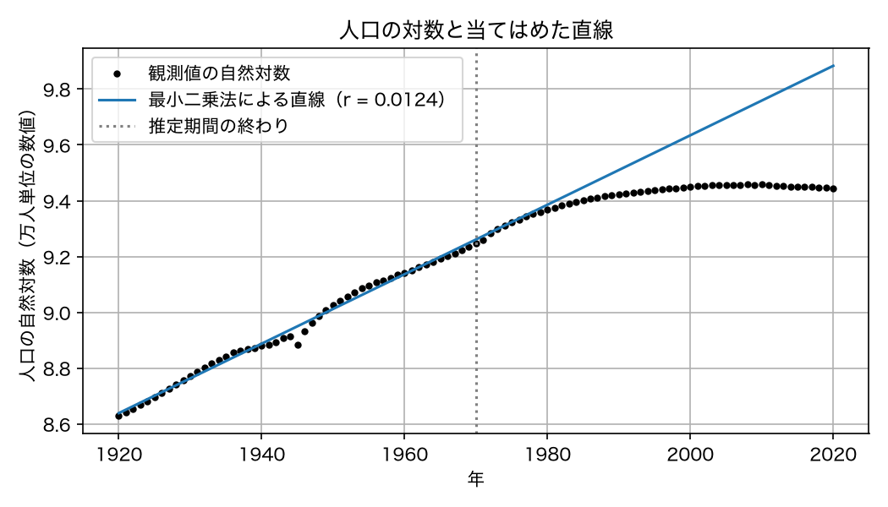

- 推定期間を変える場合：第1回と同様，`ax.axvline`の位置も変更する．

1920年から1970年までは，1945年前後の落ち込みを除いて点がほぼ直線に乗る．
1975年以降は点が直線の下に外れ，外れ方は年とともに広がる．

````{note} 演習2：パラメタを決める期間を変える

推定に使う期間を1920〜1940年，1920〜1990年，1920〜2020年に変更し，それぞれ $r$ と $N_0$ を求めよ．本文の1920〜1970年の結果とともに，`README.md`の表に記入せよ．
````


````{dropdown} 演習2の解答例

本文の`year_obs`・`t_obs`・`y_obs`を用いる．推定期間ごとの傾きの違いを確認できるように，本文の対数グラフに4本の直線を重ねる．

```python
fig, ax = plt.subplots(figsize=(8, 4.5))
ax.plot(year_obs, np.log(y_obs), color="black", marker="o", markersize=3,
        linestyle="none", label="観測値の自然対数")

for start_year, end_year in [(1920, 1970), (1920, 1940), (1920, 1990),
                             (1920, 2020)]:
    fit_mask = (year_obs >= start_year) & (year_obs <= end_year)
    slope, intercept = np.polyfit(t_obs[fit_mask], np.log(y_obs[fit_mask]), 1)
    r_loglinear = slope
    N0_loglinear = np.exp(intercept)
    print(f"{start_year}〜{end_year}年: r = {r_loglinear:.8f} /年，N0 = {N0_loglinear:.1f} 万人")
    ax.plot(year_obs, intercept + slope * t_obs,
            label=f"推定期間：{start_year}〜{end_year}年（r = {r_loglinear:.4f}）")

ax.set_title("推定期間による当てはめた直線の比較")
ax.set_xlabel("年")
ax.set_ylabel("人口の自然対数（万人単位の数値）")
ax.grid(True)
ax.legend()
fig.tight_layout()
fig.savefig(FIGURE_DIR / "exercise2_log_population_comparison.png", dpi=150)
plt.show()
```

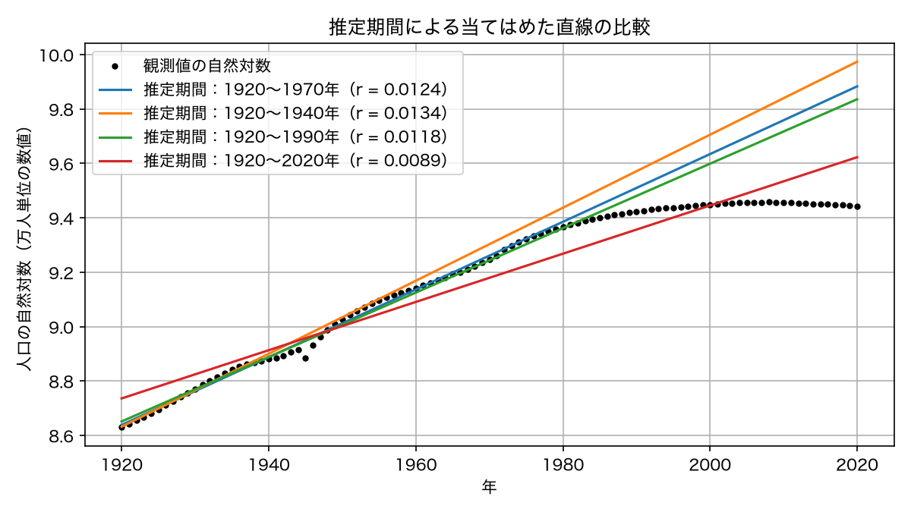

- コードの補足：`fig, ax`はループの前に作成し，ループ内で同じ`ax`に描くことで，4期間の推定結果を1枚に重ねる．直線は比較のため1920〜2020年全体に描いており，各推定期間の外側は外挿に当たる．

| 推定期間 | r [1/年] | N0 [万人，1920年に対応] |
| --- | ---: | ---: |
| 1920〜1970年 | 0.01244342 | 5647.3 |
| 1920〜1940年 | 0.01341844 | 5609.4 |
| 1920〜1990年 | 0.01184153 | 5720.0 |
| 1920〜2020年 | 0.00886544 | 6225.1 |

表は表示時に丸めている．後続の計算では，コードが求めた丸め前の値を使う．
````


## オープンデータとの比較

### 観測値とモデルを同じ図に描く

第1回の重ね描きを再利用する．演習2の設定を1920〜1970年に戻し，対数線形最小二乗法で推定した$r,N_0$を以後の基準モデルに使う．演習3でも，このモデルだけを観測値と比較する．

```python
fit_mask = (year_obs >= 1920) & (year_obs <= 1970)
slope, intercept = np.polyfit(t_obs[fit_mask], np.log(y_obs[fit_mask]), 1)
r_loglinear = slope
N0_loglinear = np.exp(intercept)
N_model = exponential_solution(t_obs, N0_loglinear, r_loglinear)

fig, ax = plt.subplots(figsize=(8, 4.5))
ax.plot(year_obs, y_obs, color="black", marker="o", markersize=3, linestyle="none", label="観測値")
ax.plot(year_obs, N_model, label=f"指数成長モデル（r = {r_loglinear:.4f}）")
ax.axvline(1970, color="gray", linestyle=":", label="推定期間の終わり")
ax.set_title("日本の人口と指数成長モデルの比較")
ax.set_xlabel("年")
ax.set_ylabel("人口 [万人]")
ax.set_ylim(0, 20000)
ax.grid(True)
ax.legend()
fig.tight_layout()
fig.savefig(FIGURE_DIR / "population_exponential_fit.png", dpi=150)
plt.show()
```

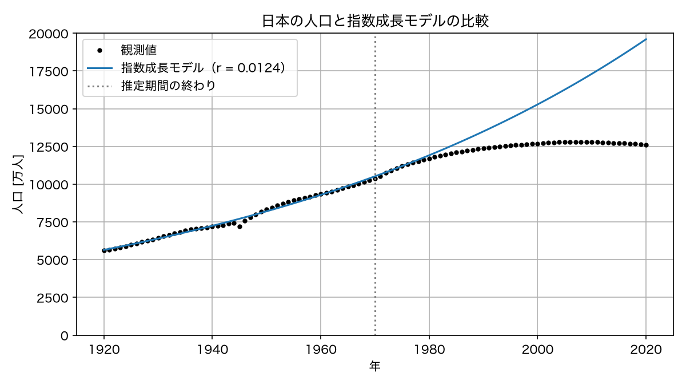

### 残差を描く

- 残差：観測値からモデル値を引いた値 $y_i-N(t_i)$．正ならモデルが過小評価，負なら過大評価している．
- 目的：比較図だけでは読み取りにくい差の符号・大きさ・時間変化を示す．
- 第2回との違い：解析解と数値解の差ではなく，観測値とモデルの差を扱う．

```python
residual = y_obs - N_model

fig, ax = plt.subplots(figsize=(8, 3.5))
ax.plot(year_obs, residual, marker="o", markersize=3)
ax.axhline(0, color="black", linewidth=0.8)
ax.axvline(1970, color="gray", linestyle=":")
ax.set_title("人口モデルの残差（観測値−モデル値）")
ax.set_xlabel("年")
ax.set_ylabel("残差 [万人]")
ax.grid(True)
fig.tight_layout()
fig.savefig(FIGURE_DIR / "population_exponential_residual.png", dpi=150)
plt.show()
```

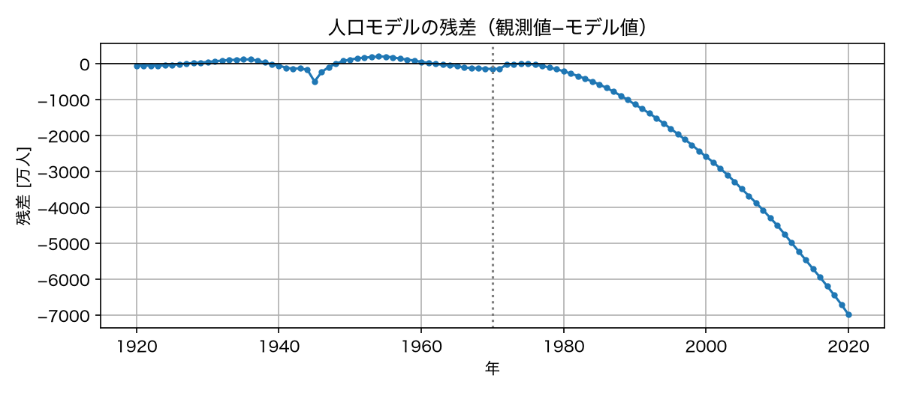

`ax.axhline(0, ...)`は残差0の水平線を描く．基準モデルの残差の図から，次が読み取れる．

- 1920〜1940年：残差の絶対値は最大約120万人で，正負が入れ替わる．
- 1945年前後：残差が大きく負になる．集計方法・範囲の変更に注意が必要であり，人口変動の原因はこの図だけでは特定できない．
- 1950〜1970年：残差の絶対値は200万人程度以内．
- 1975年以降：観測値がモデルを下回り続け，2020年には約7000万人の差になる．

### 誤差を数値で表す

残差の大きさを1つの数にまとめる指標として，**平均二乗誤差**を使う．

$$
\mathrm{MSE} = \frac{1}{n}\sum_{i=1}^{n}\left(y_i - N(t_i)\right)^2
$$

単位は（万人）$^2$ で，平方根をとれば人口と同じ単位（万人）になる．
以後の回でも同じ関数を使う．

```python
def mean_squared_error(y_obs, y_model):
    """観測値とモデル値の平均二乗誤差を返す．"""
    return np.mean((y_obs - y_model) ** 2)


mse_fit = mean_squared_error(y_obs[fit_mask], N_model[fit_mask])
mse_after = mean_squared_error(y_obs[~fit_mask], N_model[~fit_mask])

print(f"パラメタ決定に使った期間（1920〜1970年）の MSE = {mse_fit:12.1f} （万人）^2，平方根 = {np.sqrt(mse_fit):7.1f} 万人")
print(f"それ以降の期間（1971〜2020年）の MSE           = {mse_after:12.1f} （万人）^2，平方根 = {np.sqrt(mse_after):7.1f} 万人")
```

```{dropdown} コードの補足

- `** 2`：各要素を二乗する．`np.mean(...)`で算術平均を求める．
- `~fit_mask`：`True`と`False`を反転し，推定に使わなかった時点を選ぶ．
- `np.sqrt(...)`：平方根を求める．MSEの平方根がRMSE．
```

- RMSE（二乗平均平方根誤差）：人口と同じ単位で差の大きさを表す指標．基準モデルでは推定期間内が百数十万人程度，その後が数千万人となる．
- 評価する期間：推定に使用した期間と使用しなかった期間を分けて計算する．
- 後続の講義：第7回・第12回で訓練期間と検証期間の区別を扱う．

````{note} 演習3：図と残差を読む

1920〜1970年の観測値に対数線形最小二乗法を適用したモデルを用いよ．

1. 残差が正の期間と負の期間を`README.md`に記入し，それぞれ観測値とモデル値の大小関係を説明せよ．
2. 1945年と2020年の負の残差について，集計上の注意点と一定の増加率という仮定の限界を区別して説明せよ．原因の特定には例えばどのような追加資料が必要であるかも考察せよ．
````


````{dropdown} 演習3の解答例

**設問1：残差の符号**

1920〜1970年の対数線形法を基準とする．

- 正の期間：1927〜1938年，1949〜1961年．観測値がモデル値を上回り，モデルが過小評価している．
- 負の期間：1920〜1926年，1939〜1948年，1962〜2020年．観測値がモデル値を下回り，モデルが過大評価している．

**設問2：1945年と2020年の解釈と必要な追加資料**

- 1945年の解釈：残差は約−493.3万人．11月1日の調査に基づく補正人口であること，沖縄県を含まないことに注意する．戦中戦後の人口変動だけでなく，集計範囲や基準日の違いも検討する必要があり，この値だけでは死亡・移動・集計変更の寄与を分離できない．
- 1945年前後の追加資料：人口統計の調査概要・補正方法・地域別人口を確認し，集計範囲や基準日の変更による影響を検討する．さらに，出生・死亡の記録や引揚げ・海外への移動の記録を調べ，人口変動への寄与を検討する．戦中戦後の記録の欠落や，各資料の対象範囲にも注意する．
- 2020年の解釈：残差は約−6985.2万人．1975年以降の長期的な過大評価は，1920〜1970年から推定した一定の純増加率を，その後も適用することの限界を示す．ただし，残差だけから個別の原因は特定できない．
- 長期的な人口変化の追加資料：年別の出生数・死亡数と国際人口移動の統計を用い，自然増減と社会増減を分けて確認する．年齢別人口や年齢別出生率・死亡率も調べ，年齢構成の変化と各年齢層の率の変化が人口増加率にどう関係するかを検討する．

````


## 未来へ外挿する危険

- 外挿：推定期間外でモデル値を計算すること．第1回でも実施した操作を，今回は演習3と同じ対数線形法の推定値で2050年まで行う．単独でも再実行できるように，基準モデルのパラメタを再計算する．

```python
fit_mask = (year_obs >= 1920) & (year_obs <= 1970)
slope, intercept = np.polyfit(t_obs[fit_mask], np.log(y_obs[fit_mask]), 1)
r_loglinear = slope
N0_loglinear = np.exp(intercept)
t_future = np.arange(0.0, 131.0)              # 1920年から2050年まで
N_future = exponential_solution(t_future, N0_loglinear, r_loglinear)

for year in [1970, 2000, 2020, 2050]:
    idx = int(year - 1920)
    line = f"{year}年: モデル {N_future[idx]:9.0f} 万人"
    if year <= 2020:
        observed = y_obs[year_obs == year][0]
        line += f"，観測値 {observed:9.0f} 万人，差（モデル値−観測値） {N_future[idx] - observed:+9.0f} 万人"
    print(line)
```

```{dropdown} コードの補足

- `idx = int(year - 1920)`：1920年から1年刻みで並ぶ配列の添字に変換する．
- `if year <= 2020`：観測値のある年だけ比較する．2050年の観測値はこのデータにはない．
- `line += ...`：表示する文字列の末尾に追加する．`+9.0f`は正負の符号を付け，小数点以下0桁で表示する．
- 差の符号：この表はモデル値−観測値を用いる．残差（観測値−モデル値）とは符号が逆である．
```

- 2020年の比較：モデル値は観測値より約7000万人大きい．
- 2050年の計算値：約2億8500万人．一定の増加率が続くという仮定のもとでの値であり，観測値との比較はできない．
- 比較の条件：仮定・推定期間・外挿先を明記する．次の演習では推定期間による違いを調べる．外挿期間の長さだけで誤差の増減が決まるわけではない．

````{note} 演習4：外挿の幅と誤差

1. 推定に使う期間を1920〜1940年に変更して $r$ と $N_0$ を求め，1970年・2000年・2020年のモデル値と観測値との差（モデル値−観測値）を表に記入せよ．
2. 1920〜1970年で推定した場合も同じ表に記入し，推定期間・外挿期間による差の変化を説明せよ．
3. 1940年までのデータから1970年を予測する場合と，2020年までのデータから2050年を予測する場合の共通点と違いを説明せよ．
````


````{dropdown} 演習4の解答例

**設問1・2：推定期間と外挿値の比較**

```python
for end_year in [1940, 1970]:
    fit_mask = (year_obs >= 1920) & (year_obs <= end_year)
    slope, intercept = np.polyfit(t_obs[fit_mask], np.log(y_obs[fit_mask]), 1)
    r_loglinear = slope
    N0_loglinear = np.exp(intercept)
    print("推定期間:", 1920, end_year, "r:", r_loglinear, "N0:", N0_loglinear)
    for year in [1970, 2000, 2020]:
        model = exponential_solution(year - 1920, N0_loglinear, r_loglinear)
        observed = y_obs[year_obs == year][0]
        print(f"{year}年: モデル {model:.1f}，観測値 {observed:.1f}，差 {model - observed:+.1f} 万人")
```

| 推定期間 | 評価する年 | モデル値 [万人] | 観測値 [万人] | 差（モデル値−観測値）[万人] |
| --- | --- | ---: | ---: | ---: |
| 1920〜1940年 | 1970 | 10972.3 | 10372.0 | +600.3 |
| 1920〜1940年 | 2000 | 16410.5 | 12692.6 | +3717.9 |
| 1920〜1940年 | 2020 | 21462.2 | 12614.6 | +8847.6 |
| 1920〜1970年 | 1970 | 10520.7 | 10372.0 | +148.7 |
| 1920〜1970年 | 2000 | 15281.6 | 12692.6 | +2589.0 |
| 1920〜1970年 | 2020 | 19599.8 | 12614.6 | +6985.2 |

- 推定期間の影響：1940年までで推定した$r$は約0.01342／年，1970年まででは約0.01244／年．この例では推定期間を延ばした方が，表の3時点で過大評価が小さい．
- 外挿先の影響：両モデルとも後の年ほど差が大きい．ただし，1970年までで推定したモデルの1970年の値は推定期間内の評価であり，外挿ではない．この例の結果が一般に成立するとは限らない．

**設問3：30年先への予測の共通点と違い**

- 共通点：どちらも推定期間の終点から30年先へ，一定の$r$が続くと仮定して外挿する．
- 違い：1970年にはCSV内の観測値があり，1940年までのデータによる予測を事後的に検証できる．2050年の観測値はなく，同じ検証はできない．
- 推定に使う情報：1940年までのデータと2020年までのデータでは，含まれる人口変動や推定値が異なる．同じ30年間の外挿でも，同じ誤差になるとは限らない．
````


```{dropdown} コードの補足：演習4・課題1で再利用する箇所

- 推定：対数線形法のコードをコピーし，推定対象の年を選ぶ条件を変更する．`np.polyfit`から`r_loglinear`・`N0_loglinear`を求める行まで再実行する．
- 図：観測値との比較図・残差図を再利用する．`N_model`と`residual`を新しい推定値から計算し直し，縦線・ラベル・保存先ファイル名も変更する．
- 表：外挿の表示コードをコピーし，表示する年を設問に合わせる．1920〜1970年に戻すための推定コードはコピーせず，直前に推定した値を使う．
```

```{tip} データに合うことと現象を説明することは違う

- 全期間での推定：1920〜2020年を使うと，1920〜1970年で推定した場合より $r$ は小さくなる．
- 適合度の改善：全期間の対数残差二乗和は小さくなるが，人口増加・減少の仕組みを説明できたことにはならない．
- 評価する対象：誤差指標，残差の時間変化，モデルの仮定の3点を確認する．
```

## まとめ

- 観測値の単位・集計範囲を確認し，指数成長モデルのパラメタを，**2時点の観測値を通る指数関数**と**対数線形の最小二乗法**によって求めた．
- 推定したモデルを，**残差（観測値−モデル値）とMSE・RMSE**で評価した．数値計算の精度と，モデルが観測値を説明する精度は区別する．
- 推定期間後の人口を過大評価したことから，**推定期間内の適合だけでは予測精度を保証できない**と確認した．係数の調整に加え，仮定の見直しが必要である．
- 次回は，一人あたりの増加率が人口に対して線形に低下する**Logisticモデル**を導き，同じデータ・推定期間・誤差指標で比較する．

## 課題

````{warning} 課題1：人口モデルの外挿と解釈

1. 推定に使う期間を1920〜1950年に変更し，対数線形法で $r$ と $N_0$ を求めよ．状態変数・時刻の原点・単位・微分方程式・仮定とともに，推定期間・推定方法・推定値を`README.md`に記入せよ．
2. そのモデルを2020年まで計算し，観測値との比較図と残差図を作成して`reports/figures/`に保存せよ．推定期間の終わりを示す縦線も変更せよ．
3. 1970年・1990年・2020年のモデル値と観測値との差（モデル値−観測値）を表に記入せよ．
4. `population_10k`列の観測値と状態変数 $N(t)$ の対応を説明し，設問3の結果を踏まえて2020年の人口予測の限界を200〜300字程度で述べよ．国勢調査年・補正人口・沖縄県の除外に関する注記と，一定の増加率を仮定して推定期間外へ外挿していることを考慮せよ．
````

<!--
````{dropdown} 課題1の解答例

本文の準備・データ読み込み・関数定義を実行した後に，次のコードを実行する．数値の表は，丸める前の推定値を使って計算した結果である．

**1．モデルとパラメタの記録**

- 状態変数と時刻：$N(t)$は人口（万人），$t$は1920年からの経過年数．
- 微分方程式と初期条件：$dN/dt=rN$，$N(0)=N_0$．
- 仮定：一人あたりの純増加率$r$が一定．人口移動や年齢構成の変化は明示的に扱わない．
- 推定条件：1920〜1950年の観測値を使い，対数線形法で$r$と$N_0$を同時に推定する．

```python
fit_mask = (year_obs >= 1920) & (year_obs <= 1950)
slope, intercept = np.polyfit(t_obs[fit_mask], np.log(y_obs[fit_mask]), 1)
r_loglinear = slope
N0_loglinear = np.exp(intercept)
N_model = exponential_solution(t_obs, N0_loglinear, r_loglinear)
residual = y_obs - N_model

print(f"r = {r_loglinear:.8f} /年")
print(f"N0 = {N0_loglinear:.1f} 万人")
```

- コードの意図：1950年までのデータだけで推定するため，`fit_mask`で時刻と人口を同じ条件で選ぶ．$\log N(t)=\log N_0+rt$なので，直線の傾きを$r$，切片の指数関数を$N_0$とする．

- 推定値：$r \approx 0.01207289$／年，$N_0 \approx 5661.5$万人．
- 初期値の意味：1920年に対応するモデル値．1920年の観測値5596.3万人に固定した値ではない．

**2．比較図と残差図**

```python
fig, ax = plt.subplots(figsize=(8, 4.5))
ax.plot(year_obs, y_obs, color="black", marker="o", markersize=3,
        linestyle="none", label="観測値")
ax.plot(year_obs, N_model, label="指数成長モデル")
ax.axvline(1950, color="gray", linestyle=":", label="推定期間の終わり")
ax.set_xlabel("年")
ax.set_ylabel("人口 [万人]")
ax.grid(True)
ax.legend()
fig.tight_layout()
fig.savefig(FIGURE_DIR / "assignment1_population_fit.png", dpi=150)
plt.show()

fig, ax = plt.subplots(figsize=(8, 3.5))
ax.plot(year_obs, residual, marker="o", markersize=3)
ax.axhline(0, color="black", linewidth=0.8)
ax.axvline(1950, color="gray", linestyle=":")
ax.set_xlabel("年")
ax.set_ylabel("残差 [万人]")
ax.grid(True)
fig.tight_layout()
fig.savefig(FIGURE_DIR / "assignment1_population_residual.png", dpi=150)
plt.show()
```

- コードの意図：推定に使わなかった期間も含めて一致の程度を調べるため，全期間を描画する．1950年の縦線で推定期間の境界を，残差0の横線で過大評価と過小評価の境界を示す．

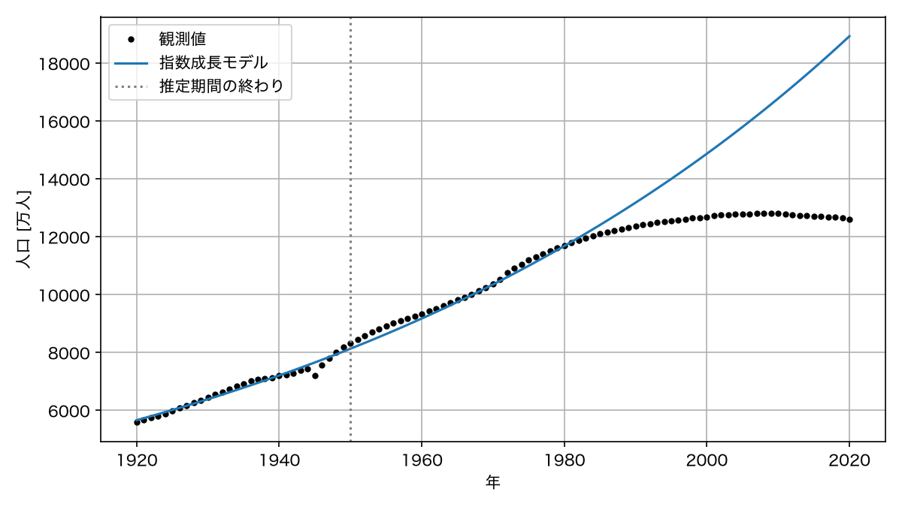

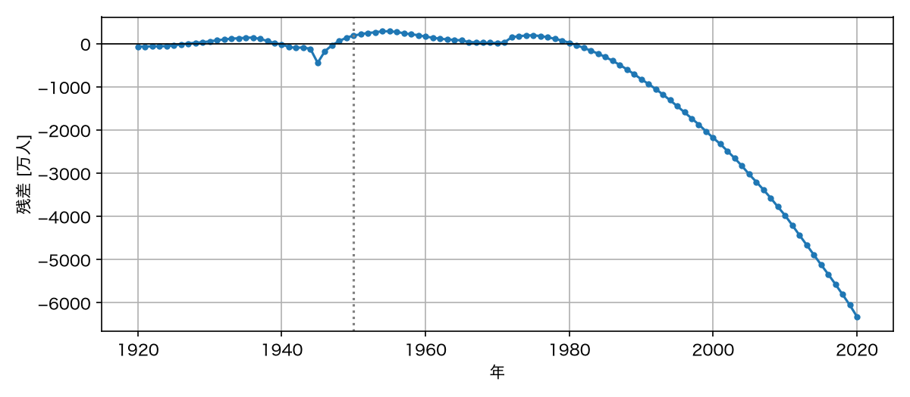

**3．モデル値と観測値の比較**

```python
for year in [1970, 1990, 2020]:
    observed = y_obs[year_obs == year][0]
    model = exponential_solution(year - 1920, N0_loglinear, r_loglinear)
    print(f"{year}年: モデル {model:.1f}，観測値 {observed:.1f}，差 {model - observed:+.1f} 万人")
```

- コードの意図：観測値は暦年で選ぶが，モデルの時刻は1920年からの経過年数なので`year - 1920`を渡す．差は設問に合わせてモデル値−観測値とし，残差図とは符号が逆になる．

| 年 | モデル値 [万人] | 観測値 [万人] | 差（モデル値−観測値）[万人] |
| --- | --- | --- | --- |
| 1970 | 10353.5 | 10372.0 | −18.5 |
| 1990 | 13181.1 | 12361.1 | +820.0 |
| 2020 | 18934.2 | 12614.6 | +6319.6 |

**4．観測量との対応と予測の限界の記述例**

population_10k列は各年の人口の観測値（万人），N(t)は同じ量を表す連続時間モデルの状態変数である．国勢調査年には調査結果，1940・1945年には補正人口が用いられ，1945〜1971年は沖縄県を含まない．モデルは集計範囲の変更を表さないため，残差をすべて人口動態の変化とは解釈できない．1920〜1950年で推定したモデルは2020年に約6320万人過大となる．一定の純増加率を70年先まで仮定しているが，出生率・死亡率や年齢構成は変化しうるため，推定期間内の適合だけで予測の妥当性は保証されない．
````
-->

### 課題2の準備：ヨウ素131濃度のデータとモデル

2011年3月の福島第一原子力発電所事故後に公表された水道水の検査結果を扱う．対象は，福島市の原子力センター福島支所で採取した水道水中のヨウ素131濃度である．データの確認とモデルの設定を以下に示すので，課題ではパラメタ推定とモデルの評価に取り組む．

- 使用データ：{download}`授業用CSV <../data/iodine131_fukushima_tapwater_2011.csv>`．2011年3月21日〜4月3日の14件を収録している．ファイル名を`iodine131_fukushima_tapwater_2011.csv`として，共通の`~/applied_programming_ii/data/`に保存する．
- 出典：[厚生労働省の検査結果（2011年4月4日公表）](https://www.mhlw.go.jp/stf/houdou/2r98520000017x7l-img/2r98520000017xbt.pdf)．[データ一覧](../data/README.md)に抽出箇所・取得日・利用条件・加工内容を記載している．
- 観測量：ヨウ素131の放射能濃度．1 Bqは1秒あたり平均1回の放射性崩壊に相当し，Bq/kgは水1 kgあたりの放射能を表す．
- 時間：2011年3月21日を $t=0$ とし，日単位で扱う．事故発生日からの経過日数ではない．
- 作業場所：既存の`population_exponential.ipynb`に課題2の節を追加し，以下の準備コードを実行する．データ確認とモデル式の導出は提出する設問には含めない．

本文のインポート，`DATA_DIR`・`FIGURE_DIR`，`exponential_solution`・`mean_squared_error`の定義を実行済みとする．

#### 使用するデータと確認コード

| 項目 | 確認結果 |
| --- | --- |
| 提供機関・資料 | 厚生労働省「水道水中の放射性物質に関する検査の実施状況」（2011年4月4日公表）．出典URLは上記のリンク参照 |
| 取得日・利用条件 | 2026年10月10日．公共データ利用規約（PDL1.0）に従い，出典と加工した旨を記載 |
| 加工内容 | 対象地点・期間のヨウ素131濃度を抽出し，日付と経過日数を付けた授業用CSV．平均化・補間は実施していない |
| 採取地点・核種 | 福島市の原子力センター福島支所．ヨウ素131 |
| 期間・件数・間隔 | 2011年3月21日〜4月3日，14件，1日間隔 |
| 単位・欠損・不検出 | Bq/kg．抽出した14件には欠損・不検出の記載なし |

```python
radioactivity = pd.read_csv(DATA_DIR / "iodine131_fukushima_tapwater_2011.csv")
t_decay = radioactivity["elapsed_days"].to_numpy().astype(float)
c_obs = radioactivity["iodine131_bq_kg"].to_numpy()

print(radioactivity)
print("件数:", len(radioactivity))
print("日付の間隔 [日]:", np.unique(np.diff(t_decay)))
print("欠損値の数:", radioactivity.isna().sum())
print("すべて正の値か:", np.all(c_obs > 0))
change = radioactivity["iodine131_bq_kg"].diff()
print("前日より濃度が上昇した日:")
print(radioactivity[change > 0][["date", "iodine131_bq_kg"]])

fig, ax = plt.subplots(figsize=(8, 4.5))
ax.plot(t_decay, c_obs, color="black", marker="o", linestyle="none",
        label="観測値")
ax.set_xlabel("3月21日からの経過日数 [日]")
ax.set_ylabel("ヨウ素131濃度 [Bq/kg]")
ax.grid(True)
ax.legend()
fig.tight_layout()
fig.savefig(FIGURE_DIR / "assignment2_observed.png", dpi=150)
plt.show()

# 対数目盛用の図も作成し，Notebookに両方を表示する．
fig, ax = plt.subplots(figsize=(8, 4.5))
ax.plot(t_decay, c_obs, color="black", marker="o", linestyle="none",
        label="観測値")
ax.set_yscale("log")
ax.set_xlabel("3月21日からの経過日数 [日]")
ax.set_ylabel("ヨウ素131濃度 [Bq/kg]")
ax.grid(True)
ax.legend()
fig.tight_layout()
fig.savefig(FIGURE_DIR / "assignment2_observed_log.png", dpi=150)
plt.show()
```

- コードの意図：対数を使えるかを正値の確認で調べ，単調減少かを前日との差`diff()`で調べる．対数目盛の図でも濃度そのものを描くため，データではなく軸の目盛を変更する．

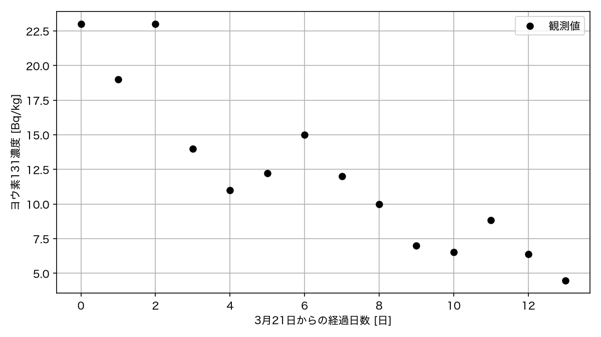

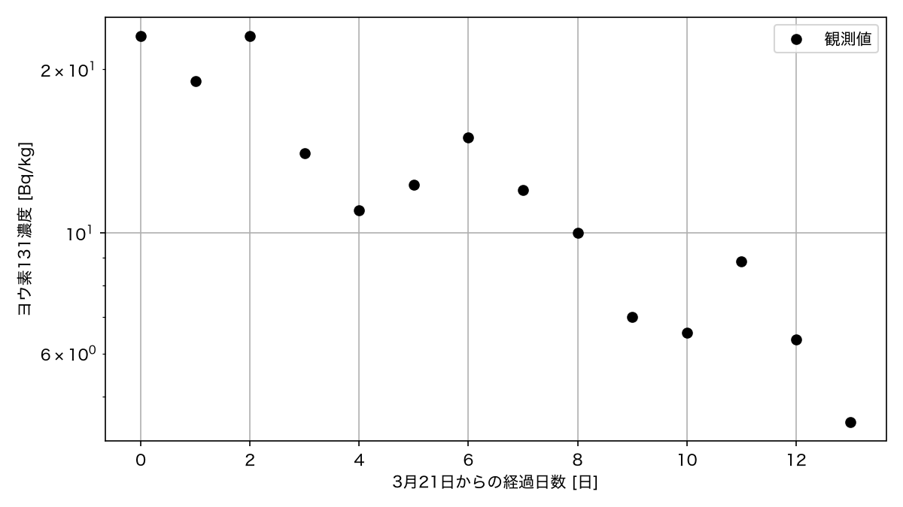

- 全体の傾向：濃度は23 Bq/kgから4.492 Bq/kgへ減少するが，単調減少ではない．対数目盛の図でも全体として右下がりである．
- 前日より上昇した日：3月23日，3月26日，3月27日，4月1日．一定係数の指数減衰モデルはこれらの上昇を表せない．

#### 使用するモデル

濃度の減少速度がその時点の濃度に比例すると仮定し，次の初期値問題と解析解を用いる．

$$
\frac{dC}{dt}=-\lambda C,\qquad C(0)=C_0,
\qquad C(t)=C_0e^{-\lambda t}.
$$

- 状態変数$C(t)$：時刻$t$の水道水中のヨウ素131濃度．単位はBq/kg．
- 時刻$t$：2011年3月21日からの経過日数．単位は日．
- 初期値$C_0$：3月21日に対応するモデルの濃度．単位はBq/kg．
- 係数$\lambda$：単位時間あたりの相対的な減少率．単位は1／日．時間によらない正の定数と仮定する．
- 仮定の範囲：複数の要因を分離せず，対象期間の濃度の減少傾向を1つの比例係数で近似する．放射性崩壊だけが作用すると断定する仮定ではない．

人口モデルの解析解は，増加率に負の値を渡すと減衰モデルにも使える．以後は，推定した`C0`と`decay_rate`を用いて`exponential_solution(t_decay, C0, -decay_rate)`を計算する．

```{tip} 物理的半減期と，濃度の見かけの半減期

- 放射性崩壊：不安定な原子核が別の原子核へ変化する現象．外部との物質の出入りがない試料では，ヨウ素131の放射能は物理的半減期に従って減少する．
- 物理的半減期：放射性崩壊によって原子核の数が半分になるまでの時間．ヨウ素131では約8日である（[環境省：半減期と放射能の減衰](https://www.env.go.jp/chemi/rhm/current/01-02-07.html)）．
- 見かけの半減期：今回の濃度モデル $C(t)=C_0e^{-\lambda t}$ が半分の値になるまでの時間．$T_{1/2}=\log 2/\lambda$ で求める．ここで $\log$ は自然対数である．
- 両者の違い：水道水の濃度には，放射性崩壊だけでなく水源への流入や希釈・除去なども影響しうる．推定した $\lambda$ は対象期間の濃度変化を近似する係数であり，ヨウ素131固有の崩壊定数とは限らない．
- 解釈の範囲：半減期が約8日に近くても，放射性崩壊だけで変化した証拠にはならない．この地点・期間の濃度から健康影響や現在の水道水の安全性を判断することもできない．
```


````{dropdown} 参考コード：人口モデルの本文からの抜粋

以下は人口モデルの本文コードを変更せずに抜粋したものであり，課題2用の完成コードではない．データ読み込みとモデルの設定は上の準備節を使い，以下のコードを濃度の減衰モデルに合わせて変更せよ．本文で定義した`exponential_solution`と`mean_squared_error`はそのまま再利用できる．

**パラメタ推定：「対数線形の最小二乗法」から抜粋**

```python
# パラメタを決めるのに使う期間
fit_mask = year_obs <= 1970

slope, intercept = np.polyfit(t_obs[fit_mask], np.log(y_obs[fit_mask]), 1)
r_loglinear = slope
N0_loglinear = np.exp(intercept)

print(f"対数線形の最小二乗法による r  = {r_loglinear:.5f} /年")
print(f"同じ方法で決めた N0          = {N0_loglinear:.1f} 万人（観測値は {N0:.1f} 万人）")
```

**比較図：「観測値とモデルを同じ図に描く」から抜粋**

```python
N_model = exponential_solution(t_obs, N0_loglinear, r_loglinear)

fig, ax = plt.subplots(figsize=(8, 4.5))
ax.plot(year_obs, y_obs, color="black", marker="o", markersize=3, linestyle="none", label="観測値")
ax.plot(year_obs, N_model, label=f"指数成長モデル（r = {r_loglinear:.4f}）")
ax.axvline(1970, color="gray", linestyle=":", label="推定期間の終わり")
ax.set_title("日本の人口と指数成長モデルの比較")
ax.set_xlabel("年")
ax.set_ylabel("人口 [万人]")
ax.set_ylim(0, 20000)
ax.grid(True)
ax.legend()
fig.tight_layout()
fig.savefig(FIGURE_DIR / "population_exponential_fit.png", dpi=150)
plt.show()
```

**残差図：「残差を描く」から抜粋**

```python
residual = y_obs - N_model

fig, ax = plt.subplots(figsize=(8, 3.5))
ax.plot(year_obs, residual, marker="o", markersize=3)
ax.axhline(0, color="black", linewidth=0.8)
ax.axvline(1970, color="gray", linestyle=":")
ax.set_title("人口モデルの残差（観測値−モデル値）")
ax.set_xlabel("年")
ax.set_ylabel("残差 [万人]")
ax.grid(True)
fig.tight_layout()
fig.savefig(FIGURE_DIR / "population_exponential_residual.png", dpi=150)
plt.show()
```

**誤差評価：「誤差を数値で表す」から抜粋**

```python
mse_fit = mean_squared_error(y_obs[fit_mask], N_model[fit_mask])
mse_after = mean_squared_error(y_obs[~fit_mask], N_model[~fit_mask])

print(f"パラメタ決定に使った期間（1920〜1970年）の MSE = {mse_fit:12.1f} （万人）^2，平方根 = {np.sqrt(mse_fit):7.1f} 万人")
print(f"それ以降の期間（1971〜2020年）の MSE           = {mse_after:12.1f} （万人）^2，平方根 = {np.sqrt(mse_after):7.1f} 万人")
```

**外挿：「未来へ外挿する危険」から抜粋**

```python
t_future = np.arange(0.0, 131.0)              # 1920年から2050年まで
N_future = exponential_solution(t_future, N0_loglinear, r_loglinear)
```

**変更時に確認する事項**

- データと時刻：人口の配列と暦年をそのまま使わず，準備節の濃度と経過日数に対応させよ．人口の結果を残せるように，計算結果を保存する変数名も区別せよ．
- 推定と半減期：設問の期間に対応する観測値を選べ．人口モデルの$r$と減衰モデルの$-\lambda$の対応を確認し，上で示した式から半減期の計算を追加せよ．Pythonの`lambda`は予約語なので，減衰率の変数名には`decay_rate`を用いよ．
- 図と出力：タイトル・軸ラベル・単位・縦線・縦軸の範囲を濃度データに合わせよ．図の保存名を人口の図と区別し，誤差の表示文も評価期間と単位に合わせよ．
- 外挿：設問1の推定値を使い，評価する日付を準備節の原点からの経過日数に直せ．その時刻のモデル値を計算し，Notebookに表示せよ．
````

````{warning} 課題2：ヨウ素131濃度のパラメタ推定とモデルの評価

上の準備節でデータを読み込み，人口モデルの参考コードを濃度の減衰モデルに合わせて変更して，以下に取り組め．変更したコードと図はNotebookに，表と考察は`README.md`の課題2の解答欄に記入せよ．

1. **パラメタ推定**：3月21〜28日の全観測値から対数線形最小二乗法で $\lambda$ と $C_0$ を求めよ．見かけの半減期を計算し，表に記入せよ．
2. **モデルの評価**：設問1で推定したモデルについて4月3日までのモデル値を求め，観測値との比較図と残差図を作成せよ．残差は観測値−モデル値とし，推定対象期間の終わりを縦線で示せ．3月21〜28日と3月29日〜4月3日を分けてMSE・RMSEを求め，評価期間による違いと残差の時間変化を説明せよ．作成した図は`reports/figures/`へ保存せよ．
3. **外挿**：設問1で推定したモデルを用いて4月10日の濃度を計算し，表に記入せよ．このCSVでは4月10日の予測誤差を求められない理由を述べよ．
4. **モデルの解釈**：設問1で求めた見かけの半減期を，ヨウ素131の物理的半減期である約8日と比較せよ．毎日別の水を採取していることを踏まえ，放射性崩壊以外に濃度を変化させうる要因を挙げ，このデータだけでは要因を特定できない理由を200字程度で説明せよ．
````
<!-- 
````{dropdown} 課題2の解答例

準備節のデータ読み込みと本文の関数定義を実行済みとする．以下は人口モデルの参考コードを課題2用に変更した解答例であり，設問番号の順に実行する．

**1．パラメタ推定**

対数線形法では，Bq/kg単位の濃度の数値を用いた対数上の傾きが$-\lambda$，切片が$\log C_0$となる．

```python
fit_decay = t_decay <= 7

slope_decay, intercept_decay = np.polyfit(
    t_decay[fit_decay], np.log(c_obs[fit_decay]), 1
)
decay_rate = -slope_decay
C0_loglinear = np.exp(intercept_decay)
half_life = np.log(2) / decay_rate

print("対数線形法（C0，λ，半減期）:", C0_loglinear, decay_rate, half_life)
```

- コードの意図：3月28日は経過日数7なので`t_decay <= 7`で推定対象を選ぶ．対数上の傾きは$-\lambda$に対応するため符号を反転し，半減期は$\log 2/\lambda$から計算する．

| 推定方法 | 推定対象（2011年） | C0 [Bq/kg] | λ [1/日] | 見かけの半減期 [日] |
| --- | --- | --- | --- | --- |
| 対数線形法 | 3月21〜28日 | 21.5776 | 0.0936854 | 7.3987 |

**2．モデルの評価**

```python
C_model = exponential_solution(t_decay, C0_loglinear, -decay_rate)
residual_decay = c_obs - C_model

fig, ax = plt.subplots(figsize=(8, 4.5))
ax.plot(t_decay, c_obs, color="black", marker="o", linestyle="none", label="観測値")
ax.plot(t_decay, C_model, label="対数線形法")
ax.set_title("ヨウ素131濃度と指数減衰モデル")
ax.axvline(7, color="gray", linestyle=":", label="推定期間の終わり")
ax.set_xlabel("3月21日からの経過日数 [日]")
ax.set_ylabel("ヨウ素131濃度 [Bq/kg]")
ax.grid(True)
ax.legend()
fig.tight_layout()
fig.savefig(FIGURE_DIR / "assignment2_decay_fit.png", dpi=150)
plt.show()

fig, ax = plt.subplots(figsize=(8, 3.5))
ax.plot(t_decay, residual_decay, marker="o", label="対数線形法")
ax.set_title("濃度モデルの残差（観測値−モデル値）")
ax.axhline(0, color="black", linewidth=0.8)
ax.axvline(7, color="gray", linestyle=":")
ax.set_xlabel("3月21日からの経過日数 [日]")
ax.set_ylabel("残差 [Bq/kg]")
ax.grid(True)
ax.legend()
fig.tight_layout()
fig.savefig(FIGURE_DIR / "assignment2_decay_residual.png", dpi=150)
plt.show()

mse_log_fit = mean_squared_error(c_obs[fit_decay], C_model[fit_decay])
mse_log_after = mean_squared_error(c_obs[~fit_decay], C_model[~fit_decay])
print("対数線形法・3月21〜28日（MSE，RMSE）:", mse_log_fit, np.sqrt(mse_log_fit))
print("対数線形法・3月29日以降（MSE，RMSE）:", mse_log_after, np.sqrt(mse_log_after))
```

- コードの意図：人口用の解析解を減衰モデルに再利用するため，増加率の引数に負の値`-decay_rate`を渡す．`fit_decay`とその否定`~fit_decay`で期間を分け，推定への適合と推定後の予測誤差を別々に評価する．

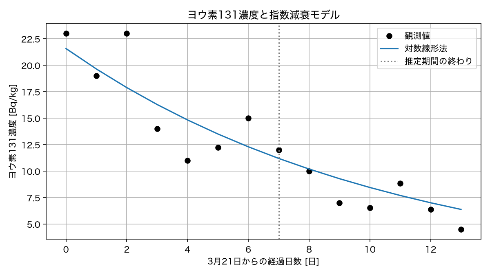

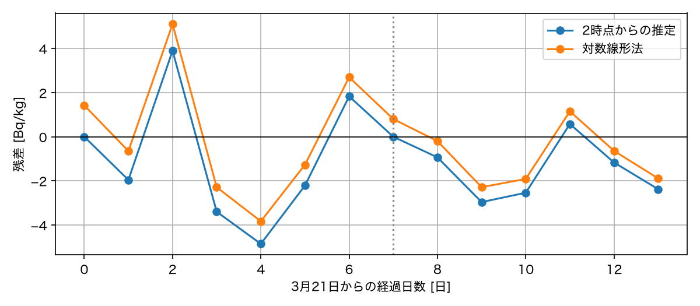

| 推定方法（3月21〜28日） | 評価期間（2011年） | MSE [(Bq/kg)^2] | RMSE [Bq/kg] |
| --- | --- | --- | --- |
| 対数線形法 | 3月21〜28日 | 7.2543 | 2.6934 |
| 対数線形法 | 3月29日〜4月3日 | 2.3749 | 1.5411 |

- 誤差指標：対数線形法が最小化するのは対数残差の二乗和であり，ここで評価する濃度のMSEとは異なる．
- 評価期間の比較：このモデルでは後半のRMSEが小さい．後半は濃度自体も低く，異なる観測値の集合を比較しているため，外挿の精度が一般に高いとは結論できない．
- 残差の時間変化：3月23日・27日には正，3月24〜26日には負となる．3月29日以降は4月1日を除いて負であり，この期間では過大評価が多い．

**3．外挿**

```python
prediction_day = 20  # 4月10日は3月21日から20日後
prediction = exponential_solution(prediction_day, C0_loglinear, -decay_rate)
print(f"4月10日のモデル値: {prediction:.4f} Bq/kg")
```

- コードの意図：設問1の推定値をそのまま使い，解析解に経過日数20を渡す．観測期間外でもモデル値は計算できるが，予測誤差の計算にはその日の観測値が必要である．

| 対数線形法の推定期間（2011年） | 4月10日のモデル値 [Bq/kg] |
| --- | --- |
| 3月21〜28日 | 3.3133 |

- 予測誤差を求められない理由：このCSVには4月3日までの観測値しかなく，4月10日のモデル値と比較する観測値がないためである．

**4．モデルの解釈**

- 半減期の比較：3月21〜28日のデータから推定した見かけの半減期は約7.40日であり，物理的半減期の約8日より短い．ただし，この違いだけでは濃度を変化させた要因を特定できない．
- 考察の記述例：このデータは同じ試料を保存して測ったものではなく，毎日採取した別の水の濃度である．濃度は放射性崩壊に加え，水源への放射性物質の流入，降水などによる希釈，浄水処理での除去などにも影響されうる．したがって，推定した係数は複数の作用を含む見かけの減少率である．各要因の寄与を特定するには，水源の濃度・流量・処理条件などの追加資料が必要であり，この濃度系列だけから減少の原因や健康影響を判断することはできない．
````
 -->

### 提出先・期限

- 提出場所：WebClass「第3回課題」
- 提出物：
  - `README.md`
  - Notebookファイル`population_exponential.ipynb`
- 提出期限：2026年10月17日(土)23:59

## 自主学習用の発展課題

以下は自主学習用の任意課題である．本文で用意したCSVと関数を再利用する．

### 発展課題1：最小化する誤差によって推定結果はどう変わるか

人口の残差と，人口の対数の残差は異なる量である．この違いだけを比較するため，どちらの方法でも初期値を1920年の観測値 $N_0=5596.3$ 万人に固定し，増加率 $r$ のみを推定する．本文の対数線形法とは異なり，切片を自由に推定しない．時刻は1920年を $t=0$ とし，1920〜1970年の51件を推定に，1971〜2020年の50件を推定後の評価に用いる．

推定に使う観測値を $y_i$，時刻を $t_i$，件数を $m$ とし，次の2つの目的関数（最小化する量）を比較する．

$$
J_{\log}(r)=\frac{1}{m}\sum_{i=1}^{m}
\left[\log\left(\frac{y_i}{N_0}\right)-rt_i\right]^2,
\qquad
J_N(r)=\frac{1}{m}\sum_{i=1}^{m}\left[y_i-N_0e^{rt_i}\right]^2
$$

1. $J_{\log}(r)$を $r$ で微分し，最小にする値が $r_{\log}=\sum_i t_i\log(y_i/N_0)/\sum_i t_i^2$ となることを示せ．2階微分が正であることも確認せよ．
2. 設問1の式で $r_{\log}$ を求めよ．次に，`np.linspace(0.005, 0.020, 3001)`で作った候補ごとに $J_N$ を計算し，その値が最小となる候補 $r_N$ を求めよ．
3. 両方の推定値について，推定期間の $J_N$ と $J_{\log}$，推定に使わなかった期間の人口のRMSEを表にまとめよ．1920〜2020年の人口の残差を1枚の図に描き，1970年の位置に縦線を加えよ．
4. それぞれの方法が最小化する量を確認し，人口のMSEが小さい方法と，対数のMSEが小さい方法が一致しない理由を説明せよ．推定期間の誤差が小さいことだけで，将来の予測精度を保証できるか述べよ．

```{dropdown} コードの補足：候補を順に比較する

- `np.sum(values)`：配列の要素の合計を求める．設問1の分子と分母に使える．
- `scores = np.zeros(len(r_candidates))`：候補ごとの目的関数の値を保存する配列を用意する．
- `for j in range(len(r_candidates)):`：候補の添字を順に取り出す．`scores[j]`に，その候補で計算したMSEを保存する．
- `np.argmin(scores)`：配列の最小値の位置を返す．`r_candidates[np.argmin(scores)]`で対応する候補を取り出せる．
- 探索の精度：得られる値は用意した候補の中での最小値であり，連続的に変化する $r$ に対する厳密な最小点とは限らない．
```

<!--
````{dropdown} 発展課題1の解答例

**設問1：対数のMSEを最小にする増加率**

$z_i=\log(y_i/N_0)$ とおくと，

$$
J_{\log}'(r)=-\frac{2}{m}\sum_{i=1}^{m}t_i(z_i-rt_i),
\qquad
J_{\log}''(r)=\frac{2}{m}\sum_{i=1}^{m}t_i^2>0
$$

となる．今回の時刻には0以外の値が含まれるので，2階微分は正である．したがって，$J_{\log}'(r)=0$ を満たす $r_{\log}=\sum_i t_i z_i/\sum_i t_i^2$ が唯一の最小点である．

**設問2・3：推定と誤差の比較**

本文のインポート，`DATA_DIR`・`FIGURE_DIR`，`exponential_solution`，`mean_squared_error`を用意してから実行する．

```python
population_adv = pd.read_csv(DATA_DIR / "population_japan.csv")
year_adv = population_adv["year"].to_numpy()
t_adv = (year_adv - 1920).astype(float)
y_adv = population_adv["total_population_thousand"].to_numpy() / 10
fit_adv = year_adv <= 1970
t_fit_adv = t_adv[fit_adv]
y_fit_adv = y_adv[fit_adv]
N0_fixed = y_adv[year_adv == 1920][0]

r_log_fixed = np.sum(t_fit_adv * np.log(y_fit_adv / N0_fixed)) / np.sum(t_fit_adv ** 2)
r_candidates = np.linspace(0.005, 0.020, 3001)
scores = np.zeros(len(r_candidates))
for j in range(len(r_candidates)):
    predicted = exponential_solution(t_fit_adv, N0_fixed, r_candidates[j])
    scores[j] = mean_squared_error(y_fit_adv, predicted)
r_population = r_candidates[np.argmin(scores)]

fig, ax = plt.subplots(figsize=(8, 4))
for label, rate in [("対数のMSEを最小化", r_log_fixed),
                    ("人口のMSEを最小化", r_population)]:
    predicted = exponential_solution(t_adv, N0_fixed, rate)
    mse_population = mean_squared_error(y_fit_adv, predicted[fit_adv])
    mse_log = mean_squared_error(np.log(y_fit_adv), np.log(predicted[fit_adv]))
    rmse_after = np.sqrt(mean_squared_error(y_adv[~fit_adv], predicted[~fit_adv]))
    print(f"{label}: r={rate:.8f}, J_N={mse_population:.1f}, "
          f"J_log={mse_log:.8f}, 推定後のRMSE={rmse_after:.1f} 万人")
    ax.plot(year_adv, y_adv - predicted, label=label)
ax.axhline(0, color="black", linewidth=1)
ax.axvline(1970, color="gray", linestyle="--", label="推定期間の終わり")
ax.set_xlabel("年")
ax.set_ylabel("残差 [万人]")
ax.legend()
ax.grid(True)
fig.tight_layout()
fig.savefig(FIGURE_DIR / "advanced1_population_residual.png", dpi=150)
plt.show()
```

- コードの意図：目的関数の違いだけを比較するため，両方法で`N0_fixed`を共通にする．対数のMSEは導出した式で最小化し，人口のMSEは候補ごとに計算して`np.argmin(scores)`で最小の候補を選ぶ．

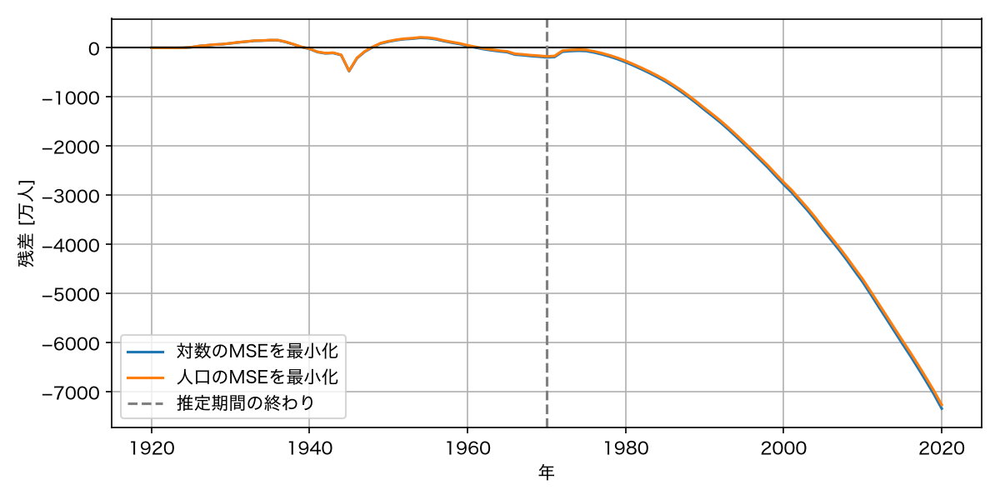

| 推定方法 | $r$ [1/年] | 推定期間の $J_N$ [(万人)$^2$] | 推定期間の $J_{\log}$ | 推定後のRMSE [万人] |
| --- | --- | --- | --- | --- |
| 対数のMSEを最小化 | 0.01271284 | 17685.5 | 0.00028039 | 3419.4 |
| 人口のMSEを候補中で最小化 | 0.01267500 | 17570.4 | 0.00028160 | 3375.8 |

- 残差図：両者の曲線は近く，推定後の期間では負の残差の絶対値が大きくなる．目的関数を変えても，長期的な過大評価は解消していない．
- 数値探索の限界：候補の間隔は0.000005 [1/年]である．$r_N$ はこの候補集合での最小点であり，厳密な最小点とは区別する．

**設問4：考察例**

- 人口のMSE：人口の差そのものを二乗する．同じ割合のずれでも，人口の規模が大きい観測ほど目的関数への寄与が大きい．
- 対数のMSE：$\log y_i-\log N(t_i)=\log[y_i/N(t_i)]$ を二乗する．同じ比率のずれなら，人口の規模によらず同じ寄与になる．
- 結果の違い：重視するずれが異なるため，最小にする増加率も一致しない．両者とも初期値は固定しているので，ここでの差は切片を推定するかどうかによるものではない．
- 予測の限界：今回，人口のMSEで選んだ候補は推定後のRMSEも小さいが，これは常に成り立つ関係ではない．どちらも大きな過大評価を残しており，推定期間への適合だけでは将来の精度を保証できない．
````
-->

### 発展課題2：半減期を固定するモデルと推定するモデルを比較する

課題2の水道水データを用い，$C(t)=C_0e^{-\lambda t}$ の半減期をデータから推定する場合と，ヨウ素131の物理的半減期の近似値である8日に固定する場合を比較する．後者は比較のための仮定であり，水道水の濃度が放射性崩壊だけで変わると確認されたわけではない．どちらも初期濃度 $C_0$ は推定し，対数の残差の二乗和を最小にする．2011年3月21日を $t=0$ とし，3月21〜31日の11件のみを推定に使う．4月1〜3日の3件は推定に使わず，予測の評価に用いる．

- 自由推定モデル：$C_0$ と $\lambda$ を対数線形法で推定する．
- 半減期固定モデル：$\lambda_{\mathrm{phys}}=\log 2/8$ [1/日]に固定し，$C_0$ のみを推定する．

1. 観測濃度を $c_i$，$a=\log C_0$ とする．$\lambda=\lambda_{\mathrm{phys}}$ のとき，$\sum_i(\log c_i-a+\lambda_{\mathrm{phys}}t_i)^2$ を最小にする切片が $a=\frac{1}{m}\sum_i(\log c_i+\lambda_{\mathrm{phys}}t_i)$ であることを，$a$ による微分から示せ．ここでは濃度をBq/kg単位で表した数値の対数をとる．
2. 自由推定モデルには本文の`np.polyfit`，半減期固定モデルには設問1の式を使い，両モデルの $C_0$，$\lambda$，半減期を表にまとめよ．
3. 両モデルの推定期間の対数のMSEと，推定期間・推定後の期間それぞれの濃度のRMSEを求めよ．全14件の観測値と両モデルを1枚の図に描き，推定期間の終わりを縦線で示せ．
4. 自由推定モデルの推定期間の対数のMSEが，半減期固定モデルより大きくならない理由を説明せよ．この関係が推定後のRMSEにも必ず成り立つか，設問3の結果から述べよ．また，この比較だけでは特定できない濃度減少の原因について述べよ．

`np.mean(np.log(c_fit) + decay_rate_fixed * t_fit)`で設問1の平均を計算し，`np.exp`で $C_0$ に戻せる．本文の関数`exponential_solution`には増加率として $-\lambda$ を渡す．

<!--
````{dropdown} 発展課題2の解答例

**設問1：半減期を固定したときの切片**

$S(a)=\sum_i(\log c_i-a+\lambda_{\mathrm{phys}}t_i)^2$ とおくと，

$$
S'(a)=-2\sum_i(\log c_i-a+\lambda_{\mathrm{phys}}t_i),
\qquad S''(a)=2m>0
$$

である．$S'(a)=0$ を解くと $a=\frac{1}{m}\sum_i(\log c_i+\lambda_{\mathrm{phys}}t_i)$ となり，これが唯一の最小点である．初期濃度は $C_0=e^a$ で求める．

**設問2・3：パラメタと誤差の比較**

本文のインポート，`DATA_DIR`・`FIGURE_DIR`，`exponential_solution`，`mean_squared_error`を用意してから実行する．

```python
decay_adv = pd.read_csv(DATA_DIR / "iodine131_fukushima_tapwater_2011.csv")
t_decay_adv = decay_adv["elapsed_days"].to_numpy().astype(float)
c_decay_adv = decay_adv["iodine131_bq_kg"].to_numpy()
fit_decay_adv = t_decay_adv <= 10  # 3月21〜31日の11件
t_fit_decay_adv = t_decay_adv[fit_decay_adv]
c_fit_decay_adv = c_decay_adv[fit_decay_adv]

slope_free, intercept_free = np.polyfit(t_fit_decay_adv, np.log(c_fit_decay_adv), 1)
decay_rate_free = -slope_free
C0_free = np.exp(intercept_free)
decay_rate_fixed = np.log(2) / 8
intercept_fixed = np.mean(np.log(c_fit_decay_adv) + decay_rate_fixed * t_fit_decay_adv)
C0_fixed = np.exp(intercept_fixed)

fig, ax = plt.subplots(figsize=(8, 4))
ax.scatter(t_decay_adv, c_decay_adv, color="black", label="観測値")
for label, initial, rate in [("自由推定", C0_free, decay_rate_free),
                             ("半減期8日に固定", C0_fixed, decay_rate_fixed)]:
    predicted = exponential_solution(t_decay_adv, initial, -rate)
    mse_log = mean_squared_error(np.log(c_fit_decay_adv), np.log(predicted[fit_decay_adv]))
    rmse_fit = np.sqrt(mean_squared_error(c_fit_decay_adv, predicted[fit_decay_adv]))
    rmse_after = np.sqrt(mean_squared_error(c_decay_adv[~fit_decay_adv], predicted[~fit_decay_adv]))
    print(f"{label}: C0={initial:.3f} Bq/kg, λ={rate:.6f} 1/日, "
          f"半減期={np.log(2) / rate:.3f} 日")
    print(f"  対数のMSE={mse_log:.6f}, "
          f"推定期間のRMSE={rmse_fit:.3f}, 推定後のRMSE={rmse_after:.3f} Bq/kg")
    ax.plot(t_decay_adv, predicted, label=label)
ax.axvline(10, color="gray", linestyle="--", label="推定期間の終わり")
ax.set_xlabel("3月21日からの経過日数 [日]")
ax.set_ylabel("ヨウ素131濃度 [Bq/kg]")
ax.legend()
ax.grid(True)
fig.tight_layout()
fig.savefig(FIGURE_DIR / "advanced2_half_life_comparison.png", dpi=150)
plt.show()
```

- コードの意図：自由推定では傾きと切片を`np.polyfit`で求め，半減期固定では傾きを変更せず，設問1の平均の式で切片だけを求める．どちらも`fit_decay_adv`の11件で推定し，残り3件を予測の評価用に残す．

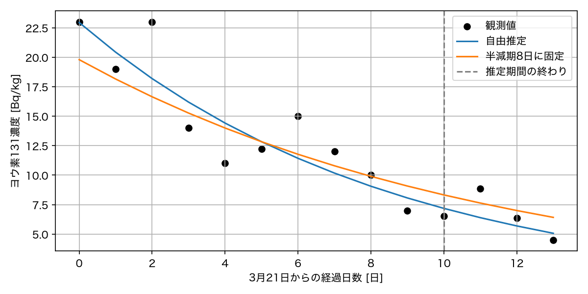

| モデル | $C_0$ [Bq/kg] | $\lambda$ [1/日] | 半減期 [日] |
| --- | --- | --- | --- |
| 自由推定 | 22.949 | 0.116171 | 5.967 |
| 半減期8日に固定 | 19.799 | 0.086643 | 8.000 |

| モデル | 推定期間の対数のMSE | 推定期間のRMSE [Bq/kg] | 推定後のRMSE [Bq/kg] |
| --- | --- | --- | --- |
| 自由推定 | 0.026977 | 2.346 | 1.509 |
| 半減期8日に固定 | 0.035696 | 2.724 | 1.365 |

- 比較図：自由推定モデルは減衰が速く，推定後の期間では半減期固定モデルより小さい濃度を予測する．4月1日の観測値はどちらのモデルよりも大きい．

**設問4：考察例**

- 推定期間の対数のMSE：自由推定では，半減期を8日とするパラメタも選択できる．選べるモデルに半減期固定モデルが含まれるので，同じデータ・目的関数で厳密に最小化すれば，最小値は大きくならない．
- 濃度のRMSEとの区別：上の性質が直接成り立つのは最小化した対数のMSEであり，濃度のRMSEではない．今回は推定期間の濃度のRMSEも自由推定の方が小さいが，一般には保証されない．
- 推定後の誤差：この3日間では半減期固定モデルのRMSEが小さい．推定期間の誤差が小さいことと，未知の観測値に対する予測誤差が小さいことは異なる．評価した観測値は3件に限られ，この結果だけで他の期間でも半減期固定モデルが優れるとはいえない．
- 原因の解釈：固定モデルの予測誤差が小さくても，放射性崩壊だけが減少の原因だとは判断できない．水源への流入や希釈，除去などの寄与を分けるには追加の観測が必要である．
````
-->
