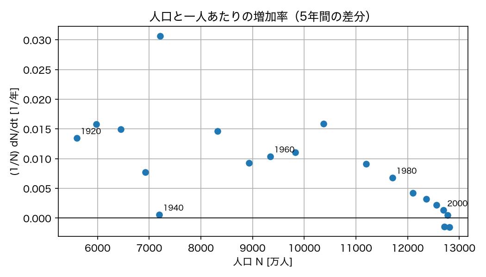
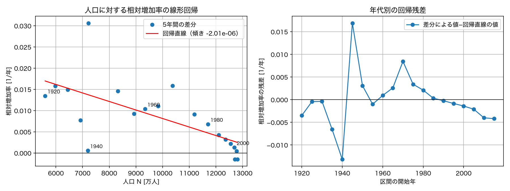
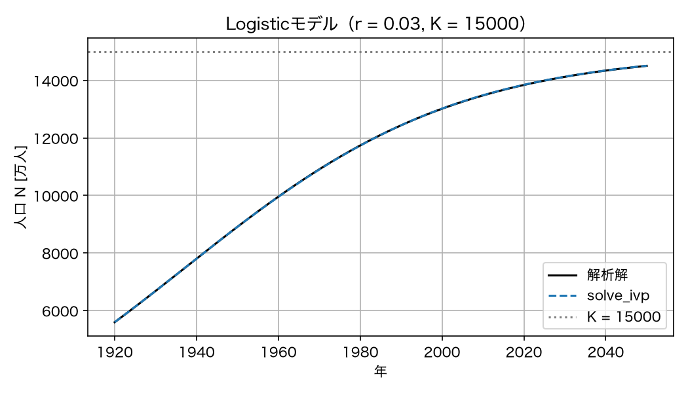
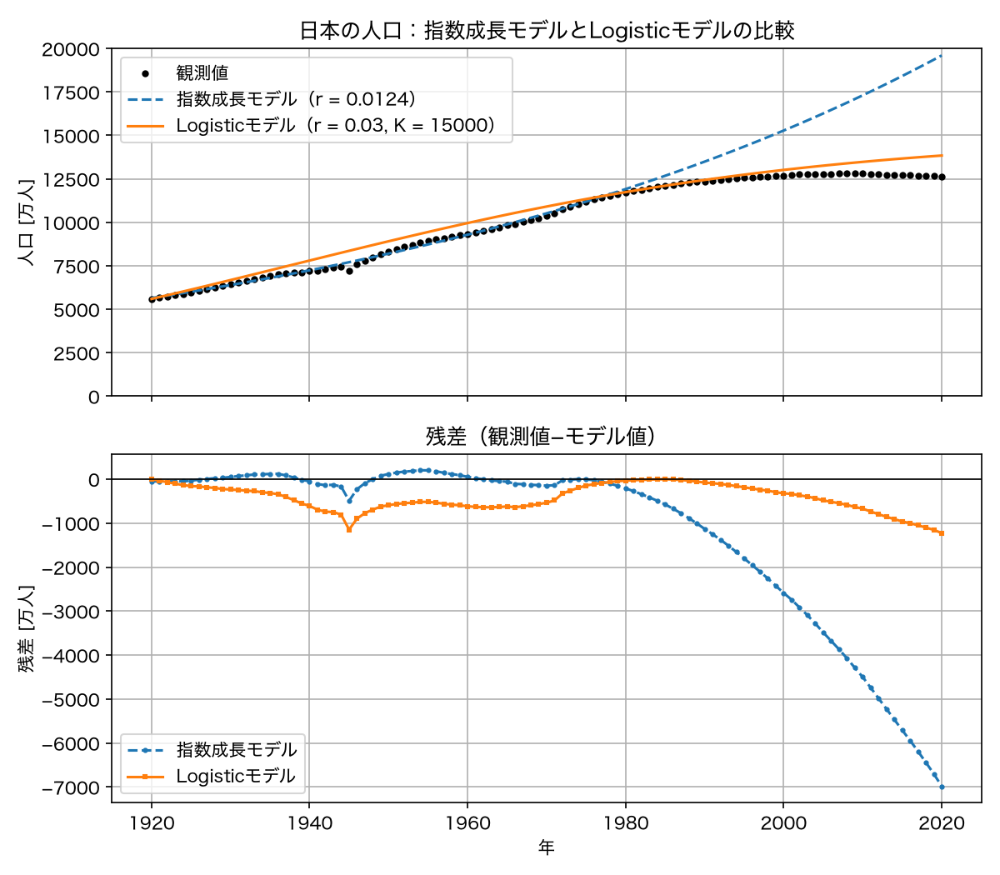
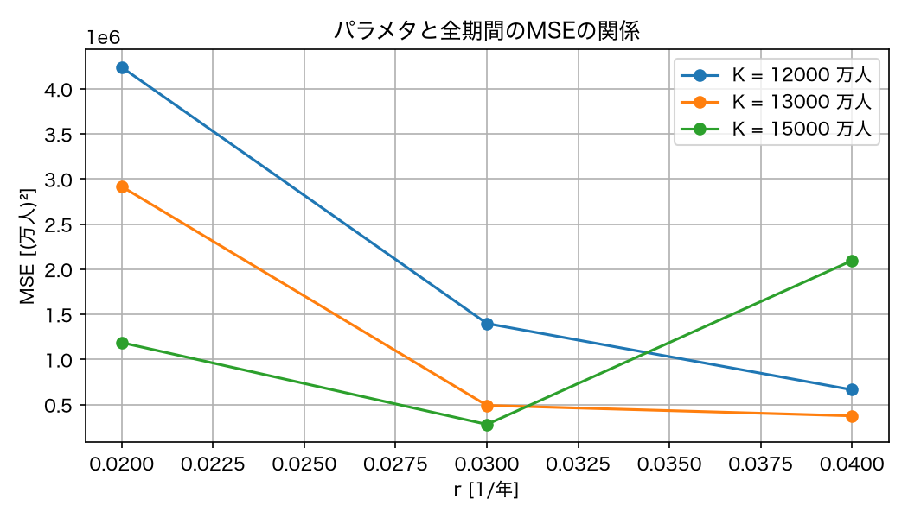
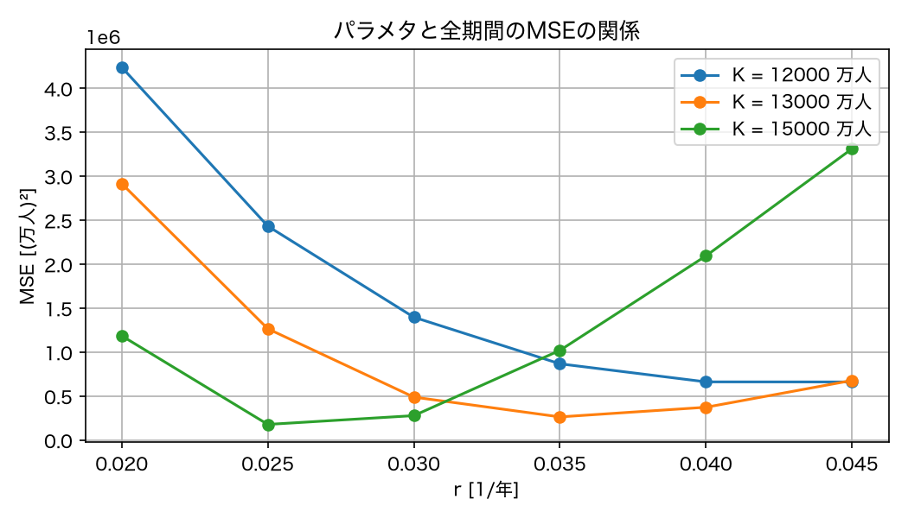
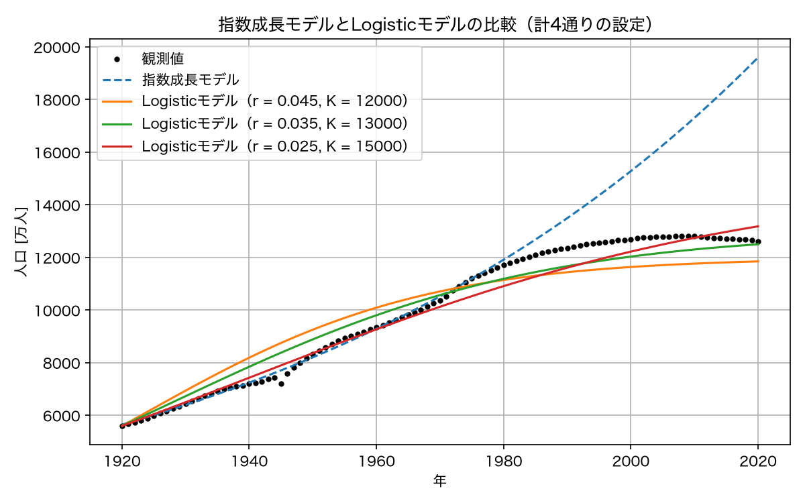
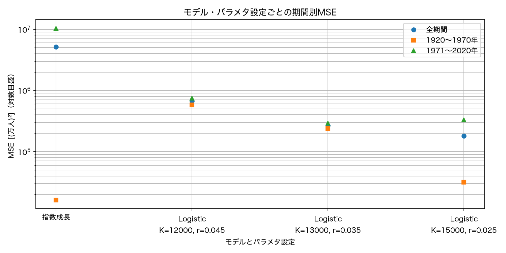
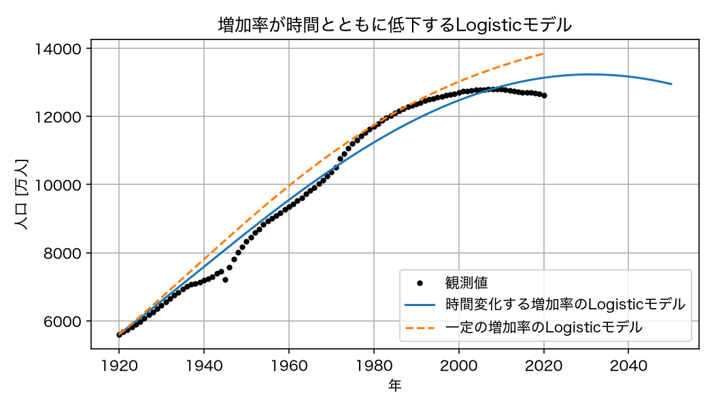

# 第4回　仮定の追加とLogisticモデル

### 今回の位置付け

1. 現象の理解
2. <span style="color:red">仮定の設定</span>
3. <span style="color:red">数理モデルの構築</span>
4. 数値シミュレーション
5. データとの比較
6. パラメタ推定
7. <span style="color:red">モデルの検証と改善</span>

- 第3回：指数成長モデルのパラメタを観測値から推定し，残差と推定期間外での誤差を調べた．
- **第4回**：一定の相対増加率という仮定を見直し，人口に依存する増加率を導入する．
  - モデルの構築：人口が増えるほど一人あたりの増加率が低下するという仮定から，Logisticモデルを導く．
  - モデルの評価：同じ観測値に対する残差・MSEを比べ，改善した点と依然として表せない点を区別する．

### 到達目標

- 仮定と数式の対応：一人あたりの増加率を人口の一次関数と仮定し，Logisticモデルを導ける．
- パラメタの解釈：$r$・$K$・初期値による解の違いを，右辺の符号と解析解から説明できる．
- 既習コードの利用：`solve_ivp`・解析解・残差・MSEのコードを再利用してモデルを比較できる．
- モデルの限界：誤差の減少と，現象の原因を説明できることを区別できる．

<!--
**今回の流れ**（105分の目安）

| 段階 | 内容 | 時間 |
| --- | --- | --- |
| 1 | 作業環境の準備と第3回の復習 | 15分 |
| 2 | 相対増加率の確認（演習1）とLogisticモデルの導出 | 25分 |
| 3 | 実装とパラメタの役割（演習2） | 20分 |
| 4 | 観測値との比較とパラメタの調整・解釈（演習3） | 30分 |
| 5 | モデルの限界，まとめ，課題の説明 | 15分 |
-->

## 準備

````{note} 演習0：作業フォルダとNotebookを作成する

1. ターミナルで第4回の作業フォルダを作成せよ．

```bash
mkdir -p ~/applied_programming_ii/04
cd ~/applied_programming_ii/04
mkdir -p notebooks reports/figures
```

作成するディレクトリ構成は次のとおりである．`data`は第1〜3回と共通で使う．

```text
applied_programming_ii/
├── data/
│   └── population_japan.csv
└── 04/
    ├── README.md
    ├── notebooks/
    │   └── logistic.ipynb
    └── reports/
        └── figures/
```

2. `notebooks/logistic.ipynb`を新規作成せよ．

3. `04`フォルダに`README.md`を作成し，次のテンプレートを記入せよ．解答欄は各設問に取り組んだ後で埋めよ．

```markdown
# 応用プログラミングII 第4回

- 氏名：
- 学籍番号：

## 今日の目標

指数成長モデルが外れた理由を考え，仮定を追加したLogisticモデルを作って2つのモデルを比較する．

## モデルの記録

- 状態変数・時刻の原点・単位：
- 微分方程式と追加した仮定：
- パラメタr，Kの意味と単位：
- 初期値：

## 演習1：差分の間隔と近似精度

| 差分の間隔 [年] | 相対増加率の近似値 [1/年] | 最大絶対誤差 [1/年] |
| --- | --- | --- |
| 5 | | |
| 1 | | |

- 間隔を狭めたときの誤差の変化：
- 観測データでも同じ改善を保証できるか，その理由：

## 演習2：初期値・K・rの役割

| 設問 | 変更した量 | 観察した変化 | 右辺の式に基づく説明 |
| --- | --- | --- | --- |
| 1 | 初期値 | | |
| 2 | K | | |
| 3 | r | | |

## 演習3：パラメタの調整とモデルの解釈

### 設問1・2：候補の比較

- MSEの比較図：Notebookに掲載する．
- 追加後に選んだr：K=12000では　，K=13000では　，K=15000では　．
- rを変えたときのMSEの傾向（1〜2行）：

### 設問3：Kの意味とモデルの限界

- 観測人口の最大値だけではKを決められない理由：
- 増加後の減少を表せない理由：

## 課題1：2種類のモデルの適合度比較

- 比較図のファイル名：
- 指数成長モデルの推定期間・方法・初期値の扱い：
- Logisticモデルの候補選定に使った期間・初期値の扱い：

- 期間別のMSE比較図：Notebookに掲載する．

- 全期間のMSEが最小のモデル・パラメタ設定：
- MSEの値に基づく選択理由（2〜3行）：

## 課題2：環境収容力の検証に必要なデータ

- 設問1：人口を制約すると考える資源または空間：

| 必要な資料・データ | 必要な量と単位 | 確認する内容 |
| --- | --- | --- |
| 1 | | |
| 2 | | |

- 設問2：データから支えられる人口を見積もる方法と，推定したKとの比較方法（3〜4行）：

```

4. Notebookの最初のコードセルに以下を入力し，実行できることを確認せよ．

```python
from pathlib import Path

import numpy as np
import pandas as pd
import matplotlib.pyplot as plt
from scipy.integrate import solve_ivp

plt.rcParams["font.family"] = "Hiragino Sans"  # 日本語表示用（macOS）

PROJECT_DIR = Path.home() / "applied_programming_ii" / "04"
DATA_DIR = Path.home() / "applied_programming_ii" / "data"
FIGURE_DIR = PROJECT_DIR / "reports" / "figures"
FIGURE_DIR.mkdir(parents=True, exist_ok=True)

print("作業フォルダ:", PROJECT_DIR)
print("人口データの有無:", (DATA_DIR / "population_japan.csv").exists())
```

5. 第3回で使用した`population_japan.csv`が共通の`data`フォルダにあることを確認せよ．未取得の場合は{download}`授業用CSV <../data/population_japan.csv>`を同名で保存せよ．
````

## 復習とデータの準備

- 第3回の結果：1975年以降は，指数成長モデルが人口を過大評価し続けた．残差は観測値−モデル値なので負となる．
- 見直す仮定：定数$r$による指数成長では，正の初期値からの解は単調増加・単調減少・一定のいずれかであり，増加から減少への転換を表せない．
- 今回も使うもの：人口データ，指数成長の解析解，MSEの関数を再利用する．出典・集計範囲は[授業用データ一覧](../data/README.md)を参照する．

### 第3回の関数と人口データの再利用

新しいNotebookでも実行できるように，必要なコードを再掲する．

```python
def exponential_rhs(t, N, r):
    """指数成長モデル dN/dt = r N の右辺．"""
    return r * N


def exponential_solution(t, N0, r, t0=0.0):
    """dN/dt = r N, N(t0) = N0 の解析解を返す．"""
    return N0 * np.exp(r * (t - t0))


def mean_squared_error(y_obs, y_model):
    """観測値とモデル値の平均二乗誤差を返す．"""
    return np.mean((y_obs - y_model) ** 2)


population = pd.read_csv(DATA_DIR / "population_japan.csv")
population["population_10k"] = population["total_population_thousand"] / 10

year_obs = population["year"].to_numpy()
t_obs = (year_obs - 1920).astype(float)          # 1920年を t = 0 とする [年]
y_obs = population["population_10k"].to_numpy()  # 観測値 [万人]
N0 = y_obs[0]                                     # 1920年の人口 [万人]

print(f"観測値の数: {len(y_obs)}，初期値 N0 = {N0:.1f} 万人")
```

- 配列の対応：
  - `year_obs`：暦年
  - `t_obs`：1920年からの経過年数
  - `y_obs`：人口の観測値（万人）
  - 添字が同じ要素は同じ年に対応する．
- 初期値：Logisticモデルでは1920年の観測値を`N0`として固定する．第3回の対数線形法で推定した初期値とは区別する．

出力例：

```text
観測値の数: 101，初期値 N0 = 5596.3 万人
```

## 指数成長モデルの限界

### 一定の相対増加率という仮定の見直し

正の量$N(t)$について，その瞬間的な変化率を現在の量で割った

$$
\frac{1}{N(t)}\frac{dN}{dt}
$$

を**相対増加率**という．

- 人口の場合には一人あたりの純増加を表す率．ここでは「一人あたりの増加率」と同じ意味で使う．$t$を年で測る場合，単位は1／年である．
- 指数成長モデルとの対応：$N'=rN$では$N'/N=r$となり，相対増加率は一定である．一般のモデルでは，時刻や人口に応じて変化してよい．

第3回では残差が時間と共に増大していくことを確認した．
これは推定した**一定の相対増加率を長期に適用することの限界**を意味する．
仮定を次のように見直す．

| 検討する要因 | モデルでの表し方 |
| --- | --- |
| 出生・死亡の率や年齢構成の時間変化 | 相対増加率を時間の関数とする，または年齢別の状態変数を導入する |
| 人口に依存する資源・空間の制約 | 一人あたりの増加率を人口の関数とする |
| 国際人口移動 | 流入・流出を表す項を加える |

今回は「人口に依存する資源・空間の制約」を仮定として導入する．

### データによる一人あたり増加率の低下の確認

指数成長モデルでは，一人あたりの増加率 $\dfrac{1}{N}\dfrac{dN}{dt}$ は定数 $r$ である．
観測値からこの量を近似的に計算し，人口 $N$ に対して描いてみる．
変化率は，5年間の差分で近似する．

```python
step = 5   # 差分をとる間隔 [年]

# 5年ごとの値を取り出す
mask_5y = (year_obs % step == 0)
year_5y = year_obs[mask_5y]
y_5y = y_obs[mask_5y]

# 一人あたりの増加率 (N_{k+1} - N_k) / (step * N_k) を計算する
per_capita_rate = (y_5y[1:] - y_5y[:-1]) / (step * y_5y[:-1])
N_start = y_5y[:-1]          # 各区間の始めの人口
```

```{dropdown} コードの補足：区間ごとの増加率

- `year_obs % step == 0`：年を`step`で割った余りが0となる観測値を選ぶ．今回は`step = 5`なので，1920年から5年ごとの値になる．
- `y_5y[1:]`と`y_5y[:-1]`：それぞれ先頭と末尾を除き，隣り合う時点の人口を対応させる．
```

計算した人口と増加率を散布図にする．

```python
fig, ax = plt.subplots(figsize=(7, 4))
ax.plot(N_start, per_capita_rate, marker="o", linestyle="none")
for N_k, rate, yr in zip(N_start, per_capita_rate, year_5y[:-1]):
    if yr % 20 == 0:
        ax.annotate(str(yr), (N_k, rate), textcoords="offset points", xytext=(4, 4), fontsize=8)
ax.axhline(0, color="black", linewidth=0.8)
ax.set_title("人口と一人あたりの増加率（5年間の差分）")
ax.set_xlabel("人口 N [万人]")
ax.set_ylabel("(1/N) dN/dt [1/年]")
ax.grid(True)
fig.tight_layout()
fig.savefig(FIGURE_DIR / "per_capita_rate_vs_N.png", dpi=150)
plt.show()
```

```{dropdown} コードの補足：点・注記・基準線の描画

- `zip(...)`：区間の始めの人口・増加率・年を同じ順番で取り出す．
- `marker="o", linestyle="none"`：丸い点だけを描き，点どうしを線で結ばない．
- `ax.annotate(...)`：指定した点に文字を添える．`textcoords="offset points", xytext=(4, 4)`は，文字を点から右・上に4ポイントずらす指定である．
- `ax.axhline(0, ...)`：増加と減少の境界となる，縦軸の値が0の水平線を描く．
```



- 差分による近似：各区間の始めの人口で割った平均変化率であり，瞬間的な相対増加率そのものではない．
- 観測された傾向：後半の人口が大きい時期には，増加率が低下して負になる．ただし，点は1本の直線上には並ばない．
- 集計上の注意：1945年前後には調査基準日や集計範囲の違いがあるため，差分をすべて人口動態の変化と解釈しない．

### 線形回帰による傾きと残差の確認

5年間の差分から求めた相対増加率に，直線$g(N)=a+bN$を当てはめる．第3回の`np.polyfit`を使うが，今回は対数をとらず，横軸を人口，縦軸を相対増加率とする．

```python
rate_slope, rate_intercept = np.polyfit(N_start, per_capita_rate, 1)
rate_fit = rate_intercept + rate_slope * N_start
rate_residual = per_capita_rate - rate_fit

# 回帰直線を描くための，人口の小さい順に並ぶ座標
N_line = np.linspace(N_start.min(), N_start.max(), 100)
rate_line = rate_intercept + rate_slope * N_line

print(f"傾き b = {rate_slope:.6e} [1/(年・万人)]")
print(f"切片 a = {rate_intercept:.6f} [1/年]")
print("傾きは負か:", rate_slope < 0)
```

```{dropdown} コードの補足：相対増加率の線形回帰

- `np.polyfit(..., 1)`：残差の二乗和を最小にする直線の係数を，傾き・切片の順に返す．
- `rate_residual`：差分で求めた相対増加率から，回帰直線の値を引いた残差である．人口の残差とは単位が異なる．
- `np.linspace(...)`：人口の最小値から最大値まで等間隔の座標を作り，回帰直線の描画に使う．
```

出力例：

```text
傾き b = -2.008364e-06 [1/(年・万人)]
切片 a = 0.028220 [1/年]
傾きは負か: True
```

左図で傾きとばらつきを，右図で年代別の残差を確認する．

```python
fig, axes = plt.subplots(1, 2, figsize=(12, 4.5))

ax = axes[0]
ax.plot(N_start, per_capita_rate, marker="o", linestyle="none", label="5年間の差分")
ax.plot(N_line, rate_line, color="red", label=f"回帰直線（傾き {rate_slope:.2e}）")
for N_k, rate, yr in zip(N_start, per_capita_rate, year_5y[:-1]):
    if yr % 20 == 0:
        ax.annotate(str(yr), (N_k, rate), textcoords="offset points", xytext=(4, 4), fontsize=8)
ax.axhline(0, color="black", linewidth=0.8)
ax.set_title("人口に対する相対増加率の線形回帰")
ax.set_xlabel("人口 N [万人]")
ax.set_ylabel("相対増加率 [1/年]")
ax.grid(True)
ax.legend()

ax = axes[1]
ax.plot(year_5y[:-1], rate_residual, marker="o", label="差分による値−回帰直線の値")
ax.axhline(0, color="black", linewidth=0.8)
ax.set_title("年代別の回帰残差")
ax.set_xlabel("区間の開始年")
ax.set_ylabel("相対増加率の残差 [1/年]")
ax.grid(True)
ax.legend()

fig.tight_layout()
fig.savefig(FIGURE_DIR / "per_capita_rate_regression.png", dpi=150)
plt.show()
```

```{dropdown} コードの補足：回帰直線と年代別残差の描画

- `plt.subplots(1, 2, ...)`：1行2列の描画領域を作る．`axes[0]`が左，`axes[1]`が右である．
- 残差は5年間の各区間の開始年に描き，年代順に線で結ぶ．
```



```{tip} データはモデルを決めるための一つの補助に過ぎない
データから読み取れる傾向を**現象に関する知識**と合わせて，モデルの仮定を検討する根拠とする．

負の関連だけでは原因を特定できない．資源制約のほか，出生率などの時間変化でも同様の傾向は生じ得る．今回は，人口増加による一人あたりの資源の減少を仮定してモデルを構築する．
なお，回帰の横軸と縦軸には共通の人口観測値を使っているため，その観測誤差は両方に影響する．
```

**差分の間隔を狭めると，滑らかな関数の瞬間的な変化率に近づく．** ただし，観測データでは短い間隔ほど観測誤差の影響が強くなる場合がある．ここでは，推定に使う全期間を短くするのではなく，差分をとる間隔を変更する．

$$
g_h(t)=\frac{N(t+h)-N(t)}{hN(t)}
\quad\xrightarrow{h\to0}\quad
\frac{N'(t)}{N(t)}.
$$

精度を直接評価するため，第3回の指数成長モデル$N(t)=N_0e^{rt}$で観測誤差のないデータを作る．この場合，相対増加率の正しい値は$r$である．

````{note} 演習1：差分の間隔と近似精度

1. 次のコードを実行し，5年間隔の場合の相対増加率の近似値と最大絶対誤差を`README.md`の表に記入せよ．
2. 同じ1920〜2020年のモデル値から，1年ごとの差分で相対増加率を求めるようにコードを変更せよ．結果を表に加え，5年間隔と比べて誤差がどう変わったかを述べよ．
3. 実際の人口データでも，間隔を狭めれば必ず精度が上がるといえるか．観測誤差を差分の間隔で割ることを踏まえ，理由を1〜2行で説明せよ．

```python
# 正しい相対増加率が分かるモデル値を用意する．
r_check = 0.02
N_check = exponential_solution(t_obs, N0, r_check)

step_check = 5
mask_check = (year_obs % step_check == 0)
y_check = N_check[mask_check]

rate_check = (y_check[1:] - y_check[:-1]) / (step_check * y_check[:-1])
error_check = np.max(np.abs(rate_check - r_check))
print(f"差分の間隔: {step_check} 年")
print(f"相対増加率の近似値: {rate_check[0]:.8f} [1/年]")
print(f"最大絶対誤差: {error_check:.8f} [1/年]")
```

```{dropdown} コードの補足：近似誤差の評価

- `N_check`：本文で定義した解析解の関数を使い，人口データと同じ年のモデル値を作る．
- `rate_check - r_check`：差分による近似値と，正しい相対増加率との差を求める．
- 指数成長モデルでは，同じ差分間隔での相対増加率の近似値は全区間で等しいため，先頭の値を表示する．
```
````

````{hidden-answer} 演習1の解答例

**1・2．差分の間隔と誤差**

設問2では，`step_check = 1`に変更して同じコードを実行する．

変更後の出力例：

```text
差分の間隔: 1 年
相対増加率の近似値: 0.02020134 [1/年]
最大絶対誤差: 0.00020134 [1/年]
```

| 差分の間隔 [年] | 相対増加率の近似値 [1/年] | 最大絶対誤差 [1/年] |
| --- | --- | --- |
| 5 | 0.02103418 | 0.00103418 |
| 1 | 0.02020134 | 0.00020134 |

間隔を5年から1年にすると，最大絶対誤差は約5分の1になる．この例では

$$
g_h(t)=\frac{e^{rh}-1}{h}\longrightarrow r
$$

となり，間隔を狭めることで正しい相対増加率に近づく．

**3．観測データの場合**

観測値の差には両時点の観測誤差も含まれる．その差を短い間隔で割ると誤差の影響が増幅されるため，実データでは間隔を狭めるだけで精度の改善を保証できない．差分による近似誤差と観測誤差の両方を考慮する必要がある．
````

## 仮定の追加とLogisticモデル

### 仮定の設定

指数成長モデルの仮定に，次の1つを加える．

**追加する仮定：一人あたりの増加率は，人口が増えるにつれて直線的に下がり，人口がある値 $K$ に達するとゼロになる．**

以下では $r>0$，$K>0$，$N_0>0$ とする．$K$ は純増加率が0となる正の平衡人口であり，資源制約を仮定したモデルでは**環境収容力**と呼ぶ．

定数$r,K>0$のLogisticモデルでは，$0<N_0<K$から出発した解は$K$を超えない．ただし，推定した$K$が現実の人口の絶対的な上限を表すとは限らない．

### 式の導出

一人あたりの増加率を $N$ の1次関数で書く．
$N = 0$ のとき $r$，$N = K$ のとき $0$ となる1次関数は

$$
r_{\mathrm{eff}}(N) = r\left(1 - \frac{N}{K}\right)
$$

である．
これを指数成長モデルの $r$ の代わりに置くと，

$$
\frac{dN}{dt} = r_{\mathrm{eff}}(N)\,N = r\,N\left(1 - \frac{N}{K}\right)
$$

を得る．
これが**Logisticモデル**である．

| 項 | 意味 | 単位 |
| --- | --- | --- |
| $r$ | 人口が少ないときの一人あたり増加率（内的自然増加率） | 1／年 |
| $K$ | 環境収容力．正の初期値からの解が長期的に収束する人口 | 万人 |
| $N/K$ | 収容力に対する現在の人口の割合 | 無次元 |
| $1 - N/K$ | 人口依存の相対増加率を内的自然増加率 $r$ で割った値 | 無次元 |
| $rN(1 - N/K)$ | 人口の瞬間的な変化率 | 万人／年 |

右辺の単位は $(1/\text{年}) \times \text{万人} \times \text{無次元} = \text{万人}/\text{年}$ で，左辺と一致する．
微分方程式の係数は，指数成長モデルの$r$に$K$が加わる．

### $1 - N/K$ の符号と人口の増減

- $N \ll K$ のとき：$N/K \approx 0$ なので $1 - N/K \approx 1$ となり，$N' \approx rN$ となる．人口が少ないうちは指数成長モデルと区別がつかない
- $N = K$ のとき：$1 - N/K = 0$ なので $N' = 0$ となり，人口は変化しない．$K$ は**平衡点**である
- $N > K$ のとき：$1 - N/K < 0$ なので $N' < 0$ となり，人口は減って $K$ に戻る

つまりLogisticモデルの解は，$K$ より小さい初期値から出発すれば増えて $K$ に近づき，$K$ より大きい初期値から出発すれば減って $K$ に近づく．
いずれの場合も $t\to\infty$ で $N(t)\to K$ となる．$N_0=0$ の場合は $N(t)=0$ のままである．

````{dropdown} 補足：解析解

**主張**

定数$r,K>0$，$N_0>0$とする．初期値問題

$$
\frac{dN}{dt}=rN\left(1-\frac{N}{K}\right),\qquad N(0)=N_0
$$

の$t\ge0$における解は

$$
N(t) = \frac{K}{1 + \left(\dfrac{K - N_0}{N_0}\right)e^{-rt}}
$$

である．

**証明**

まず$N_0\ne K$の場合を，次の5段階で導く．$N_0=K$の場合は，後述の平衡解の確認により成り立つ．

**1．微分方程式の整理と時間積分**

解の一意性により，$N_0>0$，$N_0\ne K$から出発した解は，存在する区間で平衡解$N=0,K$に達しない．したがって，微分方程式の両辺を$N(t)(1-N(t)/K)$で割ることができる．

$$
\frac{N'(t)}{N(t)(1-N(t)/K)}=r.
$$

両辺を時刻$0$から$t$まで積分すると，

$$
\int_0^t \frac{N'(s)}{N(s)(1-N(s)/K)}\,ds
=\int_0^t r\,ds=rt.
$$

左辺に変数変換$u=N(s)$を適用し，$N(0)=N_0$を用いると，

$$
\int_{N_0}^{N(t)}\frac{1}{u(1-u/K)}\,du=rt.
$$

**2．部分分数分解：積分できる形に直す**

$1-N/K=(K-N)/K$を使うと，

$$
\frac{1}{N(1-N/K)}
=\frac{K}{N(K-N)}
=\frac{1}{N}+\frac{1}{K-N}.
$$

最後の等号は，右辺を通分すれば確認できる．

$$
\frac{1}{N}+\frac{1}{K-N}
=\frac{(K-N)+N}{N(K-N)}
=\frac{K}{N(K-N)}.
$$

**3．定積分の計算**

部分分数分解を用いて積分すると，

$$
\begin{aligned}
\int_{N_0}^{N(t)}\left(\frac{1}{u}+\frac{1}{K-u}\right)\,du
&=\left[\ln|u|-\ln|K-u|\right]_{N_0}^{N(t)}\\
&=\ln\left|\frac{N(t)}{K-N(t)}\right|
-\ln\left|\frac{N_0}{K-N_0}\right|=rt.
\end{aligned}
$$

- 原始関数の確認：合成関数の微分により，$\dfrac{d}{du}[-\ln|K-u|]=\dfrac{1}{K-u}$となる．
- 対数の整理：2つの対数の差を商の対数にまとめた．

**4．指数関数による変形**

初期値を含む項を右辺に移すと，

$$
\ln\left|\frac{N(t)}{K-N(t)}\right|
=rt+\ln\left|\frac{N_0}{K-N_0}\right|.
$$

したがって，両辺の指数をとれば

$$
\left|\frac{N}{K-N}\right|
=\left|\frac{N_0}{K-N_0}\right|e^{rt}.
$$

解は平衡解$N=0,K$を横切らないため，$N/(K-N)$の符号は初期時刻と変わらない．よって，$N_0<K$でも$N_0>K$でも，符号を保った式

$$
\frac{N}{K-N}=\frac{N_0}{K-N_0}e^{rt}
$$

が得られる．

**5．$N$について解く**

逆数をとり，$N$を分母から取り出す．

$$
\begin{aligned}
\frac{K-N}{N}&=\frac{K-N_0}{N_0}e^{-rt},\\
\frac{K}{N}-1&=\frac{K-N_0}{N_0}e^{-rt},\\
\frac{K}{N}&=1+\frac{K-N_0}{N_0}e^{-rt},\\
N(t)&=\frac{K}{1+\left(\dfrac{K-N_0}{N_0}\right)e^{-rt}}.
\end{aligned}
$$

以上より，主張の式を得る．

**初期条件・平衡解・長期挙動の確認**

- 初期条件：$t=0$では分母が$1+(K-N_0)/N_0=K/N_0$となり，$N(0)=N_0$を満たす．
- 微分方程式と定義域：$A=(K-N_0)/N_0>-1$とおくと，$t\ge0$では$1+Ae^{-rt}>0$である．得られた式を微分すると$N'(t)=rKAe^{-rt}/(1+Ae^{-rt})^2=rN(t)(1-N(t)/K)$となり，全ての$t\ge0$で微分方程式を満たす．
- $N_0=K$：元の微分方程式から$N(t)=K$は平衡解である．導出中は除外したが，得られた解析解にも$N_0=K$を代入できる．
- $N_0=0$：平衡解$N(t)=0$となる．上の式は$N_0$で割るため，この場合には使わない．
- 長期挙動：$r>0$なので$e^{-rt}\to0$となり，$N_0>0$では$N(t)\to K$となる．

今回は，この解析解を数値解の検算に使う．
````

## Pythonによる実装

### 右辺と解析解

```python
def logistic_rhs(t, N, r, K):
    """Logisticモデル dN/dt = r N (1 - N/K) の右辺．"""
    return r * N * (1 - N / K)


def logistic_solution(t, N0, r, K, t0=0.0):
    """dN/dt = r N (1 - N/K), N(t0) = N0 の解析解を返す．"""
    return K / (1 + ((K - N0) / N0) * np.exp(-r * (t - t0)))
```

- 関数の変更点：第3回の右辺$rN$に因子$1-N/K$を掛ける．解析解は$N_0>0$の場合の式である．

### 数値解と解析解の比較

$r = 0.03$／年，$K = 15000$ 万人として計算する．
この値はまず手で選んだもので，あとでデータに合わせて変える．

```python
# パラメタ（まず手で選ぶ）
r_trial = 0.03       # 内的自然増加率 [1/年]
K_trial = 15000.0    # 環境収容力 [万人]

# 計算区間：1920年から2050年まで
t_span = (0.0, 130.0)
t_eval = np.arange(0.0, 131.0)

sol = solve_ivp(logistic_rhs, t_span, [N0], t_eval=t_eval, args=(r_trial, K_trial))
N_numeric = sol.y[0]
N_analytic = logistic_solution(t_eval, N0, r_trial, K_trial)

print(f"数値解と解析解の最大差: {np.max(np.abs(N_numeric - N_analytic)):.3f} 万人")
```

```{dropdown} コードの補足：数値解と解析解

- `args=(r_trial, K_trial)`：右辺の関数の追加引数に，$r$，$K$の順で渡す．
- `sol.y[0]`：1つの状態変数である人口の数値解を取り出す．
- `np.max(np.abs(...))`：出力時刻上での数値解と解析解の最大絶対差を求める．観測値との残差とは異なる．
- 演習2での変更：`logistic_solution`の初期値・係数を変更する．数値解も比べる場合は，`solve_ivp`の初期値と追加引数も対応させる．元の人口データを変更せず，試す値は別の変数に保存する．
```

出力例（SciPyのバージョンなどにより末尾の値は異なる場合がある）：

```text
数値解と解析解の最大差: 8.924 万人
```

得られた数値解と解析解を重ねて描く．水平線は収束値$K$を示す．

```python
fig, ax = plt.subplots(figsize=(7, 4))
ax.plot(1920 + t_eval, N_analytic, color="black", label="解析解")
ax.plot(1920 + t_eval, N_numeric, linestyle="--", label="solve_ivp")
ax.axhline(K_trial, color="gray", linestyle=":", label=f"K = {K_trial:.0f}")
ax.set_title(f"Logisticモデル（r = {r_trial}, K = {K_trial:.0f}）")
ax.set_xlabel("年")
ax.set_ylabel("人口 N [万人]")
ax.grid(True)
ax.legend()
fig.tight_layout()
fig.savefig(FIGURE_DIR / "logistic_analytic_vs_numeric.png", dpi=150)
plt.show()
```

```{dropdown} コードの補足：曲線の重ね描き

- 複数の曲線は，同じ`ax`に`ax.plot`を繰り返して重ねる．凡例に変更した値を記し，保存名を図ごとに変える．
```



- この設定：$0<N_0<K/2$なので，初めは増加が加速し，$N=K/2$で変化率が最大となった後，増加が鈍って$K$に近づく．
- 初期値が異なる場合：$K/2<N_0<K$では初めから増加が鈍る．すべての初期値でS字の両側が見えるわけではない．

````{note} 演習2：初期値・$K$・$r$の変更

1. $r=0.03$，$K=15000$として，初期値を3000，10000，18000万人に変え，3本の曲線を1枚の図に描け．$K$より大きい初期値から出発した場合の変化を，右辺の符号から説明せよ．
2. 初期値を1920年の観測値，$r=0.03$に戻し，$K$を12000，15000，20000万人に変えて曲線を比較せよ．初期値・長期的な収束値・初期の変化率への影響を`README.md`に記入せよ．
3. 初期値を1920年の観測値，$K=15000$として，$r$を0.02，0.03，0.05に変えて曲線を比較せよ．収束値とそこへ近づく速さの違いを`README.md`に記入せよ．
````

```{hidden-answer} 演習2の解答例
- $K$ より大きい初期値から出発すると，人口は単調に減って $K$ に近づく．$1 - N/K < 0$ で変化率が負になるためである．
- $K$は長期的な収束値を決める．初期値は変わらないが，初期の変化率$rN_0(1-N_0/K)$は変わる．$N_0\ll K$の場合に限り，$K$の影響は小さくなる．
- $r$ は $K$ に近づく速さを決める．$r$ が大きいほど早くS字の中央部分を通過する．長期的な収束値は変わらない．
```

## 同じデータ・同じ指標による2つのモデルの比較

### 比較条件の設定

モデルを比較するときは，同じデータ，同じ期間，同じ誤差指標を使う．
ここでは1920年から2020年の全期間の観測値に対して，第3回で定義した平均二乗誤差を計算する．
指数成長モデルのパラメタには，第3回の対数線形法で1920〜1970年から決めた値を使う．演習2で変更した値に依存しないように，Logisticモデルの基準値も再設定する．

| 比較条件 | 指数成長モデル | Logisticモデル |
| --- | --- | --- |
| 初期値 | 対数線形法で推定 | 1920年の観測値に固定 |
| 係数の決め方 | 1920〜1970年の対数残差で推定 | まず手で選び，その後は全期間のMSEで候補を比較 |
| 評価対象 | 1920〜2020年の全観測値 | 1920〜2020年の全観測値 |

- 比較の範囲：今回は同じ評価指標で具体的なモデル値を比べる．推定条件が異なるため，モデルの構造だけを公平に比較した実験ではない．
- 評価期間の注意：Logisticモデルの候補選定に全期間を使う場合，1971年以降の誤差も未使用データに対する予測精度ではない．

```python
# 基準値を再設定する．
N0 = y_obs[0]
r_trial = 0.03
K_trial = 15000.0

# 指数成長モデル：第3回の対数線形法（1920〜1970年）で決めた値
fit_mask = year_obs <= 1970
slope, intercept = np.polyfit(t_obs[fit_mask], np.log(y_obs[fit_mask]), 1)
r_exp = slope
N0_exp = np.exp(intercept)

N_exp = exponential_solution(t_obs, N0_exp, r_exp)
N_log = logistic_solution(t_obs, N0, r_trial, K_trial)
```

次に，モデル値から残差とMSEを計算する．

```python
residual_exp = y_obs - N_exp
residual_log = y_obs - N_log
mse_exp = mean_squared_error(y_obs, N_exp)
mse_log = mean_squared_error(y_obs, N_log)

print(f"指数成長モデル   r = {r_exp:.4f}                : MSE = {mse_exp:12.0f} （万人）^2，平方根 = {np.sqrt(mse_exp):6.0f} 万人")
print(f"Logisticモデル   r = {r_trial:.4f}, K = {K_trial:.0f}: MSE = {mse_log:12.0f} （万人）^2，平方根 = {np.sqrt(mse_log):6.0f} 万人")
print(f"2020年の観測値: {y_obs[-1]:.0f} 万人，指数成長モデル: {N_exp[-1]:.0f} 万人，Logisticモデル: {N_log[-1]:.0f} 万人")
```

- コードの補足：期間別に評価する場合は，`fit_mask`と`~fit_mask`で観測値とモデル値を同じ条件で選び，`mean_squared_error`に渡す．

出力例（「平方根」はMSEの平方根，すなわちRMSE）：

```text
指数成長モデル   r = 0.0124                : MSE =      5166802 （万人）^2，平方根 =   2273 万人
Logisticモデル   r = 0.0300, K = 15000: MSE =       280145 （万人）^2，平方根 =    529 万人
2020年の観測値: 12615 万人，指数成長モデル: 19600 万人，Logisticモデル: 13842 万人
```

### 図による比較

```python
fig, axes = plt.subplots(2, 1, figsize=(8, 7), sharex=True)

ax = axes[0]
ax.plot(year_obs, y_obs, color="black", marker="o", markersize=3, linestyle="none", label="観測値")
ax.plot(year_obs, N_exp, linestyle="--", label=f"指数成長モデル（r = {r_exp:.4f}）")
ax.plot(year_obs, N_log, linestyle="-", label=f"Logisticモデル（r = {r_trial}, K = {K_trial:.0f}）")
ax.set_title("日本の人口：指数成長モデルとLogisticモデルの比較")
ax.set_ylabel("人口 [万人]")
ax.set_ylim(0, 20000)
ax.grid(True)
ax.legend()

ax = axes[1]
ax.plot(year_obs, residual_exp, linestyle="--", marker="o", markersize=2, label="指数成長モデル")
ax.plot(year_obs, residual_log, linestyle="-", marker="s", markersize=2, label="Logisticモデル")
ax.axhline(0, color="black", linewidth=0.8)
ax.set_title("残差（観測値−モデル値）")
ax.set_xlabel("年")
ax.set_ylabel("残差 [万人]")
ax.grid(True)
ax.legend()

fig.tight_layout()
fig.savefig(FIGURE_DIR / "exponential_vs_logistic.png", dpi=150)
plt.show()
```

```{dropdown} コードの補足：上下に並べた図の描画

- `plt.subplots(2, 1, ...)`：2行1列の描画領域を作る．`axes[0]`が上段，`axes[1]`が下段である．
- `sharex=True`：上下の横軸の範囲と目盛りを共有し，同じ年の人口と残差を比較しやすくする．横軸の目盛りラベルは通常，下段だけに表示される．
- `ax.set_ylim(0, 20000)`：上段の縦軸の表示範囲を0〜20000に設定する．
- 図の更新：`r_trial`と`K_trial`を変更したら，`N_log`，残差・MSE，描画の順で再実行する．基準値を再設定する行は実行しない．
- 課題1での重ね描き：候補ごとのモデルを同じ`ax`に描き，凡例に$r,K$を記す．初期値はLogisticモデルでは1920年の観測値，指数成長モデルでは対数線形法の推定値を使う．
```



基準値$r=0.03$，$K=15000$では，次の特徴がある．

- 残差の符号：Logisticモデルは初期時点を除いて観測値を上回り，残差は負となる．
- 残差の大きさ：2020年には約−1227万人となる．指数成長モデルより小さいが，無視できる差ではない．
- 曲線の形：Logisticモデルは$K$に向かって増え続けるため，観測人口の増加後の減少は表せない．

### $K$と$r$の手動調整

$K$ごとに$r$を変え，MSEを配列に保存する．

```python
K_values = [12000.0, 13000.0, 15000.0]
r_values = [0.02, 0.03, 0.04]

mse_curves = []
for K_value in K_values:
    mse_values = []
    for r_value in r_values:
        N_try = logistic_solution(t_obs, N0, r_value, K_value)
        mse_try = mean_squared_error(y_obs, N_try)
        mse_values.append(mse_try)
    mse_curves.append(mse_values)
```

```{dropdown} コードの補足：候補の組み合わせ

- 候補の変更：`K_values`と`r_values`の値を変え，二重の`for`で各組のモデル値とMSEを再計算する．
- `append(...)`：リストの末尾に値を追加する．`mse_curves`には，$K$ごとのMSEのリストが順に入る．
```

横軸を$r$，縦軸をMSEとし，$K$ごとの結果を重ねて描く．

```python
fig, ax = plt.subplots(figsize=(7, 4))
for K_value, mse_values in zip(K_values, mse_curves):
    ax.plot(r_values, mse_values, marker="o", label=f"K = {K_value:.0f} 万人")
ax.set_title("パラメタと全期間のMSEの関係")
ax.set_xlabel("r [1/年]")
ax.set_ylabel("MSE [(万人)²]")
ax.grid(True)
ax.legend()
fig.tight_layout()
fig.savefig(FIGURE_DIR / "parameter_mse.png", dpi=150)
plt.show()
```

- コードの補足：点が実際に計算した候補であり，線は候補間の傾向を見やすくするために結んでいる．



同じ $K$ でも $r$ によって誤差は大きく変わり，同じ $r$ でも $K$ によって変わる．
また，$K = 15000$，$r = 0.03$ の組と，$K = 13000$，$r = 0.04$ の組のように，異なる組が近い誤差を与えることがある．
$K$ を小さくすると $r$ を大きくして立ち上がりを補う必要があり，2つのパラメタは互いに影響し合う．
手で変えるだけでは，どこに最も良い組があるのかを見つけにくい．
次回は**格子探索**（グリッドサーチ）により，候補を系統的に比較してMSEが最小となる組を探す．

````{note} 演習3：パラメタの調整とモデルの解釈

日本の人口は2008年に約1億2800万人で最大となり，その後減少している．

1. 本文のコードで，横軸を$r$，縦軸をMSEとする比較図を作成し，Notebookに掲載せよ．
2. $r$の候補を0.020〜0.045の0.005刻みに変更し，同じ図を作成せよ．各$K$でMSEが最小となる$r$をREADMEに記し，$r$とMSEの関係を1〜2行で説明せよ．課題1ではここで選んだ3組を使え．
3. 結果と微分方程式を用い，次の2点をそれぞれ1〜2行で説明せよ：観測人口の最大値だけでは$K$を決められない理由，および$0<N_0<K$，$r>0$を固定したモデルが増加後の減少を表せない理由．
````

````{hidden-answer} 演習3の解答例

**設問1・2：候補の比較**

設問1の出力は本文の図と同じである．設問2では，本文の候補を次のように変更し，MSEの計算と描画を順に再実行する．保存名は`exercise3_parameter_mse.png`とする．

```python
r_values = [0.020, 0.025, 0.030, 0.035, 0.040, 0.045]
```



- 選ぶ$r$：$K=12000$では0.045，$K=13000$では0.035，$K=15000$では0.025．
- 傾向：$K$によってMSEが最小になる$r$が異なる．今回の候補では，$K$が大きいほど小さい$r$が選ばれる．

最良とは，今回試した候補の中でMSEが最小という意味である．

**設問3：Kの意味とモデルの限界**

- $K$は長期的な収束値であり，観測人口の最大値ではない．MSEは曲線全体への当てはまりで決まり，$r$による増加の速さにも依存する．
- $0<N<K$では$N'=rN(1-N/K)>0$であり，解は$K$を超えずに近づく．したがって，増加から減少には転じない．
````

## モデルの限界と改善の問い

### Logisticモデルの表現上の限界

**増加の鈍化は表せるが，増加から減少への転換は表せない．**

- 表せること：$0<N_0<K$では，人口が$K/2$を超えると増加が鈍り，$K$に近づく．
- 表せない理由：$r,K$が一定なら，解は$K$を超えずに単調に近づく．途中で増加から減少には転じない．
- 改善の方向：出生・死亡による増加率の変化は$r(t)$，年齢構成は年齢別の状態変数，国際人口移動は流入・流出の項で表す．

### モデルの複雑さと評価

**MSEの減少は，原因の説明や将来予測の正しさを保証しない．** 判断を次の3つに分ける．

| 判断すること | 今回の結果から分かること・必要な確認 |
| --- | --- |
| 観測値への当てはまり | Logisticモデルの基準値は指数成長モデルよりMSEが小さい．ただし，初期値と係数の決定方法も異なる． |
| 原因の説明 | $K$を資源制約と解釈するには，資源の供給量など，人口以外の資料が必要である． |
| 将来の予測 | 候補選定に使っていないデータで評価する必要がある．全期間のMSEだけでは判断できない． |

パラメタを増やすと曲線を調整しやすくなる一方，次の問題が起こり得る．

- **過学習**：観測データの偶然の揺らぎにまで適合し，未使用データでの予測が悪くなる．
- **パラメタの決めにくさ**：異なる組が似た曲線を与えると，誤差だけでは組を区別しにくい．

## まとめ

- **仮定とモデル**：人口が増えるほど一人あたりの増加率が下がると仮定し，$N'=rN(1-N/K)$を導いた．
- **成果と限界**：増加の鈍化は表せるが，定数$r,K>0$では増加から減少への転換は表せない．
- **評価と次回**：MSEによる適合度と，原因の説明・予測精度は区別する．次回は$r,K$の候補を格子状に調べ，MSEを可視化する．

## 課題

````{warning} 課題1：2種類のモデルの適合度比較

比較するモデルは**指数成長モデルとLogisticモデルの2種類**である．指数成長モデルは1通り，Logisticモデルは$K$ごとに選んだ3通りのパラメタ設定を使うため，図に描くモデルの曲線は計4本となる．

1. 指数成長モデル（第3回の対数線形法で求めた$r$と$N_0$）と，Logisticモデル（$K = 12000$，$13000$，$15000$ 万人の3通り，$r$ はそれぞれ演習3で見つけた最も良い値）を，観測値と重ねた1枚の図に描き，`reports/figures/`に保存せよ．
2. 計4通りの設定について，全期間・1920〜1970年・1971〜2020年のMSEを計算せよ．横軸を設定，縦軸をMSEとし，期間ごとに色を分けた比較図を作成してNotebookに掲載せよ．パラメタの決定方法と初期値の扱いはREADMEに簡潔に記せ．
3. **1920〜2020年の全観測値に対するMSEが最小**となるモデルとパラメタ設定を選べ．他の候補とのMSEの比較を根拠として，この期間のデータに最も整合していると判断した理由を2〜3行で述べよ．

描画には本文の`ax.plot`を再利用する．横軸には`["指数成長", "Logistic：K=12000", ...]`のような文字列のリストを渡せる．縦軸の値は`append`で保存し，3期間それぞれの点を同じ`ax`に描け．値の桁の違いを比較するため，`ax.set_yscale("log")`で縦軸を対数目盛にせよ．
````

````{hidden-answer} 課題1の解答例

**1．比較図**

演習3で各$K$について追加候補まで比較すると，選ぶ$r$は順に0.045，0.035，0.025となる．本文の関数と人口データを読み込んだ後，次を実行する．

```python
N0 = y_obs[0]
fit_mask = year_obs <= 1970
r_exp, intercept = np.polyfit(t_obs[fit_mask], np.log(y_obs[fit_mask]), 1)
N0_exp = np.exp(intercept)
N_exp = exponential_solution(t_obs, N0_exp, r_exp)

fig, ax = plt.subplots(figsize=(8, 5))
ax.plot(year_obs, y_obs, color="black", marker="o", markersize=3,
        linestyle="none", label="観測値")
ax.plot(year_obs, N_exp, linestyle="--", label="指数成長モデル")

K_values = [12000.0, 13000.0, 15000.0]
r_values = [0.045, 0.035, 0.025]
for K_value, r_value in zip(K_values, r_values):
    N_try = logistic_solution(t_obs, N0, r_value, K_value)
    ax.plot(year_obs, N_try,
            label=f"Logisticモデル（r = {r_value}, K = {K_value:.0f}）")

ax.set_title("指数成長モデルとLogisticモデルの比較（計4通りの設定）")
ax.set_xlabel("年")
ax.set_ylabel("人口 [万人]")
ax.grid(True)
ax.legend()
fig.tight_layout()
fig.savefig(FIGURE_DIR / "assignment1_model_comparison.png", dpi=150)
plt.show()
```

- コードの補足：`zip`で各$K$に対応する$r$を1組ずつ取り出し，選んだ3組の曲線を重ねて描く．



**2．期間別の評価**

```python
labels = ["指数成長"]
mse_all = [mean_squared_error(y_obs, N_exp)]
mse_early = [mean_squared_error(y_obs[fit_mask], N_exp[fit_mask])]
mse_late = [mean_squared_error(y_obs[~fit_mask], N_exp[~fit_mask])]
for K_value, r_value in zip(K_values, r_values):
    N_try = logistic_solution(t_obs, N0, r_value, K_value)
    labels.append(f"Logistic\nK={K_value:.0f}, r={r_value}")
    mse_all.append(mean_squared_error(y_obs, N_try))
    mse_early.append(mean_squared_error(y_obs[fit_mask], N_try[fit_mask]))
    mse_late.append(mean_squared_error(y_obs[~fit_mask], N_try[~fit_mask]))
```

- コードの補足：観測値とモデル値を同じマスクで取り出し，期間別のMSEを設定の順に保存する．

```python
fig, ax = plt.subplots(figsize=(10, 5))
ax.plot(labels, mse_all, marker="o", linestyle="none", label="全期間")
ax.plot(labels, mse_early, marker="s", linestyle="none", label="1920〜1970年")
ax.plot(labels, mse_late, marker="^", linestyle="none", label="1971〜2020年")
ax.set_yscale("log")
ax.set_title("モデル・パラメタ設定ごとの期間別MSE")
ax.set_xlabel("モデルとパラメタ設定")
ax.set_ylabel("MSE [(万人)²]（対数目盛）")
ax.grid(True, which="both")
ax.legend()
fig.tight_layout()
fig.savefig(FIGURE_DIR / "assignment1_mse_comparison.png", dpi=150)
plt.show()
```

```{dropdown} コードの補足：設定ごとのMSE比較

- `ax.plot(labels, ...)`：文字列を横軸の項目名として使う．ラベル中の`\n`は改行を表す．
- `ax.set_yscale("log")`：縦軸を対数目盛にし，値の桁が異なるMSEを比較しやすくする．
- `which="both"`：主目盛と補助目盛の両方にグリッド線を描く．
```



- 指数成長モデル：1920〜1970年の対数線形法で$r$と$N_0$を推定した．$N_0$は約5647.3万人である．
- Logisticモデル：$N_0=5596.3$万人に固定し，全期間のMSEで候補を選んだ．**1971年以降も選定に使用済み**なので，後半のMSEは未使用データでの予測精度ではない．

**3．全期間のMSEに基づく選択**

Logisticモデルの$r=0.025$，$K=15000$万人を選ぶ．全期間のMSEは約180407（万人）$^2$であり，指数成長モデルの約5166802，他のLogisticモデルの設定の約663139・265821より小さい．したがって，今回比較した候補中では，1920〜2020年の観測値に最もよく適合する．
````

````{warning} 課題2：環境収容力の検証に必要なデータ

**人口データから求めた$K$を，資源・空間に関する別のデータと照合する方法を考える．**

1. 人口を制約する要因として，食料・水・居住空間などから1つを選べ．その要因が支えられる人口を見積もるために必要な資料・データを2つ挙げ，必要な量・単位と，何を確認するかを表に記入せよ．
2. それらのデータを使って支えられる人口をどう見積もり，課題1で選んだ$K$とどう比較するかを，式または3〜4行の文章で説明せよ．対象地域・時期・単位をそろえることを含めよ．

今回は調査計画を示せばよく，実際のデータ収集や数値計算は求めない．
````

```{hidden-answer} 課題2の解答例

**1．水資源を選んだ場合の資料・データ**

| 必要な資料・データ | 必要な量と単位 | 確認する内容 |
| --- | --- | --- |
| 水資源・給水施設に関する資料 | 生活用水として持続的に供給できる量$Q$ [m³/年] | 農業・工業・環境維持に必要な水量を考慮し，生活用水に利用できる量を確認する． |
| 生活用水の利用実態や必要量に関する資料 | 1人あたりに必要と仮定する水量$q$ [m³/(人・年)] | 想定する生活水準に対応した必要量を定める． |

**2．人口の見積もりと$K$との比較**

水だけが人口を制約すると仮定すると，支えられる人口は$Q/q$ [人]と見積もれる．同じ地域・時期の資料で$Q,q$を設定し，$K$の単位に合わせて$Q/(10000q)$ [万人]を課題1の$K=15000$万人と比較する．両者が大きく異なれば，水による制約という解釈や必要量の仮定を見直す．近い値であれば，その解釈と整合する一つの根拠になる．
```

### 提出先・期限

- 提出場所：WebClass「第4回課題」
- 提出物：
  - `README.md`
  - Notebookファイル`logistic.ipynb`
- 提出期限：<span style="color:red">2026年10月24日(土)23:59</span>

## 自主学習用の発展課題

以下の課題への取り組みは任意である．
取り組んだ内容は`logistic.ipynb`に追記すること．

### 増加率が時間とともに下がるモデル

相対増加率の時間変化を近似するために，$r$ を時間の1次関数 $r(t) = r_0 - c\,t$ に置き換えたモデルを考える．

$$
\frac{dN}{dt} = (r_0 - c\,t)\,N\left(1 - \frac{N}{K}\right)
$$

$0<N_0<K$，$r_0,c>0$なら，$t=r_0/c$で人口が最大となり，その後は減少する．
パラメタは $r_0$，$c$，$K$ の3つになる．

```python
def logistic_decreasing_r_rhs(t, N, r0, c, K):
    """増加率が r(t) = r0 - c t で下がるLogisticモデルの右辺．"""
    return (r0 - c * t) * N * (1 - N / K)
```

パラメタを指定し，観測時刻でのモデル値とMSEを求める．

```python
# 全期間の誤差が小さくなるように選んだ値（c > 0 の範囲で探索した結果）
r0_trial, c_trial, K_trial2 = 0.020, 0.00018, 40000.0

sol_rt = solve_ivp(logistic_decreasing_r_rhs, (0.0, 100.0), [N0], t_eval=t_obs, args=(r0_trial, c_trial, K_trial2))
N_rt = sol_rt.y[0]
print(f"r(t) が負になる年: {1920 + r0_trial / c_trial:.0f} 年")
print(f"MSE = {mean_squared_error(y_obs, N_rt):.0f} （万人）^2，2020年の値 = {N_rt[-1]:.0f} 万人")
```

出力例：

```text
r(t) が負になる年: 2031 年
MSE = 99514 （万人）^2，2020年の値 = 13131 万人
```

比較図のために2050年までの数値解と，一定の増加率を使うモデル値を計算する．

```python
# 2050年まで延ばして減少に転じる様子を見る
t_long = np.arange(0.0, 131.0)
sol_rt_long = solve_ivp(logistic_decreasing_r_rhs, (0.0, 130.0), [N0], t_eval=t_long, args=(r0_trial, c_trial, K_trial2))
N_constant_r = logistic_solution(t_obs, N0, 0.03, 15000.0)
```

計算済みの2つのモデルを，観測値と重ねて描く．

```python
fig, ax = plt.subplots(figsize=(7, 4))
ax.plot(year_obs, y_obs, color="black", marker="o", markersize=3, linestyle="none", label="観測値")
ax.plot(1920 + t_long, sol_rt_long.y[0], label="時間変化する増加率のLogisticモデル")
ax.plot(year_obs, N_constant_r, linestyle="--", label="一定の増加率のLogisticモデル")
ax.set_title("増加率が時間とともに低下するLogisticモデル")
ax.set_xlabel("年")
ax.set_ylabel("人口 [万人]")
ax.grid(True)
ax.legend()
fig.tight_layout()
fig.savefig(FIGURE_DIR / "logistic_decreasing_r.png", dpi=150)
plt.show()
```



この設定では，全期間のMSEは約10万（万人）$^2$となり，定数$r$の基準モデルより小さくなる．一方，最大となる年は約2031年で，観測人口の2008年とはずれる．$K$も15000万人から40000万人へ変更しているため，誤差の減少には$r(t)$と$K$の両方の変更が影響する．

````{note} 発展課題：増加率が時間とともに低下するモデル

1. 3つのパラメタの意味と単位を記せ．$K=40000$万人の解釈に必要な根拠を説明せよ．
2. $r_0$と$K$を固定し，2008年に最大となる$c$を求めよ．コードの$c$を変更し，1920〜1970年のMSEを変更前と比較せよ．
3. 誤差が小さくなっても人口減少の原因が特定されたとはいえない理由を説明せよ．

````

````{hidden-answer} 発展課題の解答例

**1．パラメタの意味と単位**

- $r_0$：1920年における係数$r(t)$の値で，単位は1/年である．実際の相対増加率には，さらに$1-N/K$を掛ける．
- $c$：係数$r(t)$が1年あたりに低下する速さで，単位は1/年$^2$である．
- $K$：人口依存の因子$1-N/K$が0になる人口で，単位は万人である．このモデルでは一般に長期的な収束値ではない．

**$K=40000$万人という当てはめだけでは，資源制約を示せない．** 資源の供給量・消費量から，その人口を支えられるという別の根拠が必要である．

**2．2008年に最大となるように変更**

$0<N<K$では$N(1-N/K)>0$なので，増減は$r_0-ct$の符号で決まる．2008年は$t=88$であるから，$c=r_0/88=0.020/88\simeq0.00022727$とする．

```python
N0 = y_obs[0]
r0_trial = 0.020
K_trial2 = 40000.0
fit_mask = year_obs <= 1970

for c_trial in [0.00018, r0_trial / (2008 - 1920)]:
    sol_rt = solve_ivp(
        logistic_decreasing_r_rhs, (0.0, 100.0), [N0], t_eval=t_obs,
        args=(r0_trial, c_trial, K_trial2)
    )
    N_rt = sol_rt.y[0]
    mse_rt = mean_squared_error(y_obs[fit_mask], N_rt[fit_mask])
    print(f"c = {c_trial:.8f}, 1920〜1970年のMSE = {mse_rt:.0f} （万人）^2")
```

- コードの補足：本文の数値計算で$c$だけを変更し，同じ1920〜1970年の観測値に対するMSEを比べる．
- 計算結果：MSEは約78116から約56282（万人）$^2$に減少する．
- 注意点：合わせたのは最大となる**年**であり，最大人口の値ではない．

**3．原因を特定できない理由**

**曲線への適合と，原因の特定は異なる．**

- 理由：$r(t)$は増加率の変化をまとめて表すため，出生・死亡・人口移動のどれが変化したのかを区別できない．
- 必要な検証：各要因のデータを別に調べ，仮定と照合する．異なる仕組みでも似た曲線になるため，MSEだけでは判断できない．
````
