# 第5回　パラメタサーチ

### 今回の位置付け

1. 現象の理解
2. 仮定の設定
3. 数理モデルの構築
4. 数値シミュレーション
5. データとの比較
6. <span style="color:red">パラメタ推定</span>
7. モデルの検証と改善

- 第4回：Logisticモデルのパラメタを変え，観測値に対するMSEを比較した．
- **第5回**：候補を格子状に並べる**格子探索**により，探索範囲内でMSEが最小となる組を求める．
  - 探索結果の可視化：誤差曲線とヒートマップから，パラメタの関係を読む．
  - 推定の限界：探索範囲・刻み幅・データの期間が結果に与える影響を調べる．

### 到達目標

- 観測値とモデル予測の差から目的関数 $J(\theta)$ を定義し，その単位と意味を説明できる
- 1つのパラメタを系統的に変えて誤差曲線を描き，最小値の位置を読み取れる
- `for`文と`np.meshgrid`を使って2つのパラメタの格子上で多数のシミュレーションを実行できる
- 誤差のヒートマップを描き，最小値の位置と，谷の形からパラメタどうしの関係を読み取れる
- 探索範囲，刻み幅，計算量の関係を見積もれる
- データの期間によってパラメタが決まりにくくなる場合があること（識別可能性）を説明できる

<!--
**今回の流れ**（105分の目安）

| 段階 | 内容 | 時間 |
| --- | --- | --- |
| 1 | 第4回の復習，手動による候補選択の限界（演習0） | 10分 |
| 2 | 目的関数の定義，1次元のパラメタサーチと誤差曲線 | 25分 |
| 3 | 2次元の格子，ヒートマップ，最小値の位置 | 20分 |
| 4 | 格子の刻みと計算量，谷の形と識別可能性（演習1〜3） | 35分 |
| 5 | 格子探索の限界と最適化への問い，まとめ，課題の説明 | 15分 |
-->

## 準備

````{note} 演習0：作業フォルダとNotebookの準備

1. ターミナルで第5回の作業フォルダを作成せよ．

```bash
mkdir -p ~/applied_programming_ii/05
cd ~/applied_programming_ii/05
mkdir -p notebooks reports/figures
```

- **コードの補足**：`mkdir -p`は必要な親フォルダも作成し，`cd`は作業フォルダを移動する．

実行後の構成は次のとおりである．`data`は各回で共通に使用し，`README.md`とNotebookは続く手順で作成する．

```text
applied_programming_ii/
├── data/
└── 05/
    ├── README.md
    ├── notebooks/
    │   └── parameter_sweep.ipynb
    └── reports/
        └── figures/
```

2. `notebooks/parameter_sweep.ipynb`を新規作成せよ．

3. `05`フォルダに`README.md`を作り，次の内容を記入せよ．

```markdown
# 応用プログラミングII 第5回

- 氏名：
- 学籍番号：

## 今日の目標

Logisticモデルの r と K を格子状に変えて誤差を計算し，目的関数のヒートマップから最も良い組を探す．

## 探索の記録

- 採用した探索範囲と刻み幅：
- 最良の (r, K) とMSE：
- 格子点数と計算時間の関係：

探索条件ごとの計算結果と比較図はNotebookに記録する．

## 演習1

- 変更した条件・計算結果：
- 図から読み取れる傾向：
- 考察：

## 演習2

- 変更した条件・計算結果：
- 図から読み取れる傾向：
- 考察：

## 演習3

1. 低誤差領域の比較
   - r の範囲と相対的な幅：
   - K の範囲と相対的な幅：
   - この基準で相対的に狭く絞られるパラメタと理由：
2. K の探索範囲を広げた結果：
3. 1970年までのデータによる K の推定についての考察：

## 課題1

## 課題2の考察
```

4. Notebookの最初のコードセルに以下を入力し，実行できることを確認せよ．
<span style="color:red">今回は計算時間を測るために`time`も使う．</span>

```python
import time
from pathlib import Path

import numpy as np
import pandas as pd
import matplotlib.pyplot as plt
from matplotlib.colors import LogNorm
from scipy.integrate import solve_ivp

plt.rcParams["font.family"] = "Hiragino Sans"  # 日本語表示用（macOS）

PROJECT_DIR = Path.home() / "applied_programming_ii" / "05"
DATA_DIR = Path.home() / "applied_programming_ii" / "data"
FIGURE_DIR = PROJECT_DIR / "reports" / "figures"
FIGURE_DIR.mkdir(parents=True, exist_ok=True)

print("作業フォルダ:", PROJECT_DIR)
print("人口データの有無:", (DATA_DIR / "population_japan.csv").exists())
```

```{dropdown} コードの補足：作業環境の準備

- `Path.home()`：ユーザーのホームフォルダを取得する．`PROJECT_DIR`は作業用，`DATA_DIR`は共通データ用の場所である．
- `FIGURE_DIR.mkdir(...)`：図の保存先を作成する．`exist_ok=True`により，既に存在する場合も続けて実行できる．
- `.exists()`：指定した人口データのファイルが存在すれば`True`を返す．
```

出力例（`ユーザー名`の部分は実行環境によって異なる）：

```text
作業フォルダ: /Users/ユーザー名/applied_programming_ii/05
人口データの有無: True
```
````

## 復習と今回の準備

- 第4回の演習3： $K$ と $r$ の候補ごとにMSEを計算し， $r$ とMSEの関係を図にした．今回は候補を細かい格子に広げる．
- 解析解と誤差指標：`logistic_solution`と`mean_squared_error`を再利用する．初期値は1920年の観測人口に固定する．
- 記号：パラメタの組を $\theta=(r,K)$ ，時刻 $t_i$ の観測値を $y_i$ ，モデル値を $\hat{y}(t_i;\theta)$ と書く． $\hat{y}$ は第4回の $N(t_i)$ に相当し，パラメタへの依存を明示した記号である．


### 既習関数と人口データの準備

初期条件を $N(t_0)=N_0$ とする．ここでは $r>0$ ， $K>0$ ， $N_0>0$ を定数とし， $t\geq t_0$ の人口推移を扱う．

**指数成長モデル**

- 微分方程式：

  $$
  \frac{dN}{dt}=rN
  $$

- 解析解：コードの`exponential_solution`に対応する．

  $$
  N(t)=N_0 e^{r(t-t_0)}
  $$

**Logisticモデル**

- 微分方程式（Logistic方程式）：右辺がコードの`logistic_rhs`に対応する．

  $$
  \frac{dN}{dt}=rN\left(1-\frac{N}{K}\right)
  $$

- 解析解：コードの`logistic_solution`に対応する．

  $$
  N(t)=\frac{K}{1+\dfrac{K-N_0}{N_0}e^{-r(t-t_0)}}
  $$

今回のデータでは1920年を $t_0=0$ とし，その年の観測人口を $N_0$ に用いる．コードでは`N0`が $N_0$ ，`t0`が $t_0$ に対応する．

```python
def exponential_solution(t, N0, r, t0=0.0):
    """dN/dt = r N, N(t0) = N0 の解析解を返す．"""
    return N0 * np.exp(r * (t - t0))


def logistic_rhs(t, N, r, K):
    """Logisticモデル dN/dt = r N (1 - N/K) の右辺．"""
    return r * N * (1 - N / K)


def logistic_solution(t, N0, r, K, t0=0.0):
    """dN/dt = r N (1 - N/K), N(t0) = N0 の解析解を返す．"""
    return K / (1 + ((K - N0) / N0) * np.exp(-r * (t - t0)))


def mean_squared_error(y_obs, y_model):
    """観測値とモデル値の平均二乗誤差を返す．"""
    return np.mean((y_obs - y_model) ** 2)


population = pd.read_csv(DATA_DIR / "population_japan.csv")
population["population_10k"] = population["total_population_thousand"] / 10

year_obs = population["year"].to_numpy()
t_obs = (year_obs - 1920).astype(float)          # 1920年を t = 0 とする [年]
y_obs = population["population_10k"].to_numpy()  # 観測値 [万人]
N0 = y_obs[0]                                     # 1920年の人口 [万人]

print(f"観測値の数 n = {len(y_obs)}，初期値 N0 = {N0:.1f} 万人")
```

- **コードの補足**：人口の単位を千人から万人へ換算し，1920年を時刻0とする．`N0`には最初の観測人口を用いる．

出力例：

```text
観測値の数 n = 101，初期値 N0 = 5596.3 万人
```

## 目的関数の定義

### 誤差指標と目的関数

パラメタ $\theta$ を与えるとモデルの予測 $\hat{y}(t_i; \theta)$ が決まり，観測値 $y_i$ との差が決まる．

- **目的関数**：パラメタ $\theta$ に応じて，観測値とモデル値の差の大きさを1つの数にまとめる関数． $J(\theta)$ と書く．

今回は第3回で導入した平均二乗誤差を使う．

$$
J(\theta) = \frac{1}{n}\sum_{i=1}^{n}\left(y_i - \hat{y}(t_i; \theta)\right)^2
$$

| 記号 | 意味 | 単位 |
| --- | --- | --- |
| $\theta$ | パラメタの組．Logisticモデルでは $(r, K)$ | $r$ は1／年， $K$ は万人 |
| $y_i$ | 時刻 $t_i$ の観測値 | 万人 |
| $\hat{y}(t_i; \theta)$ | パラメタ $\theta$ のもとでのモデルの予測 | 万人 |
| $y_i - \hat{y}(t_i; \theta)$ | 残差 | 万人 |
| $J(\theta)$ | 目的関数（平均二乗誤差） | （万人） $^2$ |

差を2乗するのは，正負の残差が打ち消し合わないようにするためと，大きな残差をより重く数えるためである．
残差の絶対値の $p$ 乗を使う場合もあるが，ここでは2乗を使う（[補足：残差の大きさと ℓᵖ 空間](#supplement-lp-error)を参照）．
第7回で学ぶ最小二乗法も，同じ目的関数を最小にする方法である．

- **パラメタサーチ**： $\theta$ の候補を多数用意し，それぞれについて $J(\theta)$ を計算して，最も小さくなる候補を探す方法．
- **格子探索**：候補を格子状に並べてすべて評価するパラメタサーチの方法．グリッドサーチとも呼ぶ．

今回は格子探索を用いる．

### モデル予測と目的関数の実装

- 次の2つの関数を用意する．
  - `predict_logistic`：パラメタを引数にとって予測を返す関数
  - `objective_logistic`：目的関数を返す関数
- 今回は解析解が分かっているので，予測には`logistic_solution`を使う．
解析解が分からないモデルでは`solve_ivp`を使うが，手順は同じである．

```python
def predict_logistic(theta, t, N0):
    """パラメタ theta = (r, K) のもとでのLogisticモデルの予測 y_hat(t; theta) を返す．"""
    r, K = theta
    return logistic_solution(t, N0, r, K)


def objective_logistic(theta, t, y, N0):
    """Logisticモデルの目的関数 J(theta)（平均二乗誤差）を返す．"""
    y_hat = predict_logistic(theta, t, N0)
    return mean_squared_error(y, y_hat)


# 第4回で手で選んだ値で確認する
theta_trial = (0.03, 15000.0)
print(f"J{theta_trial} = {objective_logistic(theta_trial, t_obs, y_obs, N0):.0f} （万人）^2")
```

- **コードの補足**：`r, K = theta`でパラメタの組を取り出す．`objective_logistic`は，その組に対するモデル値を計算し，MSEを1つの数として返す．

出力例：

```text
J(0.03, 15000.0) = 280145 （万人）^2
```

第4回のモデル比較で求めたMSEと同じ値が出る．
以後は，この`objective_logistic`を，いろいろな $\theta$ について何度も呼び出す．

## 1次元のパラメタサーチ

まず，パラメタが1つのモデルで練習する．
指数成長モデル $N' = rN$ の $r$ を，1920〜1970年の観測値に対して探す．
初期値は $N_0$ に固定し， $\theta = r$ だけを動かす．

```python
fit_mask = year_obs <= 1970
t_fit = t_obs[fit_mask]
y_fit = y_obs[fit_mask]

# 探索範囲と刻み幅
r_grid = np.linspace(0.005, 0.020, 151)     # 0.005 から 0.020 まで 0.0001 刻み

J_r = np.zeros_like(r_grid)
for i, r_value in enumerate(r_grid):
    y_hat = exponential_solution(t_fit, N0, r_value)
    J_r[i] = mean_squared_error(y_fit, y_hat)

i_best = np.argmin(J_r)
print(f"格子点の数: {len(r_grid)}")
print(f"最小の J = {J_r[i_best]:.0f} （万人）^2 at r = {r_grid[i_best]:.4f} /年")
```

```{dropdown} コードの補足：候補ごとの目的関数の計算

- `np.zeros_like(r_grid)`：候補の配列と同じ形で，計算結果を保存する配列を0で初期化する．
- `enumerate(r_grid)`：候補の位置`i`と値`r_value`を順に取り出す．`J_r[i]`に対応するMSEを保存する．
- `np.argmin(J_r)`：MSEが最小となる位置を返す．同じ位置の`r_grid`からパラメタを取り出す．
```

出力例：

```text
格子点の数: 151
最小の J = 17624 （万人）^2 at r = 0.0127 /年
```

第3回の2時点からの推定（ $r = 0.01234$ ）や対数線形法（ $r = 0.01244$ ）と近い値が得られる．
対数線形法は観測値と予測値の対数の差の二乗和を最小にしていたのに対し，ここでは観測人口と予測人口の差の二乗和を最小にしているので，完全には一致しない．
何を目的関数にするかで最良のパラメタは少し変わる．

まず，縦軸を線形目盛にして誤差曲線を描く．最小値付近で，候補ごとの違いがどの程度読み取れるか確認する．

**1．線形目盛での描画**

```python
fig, ax = plt.subplots(figsize=(7, 4))
ax.plot(r_grid, J_r)
ax.plot(r_grid[i_best], J_r[i_best], marker="o", color="red", label=f"最小値：r = {r_grid[i_best]:.4f}")
ax.set_title("指数成長モデルの目的関数（線形目盛，1920〜1970年）")
ax.set_xlabel("r [1/年]")
ax.set_ylabel("J(r) = MSE [(万人)²]")
ax.grid(True)
ax.legend()
fig.tight_layout()
fig.savefig(FIGURE_DIR / "error_curve_r_linear.png", dpi=150)
plt.show()
```

````{dropdown} コードの補足：最小値の位置への印の追加

曲線に最小値の位置を示す印を重ねる．強調した行が，印を追加する処理に対応する．

```{code-block} python
:linenos:
:emphasize-lines: 3
:class: code-focus

fig, ax = plt.subplots(figsize=(7, 4))
ax.plot(r_grid, J_r)
ax.plot(r_grid[i_best], J_r[i_best], marker="o", color="red", label=f"最小値：r = {r_grid[i_best]:.4f}")
ax.set_title("指数成長モデルの目的関数（線形目盛，1920〜1970年）")
ax.set_xlabel("r [1/年]")
ax.set_ylabel("J(r) = MSE [(万人)²]")
ax.grid(True)
ax.legend()
fig.tight_layout()
fig.savefig(FIGURE_DIR / "error_curve_r_linear.png", dpi=150)
plt.show()
```

- **座標の取り出し**：直前の計算で求めた`i_best`を両方の配列に使い，MSEが最小となる候補と，そのMSEを取り出す．
- **1点の描画**：強調した行の`ax.plot`には配列ではなく横座標・縦座標を1つずつ渡す．`marker="o", color="red"`で，その位置に赤い丸を描く．
- **凡例の数値**：`{r_grid[i_best]:.4f}`は最良の候補を小数点以下4桁で表示する．

縦軸の標準設定は線形目盛であり，MSEの差が等しければ図上の高さの差も等しい．
````

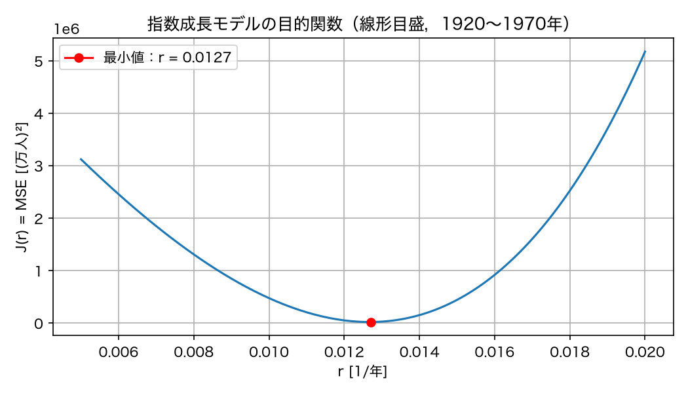

探索範囲の端ではMSEが大きく，最小値付近の曲線は縦方向につぶれて見える．最小値の位置は読み取れるが，その周囲でMSEが何倍になるかを比較しにくい．

**2．対数目盛による比較**

値の比を読み取りやすくするため，`ax.set_yscale("log")`を加えて同じ結果を描き直す．対数目盛では， $10^4$ から $10^5$ への変化と， $10^5$ から $10^6$ への変化が同じ高さの差になる．

強調した行が，目盛の設定を変更する処理である．

```{code-block} python
:linenos:
:emphasize-lines: 4,8
:class: code-focus

fig, ax = plt.subplots(figsize=(7, 4))
ax.plot(r_grid, J_r)
ax.plot(r_grid[i_best], J_r[i_best], marker="o", color="red", label=f"最小値：r = {r_grid[i_best]:.4f}")
ax.set_yscale("log")
ax.set_title("指数成長モデルの目的関数（対数目盛，1920〜1970年）")
ax.set_xlabel("r [1/年]")
ax.set_ylabel("J(r) = MSE [(万人)²]")
ax.grid(True, which="both")
ax.legend()
fig.tight_layout()
fig.savefig(FIGURE_DIR / "error_curve_r.png", dpi=150)
plt.show()
```

- **コードの補足**：`ax.set_yscale("log")`は縦軸を対数目盛にする．`which="both"`は主目盛と補助目盛の両方に格子線を描く．

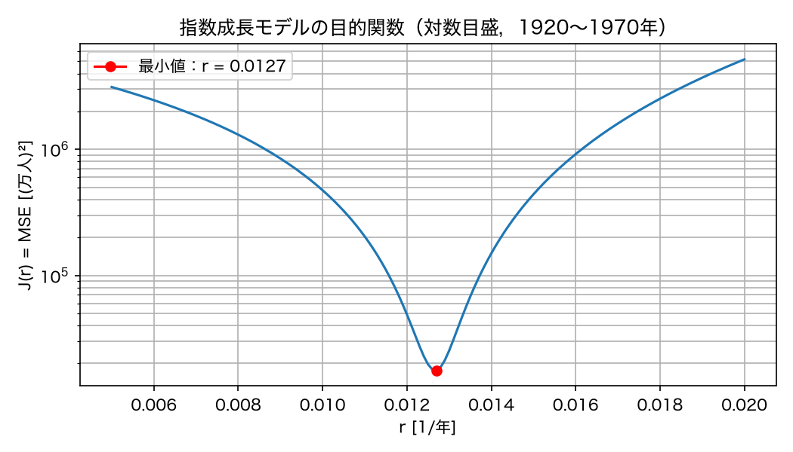

この探索範囲では，目的関数はある $r$ の近傍で最小値をとる．

- **最良のパラメタ**：このノートでは，評価した候補の中で目的関数値が最小となるパラメタを指す．

線形目盛と比べると，最小値付近でMSEが何倍になるかを読み取りやすい．目盛を変更しても，MSEの値と最良の $r$ は変わらない．
最小値の近傍で目的関数の曲率が大きいほど， $r$ の変化に対する目的関数の変化も大きい．推定の不確かさを定量化するには，観測誤差の大きさなども考慮する必要がある．

````{note} 演習1：探索範囲と刻み幅を変える

1. `r_grid`を`np.linspace(0.005, 0.020, 16)`（0.001刻み）に変えて実行せよ．最良の $r$ と最小の $J$ はどう変わるか．刻みが粗いと何が起きるか．
2. `r_grid`を`np.linspace(0.015, 0.030, 151)`に変えて実行せよ．最良の $r$ はどこになるか．この結果を見て $r=0.015$ が探索範囲外も含めた最小化点だと結論してよいか．誤差曲線の形から判断せよ．
3. 探索範囲を決めるとき，どのような点に注意すべきかを`README.md`に2行で記せ．
````

````{visible-answer} 演習1の解答例

**1．刻み幅の変更**

本文の計算コードをコピーし，`r_grid`の定義だけを変更する．

```{code-block} python
:linenos:
:emphasize-lines: 6
:class: code-focus

fit_mask = year_obs <= 1970
t_fit = t_obs[fit_mask]
y_fit = y_obs[fit_mask]

# 探索範囲と刻み幅
r_grid = np.linspace(0.005, 0.020, 16)

J_r = np.zeros_like(r_grid)
for i, r_value in enumerate(r_grid):
    y_hat = exponential_solution(t_fit, N0, r_value)
    J_r[i] = mean_squared_error(y_fit, y_hat)

i_best = np.argmin(J_r)
print(f"格子点の数: {len(r_grid)}")
print(f"最小の J = {J_r[i_best]:.0f} （万人）^2 at r = {r_grid[i_best]:.4f} /年")
```

- **コードの補足**：候補数を151から16に変更し，刻み幅を0.0001から0.001にする．

出力例：

```text
格子点の数: 16
最小の J = 25279 （万人）^2 at r = 0.0130 /年
```

```python
fig, ax = plt.subplots(figsize=(7, 4))
ax.plot(r_grid, J_r)
ax.plot(r_grid[i_best], J_r[i_best], marker="o", color="red", label=f"最小値：r = {r_grid[i_best]:.4f}")
ax.set_yscale("log")
ax.set_title("指数成長モデルの目的関数（刻み幅の変更）")
ax.set_xlabel("r [1/年]")
ax.set_ylabel("J(r) = MSE [(万人)²]")
ax.grid(True, which="both")
ax.legend()
fig.tight_layout()
fig.savefig(FIGURE_DIR / "exercise1_coarse.png", dpi=150)
plt.show()
```

- **コードの補足**：本文の対数目盛の描画コードをそのまま使い，タイトルと保存名を変更する．

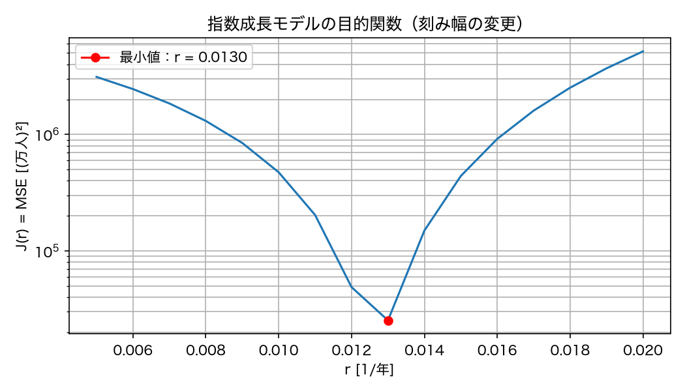

最良の $r$ は本文の0.0127から0.0130に変わり，MSEは17624から25279に増える．刻みを粗くすると，本文で得た最良の値が候補から外れるためである．

**2．探索範囲の変更**

本文の計算コードをコピーし，`r_grid`の定義だけを変更する．

```{code-block} python
:linenos:
:emphasize-lines: 6
:class: code-focus

fit_mask = year_obs <= 1970
t_fit = t_obs[fit_mask]
y_fit = y_obs[fit_mask]

# 探索範囲と刻み幅
r_grid = np.linspace(0.015, 0.030, 151)

J_r = np.zeros_like(r_grid)
for i, r_value in enumerate(r_grid):
    y_hat = exponential_solution(t_fit, N0, r_value)
    J_r[i] = mean_squared_error(y_fit, y_hat)

i_best = np.argmin(J_r)
print(f"格子点の数: {len(r_grid)}")
print(f"最小の J = {J_r[i_best]:.0f} （万人）^2 at r = {r_grid[i_best]:.4f} /年")
```

- **コードの補足**：候補数を151のままにし，探索範囲を0.015〜0.030に変更する．

出力例：

```text
格子点の数: 151
最小の J = 439808 （万人）^2 at r = 0.0150 /年
```

```python
fig, ax = plt.subplots(figsize=(7, 4))
ax.plot(r_grid, J_r)
ax.plot(r_grid[i_best], J_r[i_best], marker="o", color="red", label=f"最小値：r = {r_grid[i_best]:.4f}")
ax.set_yscale("log")
ax.set_title("指数成長モデルの目的関数（探索範囲の変更）")
ax.set_xlabel("r [1/年]")
ax.set_ylabel("J(r) = MSE [(万人)²]")
ax.grid(True, which="both")
ax.legend()
fig.tight_layout()
fig.savefig(FIGURE_DIR / "exercise1_range.png", dpi=150)
plt.show()
```

- **コードの補足**：本文の対数目盛の描画コードをそのまま使い，タイトルと保存名を変更する．

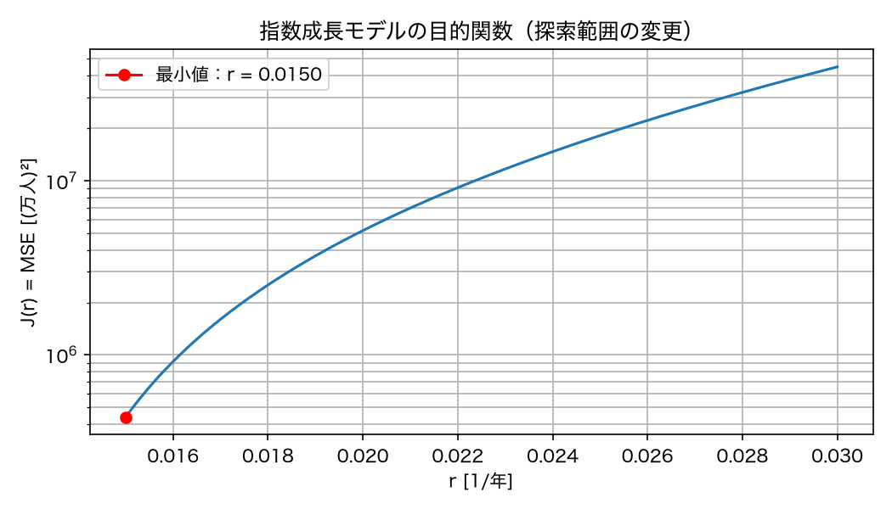

最小値は範囲の下端 $r=0.015$ に現れる．曲線は左へ向かうほど低下しているため，さらに小さい $r$ を調べる必要がある．範囲外も含めた最小化点とは結論できない．

**3．READMEの記入例**

パラメタの意味から妥当な探索範囲を設定し，最小値が端にある場合は範囲を広げて確認する．
刻み幅も変えて結果を比較し，必要な精度に応じて選ぶ．
````

## 2次元のパラメタサーチ

### 探索格子の作成

Logisticモデルの $\theta = (r, K)$ を2次元の格子上で探す．
$r$ の候補と $K$ の候補をそれぞれ配列で用意し，`np.meshgrid`ですべての組み合わせを作る．
まず粗い格子で，`solve_ivp`を使って各候補のMSEを求め，最良の組を選ぶ．

**1．格子探索の実装**

```python
r_coarse = np.linspace(0.01, 0.06, 21)          # 0.0025 刻み
K_coarse = np.linspace(10000.0, 20000.0, 21)    # 500 万人刻み

R_coarse, K_grid_coarse = np.meshgrid(r_coarse, K_coarse)
print("格子の形:", R_coarse.shape, "，格子点の数:", R_coarse.size)

J_coarse = np.zeros_like(R_coarse)

for i in range(R_coarse.shape[0]):
    for j in range(R_coarse.shape[1]):
        sol = solve_ivp(logistic_rhs, (0.0, 100.0), [N0], t_eval=t_obs, args=(R_coarse[i, j], K_grid_coarse[i, j]))
        J_coarse[i, j] = mean_squared_error(y_obs, sol.y[0])

i_min, j_min = np.unravel_index(np.argmin(J_coarse), J_coarse.shape)
print(f"最小の J = {J_coarse[i_min, j_min]:.0f} （万人）^2 at r = {R_coarse[i_min, j_min]:.4f}, K = {K_grid_coarse[i_min, j_min]:.0f}")
```

```{dropdown} コードの補足：格子上の計算

- `np.meshgrid`：2つの候補配列から，同じ形の格子座標を作る．`R_coarse[i, j]`と`K_grid_coarse[i, j]`が同じ格子点の $r$ と $K$ を与える．
- 行と列の対応：行番号`i`が $K$ ，列番号`j`が $r$ に対応し，二重の`for`文で全ての組を計算する．
- `np.unravel_index`：最小値の1次元の位置番号を，格子の行番号と列番号に変換する．
```

出力例（数値解を用いたMSEはライブラリのバージョンなどにより末尾が異なる場合がある）：

```text
格子の形: (21, 21) ，格子点の数: 441
最小の J = 125820 （万人）^2 at r = 0.0275, K = 15000
```

**2．計算時間の測定**

格子点数を増やす場合の所要時間を見積もるため，二重の`for`文の前後で時刻を記録する．上のコードに計測と表示を追加した3行を強調する．`time`は準備節で読み込み済みである．

```{code-block} python
:linenos:
:emphasize-lines: 9,14,17
:class: code-focus

r_coarse = np.linspace(0.01, 0.06, 21)          # 0.0025 刻み
K_coarse = np.linspace(10000.0, 20000.0, 21)    # 500 万人刻み

R_coarse, K_grid_coarse = np.meshgrid(r_coarse, K_coarse)
print("格子の形:", R_coarse.shape, "，格子点の数:", R_coarse.size)

J_coarse = np.zeros_like(R_coarse)

start = time.perf_counter()
for i in range(R_coarse.shape[0]):
    for j in range(R_coarse.shape[1]):
        sol = solve_ivp(logistic_rhs, (0.0, 100.0), [N0], t_eval=t_obs, args=(R_coarse[i, j], K_grid_coarse[i, j]))
        J_coarse[i, j] = mean_squared_error(y_obs, sol.y[0])
elapsed_coarse = time.perf_counter() - start

i_min, j_min = np.unravel_index(np.argmin(J_coarse), J_coarse.shape)
print(f"計算時間: {elapsed_coarse:.2f} 秒（1点あたり {1000 * elapsed_coarse / R_coarse.size:.1f} ミリ秒）")
print(f"最小の J = {J_coarse[i_min, j_min]:.0f} （万人）^2 at r = {R_coarse[i_min, j_min]:.4f}, K = {K_grid_coarse[i_min, j_min]:.0f}")
```

```{dropdown} コードの補足：計算時間の測定

- **`time.perf_counter()`**：経過時間の測定に使う時計の値を秒単位で取得する．計算前の値を`start`に保存する．
- **`elapsed_coarse`**：計算後の時計の値から`start`を引き，全格子点で数値解とMSEを計算する処理の経過時間を求める．
- **1点あたりの時間**：経過時間を格子点数`R_coarse.size`で割る．1000を掛けると秒からミリ秒へ換算できる．
```

出力例（計算時間は実行環境や実行ごとに異なる．数値解を用いたMSEもライブラリのバージョンなどにより末尾が異なる場合がある）：

```text
格子の形: (21, 21) ，格子点の数: 441
計算時間: 0.23 秒（1点あたり 0.5 ミリ秒）
最小の J = 125820 （万人）^2 at r = 0.0275, K = 15000
```

### 細かい格子

次に，同じ範囲を細かい格子で探す．
格子点が約1万点になるので，今回は解析解を使って高速に計算する．
解析解がないモデルでは`solve_ivp`を使うしかなく，計算時間は格子点の数に比例して増える．

```{code-block} python
:linenos:
:emphasize-lines: 1-2,10,17
:class: code-focus

r_fine = np.linspace(0.01, 0.06, 101)           # 0.0005 刻み
K_fine = np.linspace(10000.0, 20000.0, 101)     # 100 万人刻み

R_fine, K_grid_fine = np.meshgrid(r_fine, K_fine)
J_fine = np.zeros_like(R_fine)

start = time.perf_counter()
for i in range(R_fine.shape[0]):
    for j in range(R_fine.shape[1]):
        J_fine[i, j] = objective_logistic((R_fine[i, j], K_grid_fine[i, j]), t_obs, y_obs, N0)
elapsed_fine = time.perf_counter() - start

i_min, j_min = np.unravel_index(np.argmin(J_fine), J_fine.shape)
r_best, K_best = R_fine[i_min, j_min], K_grid_fine[i_min, j_min]
print(f"格子点の数: {R_fine.size}，計算時間: {elapsed_fine:.2f} 秒")
print(f"最小の J = {J_fine[i_min, j_min]:.0f} （万人）^2 at r = {r_best:.4f}, K = {K_best:.0f}")
print(f"参考：粗い格子で solve_ivp を使った場合の1点あたりの時間で見積もると {R_fine.size * elapsed_coarse / R_coarse.size:.0f} 秒かかる")
```

- **コードの補足**：各候補で解析解を使う`objective_logistic`を呼び出す．`R_fine.size`が格子点数であり，1点あたりの計算時間を掛けると全体の所要時間を見積もれる．

出力例（計算時間と所要時間の見積もりは実行環境によって異なる）：

```text
格子点の数: 10201，計算時間: 0.09 秒
最小の J = 115107 （万人）^2 at r = 0.0275, K = 14800
参考：粗い格子で solve_ivp を使った場合の1点あたりの時間で見積もると 5 秒かかる
```

最良の組は $r \approx 0.0275$ ／年， $K \approx 14800$ 万人で， $J$ は約11.5万（万人） $^2$ ，平方根は約340万人である．
第4回で手で見つけた $(0.03, 15000)$ より誤差が半分以下になった．

### ヒートマップの描画

- **ヒートマップ**：値の大きさを色で表した図．ここでは，パラメタの組ごとの $J(r, K)$ を色で表す．

まず， $J$ の値を線形目盛で色に対応させ，最小値の周辺をどの程度区別できるか確認する．

**1．線形目盛での描画**

```python
fig, ax = plt.subplots(figsize=(7, 5))
mesh = ax.pcolormesh(R_fine, K_grid_fine, J_fine, shading="auto", cmap="viridis")
fig.colorbar(mesh, ax=ax, label="J(r, K) = MSE [(万人)²]")
ax.plot(r_best, K_best, marker="x", color="red", markersize=10, label=f"最小値：r = {r_best:.4f}, K = {K_best:.0f}")
ax.plot(0.03, 15000.0, marker="o", color="white", markersize=7, label="第4回の基準値")
ax.set_title("Logisticモデルの目的関数（線形目盛）")
ax.set_xlabel("r [1/年]")
ax.set_ylabel("K [万人]")
ax.legend(loc="upper right")
fig.tight_layout()
fig.savefig(FIGURE_DIR / "heatmap_r_K_linear.png", dpi=150)
plt.show()
```

````{dropdown} コードの補足：ヒートマップの描画

`ax.pcolormesh`で格子上の値を色で表し，`fig.colorbar`で色と値の対応を示す．強調した2行が，これらの処理に対応する．

```{code-block} python
:linenos:
:emphasize-lines: 2-3
:class: code-focus

fig, ax = plt.subplots(figsize=(7, 5))
mesh = ax.pcolormesh(R_fine, K_grid_fine, J_fine, shading="auto", cmap="viridis")
fig.colorbar(mesh, ax=ax, label="J(r, K) = MSE [(万人)²]")
ax.plot(r_best, K_best, marker="x", color="red", markersize=10, label=f"最小値：r = {r_best:.4f}, K = {K_best:.0f}")
ax.plot(0.03, 15000.0, marker="o", color="white", markersize=7, label="第4回の基準値")
ax.set_title("Logisticモデルの目的関数（線形目盛）")
ax.set_xlabel("r [1/年]")
ax.set_ylabel("K [万人]")
ax.legend(loc="upper right")
fig.tight_layout()
fig.savefig(FIGURE_DIR / "heatmap_r_K_linear.png", dpi=150)
plt.show()
```

- **`ax.pcolormesh`**：`R_fine`を横座標，`K_grid_fine`を縦座標とし，各位置の`J_fine`の値を色で表す．
- **`shading="auto"`と`cmap="viridis"`**：前者は座標と値の配列の形に応じて色を配置する方法を選び，後者は低い値から高い値へ紫・緑・黄と変化する配色を指定する．
- **`mesh`と`fig.colorbar`**：`mesh`には描画したヒートマップの情報が入る．これを`fig.colorbar`に渡して，同じ色尺度のカラーバーを作る．`ax=ax`はカラーバーを添える描画領域，`label`はカラーバーの説明を指定する．

標準の線形目盛では，値の差が等しければ色尺度上の間隔も等しい．赤い×印は格子上の最良の組，白い丸印は第4回の基準値を表す．
````

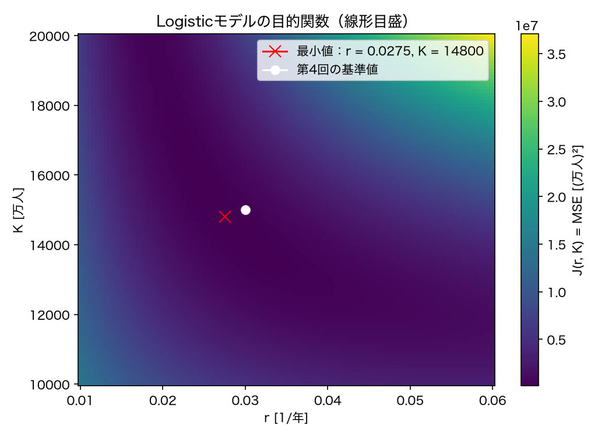

赤い印と白い印の周辺の色を比べると，広い範囲が似た暗い色になり，最小値に近い候補の違いを読み取りにくい．一方，図の右上にある大きな $J$ の違いは目立つ．

**2．色尺度の改善**

候補を比較する際には，最小値付近でMSEが2倍，10倍になる範囲も読み取りたい．そこで，値の差ではなく**値の比**に対応する対数目盛を試す．対数目盛では， $10^5$ から $10^6$ への変化と， $10^6$ から $10^7$ への変化が，色尺度上で同じ間隔になる．

上のコードの`ax.pcolormesh`に`norm=LogNorm()`を追加し，同じ計算結果を描き直す．比較できるように，タイトルと保存名も変更する．

```python
fig, ax = plt.subplots(figsize=(7, 5))
mesh = ax.pcolormesh(R_fine, K_grid_fine, J_fine, norm=LogNorm(), shading="auto", cmap="viridis")
fig.colorbar(mesh, ax=ax, label="J(r, K) = MSE [(万人)²]")
ax.plot(r_best, K_best, marker="x", color="red", markersize=10, label=f"最小値：r = {r_best:.4f}, K = {K_best:.0f}")
ax.plot(0.03, 15000.0, marker="o", color="white", markersize=7, label="第4回の基準値")
ax.set_title("Logisticモデルの目的関数（対数目盛）")
ax.set_xlabel("r [1/年]")
ax.set_ylabel("K [万人]")
ax.legend(loc="upper right")
fig.tight_layout()
fig.savefig(FIGURE_DIR / "heatmap_r_K.png", dpi=150)
plt.show()
```

- **コードの補足**：`LogNorm()`は正の値を対数目盛で色に対応させる．今回の`J_fine`は全て正である．MSEの計算結果や最良の組は変わらず，色の対応だけが変わる．

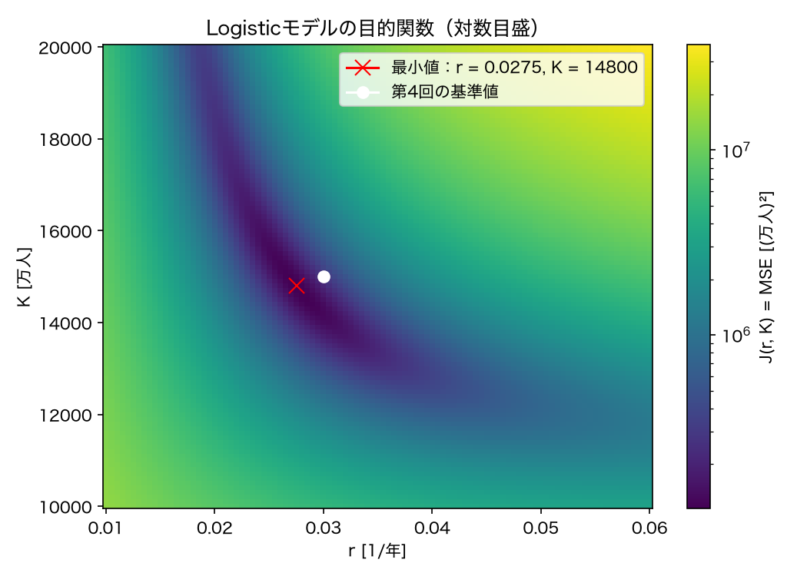

線形目盛の図と比べると，最小値付近の色の変化が読み取りやすくなり，目的関数値の小さい格子点が帯状に分布する領域を確認できる．

- **目的関数の谷**：このノートでは，ヒートマップ上で目的関数値の小さい格子点が帯状に分布する領域を指す．

その中で目的関数値が最小の格子点が，今回の探索で選ばれるパラメタの組である．

### 最良パラメタによる観測値との比較

```python
y_best = predict_logistic((r_best, K_best), t_obs, N0)
print(f"1920年のモデル値: {y_best[0]:.1f} 万人")
print(f"2020年のモデル値: {y_best[-1]:.1f} 万人")
```

- **コードの補足**：`y_best`には観測時刻ごとのモデル値を保存する．`[0]`と`[-1]`で，それぞれ最初と最後の時刻の値を取り出す．

出力例：

```text
1920年のモデル値: 5596.3 万人
2020年のモデル値: 13392.0 万人
```

```python
fig, axes = plt.subplots(2, 1, figsize=(8, 7), sharex=True)
ax = axes[0]
ax.plot(year_obs, y_obs, color="black", marker="o", markersize=3, linestyle="none", label="観測値")
ax.plot(year_obs, y_best, label=f"格子探索（r = {r_best:.4f}, K = {K_best:.0f}）")
ax.plot(year_obs, predict_logistic((0.03, 15000.0), t_obs, N0), linestyle="--", label="第4回の基準値（r = 0.03, K = 15000）")
ax.set_title("格子探索で推定したLogisticモデル")
ax.set_ylabel("人口 [万人]")
ax.grid(True)
ax.legend()

ax = axes[1]
ax.plot(year_obs, y_obs - y_best, marker="o", markersize=2)
ax.axhline(0, color="black", linewidth=0.8)
ax.set_title("残差（観測値−モデル値）")
ax.set_xlabel("年")
ax.set_ylabel("残差 [万人]")
ax.grid(True)
fig.tight_layout()
fig.savefig(FIGURE_DIR / "logistic_grid_best.png", dpi=150)
plt.show()
```

- **コードの補足**：`sharex=True`で上下の図の横軸を共有する．上段は観測値と2通りのモデル値，下段は格子探索で求めたモデルの残差`y_obs - y_best`である．

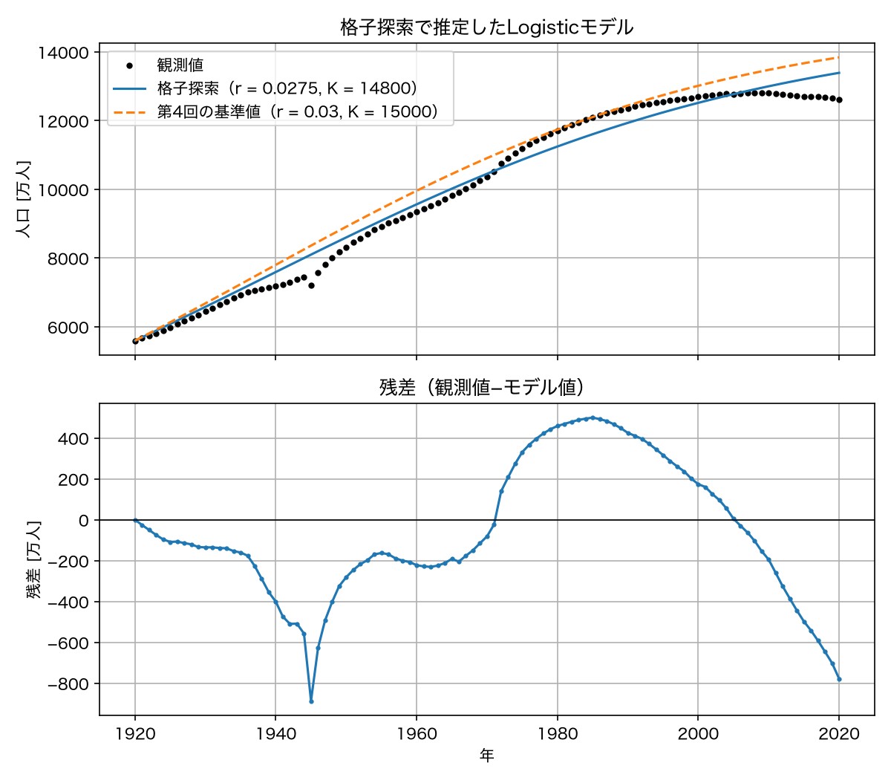

残差は約 $-886$ 〜 $500$ 万人で，1970年代から2000年代前半には正，2010年以降には負の偏りが残る．
格子探索でMSEを小さくしても，期間ごとの偏りは解消していない．特に，定数 $r,K>0$ かつ $0<N_0<K$ のLogisticモデルは人口減少への転換を表せないため，この変化を再現するにはモデルの仮定を見直す必要がある．

````{note} 演習2：格子の刻みと計算量

1. 粗い格子（21×21）と細かい格子（101×101）の探索範囲・最良の組・MSE・計算時間をNotebookに記録せよ．
2. 解析解を用いる細かい格子のコードを，21×21，51×51，101×101で実行せよ．横軸を格子点数，縦軸を計算時間とする図を描き，両者の関係を`README.md`に記せ．本文の`ax.plot`に，記録した格子点数のリストと計算時間のリストを渡せばよい．
3. `solve_ivp`を使った場合の1点あたりの時間から，101×101の格子を`solve_ivp`で計算した場合の時間を見積もれ．パラメタが3つになり，各101点の格子を使ったら何秒になるか．
4. 最良の組の周りだけを細かく探す（例えば $r \in [0.025, 0.030]$ ， $K \in [14000, 16000]$ ）ことで計算量を減らせる．この方法の利点と注意点を1行ずつ記せ．
````

````{visible-answer} 演習2の解答例

**1．本文の探索結果**

探索範囲は $r\in[0.01,0.06]$ ， $K\in[10000,20000]$ である．本文の出力から，数値解による21×21の格子では $(r,K)=(0.0275,15000)$ ，MSEは125820となる．解析解による101×101の格子では $(r,K)=(0.0275,14800)$ ，MSEは115107となる．計算時間は各自の出力を記録する．

**2．格子点数と計算時間の比較**

本文の「細かい格子」のコードをコピーし，候補数を21，51，101に変えて順に実行する．各回の末尾に，格子点数と時間を別の変数に保存する2行を追加する．以下の計算時間は実行例であり，環境や実行ごとに異なる．

**21×21の格子**

```{code-block} python
:linenos:
:emphasize-lines: 1-2,18-19
:class: code-focus

r_fine = np.linspace(0.01, 0.06, 21)
K_fine = np.linspace(10000.0, 20000.0, 21)

R_fine, K_grid_fine = np.meshgrid(r_fine, K_fine)
J_fine = np.zeros_like(R_fine)

start = time.perf_counter()
for i in range(R_fine.shape[0]):
    for j in range(R_fine.shape[1]):
        J_fine[i, j] = objective_logistic((R_fine[i, j], K_grid_fine[i, j]), t_obs, y_obs, N0)
elapsed_fine = time.perf_counter() - start

i_min, j_min = np.unravel_index(np.argmin(J_fine), J_fine.shape)
r_best, K_best = R_fine[i_min, j_min], K_grid_fine[i_min, j_min]
print(f"格子点の数: {R_fine.size}，計算時間: {elapsed_fine:.4f} 秒")
print(f"最小の J = {J_fine[i_min, j_min]:.0f} （万人）^2 at r = {r_best:.4f}, K = {K_best:.0f}")
print(f"参考：粗い格子で solve_ivp を使った場合の1点あたりの時間で見積もると {R_fine.size * elapsed_coarse / R_coarse.size:.2f} 秒かかる")
points_21 = R_fine.size
time_21 = elapsed_fine
```

- **コードの補足**：2つの候補配列の要素数だけを変更し，格子点数を`points_21`，時間を`time_21`に保存する．

出力例：

```text
格子点の数: 441，計算時間: 0.0056 秒
最小の J = 124741 （万人）^2 at r = 0.0275, K = 15000
参考：粗い格子で solve_ivp を使った場合の1点あたりの時間で見積もると 0.17 秒かかる
```

**51×51の格子**

```{code-block} python
:linenos:
:emphasize-lines: 1-2,18-19
:class: code-focus

r_fine = np.linspace(0.01, 0.06, 51)
K_fine = np.linspace(10000.0, 20000.0, 51)

R_fine, K_grid_fine = np.meshgrid(r_fine, K_fine)
J_fine = np.zeros_like(R_fine)

start = time.perf_counter()
for i in range(R_fine.shape[0]):
    for j in range(R_fine.shape[1]):
        J_fine[i, j] = objective_logistic((R_fine[i, j], K_grid_fine[i, j]), t_obs, y_obs, N0)
elapsed_fine = time.perf_counter() - start

i_min, j_min = np.unravel_index(np.argmin(J_fine), J_fine.shape)
r_best, K_best = R_fine[i_min, j_min], K_grid_fine[i_min, j_min]
print(f"格子点の数: {R_fine.size}，計算時間: {elapsed_fine:.4f} 秒")
print(f"最小の J = {J_fine[i_min, j_min]:.0f} （万人）^2 at r = {r_best:.4f}, K = {K_best:.0f}")
print(f"参考：粗い格子で solve_ivp を使った場合の1点あたりの時間で見積もると {R_fine.size * elapsed_coarse / R_coarse.size:.2f} 秒かかる")
points_51 = R_fine.size
time_51 = elapsed_fine
```

- **コードの補足**：2つの候補配列の要素数だけを変更し，格子点数を`points_51`，時間を`time_51`に保存する．

出力例：

```text
格子点の数: 2601，計算時間: 0.0322 秒
最小の J = 115847 （万人）^2 at r = 0.0280, K = 14600
参考：粗い格子で solve_ivp を使った場合の1点あたりの時間で見積もると 0.98 秒かかる
```

**101×101の格子**

```{code-block} python
:linenos:
:emphasize-lines: 18-19
:class: code-focus

r_fine = np.linspace(0.01, 0.06, 101)
K_fine = np.linspace(10000.0, 20000.0, 101)

R_fine, K_grid_fine = np.meshgrid(r_fine, K_fine)
J_fine = np.zeros_like(R_fine)

start = time.perf_counter()
for i in range(R_fine.shape[0]):
    for j in range(R_fine.shape[1]):
        J_fine[i, j] = objective_logistic((R_fine[i, j], K_grid_fine[i, j]), t_obs, y_obs, N0)
elapsed_fine = time.perf_counter() - start

i_min, j_min = np.unravel_index(np.argmin(J_fine), J_fine.shape)
r_best, K_best = R_fine[i_min, j_min], K_grid_fine[i_min, j_min]
print(f"格子点の数: {R_fine.size}，計算時間: {elapsed_fine:.4f} 秒")
print(f"最小の J = {J_fine[i_min, j_min]:.0f} （万人）^2 at r = {r_best:.4f}, K = {K_best:.0f}")
print(f"参考：粗い格子で solve_ivp を使った場合の1点あたりの時間で見積もると {R_fine.size * elapsed_coarse / R_coarse.size:.2f} 秒かかる")
points_101 = R_fine.size
time_101 = elapsed_fine
```

- **コードの補足**：本文と同じ候補数で計算し，格子点数を`points_101`，時間を`time_101`に保存する．

出力例：

```text
格子点の数: 10201，計算時間: 0.1192 秒
最小の J = 115107 （万人）^2 at r = 0.0275, K = 14800
参考：粗い格子で solve_ivp を使った場合の1点あたりの時間で見積もると 3.85 秒かかる
```

```{code-block} python
:linenos:
:emphasize-lines: 1-2,5
:class: code-focus

point_counts = [points_21, points_51, points_101]
elapsed_times = [time_21, time_51, time_101]

fig, ax = plt.subplots(figsize=(7, 4))
ax.plot(point_counts, elapsed_times, marker="o")
ax.set_title("解析解を用いた格子探索の計算時間")
ax.set_xlabel("格子点数")
ax.set_ylabel("計算時間 [秒]")
ax.grid(True)
fig.tight_layout()
fig.savefig(FIGURE_DIR / "exercise2_computation_time.png", dpi=150)
plt.show()
```

- **コードの補足**：保存した値を同じ条件順に並べ，本文の`ax.plot`に渡す．タイトル・軸名・保存名を計算時間の比較に合わせる．

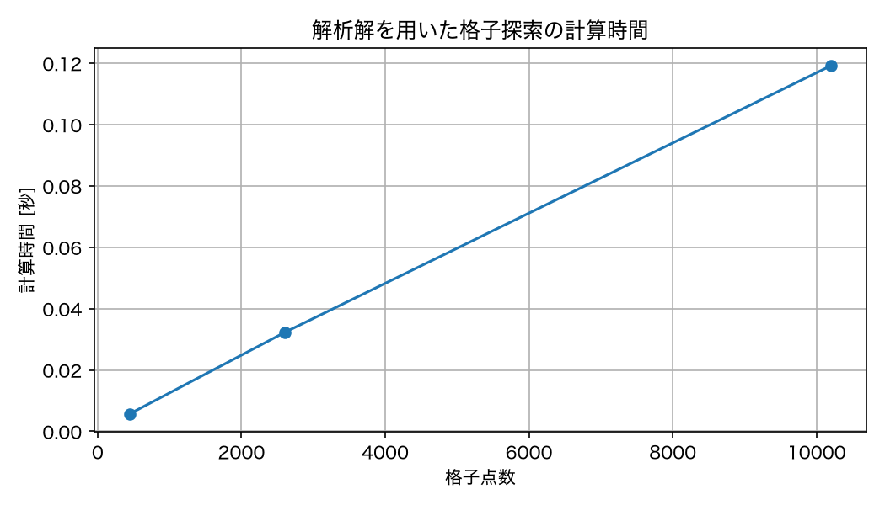

格子点数を増やすと計算時間も概ね増える．各点で同じ計算を繰り返すため計算量は格子点数に比例するが，実測時間には実行時の負荷などによる変動がある．

**3．数値解を用いる場合の時間の見積もり**

```{code-block} python
:linenos:
:emphasize-lines: 1-2
:class: code-focus

print(f"2次元の見積もり：{101**2 * elapsed_coarse / R_coarse.size:.2f} 秒")
print(f"3次元の見積もり：{101**3 * elapsed_coarse / R_coarse.size:.2f} 秒")
```

- **コードの補足**：本文の所要時間の式で，格子点数を`101**2`と`101**3`に置き換える．1点あたりの時間は同じ値を使う．

出力例：

```text
2次元の見積もり：3.85 秒
3次元の見積もり：389.12 秒
```

**4．局所的に細かく探索する方法**

- 利点：全体を細かくするより，少ない格子点で最良の組の周囲を詳しく調べられる．
- 注意点：範囲外にさらに小さいMSEを与える候補がないか，粗い探索結果も確認する．
````

## 探索結果の解釈：谷の形と識別可能性

### 谷が斜めに伸びる意味

ヒートマップの谷は， $r$ と $K$ の軸に沿っているのではなく，斜めに伸びている．
MSEが近いだけでは予測曲線も近いとは限らないため，谷に沿った複数の組で人口推移も比較する．

**1．比較するパラメタとMSE**

最良の組に加え， $K=14000,16000$ 万人それぞれについて，既に計算した格子の同じ $K$ の行でMSEが最小となる $r$ を選ぶ．対応する値は，それぞれ $r=0.0305,0.0240$ である．

```python
theta_compare = [(0.0305, 14000.0), (r_best, K_best), (0.0240, 16000.0)]
y_compare = []
for r_value, K_value in theta_compare:
    y_model = predict_logistic((r_value, K_value), t_obs, N0)
    y_compare.append(y_model)
    J_value = mean_squared_error(y_obs, y_model)
    print(f"r = {r_value:.4f}, K = {K_value:.0f}：MSE = {J_value:.0f} （万人）^2")
```

- **コードの補足**：`theta_compare`に比較する組を並べ，`append`で各組の予測配列を`y_compare`に追加する．MSEの計算には既習の関数を使う．

出力例：

```text
r = 0.0305, K = 14000：MSE = 134608 （万人）^2
r = 0.0275, K = 14800：MSE = 115107 （万人）^2
r = 0.0240, K = 16000：MSE = 145552 （万人）^2
```

**2．予測曲線の比較**

```python
fig, ax = plt.subplots(figsize=(8, 5))
ax.plot(year_obs, y_obs, color="black", marker="o", markersize=3, linestyle="none", label="観測値")
for (r_value, K_value), y_model in zip(theta_compare, y_compare):
    ax.plot(year_obs, y_model, label=f"r = {r_value:.4f}, K = {K_value:.0f}")
ax.set_title("谷に沿ったパラメタの組による人口推移の比較")
ax.set_xlabel("年")
ax.set_ylabel("人口 [万人]")
ax.grid(True)
ax.legend()
fig.tight_layout()
fig.savefig(FIGURE_DIR / "logistic_valley_comparison.png", dpi=150)
plt.show()
```

- **コードの補足**：`zip(theta_compare, y_compare)`でパラメタの組と予測配列を対応させ，同じ図に重ねて描く．

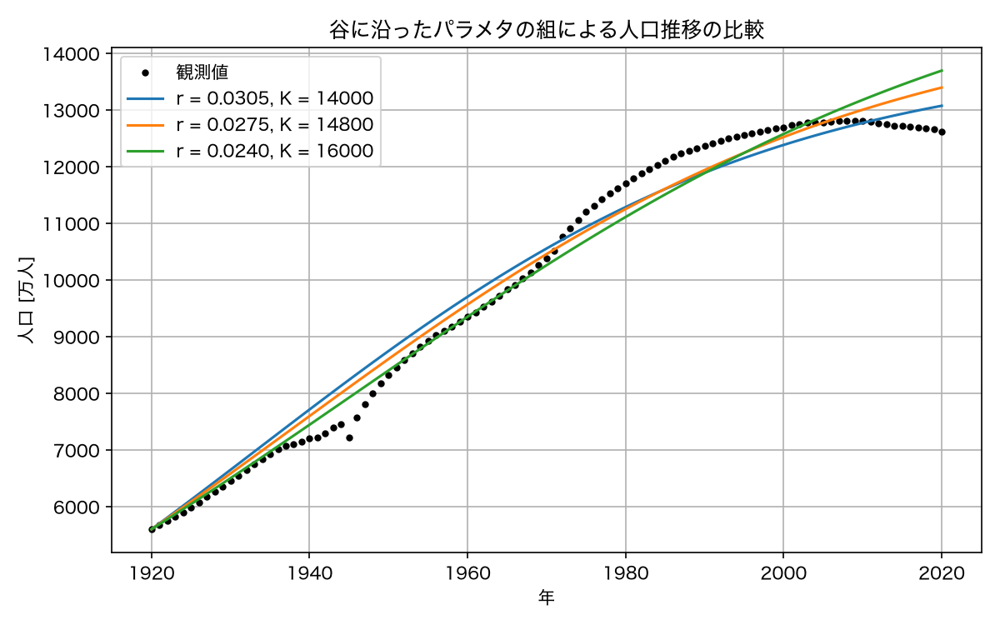

- **曲線の共通点**： $K$ が小さい組では $r$ が大きく， $K$ が大きい組では $r$ が小さい．この組み合わせにより，異なるパラメタでも観測期間の人口推移を近い曲線で表せる．
- **曲線の違い**：期間の後半には差が広がる．この差を観測データから判別できるかは，観測誤差やモデルと現実のずれの大きさにも依存する．

最小値を与える格子点が1つでも，広い範囲のパラメタが近い目的関数値を与える場合，データの小さな変化によって推定値が大きく変わる可能性がある．

- **識別可能性**：異なるパラメタの組をモデルの出力から区別できる性質．
- **実用的な識別可能性**：有限個で誤差を含む観測データから，パラメタを十分な精度で区別できるかという性質．ここでは，この観点から探索結果を検討する．

### 観測期間による目的関数の分布の変化

パラメタを決めるのに1920〜1970年の観測値だけを使った場合の $J$ を計算してみる．
この期間の人口はまだ増え続けており，頭打ちの様子はデータに含まれていない．

```python
fit_mask = year_obs <= 1970
J_fit = np.zeros_like(R_fine)
for i in range(R_fine.shape[0]):
    for j in range(R_fine.shape[1]):
        J_fit[i, j] = objective_logistic((R_fine[i, j], K_grid_fine[i, j]), t_obs[fit_mask], y_obs[fit_mask], N0)

i_fit, j_fit = np.unravel_index(np.argmin(J_fit), J_fit.shape)
r_fit_best, K_fit_best = R_fine[i_fit, j_fit], K_grid_fine[i_fit, j_fit]
print(f"1920〜1970年で探した最良の組: r = {r_fit_best:.4f}, K = {K_fit_best:.0f}, J = {J_fit[i_fit, j_fit]:.0f}")
print(f"K の探索範囲の上端: {K_fine[-1]:.0f}")
```

- **コードの補足**：`fit_mask`を時刻と観測値の両方に適用し，1920〜1970年のデータに対するMSEを計算する．格子を共通にすることで，推定期間の違いを比較できる．

出力例：

```text
1920〜1970年で探した最良の組: r = 0.0200, K = 20000, J = 18501
K の探索範囲の上端: 20000
```

```python
fig, axes = plt.subplots(1, 2, figsize=(12, 4.5))
for ax, J_map, title, (r_m, K_m) in zip(
    axes,
    [J_fine, J_fit],
    ["推定期間：1920〜2020年", "推定期間：1920〜1970年"],
    [(r_best, K_best), (r_fit_best, K_fit_best)],
):
    mesh = ax.pcolormesh(R_fine, K_grid_fine, J_map, norm=LogNorm(), shading="auto", cmap="viridis")
    fig.colorbar(mesh, ax=ax, label="J [(万人)²]")
    ax.plot(r_m, K_m, marker="x", color="red", markersize=10, label=f"最小値：r = {r_m:.4f}, K = {K_m:.0f}")
    ax.set_title(f"目的関数（{title}）")
    ax.set_xlabel("r [1/年]")
    ax.set_ylabel("K [万人]")
    ax.legend(loc="upper right")
fig.tight_layout()
fig.savefig(FIGURE_DIR / "heatmap_period_comparison.png", dpi=150)
plt.show()
```

- **コードの補足**：`zip`で描画先・目的関数の配列・タイトル・最良の組を対応させる．色の尺度は図ごとに設定されるため，MSEの値はそれぞれのカラーバーで確認する．

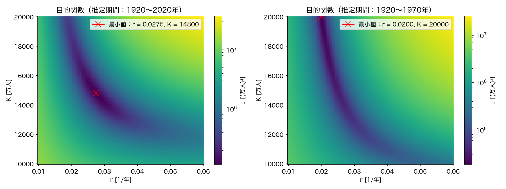

1920〜1970年だけで探すと，目的関数が最小となる $K$ は探索範囲の上端に位置する．
谷は右下から左上へ長く伸び， $K$ を大きくして $r$ を小さくすれば誤差がほとんど変わらないまま，今回調べた範囲では大きな $K$ も同程度の適合度を与える．
飽和に近い状態の観測が少ないため，このデータと探索結果から $K$ の上限を十分に制約することは難しい．
この結果は $K$ の実用的な識別可能性の不足を示すが，モデルの構造上 $K$ を識別できないことの証明ではない．

第3回の指数成長モデルの外挿誤差は，一定の増加率という仮定の限界を示した．Logisticモデルに拡張しても，推定期間に飽和に近い観測が少なければ $K$ の不確かさが大きく，長期予測も不確かになる．

**低誤差領域の比較基準**

演習では，格子上の最小値を $J_{\min}$ とし， $J\leq 2J_{\min}$ となる候補を低誤差領域として比較する．2倍という値は，谷の広がりを観察するための便宜的な基準であり，この領域は統計的な信頼区間を表すものではない．

$r$ と $K$ は単位が異なるため，次の相対的な幅で比較する．

- **相対的な幅**：低誤差領域における各パラメタの範囲の幅を，最良の推定値で割った量．

$$
w_r=\frac{r_{\max}-r_{\min}}{r_{\mathrm{best}}},\qquad
w_K=\frac{K_{\max}-K_{\min}}{K_{\mathrm{best}}}
$$

ここで $r_{\min},r_{\max},K_{\min},K_{\max}$ は，低誤差領域に含まれる候補の各パラメタの最小値・最大値である．相対的な幅が小さい方を，この基準では相対的に狭く絞られるパラメタと判断する．

````{note} 演習3：谷の形を読む

1. 全期間で探した左の図で， $J\leq 2J_{\min}$ となる領域の $r$ と $K$ の範囲をおおまかに読み取れ．それぞれの相対的な幅 $w_r,w_K$ を求め，この基準で相対的に狭く絞られるパラメタを理由とともに`README.md`に記せ．
2. 1920〜1970年で探した右の図で， $K$ の探索範囲を`np.linspace(10000.0, 50000.0, 101)`に広げて実行せよ．最良の $K$ はどうなるか．
3. 1970年までのデータからLogisticモデルの環境収容力を推定するよう求められたら，どう答えるべきか．数値を1つ答えるのが適切かどうかを含めて，2〜3行で記せ．
````

````{visible-answer} 演習3の解答例

**1．低誤差領域の比較**

全期間の図から $r$ の範囲を約0.021〜0.036， $K$ の範囲を約13200〜17800と読み取る．以下のコードの前半で，相対的な幅を計算する．

**2．探索範囲の拡張**

本文の期間別の計算と同じ手順で， $K$ の上端を50000に変更する．全期間の結果を残すため，拡張後の配列には `_wide` を付ける．

```{code-block} python
:linenos:
:emphasize-lines: 1-3,5
:class: code-focus

print(f"低誤差領域の上限：{2 * np.min(J_fine):.0f} （万人）^2")
print(f"図から求めた r の相対的な幅：{(0.036 - 0.021) / r_best:.2f}")
print(f"図から求めた K の相対的な幅：{(17800 - 13200) / K_best:.2f}")

K_wide = np.linspace(10000.0, 50000.0, 101)
R_wide, K_grid_wide = np.meshgrid(r_fine, K_wide)
J_wide = np.zeros_like(R_wide)
fit_mask = year_obs <= 1970
for i in range(R_wide.shape[0]):
    for j in range(R_wide.shape[1]):
        J_wide[i, j] = objective_logistic(
            (R_wide[i, j], K_grid_wide[i, j]), t_obs[fit_mask], y_obs[fit_mask], N0
        )
i_wide, j_wide = np.unravel_index(np.argmin(J_wide), J_wide.shape)
print(f"拡張後の最良の組：r = {R_wide[i_wide, j_wide]:.4f}，"
      f"K = {K_grid_wide[i_wide, j_wide]:.0f}，MSE = {J_wide[i_wide, j_wide]:.0f}")
```

- **コードの補足**：前半は図から読み取った範囲の幅を最良の推定値で割る．後半は `K_wide` から格子を作り直し，1970年までのデータに対するMSEを計算する．

出力例：

```text
低誤差領域の上限：230214 （万人）^2
図から求めた r の相対的な幅：0.55
図から求めた K の相対的な幅：0.31
拡張後の最良の組：r = 0.0160，K = 35200，MSE = 14926
```

相対的な幅は $r$ が約0.55， $K$ が約0.31なので，この基準では $K$ の方が相対的に狭く絞られる．図からの読み取りには多少の幅があり，格子の値から得た $r$ の上端0.0355を使う場合は約0.53となる．

```python
fig, ax = plt.subplots(figsize=(7, 5))
mesh = ax.pcolormesh(R_wide, K_grid_wide, J_wide, norm=LogNorm(), shading="auto", cmap="viridis")
fig.colorbar(mesh, ax=ax, label="MSE [(万人)²]")
ax.plot(R_wide[i_wide, j_wide], K_grid_wide[i_wide, j_wide],
        marker="x", color="red", markersize=10, label="格子上の最小値")
ax.set_title("探索範囲を拡張した目的関数（1920〜1970年）")
ax.set_xlabel("r [1/年]")
ax.set_ylabel("K [万人]")
ax.legend()
fig.tight_layout()
fig.savefig(FIGURE_DIR / "exercise3_expanded_heatmap.png", dpi=150)
plt.show()
```

- **コードの補足**：本文のヒートマップに拡張後の格子とMSEを渡し，その格子上の最良の組を赤い印で示す．

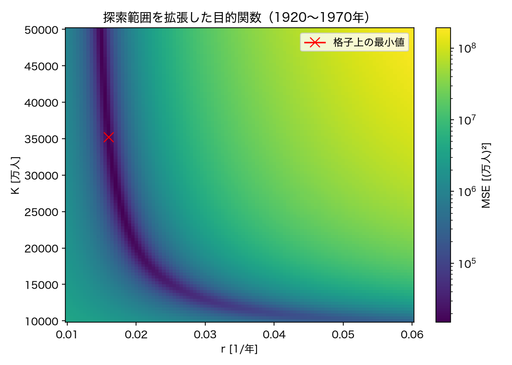

最良の組は $r=0.0160$ ， $K=35200$ となり，最小値は拡張後の範囲の内側に現れる．元の範囲の上端 $K=20000$ は，今回の探索での最小化点ではなかった．一方，低誤差領域は大きな $K$ の側へ広がっており，最小値の位置だけでは推定精度を判断できない．

**3．READMEの記入例**

今回の格子探索では $K=35200$ 万人を得たが，1970年までのデータには飽和に近い観測が少なく，幅広い $K$ が近い適合度を与える．
単一の値だけで精度が高いと判断せず，低誤差領域の広がりや複数の候補による予測を併せて示す．
````

## 探索範囲，刻み幅，計算量

パラメタサーチを設計するとき，次の3つを決める必要がある．

| 決めること | 選び方 | 失敗したときの症状 |
| --- | --- | --- |
| 探索範囲 | パラメタの意味から妥当な範囲をとる | 最小値が範囲の端に現れる |
| 刻み幅 | 必要な精度に合わせる | 最良の値が格子に丸められる |
| 計算時間 | 格子点の数 × 1点あたりの平均計算時間 | 利用可能な計算時間を超える |

格子点の数は，パラメタの数 $p$ と各パラメタの刻み数 $m$ に対して $m^p$ になる．
$m = 101$ なら， $p = 1$ で101点， $p = 2$ で約1万点， $p = 3$ で約100万点， $p = 4$ で約1億点である．
`solve_ivp`で1点あたり1ミリ秒かかるとすれば， $p = 3$ で約17分， $p = 4$ では1日以上かかる．今回のように解析解が使える場合でも， $p = 4$ では数十分かかる．
この刻み数と評価時間では，4パラメタの格子探索は講義時間内に完了しない．実行可能性はパラメタ数だけでなく，格子点数と1点あたりの計算時間に依存する．

計算量を減らす工夫はいくつかある．

- 粗い格子で谷のおおまかな位置を見つけ，その周りだけを細かい格子で探す
- 解析解や近似式があれば，`solve_ivp`の代わりに使う
- 採用した仮定と整合しない範囲を除く．例えば正の内的自然増加率で人口増加を表す場合は $r>0$ ， $K>N_0$ に制限する． $K<N_0$ は減少を表す場合には意味を持つ

しかし，根本的には全格子点で目的関数を評価する方針そのものに限界がある．

## モデルの限界と改善の問い

パラメタサーチでは，指定した範囲と刻み幅における目的関数の分布を確認できる．
谷の形から，パラメタの決まりやすさや，パラメタどうしの関係が分かる．
しかし，次の限界がある．

- 格子点の数がパラメタの数に対して爆発的に増える
- 刻み幅より細かい精度では値が決まらない
- 谷の形が分かるのは，範囲と刻みを適切に選べた場合に限られる

ヒートマップを見ると，谷の底に向かって色が滑らかに暗くなっている．
局所的な目的関数の変化を利用してパラメタを逐次更新すれば，全格子点を評価せずに極小値を探索できる．
ただし，得られる点が探索範囲全体の最小値を与えるとは限らず，探索の初期値や停止条件にも依存する．

```{tip} 第7回への問い
コンピュータに， $J(\theta)$ が最小になる $\theta$ を効率的に探させるには，どうすればよいか．
```

これが第7回で扱う**数値最適化**である．
第7回では，残差とそのパラメタに対する変化を利用する最小二乗法の数値最適化を扱う．
その前に第6回では，人口とは別の題材，河川流量とダム貯水量に移り，観測データを入力として使うモデルを学ぶ．

## まとめ

- 目的関数：観測値とモデル値の差をMSEにまとめ，候補を比較する．
- 格子探索：1次元では誤差曲線，2次元ではヒートマップから，格子上の最小値とパラメタの関係を読む．
- 推定の限界：結果は探索範囲・刻み幅・観測期間に依存し，パラメタ数が増えると計算量も増える．
- 次回：河川流量とダム貯水量を題材に，保存則と観測データを外部入力とするモデルを扱う．格子探索は第7回の数値最適化につながる．

```{dropdown} 復習用の確認事項

1. 目的関数 $J(\theta)$ とは何か．観測値・予測値・残差という用語を使って説明せよ．
2. ヒートマップの谷が斜めに細長く伸びていることは， $r$ と $K$ についてどのような事実を表しているか．
3. 今回の1920〜1970年の観測値による探索では， $K$ を十分な精度で推定できなかった．その理由を，データに含まれている情報という観点から説明せよ．
4. 格子探索はなぜパラメタが増えると使えなくなるのか．また，ヒートマップの形は，代わりにどのような探し方ができそうだと示唆しているか．
```

## 課題

````{warning} 課題1：ヒートマップと最良パラメタでの当てはめ図

1. 全期間の観測値に対する $J(r, K)$ のヒートマップを，最良の組と第4回で手で選んだ組を印で示して作成し，`reports/figures/`に保存せよ．
2. 最良の組でのモデルと観測値を重ねた図，および残差の図を作成して保存せよ．
3. 最良の組の周囲をさらに細かく探索し，細かい格子での結果とMSEを比較せよ．Notebookに比較図を示し，採用した探索範囲・刻み幅・最良の組・MSEを`README.md`の「探索の記録」に記せ．
4. 最良の組の $K \approx 14800$ 万人は，日本の人口の実際の最大値（約12800万人）より2000万人大きい．この推定値が実際の資源制約による環境収容力を表すと解釈することの妥当性を，第4回の演習3を踏まえて100字程度で記せ．
````

````{visible-answer} 課題1の解答例

**1．全期間のヒートマップ**

本文の「細かい格子」の計算を再実行し，全期間・元の探索範囲での `J_fine`，`r_best`，`K_best` を用意する．

```python
r_fine = np.linspace(0.01, 0.06, 101)           # 0.0005 刻み
K_fine = np.linspace(10000.0, 20000.0, 101)     # 100 万人刻み

R_fine, K_grid_fine = np.meshgrid(r_fine, K_fine)
J_fine = np.zeros_like(R_fine)

start = time.perf_counter()
for i in range(R_fine.shape[0]):
    for j in range(R_fine.shape[1]):
        J_fine[i, j] = objective_logistic((R_fine[i, j], K_grid_fine[i, j]), t_obs, y_obs, N0)
elapsed_fine = time.perf_counter() - start

i_min, j_min = np.unravel_index(np.argmin(J_fine), J_fine.shape)
r_best, K_best = R_fine[i_min, j_min], K_grid_fine[i_min, j_min]
print(f"格子点の数: {R_fine.size}，計算時間: {elapsed_fine:.2f} 秒")
print(f"最小の J = {J_fine[i_min, j_min]:.0f} （万人）^2 at r = {r_best:.4f}, K = {K_best:.0f}")
print(f"参考：粗い格子で solve_ivp を使った場合の1点あたりの時間で見積もると {R_fine.size * elapsed_coarse / R_coarse.size:.0f} 秒かかる")
```

- **コードの補足**：本文と同じ探索範囲と刻み幅を使う．設問3の局所探索と比較するため，この結果を残す．

出力例（計算時間は実行環境や実行ごとに異なる）：

```text
格子点の数: 10201，計算時間: 0.08 秒
最小の J = 115107 （万人）^2 at r = 0.0275, K = 14800
参考：粗い格子で solve_ivp を使った場合の1点あたりの時間で見積もると 4 秒かかる
```

```python
fig, ax = plt.subplots(figsize=(7, 5))
mesh = ax.pcolormesh(R_fine, K_grid_fine, J_fine, norm=LogNorm(), shading="auto", cmap="viridis")
fig.colorbar(mesh, ax=ax, label="J(r, K) = MSE [(万人)²]")
ax.plot(r_best, K_best, marker="x", color="red", markersize=10, label=f"最小値：r = {r_best:.4f}, K = {K_best:.0f}")
ax.plot(0.03, 15000.0, marker="o", color="white", markersize=7, label="第4回の基準値")
ax.set_title("Logisticモデルの目的関数（対数目盛）")
ax.set_xlabel("r [1/年]")
ax.set_ylabel("K [万人]")
ax.legend(loc="upper right")
fig.tight_layout()
fig.savefig(FIGURE_DIR / "heatmap_r_K.png", dpi=150)
plt.show()
```

- **コードの補足**：本文のヒートマップのコードを再利用する．赤い×印が格子上の最良の組，白い丸印が第4回の基準値である．


最良の組は $(r,K)=(0.0275,14800)$ となる．第4回の基準値 $(0.03,15000)$ より，MSEの小さい領域に位置している．

**2．観測値・モデル値と残差の比較**

```python
y_best = predict_logistic((r_best, K_best), t_obs, N0)
print(f"1920年のモデル値: {y_best[0]:.1f} 万人")
print(f"2020年のモデル値: {y_best[-1]:.1f} 万人")
```

- **コードの補足**：本文と同じ `predict_logistic` で，最良の組に対する観測時刻ごとのモデル値を計算する．

出力例：

```text
1920年のモデル値: 5596.3 万人
2020年のモデル値: 13392.0 万人
```

```python
fig, axes = plt.subplots(2, 1, figsize=(8, 7), sharex=True)
ax = axes[0]
ax.plot(year_obs, y_obs, color="black", marker="o", markersize=3, linestyle="none", label="観測値")
ax.plot(year_obs, y_best, label=f"格子探索（r = {r_best:.4f}, K = {K_best:.0f}）")
ax.plot(year_obs, predict_logistic((0.03, 15000.0), t_obs, N0), linestyle="--", label="第4回の基準値（r = 0.03, K = 15000）")
ax.set_title("格子探索で推定したLogisticモデル")
ax.set_ylabel("人口 [万人]")
ax.grid(True)
ax.legend()

ax = axes[1]
ax.plot(year_obs, y_obs - y_best, marker="o", markersize=2)
ax.axhline(0, color="black", linewidth=0.8)
ax.set_title("残差（観測値−モデル値）")
ax.set_xlabel("年")
ax.set_ylabel("残差 [万人]")
ax.grid(True)
fig.tight_layout()
fig.savefig(FIGURE_DIR / "logistic_grid_best.png", dpi=150)
plt.show()
```

- **コードの補足**：本文の比較図を再利用する．上段に観測値とモデル値，下段に観測値からモデル値を引いた残差を描く．


1970年代から2000年代前半には残差が正，2010年以降には負となる傾向が残る．最良の組でも，人口減少への転換は再現できていない．

**3．局所探索との比較**

本文の細かい格子の計算をコピーし，範囲を $r\in[0.025,0.030]$ ， $K\in[14000,16000]$ に狭める．各101点とすることで，刻み幅はそれぞれ0.00005と20万人になる．比較用に元の結果を残すため，局所探索の変数には `local` を付ける．

```{code-block} python
:linenos:
:emphasize-lines: 1-2,18
:class: code-focus

r_local = np.linspace(0.025, 0.030, 101)
K_local = np.linspace(14000.0, 16000.0, 101)

R_local, K_grid_local = np.meshgrid(r_local, K_local)
J_local = np.zeros_like(R_local)

start = time.perf_counter()
for i in range(R_local.shape[0]):
    for j in range(R_local.shape[1]):
        J_local[i, j] = objective_logistic((R_local[i, j], K_grid_local[i, j]), t_obs, y_obs, N0)
elapsed_local = time.perf_counter() - start

i_min, j_min = np.unravel_index(np.argmin(J_local), J_local.shape)
r_local_best, K_local_best = R_local[i_min, j_min], K_grid_local[i_min, j_min]
print(f"格子点の数: {R_local.size}，計算時間: {elapsed_local:.2f} 秒")
print(f"局所探索：r = {r_local_best:.5f}, K = {K_local_best:.0f}, MSE = {J_local[i_min, j_min]:.2f}")
print(f"本文の細かい格子：r = {r_best:.5f}, K = {K_best:.0f}, MSE = {np.min(J_fine):.2f}")
print(f"MSEの減少量：{np.min(J_fine) - J_local[i_min, j_min]:.2f}")
```

- **コードの補足**：候補の範囲を狭める部分と，MSEの減少量を計算する部分を強調している．二重の `for` 文で各候補のMSEを求める手順は本文と同じである．

出力例（計算時間は実行環境や実行ごとに異なる）：

```text
格子点の数: 10201，計算時間: 0.08 秒
局所探索：r = 0.02765, K = 14740, MSE = 115002.87
本文の細かい格子：r = 0.02750, K = 14800, MSE = 115107.14
MSEの減少量：104.27
```

```python
y_local = predict_logistic((r_local_best, K_local_best), t_obs, N0)
print(f"局所探索による2020年のモデル値: {y_local[-1]:.1f} 万人")
```

- **コードの補足**：本文と同じ方法で，局所探索による最良の組からモデル値を計算する．

出力例：

```text
局所探索による2020年のモデル値: 13364.8 万人
```

```{code-block} python
:linenos:
:emphasize-lines: 13
:class: code-focus

fig, axes = plt.subplots(2, 1, figsize=(8, 7), sharex=True)
ax = axes[0]
ax.plot(year_obs, y_obs, color="black", marker="o", markersize=3, linestyle="none", label="観測値")
ax.plot(year_obs, y_best, label="本文の細かい格子")
ax.plot(year_obs, y_local, linestyle="--", label="局所探索")
ax.set_title("探索範囲・刻み幅によるモデル値の比較")
ax.set_ylabel("人口 [万人]")
ax.grid(True)
ax.legend()

ax = axes[1]
ax.plot(year_obs, y_obs - y_best, label="本文の細かい格子")
ax.plot(year_obs, y_obs - y_local, linestyle="--", label="局所探索")
ax.axhline(0, color="black", linewidth=0.8)
ax.set_title("残差（観測値−モデル値）")
ax.set_xlabel("年")
ax.set_ylabel("残差 [万人]")
ax.grid(True)
ax.legend()
fig.tight_layout()
fig.savefig(FIGURE_DIR / "assignment1_local_comparison.png", dpi=150)
plt.show()
```

- **コードの補足**：本文の上下2段の比較図を再利用し，上段の比較対象を局所探索のモデル値に置き換える．下段には局所探索の残差を追加し，元の残差と重ねる．

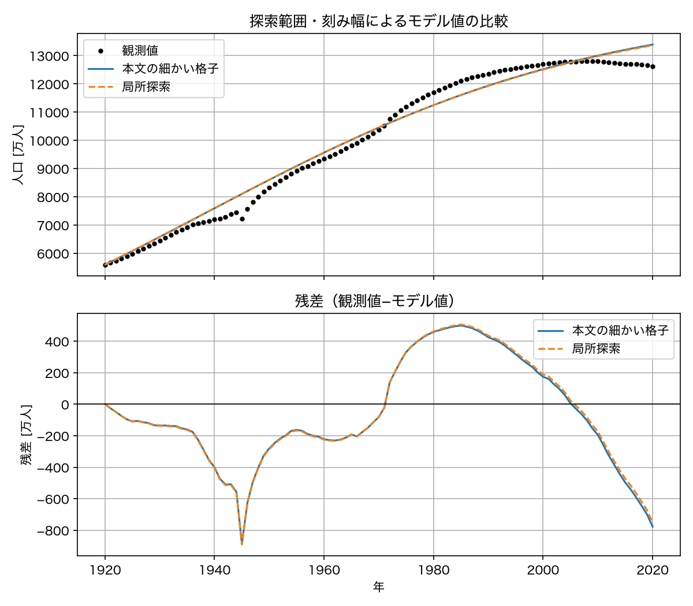

MSEは約104.27小さくなるが，減少率は約0.09%であり，2つのモデル曲線と残差はほぼ重なる．格子を細かくしても，年代ごとの残差の偏りはほとんど変わらない．

**READMEの探索記録の例**

- 探索範囲： $r\in[0.025,0.030]$ ， $K\in[14000,16000]$ ．
- 刻み幅： $r$ は0.00005， $K$ は20万人．
- 最良の組： $(r,K)=(0.02765,14740)$ ．
- MSE：115002.87（万人） $^2$ ．本文の細かい格子の115107.14（万人） $^2$ より約104.27小さい．

**4．環境収容力の解釈の例**

推定した $K$ は人口推移への当てはまりから得た値であり，資源制約の測定値ではない．環境収容力と解釈するには，食料供給・輸入や居住可能面積などの資料と照合し，人口を制限する仕組みを検証する必要がある．
````

````{warning} 課題2：識別可能性についての考察

1920〜1970年の観測値だけで探したヒートマップを使って，次の問いに200字程度で答えよ．

このヒートマップから，1970年までのデータでは $K$ を十分な精度で推定できないことが示唆された．
それにもかかわらず，第3回の課題1では1950年までのデータで2020年の人口を予測した．
パラメタが識別できない状況で予測を示すとき，何を一緒に示すべきか．
単一の予測値のみを示すことの問題点と，代わりにできることを述べよ．
````

```{visible-answer} 課題2の解答例

1970年までのデータには飽和に近い観測が少なく，異なる $r,K$ の組が近い適合度を与えるため，単一の予測値は不確かさを伝えにくい．推定期間・探索範囲・モデルの仮定を明記し，低誤差領域の複数の組による予測曲線を示す．示した予測の幅は統計的な信頼区間とは区別する．第3回の2020年予測は，観測値との比較により事後的に検証できる．未観測の将来への予測では，同様の検証がまだできないため，仮定の妥当性も併せて検討する．
```

### 提出先・期限

- 提出場所：WebClass「第5回課題」
- 提出物：
  - `README.md`
  - Notebookファイル`parameter_sweep.ipynb`
- 提出期限：2026年10月31日(土)23:59

(supplement-lp-error)=
## 補足：残差の大きさと ℓᵖ 空間

### ℓᵖ 空間の定義

- **$\ell^p$ 空間**：実数 $1\leq p<\infty$ に対して，絶対値の $p$ 乗の和が有限となる実数列全体に，以下のノルムを備えた空間．

$$
\ell^p=\left\{a=(a_i)_{i=1}^{\infty}\;\middle|\;a_i\in\mathbb{R},\ \sum_{i=1}^{\infty}|a_i|^p<\infty\right\}
$$

- **$\ell^p$ ノルム**：数列 $a\in\ell^p$ の大きさを測る量．

$$
\|a\|_p=\left(\sum_{i=1}^{\infty}|a_i|^p\right)^{1/p}
$$

- **$\ell^\infty$ 空間**：有界な実数列全体に，ノルム $\|a\|_\infty=\sup_{i\geq1}|a_i|$ を備えた空間． $\sup$ は上限を表す．

今回の観測データは有限個なので，以下では有限次元の $\ell_n^p$ を用いる．これは，ベクトル $(a_1,\ldots,a_n)$ の後ろに0を並べた数列として，上の定義と対応させられる．

### 残差ベクトルとノルム

- **残差ベクトル**：各観測時刻の残差 $e_i=y_i-\hat{y}(t_i;\theta)$ を並べたベクトル $e=(e_1,\ldots,e_n)\in\mathbb{R}^n$ ．

誤差指標の選択は，このベクトルの大きさをどう測るかという問題として捉えられる．有限個の残差に対するノルムは，実数 $1\leq p<\infty$ および $p=\infty$ に対して，それぞれ次のようになる．

$$
\|e\|_p=\left(\sum_{i=1}^n|e_i|^p\right)^{1/p},
\qquad
\|e\|_\infty=\max_{1\leq i\leq n}|e_i|.
$$

- **有限次元の $\ell_n^p$ 空間**：上のノルムを備えた $\mathbb{R}^n$ ．
- **$\ell^p$ 誤差**：観測値のベクトルとモデル値のベクトルの距離 $\|e\|_p$ ．

### 既習の誤差指標との対応

| ノルム | 残差のまとめ方 | 対応する誤差指標 |
| --- | --- | --- |
| $\ell^1$ | 絶対値を足す | 平均絶対誤差： $\mathrm{MAE}=\|e\|_1/n$ |
| $\ell^2$ | 二乗和の平方根をとる | $\mathrm{RMSE}=\|e\|_2/\sqrt{n}$ ， $\mathrm{MSE}=\|e\|_2^2/n$ |
| $\ell^\infty$ | 絶対値の最大値をとる | 最大絶対誤差： $\|e\|_\infty$ |

- **絶対値と二乗の違い**：1つの残差が2倍になると，絶対値の和への寄与は2倍，二乗和への寄与は4倍になる．二乗和は，大きな残差をより重く評価する．
- **今回の目的関数**： $J(\theta)=\|e(\theta)\|_2^2/n$ である．同じ観測データを使う場合， $n$ は一定なので，MSE・RMSE・ $\ell^2$ 誤差を最小にするパラメタの組は一致する．MSEそのものはノルムではなく，ノルムの二乗を平均した量である．

## 自主学習用の発展課題

任意で取り組み，結果をNotebookに追記せよ．

### 初期値を含むパラメタ推定

これまで初期値 $N_0$ は1920年の観測値に固定していた．
観測値にも誤差があるので， $N_0$ もパラメタとみなして $\theta = (r, K, N_0)$ の3次元で探すことができる．

````{note} 発展課題：初期値もパラメタにする

1. $N_0$ の候補を`np.linspace(5400.0, 5800.0, 21)`とし， $r$ と $K$ の格子を21×21にして，三重の`for`文で $J$ を計算する（格子点は9261点）．計算時間を測定せよ．
2. 最良の組の $r$ ， $K$ は，2次元で探した結果とどれだけ変わるか．
3. 同じ刻み数で101点ずつにした場合の計算時間を見積もれ．
4. パラメタを1つ増やすことで得られるものと失うものを，1行ずつ記せ．
````
