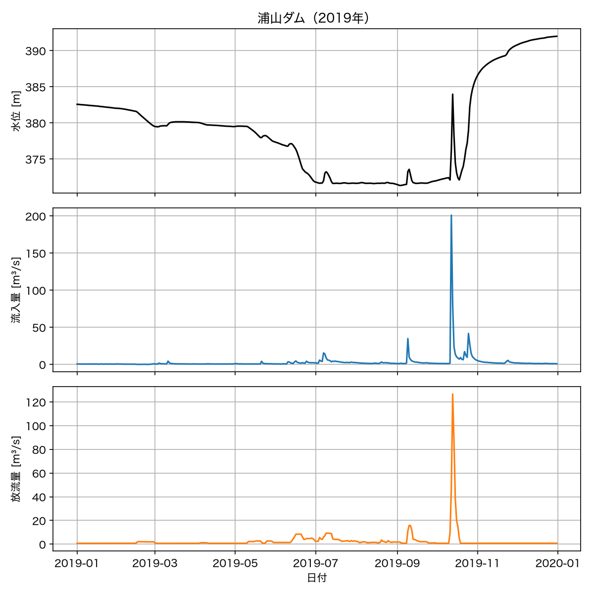
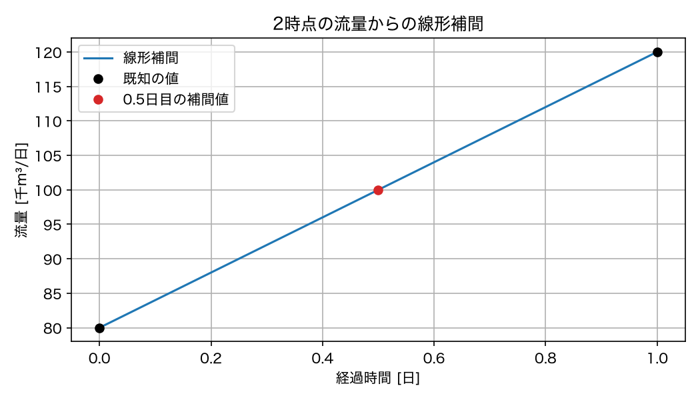
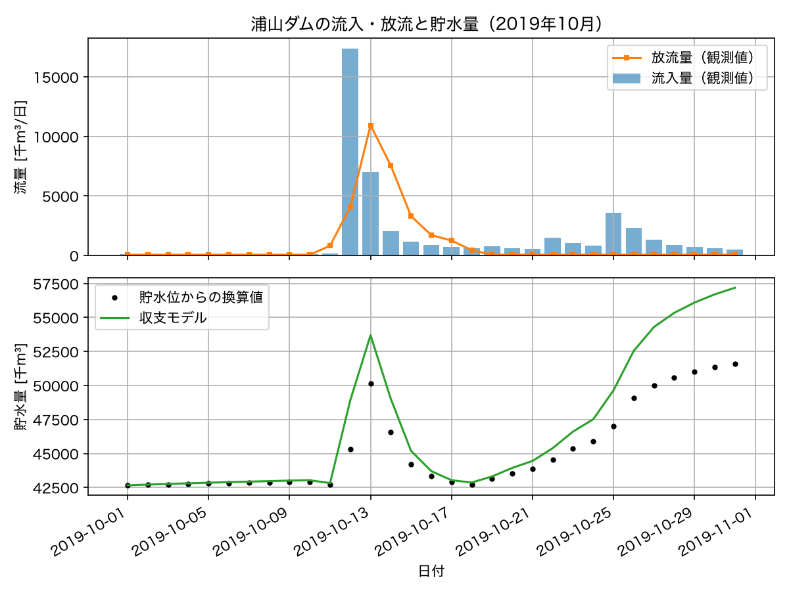
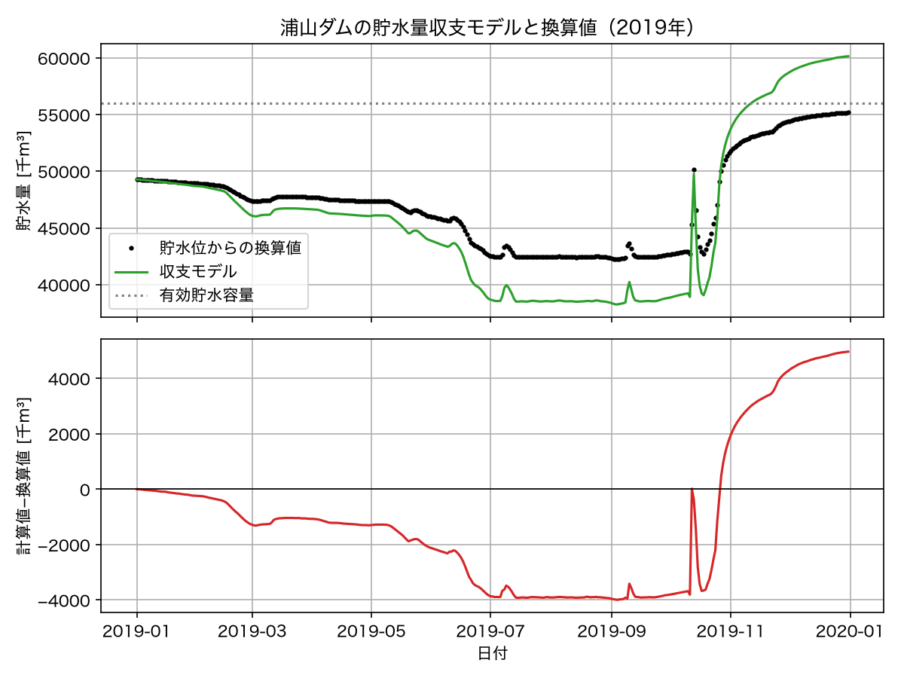
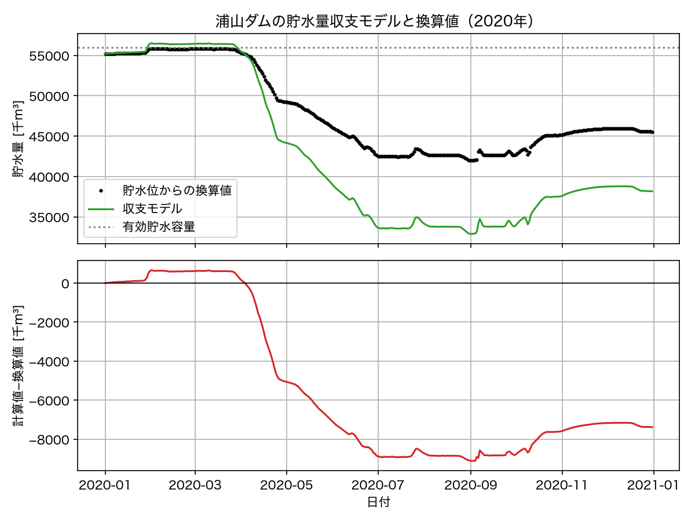
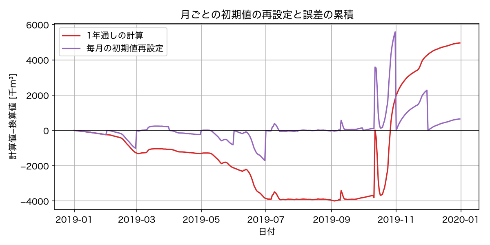
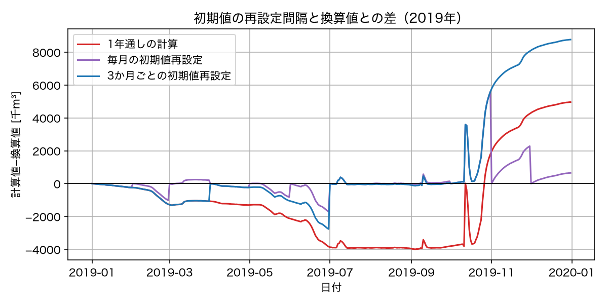
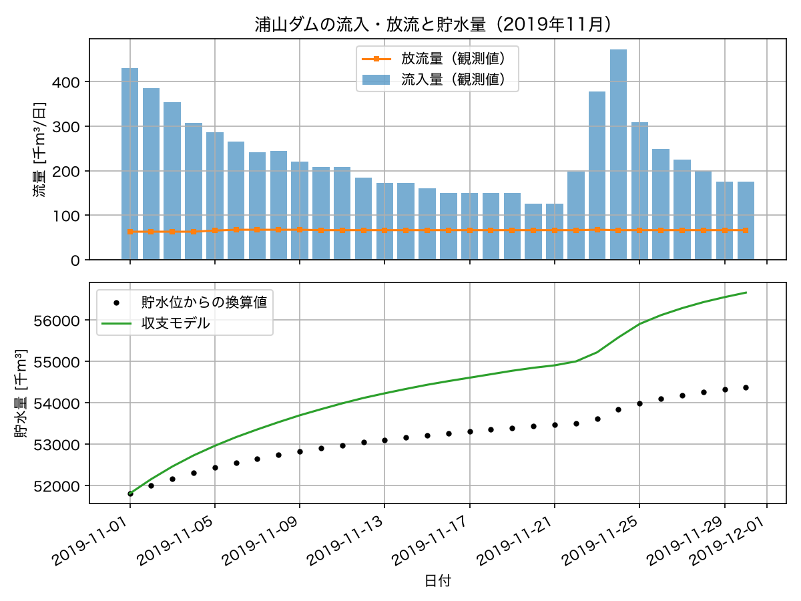
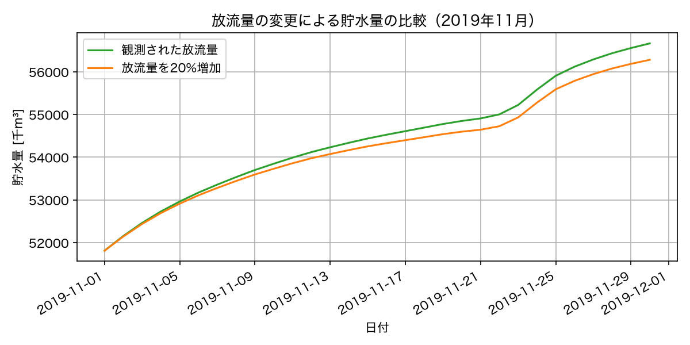
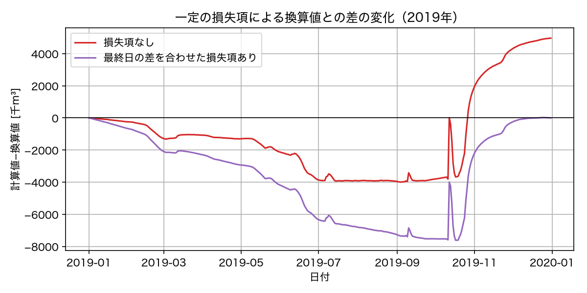

# 第6回　河川流量とダム貯水量

### 今回の位置付け

1. 現象の理解
2. <span style="color:red">仮定の設定</span>
3. <span style="color:red">数理モデルの構築</span>
4. 数値シミュレーション
5. <span style="color:red">データとの比較</span>
6. パラメタ推定
7. モデルの検証と改善

- 第5回まで：人口モデルのパラメタを観測値から推定した．
- **第6回**：保存則からダムの貯水量のモデルを構築し，観測流量を**外部入力**として与える．
  - モデルの構築：流入・流出と貯水量の変化を，単位をそろえて結び付ける．
  - データとの比較：貯水位と貯水量の対応を仮定し，計算結果との差を調べる．

### 到達目標

- 蓄積量の時間変化率が流入流量と流出流量の差に等しいという保存則から，貯水量の微分方程式 $V' = Q_{\mathrm{in}}(t) - Q_{\mathrm{out}}(t)$ を導ける
- 流量の単位 m³/s と貯水量の単位 千m³ を整合させる換算を，自分で導いて実行できる
- 観測された貯水位と，モデルの状態変数である貯水量が別の量であることを説明し，両者を結ぶ近似上の仮定を明示できる
- 離散的な観測値を補間して`solve_ivp`の右辺から参照し，外部入力付きの初期値問題を解ける
- モデルの計算結果と水位からの換算値を同じ図に示し，ずれが時間とともに蓄積する理由を説明できる

<!--
**今回の流れ**（105分の目安）

| 段階 | 内容 | 時間 |
| --- | --- | --- |
| 1 | 人口モデルとの違い，ダムのデータの確認（演習0） | 10分 |
| 2 | 保存則，単位の整合，貯水位と貯水量の関係（演習1・2） | 25分 |
| 3 | 観測値の補間と`solve_ivp`による1か月の計算 | 20分 |
| 4 | 1年間の計算，誤差の蓄積，期間を変える演習（演習3・4） | 35分 |
| 5 | 欠測・観測誤差・時間間隔の議論，まとめ，課題の説明 | 15分 |
-->

## 準備

````{note} 演習0：作業フォルダとNotebookの準備

1. ターミナルで第6回の作業フォルダを作成せよ．データフォルダは第1回以来の共通のものを使う．

```bash
mkdir -p ~/applied_programming_ii/06
cd ~/applied_programming_ii/06
mkdir -p notebooks reports/figures
```

- **コードの補足**：`mkdir -p`は必要な親フォルダも作成し，`cd`は作業フォルダを移動する．

実行後の構成は次のとおりである．`data`は各回で共通に使用し，`README.md`とNotebookは続く手順で作成する．

```text
applied_programming_ii/
├── data/
└── 06/
    ├── README.md
    ├── notebooks/
    │   └── reservoir_balance.ipynb
    └── reports/
        └── figures/
```

2. {download}`授業用CSV <../data/dam_urayama_daily.csv>`をダウンロードし，`dam_urayama_daily.csv`として`~/applied_programming_ii/data/`に保存せよ．

3. `notebooks/reservoir_balance.ipynb`を新規作成せよ．

4. `06`フォルダに`README.md`を作り，次の内容を記入せよ．

```markdown
# 応用プログラミングII 第6回

- 氏名：
- 学籍番号：

## 今日の目標

保存則からダム貯水量のモデルを作り，観測された流入量と放流量を入力として計算し，観測された貯水位と比べる．

## データの確認

- 出典：
- 期間：
- 時間間隔：
- 単位（貯水位，流入量，放流量）：
- 欠損値：

## 演習1：一定流量による流入水量

1. 7日分の流入水量・有効貯水容量に対する割合：

## 演習2：水位上昇に必要な水量と日数

1. 水位372 m・382 mでの換算貯水量・増加量：
2. 水位上昇に必要な日数：

## 演習3：対象年を変えた収支計算

1. 選んだ年：
2. 最終日の差・RMSE： （Notebookに計算結果の図を出力）

## 演習4：初期値の再設定間隔の比較

1. 3か月ごとの計算（Notebookにコードを記載して実行）
2. 誤差の比較（Notebookに図を出力）

## 課題1：対象月と放流量を変えた収支計算

1. 選んだ年月： （Notebookに流量と貯水量の図を出力）
2. 計算期間の流入・放流水量，換算貯水量の変化，収支の差と有効貯水容量に対する割合：
3. 放流量を20%増やした場合の最終日の貯水量の減少量・追加の放流水量： （Notebookに比較図を出力）

## 課題2の考察

1. 見直す仮定と，図から読み取れる根拠：

```

5. 以下のコードブロックをそれぞれNotebookのコードセルに入力し，上から順に実行せよ．

計算・描画に使うライブラリを読み込み，日本語フォントを設定する．

```python
from pathlib import Path

import numpy as np
import pandas as pd
import matplotlib.pyplot as plt
from scipy.integrate import solve_ivp

plt.rcParams["font.family"] = "Hiragino Sans"  # 日本語表示用（macOS）
```

作業フォルダとデータの場所を指定し，図の保存先を作成する．

```python
PROJECT_DIR = Path.home() / "applied_programming_ii" / "06"
DATA_DIR = Path.home() / "applied_programming_ii" / "data"
FIGURE_DIR = PROJECT_DIR / "reports" / "figures"
FIGURE_DIR.mkdir(parents=True, exist_ok=True)
```

- **コードの補足**：`mkdir(..., exist_ok=True)`は，保存先が既に存在する場合も処理を続ける．

作業フォルダの場所と，CSVファイルがあるかを確認する．

```python
print("作業フォルダ:", PROJECT_DIR)
print("ダムデータの有無:", (DATA_DIR / "dam_urayama_daily.csv").exists())
```

- **コードの補足**：`.exists()`は，指定したファイルが存在すれば`True`を返す．

出力例（`ユーザー名`の部分は実行環境によって異なる）：

```text
作業フォルダ: /Users/ユーザー名/applied_programming_ii/06
ダムデータの有無: True
```
````

## 復習と今回の準備

以下の数値出力は実行例であり，数値解の末尾はライブラリのバージョンなどによって異なる場合がある．

- **初期値問題**：第2回と同じく，初期値と右辺の関数を`solve_ivp`に渡し，指定した時刻での解を求める．
- **観測値との比較**：第3〜5回と同じく，モデル値と比較用データを同じ単位・同じ時刻にそろえる．
- **外部入力**：状態変数の方程式とは別に与える時間の関数．今回は観測された流入量・放流量から作る．人口モデルと異なり，これらの入力から貯水量の変化率が決まる．

## 導入：浦山ダムの観測データ

### データの出典と確認

今回使うのは，埼玉県秩父市にある浦山ダムの日データである．
浦山ダムは荒川水系浦山川にある重力式コンクリートダムで，水資源機構が管理している．
データは国土交通省の[ダム諸量データベース](https://mudam.nilim.go.jp/)から取得し，授業用に整形したものである．
授業用CSVには2015〜2023年の日付・貯水位・流入量・放流量を収録している．

第3回と同じく，期間，時間間隔，単位，欠損値を順に確認する．

CSVを読み込み，データを変数`dam`に入れる．

```python
dam = pd.read_csv(DATA_DIR / "dam_urayama_daily.csv", parse_dates=["date"])
```

- **コードの補足**：`parse_dates=["date"]`で，日付の列を日時型として読み込む．

データの先頭・末尾，期間，行数，欠損値の数を確認する．

```python
print(dam.head())
print(dam.tail())
print("期間:", dam["date"].min().date(), "〜", dam["date"].max().date(), " 行数:", len(dam))
print("欠損値の数:")
print(dam.isna().sum())
```

- **コードの補足**：`head()`と`tail()`は先頭・末尾の行を表示する．`isna().sum()`は列ごとの欠損値の数を求める．

出力例：

```text
        date  water_level_m  inflow_m3s  outflow_m3s
0 2015-01-01         380.37        0.72         0.72
1 2015-01-02         380.37        0.72         0.72
2 2015-01-03         380.37        0.72         0.72
3 2015-01-04         380.37        0.72         0.72
4 2015-01-05         380.37        0.72         0.72
           date  water_level_m  inflow_m3s  outflow_m3s
3282 2023-12-27         370.43        0.58         1.52
3283 2023-12-28         370.34        0.48         1.52
3284 2023-12-29         370.24        0.48         1.51
3285 2023-12-30         370.14        0.58         1.51
3286 2023-12-31         370.04        0.47         1.51
期間: 2015-01-01 〜 2023-12-31  行数: 3287
欠損値の数:
date             0
water_level_m    0
inflow_m3s       0
outflow_m3s      0
dtype: int64
```

日付の間隔がすべて1日であることを確認する．

```python
intervals = dam["date"].diff().dt.days
intervals = intervals.dropna()
interval_types = intervals.unique().tolist()
print("日付の間隔（日）の種類:", sorted(interval_types))
```

- **コードの補足**：`diff().dt.days`で隣り合う日付の差を日数にする．`dropna()`で先頭の欠損値を除き，`unique().tolist()`で間隔の種類を取り出す．

出力例：

```text
日付の間隔（日）の種類: [1.0]
```

| 列 | 意味 | 単位 |
| --- | --- | --- |
| `date` | 日付 | — |
| `water_level_m` | 日平均貯水位（標高） | m |
| `inflow_m3s` | 日平均流入量 | m³/s |
| `outflow_m3s` | 日平均放流量（発電と用水の取水を含む） | m³/s |

[ダム諸量データベースの項目説明](https://mudam.nilim.go.jp/chronology/about/form02)に基づき，各観測量の作られ方も確認する．

- **貯水位**：毎正時の水位24個の平均値．CSVには日平均値が記録されている．
- **流入量**：貯水位を水位・容量曲線で貯水量へ換算し，その時間変化と放流量から計算した値の日平均．独立に測った流入量ではない．
- **放流量**：ゲートの開度などから水理公式で求めた流量の日平均．

流量と貯水位は算出過程で関係しているため，後の比較は独立な観測による検証ではなく，換算・補間を含むモデルとデータの整合性の確認になる．

(reservoir-observed-data)=
### 2019年の観測値の可視化

2019年を主な対象とする．台風19号の影響を受けた10月を含め，流量と貯水位の時間変化を調べる．
cf. [令和元年東日本台風](https://ja.wikipedia.org/wiki/%E4%BB%A4%E5%92%8C%E5%85%83%E5%B9%B4%E6%9D%B1%E6%97%A5%E6%9C%AC%E5%8F%B0%E9%A2%A8)

対象年を指定し，その年の行を`dam_year`に取り出して内容を確認する．

```python
year = 2019
dam_year = dam[dam["date"].dt.year == year].reset_index(drop=True)
dam_year
```

- **コードの補足**：`.dt.year == year`で年を選び，`reset_index(drop=True)`で行番号を0から付け直す．セルの最後に変数名だけを書くと，その内容が表示される．行数が多い表は先頭と末尾の5行ずつが表示される．

出力例：

```text
          date  water_level_m  inflow_m3s  outflow_m3s
0   2019-01-01         382.58        0.61         0.73
1   2019-01-02         382.57        0.61         0.73
2   2019-01-03         382.55        0.48         0.73
3   2019-01-04         382.53        0.48         0.73
4   2019-01-05         382.52        0.61         0.73
..         ...            ...         ...          ...
360 2019-12-27         391.92        1.06         0.78
361 2019-12-28         391.94        1.06         0.78
362 2019-12-29         391.96        0.92         0.78
363 2019-12-30         391.97        1.06         0.78
364 2019-12-31         391.99        0.92         0.78

[365 rows x 4 columns]
```

対象年の観測日数，流量の最大値，最大となった日付を確認する．

```python
print(f"対象年: {year}年，観測日数: {len(dam_year)}日")
inflow_max_index = dam_year["inflow_m3s"].idxmax()
outflow_max_index = dam_year["outflow_m3s"].idxmax()
inflow_max_date = dam_year.loc[inflow_max_index, "date"].date()
outflow_max_date = dam_year.loc[outflow_max_index, "date"].date()
print("流入量の最大値:", dam_year["inflow_m3s"].max(), "m^3/s  日付:", inflow_max_date)
print("放流量の最大値:", dam_year["outflow_m3s"].max(), "m^3/s  日付:", outflow_max_date)
```

- **コードの補足**：`idxmax()`は最大値の行番号を返す．`.loc[行番号, "date"]`でその日付を取り出す．

出力例：

```text
対象年: 2019年，観測日数: 365日
流入量の最大値: 201.11 m^3/s  日付: 2019-10-12
放流量の最大値: 126.62 m^3/s  日付: 2019-10-13
```

水位・流入量・放流量を同じ日付の軸で上下に並べ，増減の時期を比較する．

```python
fig, axes = plt.subplots(3, 1, figsize=(8, 8), sharex=True)
axes[0].plot(dam_year["date"], dam_year["water_level_m"], color="black")
axes[0].set_ylabel("水位 [m]")
axes[0].set_title(f"浦山ダム（{year}年）")
axes[1].plot(dam_year["date"], dam_year["inflow_m3s"], color="tab:blue", label="流入量")
axes[1].set_ylabel("流入量 [m³/s]")
axes[2].plot(dam_year["date"], dam_year["outflow_m3s"], color="tab:orange", label="放流量")
axes[2].set_ylabel("放流量 [m³/s]")
axes[2].set_xlabel("日付")
for ax in axes:
    ax.grid(True)
fig.tight_layout()
fig.savefig(FIGURE_DIR / f"dam_observed_{year}.png", dpi=150)
plt.show()
```

- **コードの補足**：`plt.subplots(3, 1, sharex=True)`：日付の横軸を共有し，水位・流入量・放流量を上下3段に並べる．



- **貯水位の変化**：2019年の貯水位は夏に低く，秋以降に高くなる．この変化には，洪水期に水位を下げて洪水時の流入水を一時的に貯める容量を確保し，非洪水期には水道用水などに利用する水を蓄える運用が関係している．[水資源機構の説明](https://www.water.go.jp/kanto/arakawa/urayama/kanri.html)では，浦山ダムの洪水期は7〜9月，非洪水期は10〜6月である．[浦山ダムの操作状況](https://www.arakawadam.org/arasou/kanri/public/urayama.html)では，洪水貯留準備水位を標高372.0 mとしている．
- **流量の変化**：10月12日の流入量は201.11 m³/s，放流量の最大値は翌13日の126.62 m³/sである．流入量と放流量の差が，貯水量の増減にどう対応するかを調べる．

## 数理モデルの仮定

### 保存則

貯水池内の水の体積を $V(t)$ とする．水の密度を一定とみなし，出入りする水の体積を全て数えると，質量保存則は次の関係で表される．

$$
\text{貯水量の変化率} = \text{流入量} - \text{流出量}
$$

- **流量**：単位時間あたりに通過する水の体積．以下ではCSVの名称に合わせて流入量・放流量と呼ぶが，どちらも流量を表す．
- **貯水量**：ある時刻に貯水池に蓄えられている水の体積．流量とは単位が異なる．

今回は記録された2種類の流量で出入りを代表させ，次の仮定を置く．

```{tip} 仮定
:class: simple

- **入力の範囲**：CSVの流入量と放流量を使い，降雨・蒸発・地下水などの項を別には加えない．逆算された流入量には，これらの影響が含まれている可能性もある．
- **時間方向の近似**：日平均流量を日ごとの代表時刻の値として配置し，隣接する値の間を線形補間する．日内の変動は再現しない．
```

計算結果と観測データに差が生じた場合は，これらの仮定と，次に定める水位から貯水量への換算を検討する．

### 微分方程式

状態変数を貯水量 $V(t)$ ，流入量を $Q_{\mathrm{in}}(t)$ ，放流量を $Q_{\mathrm{out}}(t)$ とすると，保存則は

$$
\frac{dV}{dt} = Q_{\mathrm{in}}(t) - Q_{\mathrm{out}}(t),
\qquad V(t_0) = V_0
$$

となる．
第1回の言葉で各要素を整理する．

| 要素 | 内容 |
| --- | --- |
| 状態変数 | 貯水量 $V(t)$ |
| 観測量 | 貯水位（m），流入量（m³/s），放流量（m³/s） |
| パラメタ | 収支式で推定する係数はなし．水位から貯水量への換算係数は後で固定する |
| 初期条件 | 計算を始める日の貯水量 $V_0$ |
| 外部入力 | $Q_{\mathrm{in}}(t)$ ， $Q_{\mathrm{out}}(t)$ ．観測データで与える |
| 仮定 | 出入りは流入量と放流量のみ．日平均流量を代表時刻に配置し線形補間する |

- **右辺の特徴**：変化率は外部入力だけで決まり，現在の貯水量 $V$ には依存しない．第2回の初期値問題の特別な場合として，`solve_ivp`を使える．
- **計算の位置付け**：計算期間全体の観測流量を与え，過去の貯水量の変化を再現する．将来の流入量・放流量はこの式からは求まらないため，そのまま将来予測にはならない．

(reservoir-unit-conversion)=
### 単位の整合

流入量と放流量の単位は m³/s である．
一方，貯水量は，ダムの諸元表では 千m³ で表され，日データの時間単位は日である．
微分方程式の両辺の単位を合わせるには，流量を千m³／日に換算しなければならない．

1日は $24 \times 60 \times 60 = 86400$ 秒なので，1 m³/s の流れが1日続くと $86400$ m³，すなわち $86.4$ 千m³ になる．

$$
1\ \mathrm{m^3/s} = 86400\ \mathrm{m^3}/\text{日} = 86.4\ \text{千}\mathrm{m^3}/\text{日}
$$

最大流入量が1日続いた場合の水量を，有効貯水容量と比較する．

- **有効貯水容量**：最低水位から常時満水位までの間に貯められる水の量．洪水調節や水道・発電などの利水に使える容量を表す．最低水位より下の部分は，土砂の堆積などに備える容量であり，放流には使わない．浦山ダムの有効貯水容量は56,000千m³である．

流量をm³/sから千m³/日に換算する関数を定義する．

```python
SECONDS_PER_DAY = 24 * 60 * 60


def m3s_to_1000m3_per_day(flow_m3s):
    """流量 [m^3/s] を [千m^3/日] に換算する．"""
    return flow_m3s * SECONDS_PER_DAY / 1000
```

- **コードの補足**：`SECONDS_PER_DAY / 1000`は，秒から日，m³から千m³への換算をまとめた係数である．

有効貯水容量を設定し，2019年の最大流入量を換算する．

```python
V_EFFECTIVE = 56000.0   # 有効貯水容量 [千m^3]

q_max = dam_year["inflow_m3s"].max()
q_max_daily = m3s_to_1000m3_per_day(q_max)
```

換算した最大流入量と，1日分の水量が有効貯水容量に占める割合を確認する．

```python
print(f"最大流入量 {q_max:.2f} m^3/s = {q_max_daily:.1f} 千m^3/日")
print(f"有効貯水容量に対する割合: {100 * q_max_daily / V_EFFECTIVE:.1f} %")
print(f"流入量 1.0 m^3/s = {m3s_to_1000m3_per_day(1.0):.1f} 千m^3/日")
```

- **コードの補足**：割合は，最大流入量が1日続いた場合の水量を有効貯水容量で割って求める．

出力例：

```text
最大流入量 201.11 m^3/s = 17375.9 千m^3/日
有効貯水容量に対する割合: 31.0 %
流入量 1.0 m^3/s = 86.4 千m^3/日
```

````{note} 演習1：一定流量による流入水量

1. 流量3.5 m³/sの流入が7日間続くと仮定する．[単位の整合](#reservoir-unit-conversion)で定義した`m3s_to_1000m3_per_day`を使い，次の計算コードの【】を埋めて実行せよ．その下の表示コードも実行し，7日分の流入水量と有効貯水容量に対する割合を`README.md`に記せ．

```python
flow = 3.5
days = 7
flow_daily = 【flow を千m^3/日に換算した値】
inflow_volume = 【flow_daily と days から求める7日分の流入水量 [千m^3]】
volume_percent = 100 * inflow_volume / V_EFFECTIVE
```

求めた水量と割合を，次のコードで表示する．

```python
print(f"7日分の流入水量: {inflow_volume:.1f} 千m^3")
print(f"有効貯水容量に対する割合: {volume_percent:.2f} %")
```
````

````{visible-answer} 演習1の解答例

**1．7日分の流入水量と割合**

1日あたりに換算した流量に日数を掛け，期間全体の水量を求める．

流量と継続日数を設定し，流入水量を計算する．

```{code-block} python
:linenos:
:emphasize-lines: 3,4
:class: code-focus

flow = 3.5
days = 7
flow_daily = m3s_to_1000m3_per_day(flow)
inflow_volume = flow_daily * days
volume_percent = 100 * inflow_volume / V_EFFECTIVE
```

7日分の流入水量と，有効貯水容量に対する割合を確認する．

```python
print(f"7日分の流入水量: {inflow_volume:.1f} 千m^3")
print(f"有効貯水容量に対する割合: {volume_percent:.2f} %")
```

出力例：

```text
7日分の流入水量: 2116.8 千m^3
有効貯水容量に対する割合: 3.78 %
```

````

(reservoir-level-conversion)=
### 貯水位と貯水量の対応

モデルの状態変数は貯水量 $V$ （千m³）だが，データにあるのは貯水位 $h$ （m）である．
貯水量と貯水位の関係はダムごとに異なる曲線で表され，貯水池の形（水位が高いほど湖面が広い）に依存する．
この曲線は今回のデータには含まれていない．

以下では最低水位より上の水量を $V$ とする．最低水位で $V=0$ としても，貯水池全体が空になるという意味ではない．基準となる水量を差し引いても，貯水量の変化率は変わらない．換算には次の**仮定**を置く．

```{tip} 仮定
:class: simple

- 貯水量は，最低水位（標高304.0 m）で0，常時満水位（標高393.3 m）で有効貯水容量 56,000 千m³ になる．
- その間では，貯水量は貯水位に対して線形に変化する．

$$
V = V_{\mathrm{eff}} \cdot \frac{h - h_{\min}}{h_{\mathrm{full}} - h_{\min}},
\qquad
V_{\mathrm{eff}} = 56000,\ h_{\min} = 304.0,\ h_{\mathrm{full}} = 393.3
$$
```

このとき，貯水位1 mあたりの貯水量は $56000 / 89.3 \approx 627$ 千m³ である．
これは湖面の面積が約0.63 km²で水位によらず一定，と仮定したことに相当する．
水位・容量関係の局所的な傾きはその水位での湖面積に対応する．実際の傾きは水位に依存するため，一定値による換算は近似である．
この換算の近似も，計算結果との差の要因として検討する．

最低水位と常時満水位を設定し，水位から貯水量への換算関数を定義する．

```python
LEVEL_MIN = 304.0     # 最低水位 [m]
LEVEL_FULL = 393.3    # 常時満水位 [m]


def level_to_volume(level_m):
    """貯水位 [m] を貯水量 [千m^3] に換算する．最低水位と常時満水位の間で線形とみなす近似．"""
    return V_EFFECTIVE * (level_m - LEVEL_MIN) / (LEVEL_FULL - LEVEL_MIN)
```

- **コードの補足**：`level_to_volume`は，1つの水位にも水位の配列にも同じ換算式を適用する．

水位1 mあたりの貯水量と，代表的な水位での換算値を確認する．

```python
slope = V_EFFECTIVE / (LEVEL_FULL - LEVEL_MIN)
print(f"貯水位1 mあたりの貯水量（線形近似）: {slope:.1f} 千m^3/m")
for level in [304.0, 350.0, 372.0, 393.3]:
    print(f"貯水位 {level:6.1f} m -> 貯水量 {level_to_volume(level):8.1f} 千m^3")
```

出力例：

```text
貯水位1 mあたりの貯水量（線形近似）: 627.1 千m^3/m
貯水位  304.0 m -> 貯水量      0.0 千m^3
貯水位  350.0 m -> 貯水量  28846.6 千m^3
貯水位  372.0 m -> 貯水量  42642.8 千m^3
貯水位  393.3 m -> 貯水量  56000.0 千m^3
```

各日の水位を貯水量に換算し，`dam_year`に新しい列を追加する．

```python
dam_year["volume_1000m3"] = level_to_volume(dam_year["water_level_m"])
```

- **コードの補足**：`dam_year["volume_1000m3"]`に換算結果を保存する．

追加した貯水量の列を，元の水位と並べて確認する．

```python
print(dam_year[["date", "water_level_m", "volume_1000m3"]].head())
```

出力例：

```text
        date  water_level_m  volume_1000m3
0 2019-01-01         382.58   49277.491601
1 2019-01-02         382.57   49271.220605
2 2019-01-03         382.55   49258.678611
3 2019-01-04         382.53   49246.136618
4 2019-01-05         382.52   49239.865622
```

````{note} 演習2：水位上昇に必要な水量と日数

水位と貯水量の線形換算を用い，水位が372 mから382 mまで上昇する場合を計算する．

1. [貯水位と貯水量の対応](#reservoir-level-conversion)で定義した`level_to_volume`を使い，次の計算コードの【】を埋めて実行せよ．その下の表示コードも実行し，両水位に対応する貯水量と増加量を`README.md`に記せ．

```python
V_start = 【水位372 mを貯水量に換算した値】
V_end = 【水位382 mを貯水量に換算した値】
volume_change = 【V_start と V_end から求める貯水量の増加量】
```

両水位の貯水量と増加量を，次のコードで表示する．

```python
print(f"水位372 mでの貯水量: {V_start:.1f} 千m^3")
print(f"水位382 mでの貯水量: {V_end:.1f} 千m^3")
print(f"貯水量の増加: {volume_change:.1f} 千m^3")
```

2. 流入量は3.5 m³/sで一定，放流などによる流出は0とする．[単位の整合](#reservoir-unit-conversion)の換算関数と設問1の`volume_change`を使い，次の計算コードの【】を埋めて実行せよ．その下の表示コードも実行し，水位上昇に必要な日数を`README.md`に記せ．

```python
flow = 3.5
flow_daily = m3s_to_1000m3_per_day(flow)
required_days = 【volume_change と flow_daily から求める日数】
```

水位上昇に必要な日数を，次のコードで表示する．

```python
print(f"水位372 mから382 mまでに必要な日数: {required_days:.2f} 日")
```
````

````{visible-answer} 演習2の解答例

**1．水位からの換算と貯水量の増加**

同じ換算関数を2つの水位に適用し，終わりの貯水量から始めの貯水量を引く．

水位372 mと382 mを貯水量へ換算し，増加量を求める．

```{code-block} python
:linenos:
:emphasize-lines: 1,2,3
:class: code-focus

V_start = level_to_volume(372.0)
V_end = level_to_volume(382.0)
volume_change = V_end - V_start
```

両水位での貯水量と，増加量を表示する．

```python
print(f"水位372 mでの貯水量: {V_start:.1f} 千m^3")
print(f"水位382 mでの貯水量: {V_end:.1f} 千m^3")
print(f"貯水量の増加: {volume_change:.1f} 千m^3")
```

出力例：

```text
水位372 mでの貯水量: 42642.8 千m^3
水位382 mでの貯水量: 48913.8 千m^3
貯水量の増加: 6271.0 千m^3
```

**2．水位上昇に必要な日数**

流出がないため，貯水量の増加率は流入流量に等しい．必要な水量を1日あたりの流入水量で割る．

流量を千m³/日に換算し，必要な日数を求める．

```{code-block} python
:linenos:
:emphasize-lines: 3
:class: code-focus

flow = 3.5
flow_daily = m3s_to_1000m3_per_day(flow)
required_days = volume_change / flow_daily
```

水位上昇に必要な日数を確認する．

```python
print(f"水位372 mから382 mまでに必要な日数: {required_days:.2f} 日")
```

出力例：

```text
水位372 mから382 mまでに必要な日数: 20.74 日
```

````

```{tip} 今回の計算におけるデータの使い方

CSVの各データを，計算に与える値と，計算結果との比較に使う値に分けて整理する．

| 役割 | 使用するデータ | 計算での使い方 |
| --- | --- | --- |
| 初期条件 | 初日の貯水位から換算した貯水量 | 計算開始時の貯水量を決める |
| 外部入力 | 計算期間中の流入量・放流量 | 各時刻の貯水量の変化率を決める |
| 比較用データ | 各日の貯水位から換算した貯水量 | 計算した貯水量と比較する |

**初日の貯水量から出発し，流入量と放流量を使ってその後の貯水量を計算し，各日の水位から換算した貯水量と比べる**，という流れである．

流入量は貯水位の変化と放流量から算出されているため，外部入力と比較用データは独立した観測ではない．
```

## Pythonによる実装

### 線形補間

`solve_ivp`は，計算の途中で任意の時刻 $t$ における右辺の値を要求する．
例えば，0日目と1日目の流量が与えられていても，計算には0.5日目の流量が必要になる．そこで，既知の値の間を補間して流量を与える．

- **補間**：既知のデータ点の間の値を，それらの点を通る関数で求めること．
- **線形補間**：隣り合う2点を結ぶ線分を使って，その間の値を求める方法．

**補間の式**

時刻 $t_i<t_{i+1}$ での流量をそれぞれ $q_i,q_{i+1}$ とする．2点を通る直線の傾きは $(q_{i+1}-q_i)/(t_{i+1}-t_i)$ なので，区間 $t_i\leq t\leq t_{i+1}$ では，補間した流量 $\widetilde{Q}(t)$ を

$$
\widetilde{Q}(t)
=q_i+\frac{q_{i+1}-q_i}{t_{i+1}-t_i}(t-t_i)
$$

と定める． $t=t_i$ では $q_i$ ， $t=t_{i+1}$ では $q_{i+1}$ に一致する．データが3点以上ある場合も，時刻順に隣り合う点を線分で結ぶ．

**流量の具体例**

0日目の流量が80千m³/日，1日目が120千m³/日なら，0.5日目の補間値は

$$
\widetilde{Q}(0.5)=80+\frac{120-80}{1-0}(0.5-0)=100
\quad[\text{千}\mathrm{m^3}/\text{日}]
$$

となる．式による計算と`np.interp`の結果を比較する．

既知の時刻と流量を配列に入れ，補間したい時刻を0.5日目に設定する．

```python
t_example = np.array([0.0, 1.0])
q_example = np.array([80.0, 120.0])
t_mid = 0.5
```

線形補間の式と`np.interp`を使い，同じ時刻の流量を求める．

```python
slope = (q_example[1] - q_example[0]) / (t_example[1] - t_example[0])
q_formula = q_example[0] + slope * (t_mid - t_example[0])
q_interp = np.interp(t_mid, t_example, q_example)
```

- **コードの補足**：`slope`は2点を結ぶ直線の傾きである．`np.interp`には，求めたい時刻，既知の時刻の配列，対応する値の配列を渡す．

2通りの計算で得た補間値が一致することを確認する．

```python
print(f"式による補間値: {q_formula:.1f} 千m^3/日")
print(f"np.interpによる補間値: {q_interp:.1f} 千m^3/日")
```

出力例：

```text
式による補間値: 100.0 千m^3/日
np.interpによる補間値: 100.0 千m^3/日
```

既知の2点を結ぶ線分と，0.5日目の補間値を同じ図に示す．

```python
fig, ax = plt.subplots(figsize=(7, 4))
ax.plot(t_example, q_example, color="tab:blue", label="線形補間")
ax.plot(t_example, q_example, "o", color="black", label="既知の値")
ax.plot(t_mid, q_interp, "o", color="tab:red", label="0.5日目の補間値")
ax.set_title("2時点の流量からの線形補間")
ax.set_xlabel("経過時間 [日]")
ax.set_ylabel("流量 [千m³/日]")
ax.grid(True)
ax.legend()
fig.tight_layout()
fig.savefig(FIGURE_DIR / "linear_interpolation.png", dpi=150)
plt.show()
```

- **コードの補足**：`plot`は隣り合う点を線分で結ぶ．`"o"`を指定した系列では点だけを描き，既知の値と補間値を区別する．



補間値は，区間内で流量が直線的に変化すると仮定して求めた値である．今回の日平均流量も代表時刻の値として扱うため，補間値が実際の日内の流量を再現するとは限らない．

### 補間した流量の右辺からの参照

時間の変数 $t$ は，計算を始める日を0とした日数とする．
補間に使う時刻の配列，流入量の配列，放流量の配列は，右辺の関数に引数として渡す．

流入量と放流量を補間し，その差を返す右辺の関数を定義する．

```python
def reservoir_rhs(t, V, t_data, qin_data, qout_data):
    """dV/dt = Q_in(t) - Q_out(t) の右辺．流入量と放流量は観測値を線形補間して使う．

    t_data: 観測時刻の配列 [日]
    qin_data, qout_data: 観測された流入量と放流量の配列 [千m^3/日]
    """
    q_in = np.interp(t, t_data, qin_data)
    q_out = np.interp(t, t_data, qout_data)
    return q_in - q_out
```

- **コードの補足**：`V`は`solve_ivp`に渡す右辺の第2引数として受け取る．今回の変化率は流量の入力だけで決まる．

2日分の仮の流量を用意し，0.5日後の貯水量の変化率を求める．

```python
# 2日分の仮の入力で，中間時刻の補間を確認する．
t_example = np.array([0.0, 1.0])
qin_example = np.array([80.0, 120.0])
qout_example = np.array([60.0, 80.0])
rate_example = reservoir_rhs(0.5, 100.0, t_example, qin_example, qout_example)
```

変化率が，補間した流入量100と放流量70の差になっていることを確認する．

```python
print(f"0.5日後の貯水量の変化率: {rate_example:.1f} 千m^3/日")
```

出力例：

```text
0.5日後の貯水量の変化率: 30.0 千m^3/日
```

### 1か月の計算：2019年10月

まず台風を含む2019年10月の1か月間を計算する．
入力が1日ごとに折れ曲がる関数なので，`max_step=1.0`を指定して計算の刻み幅が1日を超えないようにする．

2019年10月の行を取り出し，先頭の5行を確認する．

```python
month_mask = (dam["date"] >= "2019-10-01") & (dam["date"] <= "2019-10-31")
month = dam[month_mask].reset_index(drop=True)
month.head()
```

- **コードの補足**：`month_mask`は，指定した期間に含まれる日を選ぶ条件である．

出力例：

```text
        date  water_level_m  inflow_m3s  outflow_m3s
0 2019-10-01         372.03        1.35         0.72
1 2019-10-02         372.09        1.25         0.72
2 2019-10-03         372.14        1.25         0.72
3 2019-10-04         372.19        1.25         0.72
4 2019-10-05         372.24        1.25         0.72
```

時刻を経過日数にし，流量と貯水位をモデルで使う単位に換算して，各配列の先頭の値を確認する．

```python
# 観測値をモデルの単位に揃える
t_obs = np.arange(len(month), dtype=float)                       # 10月1日を0とした日数 [日]
qin_obs = m3s_to_1000m3_per_day(month["inflow_m3s"].values)      # [千m^3/日]
qout_obs = m3s_to_1000m3_per_day(month["outflow_m3s"].values)    # [千m^3/日]
V_obs = level_to_volume(month["water_level_m"].values)           # [千m^3]
print("t_obs:", t_obs[:5])
print("qin_obs:", qin_obs[:5])
print("qout_obs:", qout_obs[:5])
print("V_obs:", V_obs[:5])
```

- **コードの補足**：`t_obs`は初日を0とした日数，`qin_obs`・`qout_obs`は千m³/日，`V_obs`は千m³である．`[:5]`は配列の先頭から5個の要素を取り出す．

出力例：

```text
t_obs: [0. 1. 2. 3. 4.]
qin_obs: [116.64 108.   108.   108.   108.  ]
qout_obs: [62.208 62.208 62.208 62.208 62.208]
V_obs: [42661.59014558 42699.21612542 42730.57110862 42761.92609183
 42793.28107503]
```

初日の換算貯水量を初期値にし，初日から最終日までを計算区間に設定する．

```python
# 初期条件と計算区間
V0 = V_obs[0]
t_span = (t_obs[0], t_obs[-1])
```

`solve_ivp`で貯水量を計算し，各観測時刻の値を取り出す．

```python
sol = solve_ivp(
    reservoir_rhs,
    t_span,
    [V0],
    t_eval=t_obs,
    args=(t_obs, qin_obs, qout_obs),
    max_step=1.0,
)
V_model = sol.y[0]
```

```{dropdown} コードの補足

- `args`で時刻・流入量・放流量の配列を右辺へ渡す．
- `max_step=1.0`は内部の計算刻み幅の上限を1日にする．`t_eval`は解を出力する時刻を指定する．
- `sol.y[0]`で貯水量の計算結果を取り出す．
```

計算の成功を確認し，10月9〜18日の流量・貯水量・換算値との差を表示する．

```python
print("成功したか:", sol.success)
print(f"{'日付':>12} {'流入':>8} {'放流':>8} {'モデルV':>9} {'換算V':>9} {'差':>8}")
for i in range(8, 18):
    date = str(month["date"][i].date())
    difference = V_model[i] - V_obs[i]
    print(f"{date:>12} {qin_obs[i]:8.0f} {qout_obs[i]:8.0f} {V_model[i]:9.0f} {V_obs[i]:9.0f} {difference:8.0f}")
```

- **コードの補足**：流入・放流の単位は千m³/日，モデルV・換算V・差は千m³である．差は計算値から換算値を引いた値である．

出力例：

```text
成功したか: True
          日付       流入       放流      モデルV       換算V        差
  2019-10-09       90       62     43004     42894      111
  2019-10-10       93       67     43026     42912      114
  2019-10-11      162      816     42822     42718      104
  2019-10-12    17376     4079     48915     45320     3595
  2019-10-13     6994    10940     53694     50155     3539
  2019-10-14     2049     7550     49015     46575     2440
  2019-10-15     1184     3307     45189     44204      985
  2019-10-16      876     1712     43702     43333      369
  2019-10-17      742     1250     43032     42900      132
  2019-10-18      616      444     42863     42718      145
```

流入量・放流量を上段，貯水量の計算結果と水位からの換算値を下段に描き，増減の時期を比較する．

```python
fig, axes = plt.subplots(2, 1, figsize=(8, 6), sharex=True)
axes[0].bar(month["date"], qin_obs, color="tab:blue", alpha=0.6, label="流入量（観測値）")
axes[0].plot(month["date"], qout_obs, color="tab:orange", marker="s", markersize=3, label="放流量（観測値）")
axes[0].set_ylabel("流量 [千m³/日]")
axes[0].set_title("浦山ダムの流入・放流と貯水量（2019年10月）")
axes[0].legend()
axes[1].plot(month["date"], V_obs, color="black", marker="o", markersize=3, linestyle="none", label="貯水位からの換算値")
axes[1].plot(month["date"], V_model, color="tab:green", label="収支モデル")
axes[1].set_ylabel("貯水量 [千m³]")
axes[1].set_xlabel("日付")
axes[1].legend()
for ax in axes:
    ax.grid(True)
fig.autofmt_xdate(rotation=30)
fig.tight_layout()
fig.savefig(FIGURE_DIR / "reservoir_october_2019.png", dpi=150)
plt.show()
```

- **コードの補足**：`axes[0].bar`：流入量を棒グラフで示す．下段では，貯水位から換算した貯水量を点，計算した貯水量を線で重ねる．
- `fig.autofmt_xdate(rotation=30)`：日付の目盛りを30度傾け，文字の重なりを避ける．



- **結果**：10月12日の計算結果は，水位からの換算値より約3,600千m³大きい．貯水量の変化は，補間した流入量と放流量の差を時間積分した値である．その日の流量の差だけでは，前日からの貯水量変化を求められない．
- **検討する仮定**：水位・容量関係を線形としたことや，日平均値を代表時刻に配置して補間したことが，差の要因として考えられる．実際の水位・容量曲線や1時間ごとのデータで確かめる必要がある．

## 1年間の計算と誤差の蓄積

(reservoir-year-calculation)=
### 2019年の1年間

同じ手順を2019年の1年間に広げる．

1か月の計算手順を関数にまとめ，対象期間のデータを渡して再利用できるようにする．

```python
def simulate_reservoir(dam_window):
    """連続した日データを受け取り，時刻，計算した貯水量，水位からの換算値を返す．"""
    t_data = np.arange(len(dam_window), dtype=float)
    qin_data = m3s_to_1000m3_per_day(dam_window["inflow_m3s"].values)
    qout_data = m3s_to_1000m3_per_day(dam_window["outflow_m3s"].values)
    V_observed = level_to_volume(dam_window["water_level_m"].values)
    V0 = V_observed[0]
    t_span = (t_data[0], t_data[-1])
    solution = solve_ivp(
        reservoir_rhs,
        t_span,
        [V0],
        t_eval=t_data,
        args=(t_data, qin_data, qout_data),
        max_step=1.0,
    )
    return t_data, solution.y[0], V_observed
```

- **コードの補足**：`simulate_reservoir`は，時刻の配列，貯水量の計算結果，水位からの換算値を返す．

2019年の1年間を計算し，換算値との差，RMSE，最終日の差の割合を求める．

```python
t_year, V_model_year, V_obs_year = simulate_reservoir(dam_year)
error_year = V_model_year - V_obs_year
rmse_year = np.sqrt(np.mean(error_year ** 2))
final_error_percent = 100 * error_year[-1] / V_EFFECTIVE
```

- **コードの補足**：`error_year`は計算値から換算値を引いた差である．

初日・最終日の貯水量と，計算結果の誤差を確認する．

```python
print(f"初日の貯水量:            {V_obs_year[0]:9.0f} 千m^3")
print(f"最終日の換算貯水量:      {V_obs_year[-1]:9.0f} 千m^3")
print(f"最終日のモデル貯水量:    {V_model_year[-1]:9.0f} 千m^3")
print(f"最終日の差:              {error_year[-1]:9.0f} 千m^3（有効貯水容量の {final_error_percent:.1f} %）")
print(f"差の二乗平均平方根 RMSE: {rmse_year:9.0f} 千m^3")
```

出力例：

```text
初日の貯水量:                49277 千m^3
最終日の換算貯水量:          55178 千m^3
最終日のモデル貯水量:        60143 千m^3
最終日の差:                   4965 千m^3（有効貯水容量の 8.9 %）
差の二乗平均平方根 RMSE:      2907 千m^3
```

貯水量の計算結果と換算値を上段，その差を下段に示し，差の符号と大きさの時間変化を確認する．

```python
fig, axes = plt.subplots(2, 1, figsize=(8, 6), sharex=True)
axes[0].plot(dam_year["date"], V_obs_year, color="black", marker="o", markersize=2, linestyle="none", label="貯水位からの換算値")
axes[0].plot(dam_year["date"], V_model_year, color="tab:green", label="収支モデル")
axes[0].axhline(V_EFFECTIVE, color="gray", linestyle=":", label="有効貯水容量")
axes[0].set_ylabel("貯水量 [千m³]")
axes[0].set_title(f"浦山ダムの貯水量収支モデルと換算値（{year}年）")
axes[0].legend()
axes[1].plot(dam_year["date"], error_year, color="tab:red")
axes[1].axhline(0, color="black", linewidth=0.8)
axes[1].set_ylabel("計算値−換算値 [千m³]")
axes[1].set_xlabel("日付")
for ax in axes:
    ax.grid(True)
fig.tight_layout()
fig.savefig(FIGURE_DIR / f"reservoir_balance_{year}.png", dpi=150)
plt.show()
```

- **コードの補足**：`axhline(V_EFFECTIVE)`：有効貯水容量を水平線で示す．下段はモデル値と比較用データの差の時系列であり，0の線を基準に偏りを読む．



(reservoir-water-budget)=
### 収支の確認

モデルと同じ期間で，流入・放流の水量と水位から換算した貯水量の変化を比較する．1月1日から12月31日の代表時刻までの経過時間は364日である．

- **台形則**：区間両端の流量の平均に区間の長さを掛けて水量を求める積分法．線形補間した流量の積分は，この台形の面積の和と一致する．

各日の流量を換算し，隣り合う代表時刻の間隔と両端の平均流量を求めて，先頭の値を確認する．

```python
qin_year = m3s_to_1000m3_per_day(dam_year["inflow_m3s"].values)
qout_year = m3s_to_1000m3_per_day(dam_year["outflow_m3s"].values)
dt = np.diff(t_year)
qin_mean = (qin_year[:-1] + qin_year[1:]) / 2
qout_mean = (qout_year[:-1] + qout_year[1:]) / 2
print("dt:", dt[:5])
print("qin_mean:", qin_mean[:5])
print("qout_mean:", qout_mean[:5])
```

- **コードの補足**：`np.diff(t_year)`は時刻の差を求める．`qin_year[:-1]`と`qin_year[1:]`で，区間の始めと終わりの流量を対応させる．

出力例：

```text
dt: [1. 1. 1. 1. 1.]
qin_mean: [52.704 47.088 41.472 47.088 47.088]
qout_mean: [63.072 63.072 63.072 63.072 63.072]
```

平均流量に区間の長さを掛けて合計し，流入・放流水量と換算貯水量の変化を比較する．

```python
total_in = np.sum(qin_mean * dt)
total_out = np.sum(qout_mean * dt)
observed_change = V_obs_year[-1] - V_obs_year[0]
net_inflow = total_in - total_out
balance_difference = net_inflow - observed_change
```

- **コードの補足**：`np.sum(qin_mean * dt)`は，線形補間した流量を各区間で積分し，合計した水量である．

収支と換算値の変化を同じ単位で表示する．

```python
print(f"計算期間の流入水量:     {total_in:9.0f} 千m^3")
print(f"計算期間の放流水量:     {total_out:9.0f} 千m^3")
print(f"流入 - 放流:            {net_inflow:9.0f} 千m^3")
print(f"換算した貯水量の変化:   {observed_change:9.0f} 千m^3")
print(f"収支と換算値の変化の差: {balance_difference:9.0f} 千m^3")
```

出力例：

```text
計算期間の流入水量:         96018 千m^3
計算期間の放流水量:         85152 千m^3
流入 - 放流:                10866 千m^3
換算した貯水量の変化:        5901 千m^3
収支と換算値の変化の差:      4965 千m^3
```

- **収支の差**：流入水量から放流水量を引いた量は約10,900千m³，換算した貯水量の変化は約5,900千m³であり，約5,000千m³の差がある．
- **入力の偏りの蓄積**：この差を364日で割ると，1日あたり約14千m³，流量では約0.16 m³/sに相当する．同じ符号の偏りが続くと，小さな流量差も時間積分によって蓄積する．
- **換算の誤差との区別**：水位から貯水量への換算は初期値と比較用データにも影響する．上の差だけから，実際に流量が0.16 m³/s偏っていたとは断定できない．

````{note} 演習3：対象年を変えた収支計算

**設問1は下の補完コード，設問2は本文のコードを使う**．番号順に取り組め．

1. [2019年の観測値の可視化](#reservoir-observed-data)のデータ抽出を参考に，2020〜2023年から1年を選び，次のコードの`year`に設定せよ．【】を埋めて実行し，選んだ年の行を取り出して内容を確認せよ．選んだ年を`README.md`に記せ．

```python
year = 2020
dam_year = dam[【date 列の年が year に等しい行を選ぶ条件】].reset_index(drop=True)
dam_year
```

2. **1年間の計算と描画**：[2019年の1年間](#reservoir-year-calculation)から，`t_year, V_model_year, V_obs_year = simulate_reservoir(dam_year)`で始まる計算コード，結果の表示コード，2段の図の描画コードをNotebookの新しいセルにコピーして実行せよ．設問1の`dam_year`を使い，貯水量の計算値・換算値と両者の差をNotebookに図として出力せよ．最終日の差とRMSEを`README.md`に記せ．
````

````{visible-answer} 演習3の解答例

**1．対象年のデータ抽出**

対象年を2020年に変更し，その年の行を`dam_year`に取り出して内容を確認する．

```{code-block} python
:linenos:
:emphasize-lines: 1,2
:class: code-focus

year = 2020
dam_year = dam[dam["date"].dt.year == year].reset_index(drop=True)
dam_year
```

- **コードの補足**：`.dt.year == year`で年を選び，`reset_index(drop=True)`で行番号を0から付け直す．

出力例：

```text
          date  water_level_m  inflow_m3s  outflow_m3s
0   2020-01-01         392.00        0.92         0.78
1   2020-01-02         392.01        1.07         0.78
2   2020-01-03         392.03        0.92         0.78
3   2020-01-04         392.04        0.92         0.78
4   2020-01-05         392.05        0.92         0.78
..         ...            ...         ...          ...
361 2020-12-27         376.67        0.72         0.72
362 2020-12-28         376.66        0.61         0.72
363 2020-12-29         376.65        0.61         0.72
364 2020-12-30         376.64        0.61         0.72
365 2020-12-31         376.63        0.50         0.72

[366 rows x 4 columns]
```

**2．1年間の計算と描画**

本文と同じ関数で2020年の貯水量を計算し，換算値との差とRMSEを求める．

```python
t_year, V_model_year, V_obs_year = simulate_reservoir(dam_year)
error_year = V_model_year - V_obs_year
rmse_year = np.sqrt(np.mean(error_year ** 2))
final_error_percent = 100 * error_year[-1] / V_EFFECTIVE
```

- **コードの補足**：対象データを取り出し直しているため，計算手順は本文と同じでよい．

2020年の初日・最終日の貯水量と誤差を確認する．

```python
print(f"初日の貯水量:            {V_obs_year[0]:9.0f} 千m^3")
print(f"最終日の換算貯水量:      {V_obs_year[-1]:9.0f} 千m^3")
print(f"最終日のモデル貯水量:    {V_model_year[-1]:9.0f} 千m^3")
print(f"最終日の差:              {error_year[-1]:9.0f} 千m^3（有効貯水容量の {final_error_percent:.1f} %）")
print(f"差の二乗平均平方根 RMSE: {rmse_year:9.0f} 千m^3")
```

出力例：

```text
初日の貯水量:                55185 千m^3
最終日の換算貯水量:          45546 千m^3
最終日のモデル貯水量:        38165 千m^3
最終日の差:                  -7382 千m^3（有効貯水容量の -13.2 %）
差の二乗平均平方根 RMSE:      6560 千m^3
```

計算結果と換算値，および両者の差を上下に示す．

```python
fig, axes = plt.subplots(2, 1, figsize=(8, 6), sharex=True)
axes[0].plot(dam_year["date"], V_obs_year, color="black", marker="o", markersize=2, linestyle="none", label="貯水位からの換算値")
axes[0].plot(dam_year["date"], V_model_year, color="tab:green", label="収支モデル")
axes[0].axhline(V_EFFECTIVE, color="gray", linestyle=":", label="有効貯水容量")
axes[0].set_ylabel("貯水量 [千m³]")
axes[0].set_title(f"浦山ダムの貯水量収支モデルと換算値（{year}年）")
axes[0].legend()
axes[1].plot(dam_year["date"], error_year, color="tab:red")
axes[1].axhline(0, color="black", linewidth=0.8)
axes[1].set_ylabel("計算値−換算値 [千m³]")
axes[1].set_xlabel("日付")
for ax in axes:
    ax.grid(True)
fig.tight_layout()
fig.savefig(FIGURE_DIR / f"reservoir_balance_{year}.png", dpi=150)
plt.show()
```

- **コードの補足**：下段の差は計算値から換算値を引いた値であり，負の値は過小評価を表す．


````

(reservoir-monthly-reset)=
### 月ごとの初期値の再設定

このモデルの右辺は $V$ に依存しないため，同じ入力を与えた2つの解の差は時間によらず一定となる．したがって，初期値の誤差を減少させる仕組みはない．
そこで，毎月の初日の水位から初期値を設定し直す．前月までの差を引き継がずに計算した場合に，どのような差が残るかを調べる．対象年を2019年に戻し，各月の計算結果をまとめる．

対象年を2019年に戻し，1年通しの計算結果と換算値との差を求める．

```python
year = 2019
dam_year = dam[dam["date"].dt.year == year].reset_index(drop=True)
t_year, V_model_year, V_obs_year = simulate_reservoir(dam_year)
error_year = V_model_year - V_obs_year
```

月ごとに初期値を設定して計算し，各月の結果を1年分の配列に入れる．

```python
V_monthly = np.zeros(len(dam_year))
for month_number in range(1, 13):
    month_mask = dam_year["date"].dt.month == month_number
    segment = dam_year[month_mask].reset_index(drop=True)
    t_seg, V_seg_model, V_seg_obs = simulate_reservoir(segment)
    V_monthly[month_mask] = V_seg_model
```

```{dropdown} コードの補足

- `np.zeros(len(dam_year))`で，1年の日数と同じ長さの配列を用意する．
- `month_mask`は対象月の日を選ぶ条件である．対応する位置へ`V_seg_model`を代入する．
- `simulate_reservoir`は，選んだ月の初日の観測水位から初期貯水量を設定する．
```

月ごとの計算結果と換算値との差を求め，2通りの計算のRMSEを計算する．

```python
monthly_error = V_monthly - V_obs_year
rmse_year = np.sqrt(np.mean(error_year ** 2))
rmse_monthly = np.sqrt(np.mean(monthly_error ** 2))
```

1年通しの場合と，月ごとに初期値を置き直した場合のRMSEを比較する．

```python
print(f"1年通しで計算した場合の RMSE:     {rmse_year:8.0f} 千m^3")
print(f"毎月初期条件を置き直した場合の RMSE: {rmse_monthly:8.0f} 千m^3")
```

出力例：

```text
1年通しで計算した場合の RMSE:         2907 千m^3
毎月初期条件を置き直した場合の RMSE:      885 千m^3
```

1年通しの計算と月ごとの計算について，換算値との差を同じ図で比較する．

```python
fig, ax = plt.subplots(figsize=(8, 4))
ax.plot(dam_year["date"], error_year, color="tab:red", label="1年通しの計算")
ax.plot(dam_year["date"], monthly_error, color="tab:purple", label="毎月の初期値再設定")
ax.axhline(0, color="black", linewidth=0.8)
ax.set_title("月ごとの初期値の再設定と誤差の累積")
ax.set_xlabel("日付")
ax.set_ylabel("計算値−換算値 [千m³]")
ax.grid(True)
ax.legend()
fig.tight_layout()
fig.savefig(FIGURE_DIR / "reservoir_error_reset.png", dpi=150)
plt.show()
```

- **コードの補足**：同じ日付の軸に，1年通しの計算と月ごとに初期値を再設定した計算の差を重ねる．



````{note} 演習4：初期値の再設定間隔の比較

2019年について，初期値を3か月ごとに再設定して計算する．[月ごとの初期値の再設定](#reservoir-monthly-reset)で用意した2019年のデータと，1年通し・毎月の計算結果を使う．

1. 本文では毎月初期値を再設定した．これを**3か月ごとの再設定に変更**するように，次のコードの【】を埋めて実行せよ．1〜3月，4〜6月，7〜9月，10〜12月の4区間をそれぞれの初日の換算貯水量から計算し，1年分の計算値を`V_quarterly`に格納せよ．

```python
V_quarterly = np.zeros(len(dam_year))
for month_number in 【開始月 1，4，7，10 を順に取り出す範囲】:
    month_mask = 【開始月から3か月分の日を選ぶ条件】
    segment = dam_year[month_mask].reset_index(drop=True)
    t_seg, V_seg_model, V_seg_obs = simulate_reservoir(segment)
    V_quarterly[month_mask] = V_seg_model
```

2. 本文の1年通し・毎月の比較図に，**3か月ごとに再設定した結果を追加**せよ．設問1の計算値と換算値との差を求めるコードを自分で作成し，結果を`quarterly_error`に格納せよ．描画コードの【】を埋めて実行し，3通りの結果を1つのグラフとしてNotebookに出力せよ．

本文と同じ描画コードに3か月ごとの結果を追加する．【】を埋めて実行せよ．

```python
fig, ax = plt.subplots(figsize=(8, 4))
ax.plot(dam_year["date"], error_year, color="tab:red", label="1年通しの計算")
ax.plot(dam_year["date"], monthly_error, color="tab:purple", label="毎月の初期値再設定")
ax.plot(dam_year["date"], 【3か月ごとの計算と換算値との差】, color="tab:blue", label="3か月ごとの初期値再設定")
ax.axhline(0, color="black", linewidth=0.8)
ax.set_title("初期値の再設定間隔と換算値との差（2019年）")
ax.set_xlabel("日付")
ax.set_ylabel("計算値−換算値 [千m³]")
ax.grid(True)
ax.legend()
fig.tight_layout()
fig.savefig(FIGURE_DIR / "reservoir_reset_intervals.png", dpi=150)
plt.show()
```
````

````{visible-answer} 演習4の解答例

**1．3か月ごとの再設定**

本文の月ごとのループを使い，開始月を3ずつ進める．各回に取り出す範囲も，1か月から3か月へ変更する．

3か月ずつのデータを取り出して計算し，1年分の配列に格納する．

```{code-block} python
:linenos:
:emphasize-lines: 2,3
:class: code-focus

V_quarterly = np.zeros(len(dam_year))
for month_number in range(1, 13, 3):
    month_mask = (dam_year["date"].dt.month >= month_number) & (dam_year["date"].dt.month < month_number + 3)
    segment = dam_year[month_mask].reset_index(drop=True)
    t_seg, V_seg_model, V_seg_obs = simulate_reservoir(segment)
    V_quarterly[month_mask] = V_seg_model
```

- **コードの補足**：`month_mask`の上限を`month_number + 3`未満にすると，開始月を含む3か月分を選べる．

**2．換算値との差の比較図**

3か月ごとの計算結果から，同じ日の換算貯水量を引く．

```python
quarterly_error = V_quarterly - V_obs_year
```

本文の誤差の比較図に，3か月ごとに再設定した結果を重ねる．

```{code-block} python
:linenos:
:emphasize-lines: 4
:class: code-focus

fig, ax = plt.subplots(figsize=(8, 4))
ax.plot(dam_year["date"], error_year, color="tab:red", label="1年通しの計算")
ax.plot(dam_year["date"], monthly_error, color="tab:purple", label="毎月の初期値再設定")
ax.plot(dam_year["date"], quarterly_error, color="tab:blue", label="3か月ごとの初期値再設定")
ax.axhline(0, color="black", linewidth=0.8)
ax.set_title("初期値の再設定間隔と換算値との差（2019年）")
ax.set_xlabel("日付")
ax.set_ylabel("計算値−換算値 [千m³]")
ax.grid(True)
ax.legend()
fig.tight_layout()
fig.savefig(FIGURE_DIR / "reservoir_reset_intervals.png", dpi=150)
plt.show()
```



各区間の初日には換算値との差が0になる．3か月ごとの計算では，10月の再設定後に正の差が蓄積し，年末には1年通しの場合より差が大きくなる．再設定後も，区間内では入力や換算の近似による差が蓄積する．
````

## モデルの限界と改善の問い

計算結果と水位からの換算値との差について，見直す仮定と確認に必要な資料を対応させる．

- **水位からの換算**：水位・容量関係を線形とした仮定を，実際の水位・容量曲線と照合する．曲線が得られれば，`level_to_volume`を改訂して差が小さくなるか確認できる．
- **流量の算出**：流入量は貯水位の変化と放流量から逆算されるため，各列の誤差も関係している．算出に用いた容量曲線・時間間隔・丸め処理を確認する．流入量と放流量に共通する偏りが相殺される場合もあり，各流量の誤差がそのまま収支の誤差になるとは限らない．
- **時間方向の近似**：台風時の日内変動を確認するには，1時間ごとのデータが必要である．使う場合は，時刻配列を日単位の経過時間で作り，`max_step`も観測間隔に合わせて見直す．欠測があれば，補間する範囲や計算対象の期間を明記する．
- **追加する流入・流出**：蒸発・降雨などを別の項で表す場合は，逆算された流入量に既に含まれていないか確認する．計算結果との差だけから，蒸発量や漏水量を特定することはできない．

第7回では，水位から貯水量への換算の傾きを数値最適化で推定し，データとの当てはまりを調べる．


## まとめ

1. **蓄積量の変化は，入る量と出る量の差で決まる．** 水の密度を一定とし，出入りを流入量と放流量で表すと，貯水量の変化率は $dV/dt = Q_{\mathrm{in}}(t) - Q_{\mathrm{out}}(t)$ となる．現象の収支を整理することが，微分方程式を構築する手掛かりになる．

2. **観測データをモデルで使うには，量・単位・時刻を対応させる．** 貯水位を貯水量へ換算し，流量の単位を千m³/日にそろえ，日ごとの流量を補間する．換算の関係や補間の方法には，データと数理モデルを結ぶ仮定が含まれる．

3. **計算結果の意味は，使ったデータと仮定によって決まる．** 観測済みの流量を与えた計算は過去の貯水量の再現であり，将来予測には将来の流入量と放流計画が必要になる．また，今回の流入量は貯水位の変化と放流量から逆算されているため，計算と換算値の一致を，保存則の独立した検証とは扱えない．

## 課題

````{warning} 課題1：対象月と放流量を変えた収支計算

本文の1か月の計算，年間の収支確認，比較図のコードを組み合わせ，対象月と放流量を変えて計算する．コードと図はNotebookに残し，指定した数値を`README.md`に記せ．

1. CSVに含まれる2019年10月以外の1か月を選べ．データを抽出し，観測流量を入力とした貯水量を計算せよ．本文と同じく，上段に流入・放流，下段に計算値・換算値を示す図を作成し，選んだ年月を記せ．
2. 年間の収支確認のコードを，選んだ月に適用せよ．月初から月末の代表時刻までの流入・放流水量，換算貯水量の変化，収支と換算値の変化の差を求めよ．差の絶対値が有効貯水容量に占める割合も計算し，これらの値を記せ．
3. 初期貯水量と流入量は設問1のままとし，すべての日の放流量を20%増やした仮想的な条件で再計算せよ．放流量の変更前後の貯水量を1つのグラフに重ね，最終日の貯水量の減少量を求めよ．設問2で求めた放流水量の20%と並べて表示し，両方の値を記せ．
````

````{visible-answer} 課題1の解答例

**1．2019年11月の計算と図**

2019年11月の行を取り出し，先頭の5行を確認する．

```{code-block} python
:linenos:
:emphasize-lines: 1
:class: code-focus

month_mask = (dam["date"] >= "2019-11-01") & (dam["date"] <= "2019-11-30")
month = dam[month_mask].reset_index(drop=True)
month.head()
```

- **コードの補足**：`month_mask`は，指定した期間に含まれる日を選ぶ条件である．

出力例：

```text
        date  water_level_m  inflow_m3s  outflow_m3s
0 2019-11-01         386.62        4.98         0.73
1 2019-11-02         386.92        4.46         0.73
2 2019-11-03         387.18        4.10         0.73
3 2019-11-04         387.41        3.56         0.73
4 2019-11-05         387.62        3.32         0.76
```

時刻を経過日数にし，流量と貯水位をモデルで使う単位に換算して，各配列の先頭の値を確認する．

```python
# 観測値をモデルの単位に揃える
t_obs = np.arange(len(month), dtype=float)                       # 11月1日を0とした日数 [日]
qin_obs = m3s_to_1000m3_per_day(month["inflow_m3s"].values)      # [千m^3/日]
qout_obs = m3s_to_1000m3_per_day(month["outflow_m3s"].values)    # [千m^3/日]
V_obs = level_to_volume(month["water_level_m"].values)           # [千m^3]
print("t_obs:", t_obs[:5])
print("qin_obs:", qin_obs[:5])
print("qout_obs:", qout_obs[:5])
print("V_obs:", V_obs[:5])
```

- **コードの補足**：`t_obs`は初日を0とした日数，`qin_obs`・`qout_obs`は千m³/日，`V_obs`は千m³である．

出力例：

```text
t_obs: [0. 1. 2. 3. 4.]
qin_obs: [430.272 385.344 354.24  307.584 286.848]
qout_obs: [63.072 63.072 63.072 63.072 65.664]
V_obs: [51810.97424412 51999.10414334 52162.15005599 52306.38297872
 52438.07390817]
```

初日の換算貯水量を初期値にし，初日から最終日までを計算区間に設定する．

```python
# 初期条件と計算区間
V0 = V_obs[0]
t_span = (t_obs[0], t_obs[-1])
```

`solve_ivp`で貯水量を計算し，各観測時刻の値を取り出す．

```python
sol = solve_ivp(
    reservoir_rhs,
    t_span,
    [V0],
    t_eval=t_obs,
    args=(t_obs, qin_obs, qout_obs),
    max_step=1.0,
)
V_model = sol.y[0]
```

```{dropdown} コードの補足

- `args`で時刻・流入量・放流量の配列を右辺へ渡す．
- `max_step=1.0`は内部の計算刻み幅の上限を1日にする．`t_eval`は解を出力する時刻を指定する．
- `sol.y[0]`で貯水量の計算結果を取り出す．
```

計算の成功を確認し，11月9〜18日の流量・貯水量・換算値との差を表示する．

```python
print("成功したか:", sol.success)
print(f"{'日付':>12} {'流入':>8} {'放流':>8} {'モデルV':>9} {'換算V':>9} {'差':>8}")
for i in range(8, 18):
    date = str(month["date"][i].date())
    difference = V_model[i] - V_obs[i]
    print(f"{date:>12} {qin_obs[i]:8.0f} {qout_obs[i]:8.0f} {V_model[i]:9.0f} {V_obs[i]:9.0f} {difference:8.0f}")
```

- **コードの補足**：流入・放流の単位は千m³/日，モデルV・換算V・差は千m³である．差は計算値から換算値を引いた値である．

出力例：

```text
成功したか: True
          日付       流入       放流      モデルV       換算V        差
  2019-11-09      221       67     53700     52827      873
  2019-11-10      208       67     53848     52902      945
  2019-11-11      208       67     53989     52977     1012
  2019-11-12      185       67     54119     53046     1073
  2019-11-13      173       67     54232     53109     1123
  2019-11-14      173       67     54338     53166     1172
  2019-11-15      161       67     54438     53216     1222
  2019-11-16      149       67     54527     53266     1261
  2019-11-17      149       67     54610     53310     1300
  2019-11-18      150       67     54693     53354     1339
```

11月の流量と貯水量を，本文と同じ2段の図に示す．

```python
fig, axes = plt.subplots(2, 1, figsize=(8, 6), sharex=True)
axes[0].bar(month["date"], qin_obs, color="tab:blue", alpha=0.6, label="流入量（観測値）")
axes[0].plot(month["date"], qout_obs, color="tab:orange", marker="s", markersize=3, label="放流量（観測値）")
axes[0].set_ylabel("流量 [千m³/日]")
axes[0].set_title("浦山ダムの流入・放流と貯水量（2019年11月）")
axes[0].legend()
axes[1].plot(month["date"], V_obs, color="black", marker="o", markersize=3, linestyle="none", label="貯水位からの換算値")
axes[1].plot(month["date"], V_model, color="tab:green", label="収支モデル")
axes[1].set_ylabel("貯水量 [千m³]")
axes[1].set_xlabel("日付")
axes[1].legend()
for ax in axes:
    ax.grid(True)
fig.autofmt_xdate(rotation=30)
fig.tight_layout()
fig.savefig(FIGURE_DIR / "reservoir_november_2019.png", dpi=150)
plt.show()
```

- **コードの補足**：描画の手順は本文と同じである．タイトルと保存名を11月にそろえる．



**2．収支と換算値の比較**

11月の流量を換算し，各区間の間隔と平均流量を求めて，先頭の値を確認する．

```python
qin_year = m3s_to_1000m3_per_day(month["inflow_m3s"].values)
qout_year = m3s_to_1000m3_per_day(month["outflow_m3s"].values)
dt = np.diff(t_obs)
qin_mean = (qin_year[:-1] + qin_year[1:]) / 2
qout_mean = (qout_year[:-1] + qout_year[1:]) / 2
print("dt:", dt[:5])
print("qin_mean:", qin_mean[:5])
print("qout_mean:", qout_mean[:5])
```

- **コードの補足**：配列は課題で選んだ月のものを使い，台形則の手順は本文とそろえる．

出力例：

```text
dt: [1. 1. 1. 1. 1.]
qin_mean: [407.808 369.792 330.912 297.216 276.048]
qout_mean: [63.072 63.072 63.072 64.368 66.528]
```

流入・放流水量と換算貯水量の変化を比較し，差の絶対値の割合も求める．

```{code-block} python
:linenos:
:emphasize-lines: 6
:class: code-focus

total_in = np.sum(qin_mean * dt)
total_out = np.sum(qout_mean * dt)
observed_change = V_obs[-1] - V_obs[0]
net_inflow = total_in - total_out
balance_difference = net_inflow - observed_change
difference_percent = 100 * abs(balance_difference) / V_EFFECTIVE
```

- **コードの補足**：`abs(balance_difference)`は差の絶対値である．有効貯水容量で割り，100を掛けて%にする．

月初から月末の代表時刻までの収支と，差の割合を確認する．

```{code-block} python
:linenos:
:emphasize-lines: 6
:class: code-focus

print(f"計算期間の流入水量:     {total_in:9.0f} 千m^3")
print(f"計算期間の放流水量:     {total_out:9.0f} 千m^3")
print(f"流入 - 放流:            {net_inflow:9.0f} 千m^3")
print(f"換算した貯水量の変化:   {observed_change:9.0f} 千m^3")
print(f"収支と換算値の変化の差: {balance_difference:9.0f} 千m^3")
print(f"差の絶対値が有効貯水容量に占める割合: {difference_percent:.2f} %")
```

出力例：

```text
計算期間の流入水量:          6775 千m^3
計算期間の放流水量:          1921 千m^3
流入 - 放流:                 4854 千m^3
換算した貯水量の変化:        2571 千m^3
収支と換算値の変化の差:      2283 千m^3
差の絶対値が有効貯水容量に占める割合: 4.08 %
```

11月1日から30日の代表時刻までの**29日間**を比較している．収支の差には水位からの換算や流量の補間も関係するため，この値をそのまま漏水量と解釈することはできない．

**3．放流量を20%増やした場合**

設問1の計算から放流量の配列だけを変更し，同じ初期値・流入量で再計算する．

観測された各日の放流量を1.2倍にし，変更前と先頭の値を比べる．

```{code-block} python
:linenos:
:emphasize-lines: 1
:class: code-focus

qout_scenario = 1.2 * qout_obs
print("qout_obs:", qout_obs[:5])
print("qout_scenario:", qout_scenario[:5])
```

出力例：

```text
qout_obs: [63.072 63.072 63.072 63.072 65.664]
qout_scenario: [75.6864 75.6864 75.6864 75.6864 78.7968]
```

変更後の放流量を右辺へ渡し，貯水量を計算する．

```python
sol_scenario = solve_ivp(
    reservoir_rhs,
    t_span,
    [V0],
    t_eval=t_obs,
    args=(t_obs, qin_obs, qout_scenario),
    max_step=1.0,
)
V_scenario = sol_scenario.y[0]
```

最終日の貯水量の減少量と，追加の放流水量を求める．

```{code-block} python
:linenos:
:emphasize-lines: 1,2
:class: code-focus

volume_decrease = V_model[-1] - V_scenario[-1]
additional_outflow = 0.2 * total_out
```

計算結果の差と，収支から求めた水量を比較する．

```python
print(f"最終日の貯水量の減少量: {volume_decrease:.1f} 千m^3")
print(f"追加の放流水量: {additional_outflow:.1f} 千m^3")
```

出力例：

```text
最終日の貯水量の減少量: 384.1 千m^3
追加の放流水量: 384.1 千m^3
```

初期値と流入量が同じなので，貯水量の減少量は追加の放流水量に対応する．数値積分による誤差の範囲で両者が一致する．

本文の貯水量の描画を使い，放流量の変更前後を重ねる．

```python
fig, ax = plt.subplots(figsize=(8, 4))
ax.plot(month["date"], V_model, color="tab:green", label="観測された放流量")
ax.plot(month["date"], V_scenario, color="tab:orange", label="放流量を20%増加")
ax.set_title("放流量の変更による貯水量の比較（2019年11月）")
ax.set_xlabel("日付")
ax.set_ylabel("貯水量 [千m³]")
ax.grid(True)
ax.legend()
fig.autofmt_xdate(rotation=30)
fig.tight_layout()
fig.savefig(FIGURE_DIR / "reservoir_outflow_scenario.png", dpi=150)
plt.show()
```


````

````{warning} 課題2：誤差が時間とともに広がる理由

2019年の1年間の図を見て，換算値との差の絶対値が大きい時期を1つ選べ．その時期・差の符号と大きさ・貯水位や流量の特徴を示し，見直す仮定とその根拠を1つ挙げて，2〜3文程度で説明せよ．
````

````{visible-answer} 課題2の解答例

**解答までの考え方**

1. **時期と差**：1年間の図の下段では，6月ごろに差が負の方向へ広がり，夏には約−4000千m³となる．
2. **データとの対応**：観測値の図では，この時期に水位が下がり，その後は約372 mで推移する．
3. **見直す仮定**：水位が変わる時期に差が広がることから，水位・容量関係を一定の傾きで換算した仮定を検討する．実際の容量曲線を使った比較で，差が小さくなるか確かめる．

**解答例**

6月ごろから差が負の方向へ広がり，水位が低下して約372 mで推移する夏には，計算値が換算値を約4000千m³下回る．<span style="color:red">水位低下に伴って差が広がるため，水位・容量関係を線形とした仮定を見直し，実際の水位・容量曲線による換算で差を比較する．</span>流量や補間の誤差も関係するため，この図だけでは原因を特定できない．
````

### 提出先・期限

- 提出場所：WebClass「第6回課題」
- 提出物：
  - `README.md`
  - Notebookファイル`reservoir_balance.ipynb`
- 提出期限：2026年11月14日(土)23:59

## 自主学習用の発展課題

任意で取り組み，結果をNotebookに追記せよ．

### 一定の損失項の追加

流量の収支を補正する仮の項として，一定の損失流量 $c$ （千m³/日）を右辺から引く．この値を蒸発量や漏水量と解釈するには，入力データに含まれる出入りの確認と，別の観測資料が必要である．

$$
\frac{dV}{dt} = Q_{\mathrm{in}}(t) - Q_{\mathrm{out}}(t) - c
$$

2019年の入力と初期値を使い，損失流量の候補ごとに最終日の差とRMSEを比較する．

流入量と放流量の差から，一定の損失流量を引く右辺を定義する．

```python
def reservoir_rhs_with_loss(t, V, t_data, qin_data, qout_data, loss):
    """dV/dt = Q_in(t) - Q_out(t) - loss の右辺．loss は一定の損失 [千m^3/日]．"""
    q_in = np.interp(t, t_data, qin_data)
    q_out = np.interp(t, t_data, qout_data)
    return q_in - q_out - loss
```

- **コードの補足**：`loss`の単位は，右辺の他の流量と同じ千m³/日である．

2019年の時刻と流量の配列を用意する．

```python
t_data = np.arange(len(dam_year), dtype=float)
qin_data = m3s_to_1000m3_per_day(dam_year["inflow_m3s"].values)
qout_data = m3s_to_1000m3_per_day(dam_year["outflow_m3s"].values)
```

損失流量の候補ごとに再計算し，最終日の差と全期間のRMSEを比較する．

```python
print(f"{'loss [千m^3/日]':>16} {'最終日の差':>12} {'RMSE':>10}")
for loss in [0.0, 5.0, 10.0, 14.0, 20.0]:
    sol_loss = solve_ivp(
        reservoir_rhs_with_loss,
        (t_data[0], t_data[-1]),
        [V_obs_year[0]],
        t_eval=t_data,
        args=(t_data, qin_data, qout_data, loss),
        max_step=1.0,
    )
    err = sol_loss.y[0] - V_obs_year
    rmse_loss = np.sqrt(np.mean(err ** 2))
    print(f"{loss:16.1f} {err[-1]:12.0f} {rmse_loss:10.0f}")
```

- **コードの補足**：ループ内で計算と結果の表示を繰り返し，候補ごとの違いを確認する．

出力例：

```text
   loss [千m^3/日]        最終日の差       RMSE
             0.0         4965       2907
             5.0         3145       3292
            10.0         1325       3929
            14.0         -131       4551
            20.0        -2315       5592
```

````{note} 発展課題：一定の損失項の追加

損失項を加えると，時刻 $t$ の貯水量は $c(t-t_0)$ だけ減少する．最終日の差を0にする値は，損失項がない場合の最終日の差を計算期間の日数で割って求められる．

1. 最終日の差と流量の単位換算のコードを組み合わせ，この $c$ を千m³/日とm³/sで計算し，表示せよ．計算期間は`t_data[-1] - t_data[0]`日とせよ．
2. 直前の損失項を含む計算コードに設問1の値を用い，最終日の差とRMSEを求めよ．本文の誤差の比較図を変更し，損失項を加える前後の誤差を1つのグラフに示せ．
````

````{visible-answer} 発展課題の解答例

**1．最終日の差を0にする損失流量**

損失項がない解を $V^{(0)}(t)$ ，損失項を加えた解を $V^{(c)}(t)$ とする．同じ初期値・入力を使うと，両者の差の微分は $-c$ なので，

$$
V^{(c)}(t)-V^{(0)}(t)=-c(t-t_0).
$$

損失項がない場合の最終日の差を $E$ ，最終時刻を $t_1$ とすれば，差を0にする条件は $E-c(t_1-t_0)=0$ であり，

$$
c=\frac{E}{t_1-t_0}
$$

となる．

最終日の差を経過日数で割り，差を0にする損失流量を求める．

```{code-block} python
:linenos:
:emphasize-lines: 1,2,3
:class: code-focus

elapsed_days = t_data[-1] - t_data[0]
loss = error_year[-1] / elapsed_days
loss_m3s = loss * 1000 / SECONDS_PER_DAY
```

- **コードの補足**：m³/sへの変換は，本文の流量換算と逆の操作である．

求めた損失流量を，千m³/日とm³/sの両方で確認する．

```python
print(f"最終日の差から求めた損失流量: {loss:.3f} 千m^3/日")
print(f"m^3/sへの換算: {loss_m3s:.4f} m^3/s")
```

出力例：

```text
最終日の差から求めた損失流量: 13.639 千m^3/日
m^3/sへの換算: 0.1579 m^3/s
```

**2．損失項を加える前後の比較**

求めた損失流量で再計算し，換算値との差とRMSEを求める．

```python
sol_loss = solve_ivp(
    reservoir_rhs_with_loss,
    (t_data[0], t_data[-1]),
    [V_obs_year[0]],
    t_eval=t_data,
    args=(t_data, qin_data, qout_data, loss),
    max_step=1.0,
)
err = sol_loss.y[0] - V_obs_year
rmse_loss = np.sqrt(np.mean(err ** 2))
```

最終日の差がほぼ0になったことと，全期間のRMSEを確認する．

```python
print(f"最終日の差: {err[-1]:.3f} 千m^3")
print(f"RMSE: {rmse_loss:.0f} 千m^3")
```

出力例：

```text
最終日の差: -0.043 千m^3
RMSE: 4492 千m^3
```

数値解から $c$ を求めて再計算しているため，最終日の差には数値積分による小さな誤差が残る．

本文の誤差の比較図を使い，損失項を加える前後を重ねる．

```python
fig, ax = plt.subplots(figsize=(8, 4))
ax.plot(dam_year["date"], error_year, color="tab:red", label="損失項なし")
ax.plot(dam_year["date"], err, color="tab:purple", label="最終日の差を合わせた損失項あり")
ax.axhline(0, color="black", linewidth=0.8)
ax.set_title("一定の損失項による換算値との差の変化（2019年）")
ax.set_xlabel("日付")
ax.set_ylabel("計算値−換算値 [千m³]")
ax.grid(True)
ax.legend()
fig.tight_layout()
fig.savefig(FIGURE_DIR / "reservoir_loss_comparison.png", dpi=150)
plt.show()
```



正の損失項を加えると，すべての時刻の貯水量が低くなる．秋以降の正の差は小さくなる一方，夏の負の差はさらに負になるため，RMSEは約2907千m³から約4492千m³へ増える．**最終日の一致だけでは，全期間の当てはまりは保証されない**．
````

## 補足：閲覧できなくなったWebページの確認

データの出典や項目説明のページは，移転や閉鎖によって閲覧できなくなることがある．その場合は，Webページの過去の状態を保存しているアーカイブサービスで，以前の内容を確認できる．

- **[Wayback Machine](https://web.archive.org/)**：米国の非営利団体Internet Archiveが運営するサービス．検索欄に見たいページのURLを入力すると，保存された日付の一覧がカレンダーで表示され，日付を選ぶとその時点のページが表示される．
- **[国立国会図書館インターネット資料収集保存事業（WARP）](https://warp.ndl.go.jp/)**：国の機関や地方公共団体などのWebサイトを定期的に保存している．官公庁が公開する資料を探す場合に使える．

Wayback Machineでは，`https://web.archive.org/web/*/`の後にURLを続けると，そのページの保存日の一覧を直接開ける．例えば，本文で参照した浦山ダムの操作状況のページは次のリンクで確認できる．

- [https://web.archive.org/web/*/https://www.arakawadam.org/arasou/kanri/public/urayama.html](https://web.archive.org/web/*/https://www.arakawadam.org/arasou/kanri/public/urayama.html)

利用する際は，次の点に注意する．

- **保存されていないページがある**：すべてのページが保存されているわけではない．検索フォームから表示するデータベースの結果ページなどは，保存されていないことが多い．
- **内容は保存時点のもの**：表示されるのは保存した日の内容であり，現在の情報とは異なる場合がある．レポートで引用するときは，アーカイブのURLと保存日を記す．
- **ページの保存**：閲覧できるページは，[Save Page Now](https://web.archive.org/save)にURLを入力して保存を依頼できる．後で参照する出典は，閲覧できるうちに保存しておくとよい．
