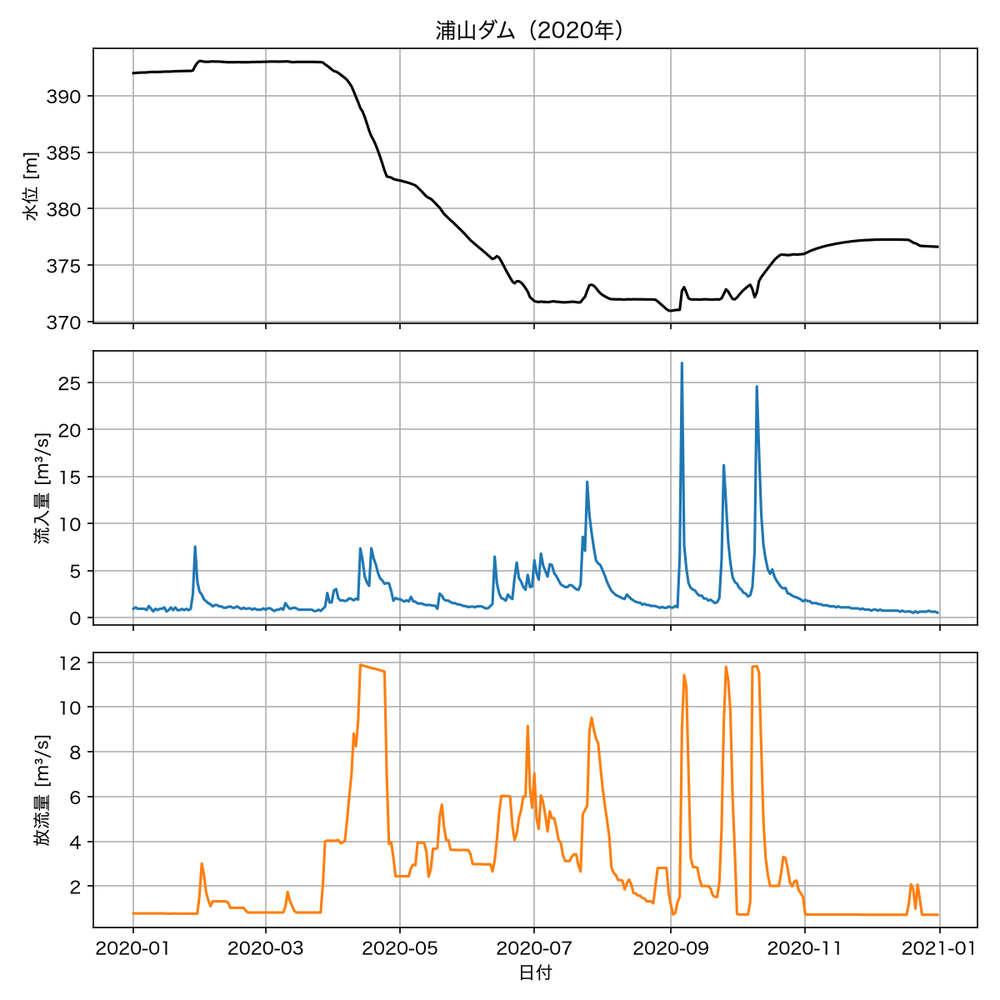

# 第6回　河川流量とダム貯水量

### 今回の位置付け

1. 現象の理解
2. <span style="color:red">仮定の設定</span>
3. <span style="color:red">数理モデルの構築</span>
4. 数値シミュレーション
5. <span style="color:red">データとの比較</span>
6. パラメタ推定
7. モデルの検証と改善

- 第5回まで：人口モデルのパラメタを観測値から推定した．
- **第6回**：保存則からダムの貯水量のモデルを構築し，観測流量を**外部入力**として与える．
  - モデルの構築：流入・流出と貯水量の変化を，単位をそろえて結び付ける．
  - データとの比較：貯水位と貯水量の対応を仮定し，計算結果との差を調べる．

### 到達目標

- 蓄積量の時間変化率が流入流量と流出流量の差に等しいという保存則から，貯水量の微分方程式 $V' = Q_{\mathrm{in}}(t) - Q_{\mathrm{out}}(t)$ を導ける
- 流量の単位 m³/s と貯水量の単位 千m³ を整合させる換算を，自分で導いて実行できる
- 観測された貯水位と，モデルの状態変数である貯水量が別の量であることを説明し，両者を結ぶ近似上の仮定を明示できる
- 離散的な観測値を補間して`solve_ivp`の右辺から参照し，外部入力付きの初期値問題を解ける
- モデルの計算結果と水位からの換算値を同じ図に示し，ずれが時間とともに蓄積する理由を説明できる

<!--
**今回の流れ**（105分の目安）

| 段階 | 内容 | 時間 |
| --- | --- | --- |
| 1 | 人口モデルとの違い，ダムのデータの確認（演習0） | 10分 |
| 2 | 保存則，単位の整合，貯水位と貯水量の関係（演習1・2） | 25分 |
| 3 | 観測値の補間と`solve_ivp`による1か月の計算 | 20分 |
| 4 | 1年間の計算，誤差の蓄積，期間を変える演習（演習3・4） | 35分 |
| 5 | 欠測・観測誤差・時間間隔の議論，まとめ，課題の説明 | 15分 |
-->

## 準備

````{note} 演習0：作業フォルダとNotebookの準備

1. ターミナルで第6回の作業フォルダを作成せよ．データフォルダは第1回以来の共通のものを使う．

```bash
mkdir -p ~/applied_programming_ii/06
cd ~/applied_programming_ii/06
mkdir -p notebooks reports/figures
```

- **コードの補足**：`mkdir -p`は必要な親フォルダも作成し，`cd`は作業フォルダを移動する．

実行後の構成は次のとおりである．`data`は各回で共通に使用し，`README.md`とNotebookは続く手順で作成する．

```text
applied_programming_ii/
├── data/
└── 06/
    ├── README.md
    ├── notebooks/
    │   └── reservoir_balance.ipynb
    └── reports/
        └── figures/
```

2. {download}`授業用CSV <../data/dam_urayama_daily.csv>`をダウンロードし，`dam_urayama_daily.csv`として`~/applied_programming_ii/data/`に保存せよ．

3. `notebooks/reservoir_balance.ipynb`を新規作成せよ．

4. `06`フォルダに`README.md`を作り，次の内容を記入せよ．

```markdown
# 応用プログラミングII 第6回

- 氏名：
- 学籍番号：

## 今日の目標

保存則からダム貯水量のモデルを作り，観測された流入量と放流量を入力として計算し，観測された貯水位と比べる．

## データの確認

- 出典：
- 期間：
- 時間間隔：
- 単位（貯水位，流入量，放流量）：
- 欠損値：

## 演習1：単位の換算

1. 換算の式：
2. 最大流入量の換算値・1日分の水量が有効貯水容量に占める割合：
3. 換算を省いた場合の倍率：

## 演習2：貯水位と貯水量の対応についての仮定

1. 線形換算の仮定：
2. 換算誤差と確認に必要な資料：
3. バッテリー残量の例との共通点：

## 演習3

1. 選んだ年・最終日の差・RMSE：
2. 2019年との比較と，RMSEが小さい年：
3. 差が広がった時期・水位の特徴・考察：

## 演習4

1. 初期値の再設定によるRMSEの変化：
2. 再設定後も残る差と考えられる要因：
3. 再現計算と将来予測の違い：

## 課題1

1. 換算結果と30日分の水量を計算する際の仮定：
2. 選んだ年月・Notebookの図：
3. 計算区間の流入・放流水量，換算貯水量の変化，収支の差と有効貯水容量に対する割合：

## 課題2の考察
```

5. Notebookの最初のコードセルに以下を入力し，実行できることを確認せよ．

計算・描画に使うライブラリを読み込み，データの場所と図の保存先を設定する．

```python
from pathlib import Path

import numpy as np
import pandas as pd
import matplotlib.pyplot as plt
from scipy.integrate import solve_ivp

plt.rcParams["font.family"] = "Hiragino Sans"  # 日本語表示用（macOS）

PROJECT_DIR = Path.home() / "applied_programming_ii" / "06"
DATA_DIR = Path.home() / "applied_programming_ii" / "data"
FIGURE_DIR = PROJECT_DIR / "reports" / "figures"
FIGURE_DIR.mkdir(parents=True, exist_ok=True)

print("作業フォルダ:", PROJECT_DIR)
print("ダムデータの有無:", (DATA_DIR / "dam_urayama_daily.csv").exists())
```

```{dropdown} コードの補足

- `PROJECT_DIR`と`DATA_DIR`：作業用フォルダと共通データの場所を指定する．
- `FIGURE_DIR.mkdir(...)`：図の保存先を作成する．`exist_ok=True`により，既に存在する場合も実行を続ける．
- `.exists()`：指定したファイルが存在すれば`True`を返す．
```

出力例（`ユーザー名`の部分は実行環境によって異なる）：

```text
作業フォルダ: /Users/ユーザー名/applied_programming_ii/06
ダムデータの有無: True
```
````

## 復習と今回の準備

以下の数値出力は実行例であり，数値解の末尾はライブラリのバージョンなどによって異なる場合がある．

- **初期値問題**：第2回と同じく，初期値と右辺の関数を`solve_ivp`に渡し，指定した時刻での解を求める．
- **観測値との比較**：第3〜5回と同じく，モデル値と比較用データを同じ単位・同じ時刻にそろえる．
- **外部入力**：状態変数の方程式とは別に与える時間の関数．今回は観測された流入量・放流量から作る．人口モデルと異なり，これらの入力から貯水量の変化率が決まる．

## 導入：浦山ダムの観測データ

### データの出典と確認

今回使うのは，埼玉県秩父市にある浦山ダムの日データである．
浦山ダムは荒川水系浦山川にある重力式コンクリートダムで，水資源機構が管理している．
データは国土交通省の[ダム諸量データベース](https://mudam.nilim.go.jp/)から取得し，授業用に整形したものである．
授業用CSVには2015〜2023年の日付・貯水位・流入量・放流量を収録している．

データを読み込んだら，第3回で人口データに対して行ったのと同じ手順で，期間，時間間隔，単位，欠損値を確認する．

```python
dam = pd.read_csv(DATA_DIR / "dam_urayama_daily.csv", parse_dates=["date"])

print(dam.head())
print(dam.tail())
print("期間:", dam["date"].min().date(), "〜", dam["date"].max().date(), " 行数:", len(dam))
print("欠損値の数:")
print(dam.isna().sum())

# 日付の間隔がすべて1日であることを確認する．
intervals = dam["date"].diff().dt.days.dropna()
print("日付の間隔（日）の種類:", sorted(intervals.unique().tolist()))
```

```{dropdown} コードの補足

- `parse_dates=["date"]`：日付の列を日時型として読み込む．
- `head()`・`tail()`・`isna().sum()`：先頭・末尾のデータと，列ごとの欠損値数を確認する．
- `diff().dt.days`：隣り合う日付の差を日数で表す．先頭の欠損値を除き，`unique().tolist()`で間隔の種類をリストにする．
```

出力例：

```text
        date  water_level_m  inflow_m3s  outflow_m3s
0 2015-01-01         380.37        0.72         0.72
1 2015-01-02         380.37        0.72         0.72
2 2015-01-03         380.37        0.72         0.72
3 2015-01-04         380.37        0.72         0.72
4 2015-01-05         380.37        0.72         0.72
           date  water_level_m  inflow_m3s  outflow_m3s
3282 2023-12-27         370.43        0.58         1.52
3283 2023-12-28         370.34        0.48         1.52
3284 2023-12-29         370.24        0.48         1.51
3285 2023-12-30         370.14        0.58         1.51
3286 2023-12-31         370.04        0.47         1.51
期間: 2015-01-01 〜 2023-12-31  行数: 3287
欠損値の数:
date             0
water_level_m    0
inflow_m3s       0
outflow_m3s      0
dtype: int64
日付の間隔（日）の種類: [1.0]
```

| 列 | 意味 | 単位 |
| --- | --- | --- |
| `date` | 日付 | — |
| `water_level_m` | 日平均貯水位（標高） | m |
| `inflow_m3s` | 日平均流入量 | m³/s |
| `outflow_m3s` | 日平均放流量（発電と用水の取水を含む） | m³/s |

[ダム諸量データベースの項目説明](https://mudam.nilim.go.jp/chronology/about/form02)に基づき，各観測量の作られ方も確認する．

- **貯水位**：毎正時の水位24個の平均値．CSVには日平均値が記録されている．
- **流入量**：貯水位を水位・容量曲線で貯水量へ換算し，その時間変化と放流量から計算した値の日平均．独立に測った流入量ではない．
- **放流量**：ゲートの開度などから水理公式で求めた流量の日平均．

流量と貯水位は算出過程で関係しているため，後の比較は独立な観測による検証ではなく，換算・補間を含むモデルとデータの整合性の確認になる．

### 2019年の観測値の可視化

2019年を主な対象とする．台風19号の影響を受けた10月を含め，流量と貯水位の時間変化を調べる．まず2019年の行を取り出し，流入量・放流量の最大値とその日付を確認する．

```python
year = 2019
dam_year = dam[dam["date"].dt.year == year].reset_index(drop=True)
print(f"対象年: {year}年，観測日数: {len(dam_year)}日")
print("流入量の最大値:", dam_year["inflow_m3s"].max(), "m^3/s  日付:", dam_year.loc[dam_year["inflow_m3s"].idxmax(), "date"].date())
print("放流量の最大値:", dam_year["outflow_m3s"].max(), "m^3/s  日付:", dam_year.loc[dam_year["outflow_m3s"].idxmax(), "date"].date())
```

- **コードの補足**：`.dt.year == year`：指定した年の行を選ぶ．`reset_index(drop=True)`で行番号を0から付け直す．
- **コードの補足**：`idxmax()`：最大値の行番号を返す．`.loc[行番号, "date"]`で対応する日付を取り出す．

出力例：

```text
対象年: 2019年，観測日数: 365日
流入量の最大値: 201.11 m^3/s  日付: 2019-10-12
放流量の最大値: 126.62 m^3/s  日付: 2019-10-13
```

水位・流入量・放流量を同じ日付の軸で上下に並べ，増減の時期を比較する．

```python
fig, axes = plt.subplots(3, 1, figsize=(8, 8), sharex=True)
axes[0].plot(dam_year["date"], dam_year["water_level_m"], color="black")
axes[0].set_ylabel("水位 [m]")
axes[0].set_title(f"浦山ダム（{year}年）")
axes[1].plot(dam_year["date"], dam_year["inflow_m3s"], color="tab:blue", label="流入量")
axes[1].set_ylabel("流入量 [m³/s]")
axes[2].plot(dam_year["date"], dam_year["outflow_m3s"], color="tab:orange", label="放流量")
axes[2].set_ylabel("放流量 [m³/s]")
axes[2].set_xlabel("日付")
for ax in axes:
    ax.grid(True)
fig.tight_layout()
fig.savefig(FIGURE_DIR / f"dam_observed_{year}.png", dpi=150)
plt.show()
```

- **コードの補足**：`plt.subplots(3, 1, sharex=True)`：日付の横軸を共有し，水位・流入量・放流量を上下3段に並べる．


- **貯水位の変化**：2019年は夏に低く，秋以降に高くなる．洪水に備えて貯留できる容量を確保する運用を考える必要がある．[浦山ダムの操作状況](https://www.arakawadam.org/arasou/kanri/public/urayama.html)では，洪水貯留準備水位を標高372.0 mとしている．
- **流量の変化**：10月12日の流入量は201.11 m³/s，放流量の最大値は翌13日の126.62 m³/sである．流入量と放流量の差が，貯水量の増減にどう対応するかを調べる．

## 数理モデルの仮定

### 保存則

貯水池内の水の体積を $V(t)$ とする．水の密度を一定とみなし，出入りする水の体積を全て数えると，質量保存則は次の関係で表される．

$$
\text{貯水量の変化率} = \text{流入量} - \text{流出量}
$$

- **流量**：単位時間あたりに通過する水の体積．以下ではCSVの名称に合わせて流入量・放流量と呼ぶが，どちらも流量を表す．
- **貯水量**：ある時刻に貯水池に蓄えられている水の体積．流量とは単位が異なる．

今回は記録された2種類の流量で出入りを代表させ，次の仮定を置く．

- **入力の範囲**：CSVの流入量と放流量を使い，降雨・蒸発・地下水などの項を別には加えない．逆算された流入量には，これらの影響が含まれている可能性もある．
- **時間方向の近似**：日平均流量を日ごとの代表時刻の値として配置し，隣接する値の間を線形補間する．日内の変動は再現しない．

計算結果と観測データに差が生じた場合は，これらの仮定と，次に定める水位から貯水量への換算を検討する．

### 微分方程式

状態変数を貯水量 $V(t)$ ，流入量を $Q_{\mathrm{in}}(t)$ ，放流量を $Q_{\mathrm{out}}(t)$ とすると，保存則は

$$
\frac{dV}{dt} = Q_{\mathrm{in}}(t) - Q_{\mathrm{out}}(t),
\qquad V(t_0) = V_0
$$

となる．
第1回の言葉で各要素を整理する．

| 要素 | 内容 |
| --- | --- |
| 状態変数 | 貯水量 $V(t)$ |
| 観測量 | 貯水位（m），流入量（m³/s），放流量（m³/s） |
| パラメタ | 収支式で推定する係数はなし．水位から貯水量への換算係数は後で固定する |
| 初期条件 | 計算を始める日の貯水量 $V_0$ |
| 外部入力 | $Q_{\mathrm{in}}(t)$ ， $Q_{\mathrm{out}}(t)$ ．観測データで与える |
| 仮定 | 出入りは流入量と放流量のみ．日平均流量を代表時刻に配置し線形補間する |

- **右辺の特徴**：変化率は外部入力だけで決まり，現在の貯水量 $V$ には依存しない．第2回の初期値問題の特別な場合として，`solve_ivp`を使える．
- **計算の位置付け**：計算期間全体の観測流量を与え，過去の貯水量の変化を再現する．将来の流入量・放流量はこの式からは求まらないため，そのまま将来予測にはならない．

### 単位の整合

流入量と放流量の単位は m³/s である．
一方，貯水量は，ダムの諸元表では 千m³ で表され，日データの時間単位は日である．
微分方程式の両辺の単位を合わせるには，流量を千m³／日に換算しなければならない．

1日は $24 \times 60 \times 60 = 86400$ 秒なので，1 m³/s の流れが1日続くと $86400$ m³，すなわち $86.4$ 千m³ になる．

$$
1\ \mathrm{m^3/s} = 86400\ \mathrm{m^3}/\text{日} = 86.4\ \text{千}\mathrm{m^3}/\text{日}
$$

流量を千m³／日に換算する関数を定義し，2019年の最大流入量が1日続いた場合の水量を有効貯水容量と比較する．

```python
SECONDS_PER_DAY = 24 * 60 * 60


def m3s_to_1000m3_per_day(flow_m3s):
    """流量 [m^3/s] を [千m^3/日] に換算する．"""
    return flow_m3s * SECONDS_PER_DAY / 1000


V_EFFECTIVE = 56000.0   # 有効貯水容量 [千m^3]

q_max = dam_year["inflow_m3s"].max()
q_max_daily = m3s_to_1000m3_per_day(q_max)
print(f"最大流入量 {q_max:.2f} m^3/s = {q_max_daily:.1f} 千m^3/日")
print(f"有効貯水容量に対する割合: {100 * q_max_daily / V_EFFECTIVE:.1f} %")
print(f"流入量 1.0 m^3/s = {m3s_to_1000m3_per_day(1.0):.1f} 千m^3/日")
```

- **コードの補足**：`SECONDS_PER_DAY / 1000`：秒から日への換算と，m³から千m³への換算をまとめた係数である．割合は最大流入量が1日続いたときの水量を有効貯水容量で割って求める．

出力例：

```text
最大流入量 201.11 m^3/s = 17375.9 千m^3/日
有効貯水容量に対する割合: 31.0 %
流入量 1.0 m^3/s = 86.4 千m^3/日
```

````{note} 演習1：単位の換算

1. 1 m³/s を千m³／日へ換算する式を導き，`README.md`の「演習1」に記せ．
2. 上のコードを使い，2019年の最大流入量が1日続いた場合の水量と，有効貯水容量に対する割合を記せ．
3. 1日分の水量を求めるとき，換算せずに m³/s の数値を千m³として使うと，正しい値の何倍になるか答えよ．
````

````{visible-answer} 演習1の解答例

**1．換算の式**

1日は86400秒，1000 m³は1千m³なので，

$$
1\ \mathrm{m^3/s}
= 86400\ \mathrm{m^3}/\text{日}
= 86.4\ \text{千}\mathrm{m^3}/\text{日}
$$

となる．

**2．最大流入量の換算と割合**

本文の `q_max` 以降の計算をそのまま使う．流量を千m³/日に換算し，1日分の水量を有効貯水容量で割る．

$$
201.11\times86.4=17375.904\ \text{千}\mathrm{m^3}/\text{日},
\qquad
\frac{17375.904\times1}{56000}\times100\approx31.0\%.
$$

出力例：

```text
最大流入量 201.11 m^3/s = 17375.9 千m^3/日
有効貯水容量に対する割合: 31.0 %
```

**3．換算を省いた場合の倍率**

換算前の数値をそのまま使うと，**正しい水量の約0.0116倍**になる．例えば1 m³/sでは，1日分の正しい水量86.4千m³を1千m³として扱ってしまうため，倍率は $1/86.4\approx0.0116$ である．
````

### 貯水位と貯水量の対応

モデルの状態変数は貯水量 $V$ （千m³）だが，データにあるのは貯水位 $h$ （m）である．
貯水量と貯水位の関係はダムごとに異なる曲線で表され，貯水池の形（水位が高いほど湖面が広い）に依存する．
この曲線は今回のデータには含まれていない．

以下では最低水位より上の水量を $V$ とする．最低水位で $V=0$ としても，貯水池全体が空になるという意味ではない．基準となる水量を差し引いても，貯水量の変化率は変わらない．換算には次の仮定を置く．

- 貯水量は，最低水位 EL. 304.0 m で0，常時満水位 EL. 393.3 m で有効貯水容量 56,000 千m³ になる
- その間では，貯水量は貯水位に対して線形に変化する

$$
V = V_{\mathrm{eff}} \cdot \frac{h - h_{\min}}{h_{\mathrm{full}} - h_{\min}},
\qquad
V_{\mathrm{eff}} = 56000,\ h_{\min} = 304.0,\ h_{\mathrm{full}} = 393.3
$$

このとき，貯水位1 mあたりの貯水量は $56000 / 89.3 \approx 627$ 千m³ である．
これは湖面の面積が約0.63 km²で水位によらず一定，と仮定したことに相当する．
水位・容量関係の局所的な傾きはその水位での湖面積に対応する．実際の傾きは水位に依存するため，一定値による換算は近似である．
この換算の近似も，計算結果との差の要因として検討する．次の関数で水位を換算し，代表的な水位での値を確認する．

```python
LEVEL_MIN = 304.0     # 最低水位 [m]
LEVEL_FULL = 393.3    # 常時満水位 [m]


def level_to_volume(level_m):
    """貯水位 [m] を貯水量 [千m^3] に換算する．最低水位と常時満水位の間で線形とみなす近似．"""
    return V_EFFECTIVE * (level_m - LEVEL_MIN) / (LEVEL_FULL - LEVEL_MIN)


slope = V_EFFECTIVE / (LEVEL_FULL - LEVEL_MIN)
print(f"貯水位1 mあたりの貯水量（線形近似）: {slope:.1f} 千m^3/m")
for level in [304.0, 350.0, 372.0, 393.3]:
    print(f"貯水位 {level:6.1f} m -> 貯水量 {level_to_volume(level):8.1f} 千m^3")

dam_year["volume_1000m3"] = level_to_volume(dam_year["water_level_m"])
print(dam_year[["date", "water_level_m", "volume_1000m3"]].head())
```

- **コードの補足**：`level_to_volume`：最低水位を基準とする線形換算を，1つの水位にも配列にも適用できる．`dam_year["volume_1000m3"]`に換算後の列を追加する．

出力例：

```text
貯水位1 mあたりの貯水量（線形近似）: 627.1 千m^3/m
貯水位  304.0 m -> 貯水量      0.0 千m^3
貯水位  350.0 m -> 貯水量  28846.6 千m^3
貯水位  372.0 m -> 貯水量  42642.8 千m^3
貯水位  393.3 m -> 貯水量  56000.0 千m^3
        date  water_level_m  volume_1000m3
0 2019-01-01         382.58   49277.491601
1 2019-01-02         382.57   49271.220605
2 2019-01-03         382.55   49258.678611
3 2019-01-04         382.53   49246.136618
4 2019-01-05         382.52   49239.865622
```

````{note} 演習2：観測量と状態変数の対応を書く

`README.md`の「演習2」に次を記せ．

1. 観測量（貯水位）と状態変数（貯水量）を結ぶために置いた仮定を，自分の言葉で1〜2文で説明せよ．
2. 水位によって湖面積が変わると，一定の傾きによる換算にはどのような誤差が生じ得るか．誤差の大小を確かめるために必要な追加資料も挙げよ．
3. 第1回で扱ったバッテリー残量の例（表示は%，状態変数は電荷量）と，今回の貯水位と貯水量の関係の共通点を1文で記せ．
````

````{visible-answer} 演習2の解答例

**1．線形換算の仮定**

最低水位304.0 mで貯水量を0，常時満水位393.3 mで56000千m³とし，この間で貯水量が水位に比例して増えると仮定した．すなわち，水位1 mの上昇に対する水量の増加を約627千m³で一定とした．

**2．換算誤差と追加資料**

- **誤差が生じる理由**：実際の湖面積が水位とともに変われば，同じ1 mの水位差でも水量の変化は異なる．線形換算では，実際の水位・容量曲線との差に応じて貯水量を過大評価または過小評価する．
- **確認に必要な資料**：浦山ダムの水位・容量曲線または対応表を用意し，同じ水位での貯水量を線形換算の結果と比較する．湖面積が変わるという情報だけでは，換算誤差の符号や大きさまでは決められない．

**3．バッテリー残量の例との共通点**

どちらも，表示・観測された量をモデルの状態変数と比べるために，両者を結ぶ換算の関係が必要になる．
````

```{tip} オープンデータの3つの役割
今回のデータは3通りの使われ方をする．
流入量と放流量はモデルへの**入力**，貯水位から換算した貯水量は計算結果と比べる**比較用データ**，初日の貯水位から換算した貯水量は**初期条件**である．流入量の算出にも貯水位が使われているため，これらは独立した観測ではない．
同じCSVの中の列でも，モデルの中での役割は異なる．
第7回では，同じデータがパラメタ推定の対象にもなる．
```

## Pythonによる実装

### 観測値の補間と右辺からの参照

`solve_ivp`は，計算の途中で任意の時刻 $t$ における右辺の値を要求する．
観測値は1日ごとの離散値なので，観測のない時刻の値を何らかの方法で決めなければならない．
最も単純なのは，隣り合う観測値を直線でつなぐ線形補間で，`np.interp`で行える．

時間の変数 $t$ は，計算を始める日を0とした日数とする．
補間に使う時刻の配列，流入量の配列，放流量の配列は，右辺の関数に引数として渡す．

```python
def reservoir_rhs(t, V, t_data, qin_data, qout_data):
    """dV/dt = Q_in(t) - Q_out(t) の右辺．流入量と放流量は観測値を線形補間して使う．

    t_data: 観測時刻の配列 [日]
    qin_data, qout_data: 観測された流入量と放流量の配列 [千m^3/日]
    """
    q_in = np.interp(t, t_data, qin_data)
    q_out = np.interp(t, t_data, qout_data)
    return q_in - q_out


# 2日分の仮の入力で，中間時刻の補間を確認する．
rate_example = reservoir_rhs(0.5, 100.0, [0.0, 1.0], [80.0, 120.0], [60.0, 80.0])
print(f"0.5日後の貯水量の変化率: {rate_example:.1f} 千m^3/日")
```

```{dropdown} コードの補足

- `np.interp(t, t_data, ...)`：隣り合う観測時刻の値を線形補間し，任意の時刻`t`での流量を求める．
- 動作確認：0.5日後の流入量は100，放流量は70千m³/日なので，差は30千m³/日となる．
- `V`：`solve_ivp`に渡す右辺の第2引数として受け取る．今回の変化率は流量の入力だけで決まる．
```

出力例：

```text
0.5日後の貯水量の変化率: 30.0 千m^3/日
```

### 1か月の計算：2019年10月

まず台風を含む2019年10月の1か月間を計算する．
観測された流量を千m³／日に換算し，初日の貯水位から初期条件を決め，`solve_ivp`を呼ぶ．
入力が1日ごとに折れ曲がる関数なので，`max_step=1.0`を指定して計算の刻み幅が1日を超えないようにする．

```python
month = dam[(dam["date"] >= "2019-10-01") & (dam["date"] <= "2019-10-31")].reset_index(drop=True)

# 観測値をモデルの単位に揃える
t_obs = np.arange(len(month), dtype=float)                       # 10月1日を0とした日数 [日]
qin_obs = m3s_to_1000m3_per_day(month["inflow_m3s"].values)      # [千m^3/日]
qout_obs = m3s_to_1000m3_per_day(month["outflow_m3s"].values)    # [千m^3/日]
V_obs = level_to_volume(month["water_level_m"].values)           # [千m^3]

# 初期条件と計算区間
V0 = V_obs[0]
t_span = (t_obs[0], t_obs[-1])

sol = solve_ivp(reservoir_rhs, t_span, [V0], t_eval=t_obs, args=(t_obs, qin_obs, qout_obs), max_step=1.0)
V_model = sol.y[0]

print("成功したか:", sol.success)
print(f"{'日付':>12} {'流入':>8} {'放流':>8} {'モデルV':>9} {'換算V':>9} {'差':>8}")
for i in range(8, 18):
    print(f"{str(month['date'][i].date()):>12} {qin_obs[i]:8.0f} {qout_obs[i]:8.0f} {V_model[i]:9.0f} {V_obs[i]:9.0f} {V_model[i] - V_obs[i]:8.0f}")
```

```{dropdown} コードの補足

- `args=(t_obs, qin_obs, qout_obs)`：観測時刻と流量の配列を右辺の追加引数に渡す．
- `max_step=1.0`：内部の計算刻み幅の上限を1日に設定する．`t_eval`は解を出力する時刻の指定であり，役割が異なる．
- 出力の単位：流入・放流は千m³/日，モデルV・換算V・差は千m³である．差は計算値から水位に基づく換算値を引いた値である．
```

出力例：

```text
成功したか: True
          日付       流入       放流      モデルV       換算V        差
  2019-10-09       90       62     43004     42894      111
  2019-10-10       93       67     43026     42912      114
  2019-10-11      162      816     42822     42718      104
  2019-10-12    17376     4079     48915     45320     3595
  2019-10-13     6994    10940     53694     50155     3539
  2019-10-14     2049     7550     49015     46575     2440
  2019-10-15     1184     3307     45189     44204      985
  2019-10-16      876     1712     43702     43333      369
  2019-10-17      742     1250     43032     42900      132
  2019-10-18      616      444     42863     42718      145
```

流入量・放流量を上段，貯水量の計算結果と水位からの換算値を下段に描き，増減の時期を比較する．

```python
fig, axes = plt.subplots(2, 1, figsize=(8, 6), sharex=True)
axes[0].bar(month["date"], qin_obs, color="tab:blue", alpha=0.6, label="流入量（観測値）")
axes[0].plot(month["date"], qout_obs, color="tab:orange", marker="s", markersize=3, label="放流量（観測値）")
axes[0].set_ylabel("流量 [千m³/日]")
axes[0].set_title("浦山ダムの流入・放流と貯水量（2019年10月）")
axes[0].legend()
axes[1].plot(month["date"], V_obs, color="black", marker="o", markersize=3, linestyle="none", label="貯水位からの換算値")
axes[1].plot(month["date"], V_model, color="tab:green", label="収支モデル")
axes[1].set_ylabel("貯水量 [千m³]")
axes[1].set_xlabel("日付")
axes[1].legend()
for ax in axes:
    ax.grid(True)
fig.autofmt_xdate(rotation=30)
fig.tight_layout()
fig.savefig(FIGURE_DIR / "reservoir_october_2019.png", dpi=150)
plt.show()
```

- **コードの補足**：`axes[0].bar`：流入量を棒グラフで示す．下段では，貯水位から換算した貯水量を点，計算した貯水量を線で重ねる．
- `fig.autofmt_xdate(rotation=30)`：日付の目盛りを30度傾け，文字の重なりを避ける．


- **結果**：10月12日の計算結果は，水位からの換算値より約3,600千m³大きい．貯水量の変化は，補間した流入量と放流量の差を時間積分した値である．その日の流量の差だけでは，前日からの貯水量変化を求められない．
- **検討する仮定**：水位・容量関係を線形としたことや，日平均値を代表時刻に配置して補間したことが，差の要因として考えられる．実際の水位・容量曲線や1時間ごとのデータで確かめる必要がある．

## 1年間の計算と誤差の蓄積

### 2019年の1年間

同じ手順を2019年の1年間に広げる．

```python
def simulate_reservoir(dam_window):
    """連続した日データを受け取り，時刻，計算した貯水量，水位からの換算値を返す．"""
    t_data = np.arange(len(dam_window), dtype=float)
    qin_data = m3s_to_1000m3_per_day(dam_window["inflow_m3s"].values)
    qout_data = m3s_to_1000m3_per_day(dam_window["outflow_m3s"].values)
    V_observed = level_to_volume(dam_window["water_level_m"].values)
    solution = solve_ivp(reservoir_rhs, (t_data[0], t_data[-1]), [V_observed[0]], t_eval=t_data, args=(t_data, qin_data, qout_data), max_step=1.0)
    return t_data, solution.y[0], V_observed


t_year, V_model_year, V_obs_year = simulate_reservoir(dam_year)
error_year = V_model_year - V_obs_year

print(f"初日の貯水量:            {V_obs_year[0]:9.0f} 千m^3")
print(f"最終日の換算貯水量:      {V_obs_year[-1]:9.0f} 千m^3")
print(f"最終日のモデル貯水量:    {V_model_year[-1]:9.0f} 千m^3")
print(f"最終日の差:              {error_year[-1]:9.0f} 千m^3（有効貯水容量の {100 * error_year[-1] / V_EFFECTIVE:.1f} %）")
print(f"差の二乗平均平方根 RMSE: {np.sqrt(np.mean(error_year ** 2)):9.0f} 千m^3")
```

- **コードの補足**：`simulate_reservoir`：対象期間のデータから時刻・流量・初期値を用意し，時刻とモデル値と比較用の貯水量を返す．
- **コードの補足**：`error_year`：モデル値から比較用の貯水量を引いた差である．その二乗平均の平方根がRMSEである．

出力例：

```text
初日の貯水量:                49277 千m^3
最終日の換算貯水量:          55178 千m^3
最終日のモデル貯水量:        60143 千m^3
最終日の差:                   4965 千m^3（有効貯水容量の 8.9 %）
差の二乗平均平方根 RMSE:      2907 千m^3
```

貯水量の計算結果と換算値を上段，その差を下段に示し，差の符号と大きさの時間変化を確認する．

```python
fig, axes = plt.subplots(2, 1, figsize=(8, 6), sharex=True)
axes[0].plot(dam_year["date"], V_obs_year, color="black", marker="o", markersize=2, linestyle="none", label="貯水位からの換算値")
axes[0].plot(dam_year["date"], V_model_year, color="tab:green", label="収支モデル")
axes[0].axhline(V_EFFECTIVE, color="gray", linestyle=":", label="有効貯水容量")
axes[0].set_ylabel("貯水量 [千m³]")
axes[0].set_title(f"浦山ダムの貯水量収支モデルと換算値（{year}年）")
axes[0].legend()
axes[1].plot(dam_year["date"], error_year, color="tab:red")
axes[1].axhline(0, color="black", linewidth=0.8)
axes[1].set_ylabel("計算値−換算値 [千m³]")
axes[1].set_xlabel("日付")
for ax in axes:
    ax.grid(True)
fig.tight_layout()
fig.savefig(FIGURE_DIR / f"reservoir_balance_{year}.png", dpi=150)
plt.show()
```

- **コードの補足**：`axhline(V_EFFECTIVE)`：有効貯水容量を水平線で示す．下段はモデル値と比較用データの差の時系列であり，0の線を基準に偏りを読む．


### 収支の確認

モデルと同じ期間で，流入・放流の水量と水位から換算した貯水量の変化を比較する．1月1日から12月31日の代表時刻までの経過時間は364日である．

- **台形則**：区間両端の流量の平均に区間の長さを掛けて水量を求める積分法．線形補間した流量の積分は，この台形の面積の和と一致する．

各区間の水量を合計し，初日と最終日の換算貯水量の差と比較する．

```python
qin_year = m3s_to_1000m3_per_day(dam_year["inflow_m3s"].values)
qout_year = m3s_to_1000m3_per_day(dam_year["outflow_m3s"].values)
dt = np.diff(t_year)
total_in = np.sum((qin_year[:-1] + qin_year[1:]) / 2 * dt)
total_out = np.sum((qout_year[:-1] + qout_year[1:]) / 2 * dt)
observed_change = V_obs_year[-1] - V_obs_year[0]

print(f"計算期間の流入水量:     {total_in:9.0f} 千m^3")
print(f"計算期間の放流水量:     {total_out:9.0f} 千m^3")
print(f"流入 - 放流:            {total_in - total_out:9.0f} 千m^3")
print(f"換算した貯水量の変化:   {observed_change:9.0f} 千m^3")
print(f"収支と換算値の変化の差: {(total_in - total_out) - observed_change:9.0f} 千m^3")
```

```{dropdown} コードの補足

- `np.diff(t_year)`：隣り合う代表時刻の差を求める．今回は全て1日である．
- `qin_year[:-1]`と`qin_year[1:]`：各区間の始めと終わりの流量を対応させる．平均に`dt`を掛けると区間の水量になる．
- `np.sum(...)`：各区間の水量を合計する．`solve_ivp`による貯水量の変化とは，数値積分の誤差の範囲で一致する．
```

出力例：

```text
計算期間の流入水量:         96018 千m^3
計算期間の放流水量:         85152 千m^3
流入 - 放流:                10866 千m^3
換算した貯水量の変化:        5901 千m^3
収支と換算値の変化の差:      4965 千m^3
```

- **収支の差**：流入水量から放流水量を引いた量は約10,900千m³，換算した貯水量の変化は約5,900千m³であり，約5,000千m³の差がある．
- **入力の偏りの蓄積**：この差を364日で割ると，1日あたり約14千m³，流量では約0.16 m³/sに相当する．同じ符号の偏りが続くと，小さな流量差も時間積分によって蓄積する．
- **換算の誤差との区別**：水位から貯水量への換算は初期値と比較用データにも影響する．上の差だけから，実際に流量が0.16 m³/s偏っていたとは断定できない．

````{note} 演習3：期間を変えて計算する

1. `year`を`2020`から`2023`のいずれかに変え，対象年のデータ抽出，観測値の図，1年間の計算・図，収支の確認を再実行せよ．選んだ年，最終日の差，RMSEを`README.md`に記せ．
2. 2019年と選んだ年のRMSEを比較し，どちらの年で計算結果と換算値の当てはまりがよいか答えよ．
3. 選んだ年で差の絶対値が大きくなる時期を図から読み取り，その時期の貯水位の特徴を記せ．
````

````{visible-answer} 演習3の解答例

**1．2020年の計算と図**

本文で定義した `simulate_reservoir` を使う．年の指定を2020へ変更し，対象データを取り出し直す．

2020年の観測日数と流量の最大値を確認する．

```{code-block} python
:linenos:
:emphasize-lines: 1
:class: code-focus

year = 2020
dam_year = dam[dam["date"].dt.year == year].reset_index(drop=True)
print(f"対象年: {year}年，観測日数: {len(dam_year)}日")
print("流入量の最大値:", dam_year["inflow_m3s"].max(), "m^3/s  日付:", dam_year.loc[dam_year["inflow_m3s"].idxmax(), "date"].date())
print("放流量の最大値:", dam_year["outflow_m3s"].max(), "m^3/s  日付:", dam_year.loc[dam_year["outflow_m3s"].idxmax(), "date"].date())
```

- **コードの補足**：`year`だけを変更する．年の抽出条件は本文と同じである．

出力例：

```text
対象年: 2020年，観測日数: 366日
流入量の最大値: 27.08 m^3/s  日付: 2020-09-06
放流量の最大値: 11.88 m^3/s  日付: 2020-04-13
```

2020年の水位・流入量・放流量を描く．

```python
fig, axes = plt.subplots(3, 1, figsize=(8, 8), sharex=True)
axes[0].plot(dam_year["date"], dam_year["water_level_m"], color="black")
axes[0].set_ylabel("水位 [m]")
axes[0].set_title(f"浦山ダム（{year}年）")
axes[1].plot(dam_year["date"], dam_year["inflow_m3s"], color="tab:blue", label="流入量")
axes[1].set_ylabel("流入量 [m³/s]")
axes[2].plot(dam_year["date"], dam_year["outflow_m3s"], color="tab:orange", label="放流量")
axes[2].set_ylabel("放流量 [m³/s]")
axes[2].set_xlabel("日付")
for ax in axes:
    ax.grid(True)
fig.tight_layout()
fig.savefig(FIGURE_DIR / f"dam_observed_{year}.png", dpi=150)
plt.show()
```

- **コードの補足**：本文と同じ描画コードを使い，年による水位や流量の特徴を比較する．



初日の換算貯水量を初期値とし，2020年の計算結果と換算値との差を求める．

```python
t_year, V_model_year, V_obs_year = simulate_reservoir(dam_year)
error_year = V_model_year - V_obs_year

print(f"初日の貯水量:            {V_obs_year[0]:9.0f} 千m^3")
print(f"最終日の換算貯水量:      {V_obs_year[-1]:9.0f} 千m^3")
print(f"最終日のモデル貯水量:    {V_model_year[-1]:9.0f} 千m^3")
print(f"最終日の差:              {error_year[-1]:9.0f} 千m^3（有効貯水容量の {100 * error_year[-1] / V_EFFECTIVE:.1f} %）")
print(f"差の二乗平均平方根 RMSE: {np.sqrt(np.mean(error_year ** 2)):9.0f} 千m^3")
```

- **コードの補足**：`dam_year`が2020年のデータなので，関数と誤差計算は本文のままでよい．

出力例：

```text
初日の貯水量:                55185 千m^3
最終日の換算貯水量:          45546 千m^3
最終日のモデル貯水量:        38165 千m^3
最終日の差:                  -7382 千m^3（有効貯水容量の -13.2 %）
差の二乗平均平方根 RMSE:      6560 千m^3
```

計算結果と換算値，および両者の差を上下に示す．

```python
fig, axes = plt.subplots(2, 1, figsize=(8, 6), sharex=True)
axes[0].plot(dam_year["date"], V_obs_year, color="black", marker="o", markersize=2, linestyle="none", label="貯水位からの換算値")
axes[0].plot(dam_year["date"], V_model_year, color="tab:green", label="収支モデル")
axes[0].axhline(V_EFFECTIVE, color="gray", linestyle=":", label="有効貯水容量")
axes[0].set_ylabel("貯水量 [千m³]")
axes[0].set_title(f"浦山ダムの貯水量収支モデルと換算値（{year}年）")
axes[0].legend()
axes[1].plot(dam_year["date"], error_year, color="tab:red")
axes[1].axhline(0, color="black", linewidth=0.8)
axes[1].set_ylabel("計算値−換算値 [千m³]")
axes[1].set_xlabel("日付")
for ax in axes:
    ax.grid(True)
fig.tight_layout()
fig.savefig(FIGURE_DIR / f"reservoir_balance_{year}.png", dpi=150)
plt.show()
```

- **コードの補足**：下段の差は計算値から換算値を引いた値であり，負の値は過小評価を表す．


2020年の計算期間に流入・放流した水量と，換算貯水量の変化を比較する．

```python
qin_year = m3s_to_1000m3_per_day(dam_year["inflow_m3s"].values)
qout_year = m3s_to_1000m3_per_day(dam_year["outflow_m3s"].values)
dt = np.diff(t_year)
total_in = np.sum((qin_year[:-1] + qin_year[1:]) / 2 * dt)
total_out = np.sum((qout_year[:-1] + qout_year[1:]) / 2 * dt)
observed_change = V_obs_year[-1] - V_obs_year[0]

print(f"計算期間の流入水量:     {total_in:9.0f} 千m^3")
print(f"計算期間の放流水量:     {total_out:9.0f} 千m^3")
print(f"流入 - 放流:            {total_in - total_out:9.0f} 千m^3")
print(f"換算した貯水量の変化:   {observed_change:9.0f} 千m^3")
print(f"収支と換算値の変化の差: {(total_in - total_out) - observed_change:9.0f} 千m^3")
```

- **コードの補足**：2020年は366個の代表時刻があり，最初から最後までの経過時間は365日である．

出力例：

```text
計算期間の流入水量:         78326 千m^3
計算期間の放流水量:         95346 千m^3
流入 - 放流:               -17020 千m^3
換算した貯水量の変化:       -9639 千m^3
収支と換算値の変化の差:     -7381 千m^3
```

**2．2019年との比較**

2019年のRMSEは約2907千m³，2020年は約6560千m³である．したがって，**この換算方法とRMSEを基準にすると，2019年の方が当てはまりがよい**．これは換算値との比較であり，真の貯水量に対する精度を直接評価した結果ではない．

**3．差が大きくなる時期と貯水位**

2020年は4〜6月に差が負の方向へ広がり，夏から初秋には約−9000千m³になる．同じ期間に貯水位は約392 mから約372 mへ低下し，夏は約372 mで推移する．計算値が換算値を下回る傾向が，水位の低下とともに強まっている．水位に対して一定の傾きで換算する仮定などを検討する手掛かりになる．
````

### 月ごとの初期値の再設定

このモデルの右辺は $V$ に依存しないため，同じ入力を与えた2つの解の差は時間によらず一定となる．したがって，初期値の誤差を減少させる仕組みはない．
そこで，毎月の初日の水位から初期値を設定し直す．前月までの差を引き継がずに計算した場合に，どのような差が残るかを調べる．対象年を2019年に戻し，各月の計算結果をまとめる．

```python
year = 2019
dam_year = dam[dam["date"].dt.year == year].reset_index(drop=True)
t_year, V_model_year, V_obs_year = simulate_reservoir(dam_year)
error_year = V_model_year - V_obs_year

segments = []
for month_number in range(1, 13):
    segment = dam_year[dam_year["date"].dt.month == month_number].reset_index(drop=True)
    t_seg, V_seg_model, V_seg_obs = simulate_reservoir(segment)
    segments.append(pd.DataFrame({"date": segment["date"], "V_model": V_seg_model, "V_obs": V_seg_obs}))
monthly_reset = pd.concat(segments, ignore_index=True)
monthly_error = monthly_reset["V_model"] - monthly_reset["V_obs"]

print(f"1年通しで計算した場合の RMSE:     {np.sqrt(np.mean(error_year ** 2)):8.0f} 千m^3")
print(f"毎月初期条件を置き直した場合の RMSE: {np.sqrt(np.mean(monthly_error ** 2)):8.0f} 千m^3")
```

```{dropdown} コードの補足

- `segments.append(...)`：月ごとの計算結果をリストに追加する．
- `pd.concat(..., ignore_index=True)`：各月の結果を縦に連結し，行番号を付け直す．
- 初期条件：各月の最初の観測水位から換算した貯水量で計算を開始し，その月の結果を比較する．
```

出力例：

```text
1年通しで計算した場合の RMSE:         2907 千m^3
毎月初期条件を置き直した場合の RMSE:      885 千m^3
```

1年通しの計算と月ごとの計算について，換算値との差を同じ図で比較する．

```python
fig, ax = plt.subplots(figsize=(8, 4))
ax.plot(dam_year["date"], error_year, color="tab:red", label="1年通しの計算")
ax.plot(monthly_reset["date"], monthly_error, color="tab:purple", label="毎月の初期値再設定")
ax.axhline(0, color="black", linewidth=0.8)
ax.set_title("月ごとの初期値の再設定と誤差の累積")
ax.set_xlabel("日付")
ax.set_ylabel("計算値−換算値 [千m³]")
ax.grid(True)
ax.legend()
fig.tight_layout()
fig.savefig(FIGURE_DIR / "reservoir_error_reset.png", dpi=150)
plt.show()
```

- **コードの補足**：同じ日付の軸に，1年通しの計算と月ごとに初期値を再設定した計算の差を重ねる．


````{note} 演習4：初期条件を途中で合わせ直す

1. 初期値の再設定によってRMSEがどれだけ小さくなったか，値の差を記せ．
2. 10月に残る差に注目し，水位からの換算と日平均流量の補間のうち，見直す仮定を1つ挙げ，理由を説明せよ．
3. この計算が各月初の情報だけによる将来予測と言えるか，計算に使う流量データの期間を根拠として答えよ．
````

````{visible-answer} 演習4の解答例

**1．RMSEの減少量**

本文で求めた2019年の `error_year` と `monthly_error` を使い，RMSEの差を計算する．

```python
rmse_year = np.sqrt(np.mean(error_year ** 2))
rmse_monthly = np.sqrt(np.mean(monthly_error ** 2))
print(f"1年通しのRMSE: {rmse_year:.0f} 千m^3")
print(f"月ごとのRMSE: {rmse_monthly:.0f} 千m^3")
print(f"RMSEの減少量: {rmse_year - rmse_monthly:.0f} 千m^3")
```

- **コードの補足**：本文と同じRMSEの式を使い，1年通しの値から月ごとの値を引く．

出力例：

```text
1年通しのRMSE: 2907 千m^3
月ごとのRMSE: 885 千m^3
RMSEの減少量: 2022 千m^3
```

**2．再設定後も残る差**

見直す仮定として，**日平均流量を代表時刻に配置して線形補間すること**を挙げる．10月は月初に初期値を合わせても，流量が急増する12日前後で差が生じる．日内変動を日平均値だけでは表せない可能性があるため，1時間ごとの流量・貯水位を用いた計算と比較する．この図だけで補間が唯一の原因とは断定できない．

**3．将来予測との区別**

<span style="color:red">各月初の情報だけによる将来予測とは言えない．月末までに観測された流入量・放流量を使っているため，その月の貯水量変化を再現する計算である．</span>将来予測には，初期値に加えて，計算対象期間の流入量の予測と放流計画などが必要になる．
````

## モデルの限界と改善の問い

計算結果と水位からの換算値との差について，見直す仮定と確認に必要な資料を対応させる．

- **水位からの換算**：水位・容量関係を線形とした仮定を，実際の水位・容量曲線と照合する．曲線が得られれば，`level_to_volume`を改訂して差が小さくなるか確認できる．
- **流量の算出**：流入量は貯水位の変化と放流量から逆算されるため，各列の誤差も関係している．算出に用いた容量曲線・時間間隔・丸め処理を確認する．流入量と放流量に共通する偏りが相殺される場合もあり，各流量の誤差がそのまま収支の誤差になるとは限らない．
- **時間方向の近似**：台風時の日内変動を確認するには，1時間ごとのデータが必要である．使う場合は，時刻配列を日単位の経過時間で作り，`max_step`も観測間隔に合わせて見直す．欠測があれば，補間する範囲や計算対象の期間を明記する．
- **追加する流入・流出**：蒸発・降雨などを別の項で表す場合は，逆算された流入量に既に含まれていないか確認する．計算結果との差だけから，蒸発量や漏水量を特定することはできない．

第7回では，水位から貯水量への換算の傾きを数値最適化で推定し，データとの当てはまりを調べる．


## まとめ

- **保存則**：貯水量の変化率を流入流量と流出流量の差で表す．
- **単位と換算の仮定**：流量の単位をそろえ，貯水位と貯水量を結ぶ仮定を明示する．
- **外部入力と誤差の蓄積**：流量を補間して入力に用いる．入力の偏りは時間積分によって蓄積するため，水位からの換算値と比較して差の時間変化を調べる．
- **次回**：格子探索に代わる数値最適化を学び，Logisticモデルと貯水位・貯水量の換算係数を推定する．

```{dropdown} 復習用の確認事項

1. 蓄積量の時間変化率が流入流量と流出流量の差に等しいという保存則を微分方程式にするとき，明示しておくべき仮定は何か．3つ挙げよ．
2. 1 m³/s の流れが1日続くと何千m³になるか．導出の過程を含めて説明せよ．
3. 今回の微分方程式には未知パラメタがなく，右辺は観測流量の補間値である．それでも計算結果が観測から外れた理由を，観測量と状態変数の対応，および流量誤差の時間積分を使って説明せよ．
4. 同じCSVファイルの中で，モデルへの入力として使った列，初期条件として使った値，比較用データとして使った列はそれぞれ何か．
```

## 課題

````{warning} 課題1：単位の換算と1か月の収支計算

1. 流量1.0 m³/sと201.11 m³/sを，それぞれm³/日，千m³/日に換算せよ．さらに，それぞれの流量が30日間一定と仮定した水量を千m³で求め，換算結果と仮定を`README.md`に記せ．
2. 2019年10月以外の任意の1か月を選び，「1か月の計算」のコードの日付・図のタイトル・保存名を変更して，同じ2段の図をNotebookに示せ．表の出力範囲は本文と同じ日付順の10行でよい．
3. 「収支の確認」のコードを使い，対象データを`dam_year`から`month`，時刻を`t_year`から`t_obs`，換算値を`V_obs_year`から`V_obs`に変更せよ．月初から月末の代表時刻までの流入・放流水量，換算した貯水量の変化，両者の差を記せ．差の絶対値が有効貯水容量の何%かも求めよ．
````

````{hidden-answer} 課題1の解答例

**1．単位の換算**

1日あたりの水量は，m³/sの値に86400を掛けて求める．千m³/日へはさらに1000で割り，30日分の水量はその値に30を掛ける．

| 流量 [m³/s] | 流量 [m³/日] | 流量 [千m³/日] | 30日分の水量 [千m³] |
| --- | ---: | ---: | ---: |
| 1.0 | 86400 | 86.4 | 2592 |
| 201.11 | 17375904 | 17375.904 | 521277.12 |

**30日間，同じ流量が続くことを仮定している**．201.11 m³/sは2019年の最大日平均流入量であり，その流量が実際に30日続いたという意味ではない．

**2．2019年11月の計算と図**

本文の月の指定を2019年11月に変更し，流量の換算から数値計算までを再実行する．

```{code-block} python
:linenos:
:emphasize-lines: 1
:class: code-focus

month = dam[(dam["date"] >= "2019-11-01") & (dam["date"] <= "2019-11-30")].reset_index(drop=True)

# 観測値をモデルの単位に揃える
t_obs = np.arange(len(month), dtype=float)                       # 11月1日を0とした日数 [日]
qin_obs = m3s_to_1000m3_per_day(month["inflow_m3s"].values)      # [千m^3/日]
qout_obs = m3s_to_1000m3_per_day(month["outflow_m3s"].values)    # [千m^3/日]
V_obs = level_to_volume(month["water_level_m"].values)           # [千m^3]

# 初期条件と計算区間
V0 = V_obs[0]
t_span = (t_obs[0], t_obs[-1])

sol = solve_ivp(reservoir_rhs, t_span, [V0], t_eval=t_obs, args=(t_obs, qin_obs, qout_obs), max_step=1.0)
V_model = sol.y[0]

print("成功したか:", sol.success)
print(f"{'日付':>12} {'流入':>8} {'放流':>8} {'モデルV':>9} {'換算V':>9} {'差':>8}")
for i in range(8, 18):
    print(f"{str(month['date'][i].date()):>12} {qin_obs[i]:8.0f} {qout_obs[i]:8.0f} {V_model[i]:9.0f} {V_obs[i]:9.0f} {V_model[i] - V_obs[i]:8.0f}")
```

- **コードの補足**：期間だけを変更する．月初の貯水量と流量の配列は，選んだ月から自動的に作られる．

出力例：

```text
成功したか: True
          日付       流入       放流      モデルV       換算V        差
  2019-11-09      221       67     53700     52827      873
  2019-11-10      208       67     53848     52902      945
  2019-11-11      208       67     53989     52977     1012
  2019-11-12      185       67     54119     53046     1073
  2019-11-13      173       67     54232     53109     1123
  2019-11-14      173       67     54338     53166     1172
  2019-11-15      161       67     54438     53216     1222
  2019-11-16      149       67     54527     53266     1261
  2019-11-17      149       67     54610     53310     1300
  2019-11-18      150       67     54693     53354     1339
```

11月の流量と貯水量を，本文と同じ2段の図に示す．

```python
fig, axes = plt.subplots(2, 1, figsize=(8, 6), sharex=True)
axes[0].bar(month["date"], qin_obs, color="tab:blue", alpha=0.6, label="流入量（観測値）")
axes[0].plot(month["date"], qout_obs, color="tab:orange", marker="s", markersize=3, label="放流量（観測値）")
axes[0].set_ylabel("流量 [千m³/日]")
axes[0].set_title("浦山ダムの流入・放流と貯水量（2019年11月）")
axes[0].legend()
axes[1].plot(month["date"], V_obs, color="black", marker="o", markersize=3, linestyle="none", label="貯水位からの換算値")
axes[1].plot(month["date"], V_model, color="tab:green", label="収支モデル")
axes[1].set_ylabel("貯水量 [千m³]")
axes[1].set_xlabel("日付")
axes[1].legend()
for ax in axes:
    ax.grid(True)
fig.autofmt_xdate(rotation=30)
fig.tight_layout()
fig.savefig(FIGURE_DIR / "reservoir_november_2019.png", dpi=150)
plt.show()
```

- **コードの補足**：描画の手順は本文と同じである．タイトルと保存名を11月にそろえる．


**3．収支と換算値の比較**

対象を11月の配列へ置き換え，月初から月末までの収支を確認する．最後に差の絶対値を有効貯水容量で割る．

```{code-block} python
:linenos:
:emphasize-lines: 13
:class: code-focus

qin_year = m3s_to_1000m3_per_day(month["inflow_m3s"].values)
qout_year = m3s_to_1000m3_per_day(month["outflow_m3s"].values)
dt = np.diff(t_obs)
total_in = np.sum((qin_year[:-1] + qin_year[1:]) / 2 * dt)
total_out = np.sum((qout_year[:-1] + qout_year[1:]) / 2 * dt)
observed_change = V_obs[-1] - V_obs[0]

print(f"計算期間の流入水量:     {total_in:9.0f} 千m^3")
print(f"計算期間の放流水量:     {total_out:9.0f} 千m^3")
print(f"流入 - 放流:            {total_in - total_out:9.0f} 千m^3")
print(f"換算した貯水量の変化:   {observed_change:9.0f} 千m^3")
print(f"収支と換算値の変化の差: {(total_in - total_out) - observed_change:9.0f} 千m^3")
print(f"差の絶対値が有効貯水容量に占める割合: {100 * abs((total_in - total_out) - observed_change) / V_EFFECTIVE:.2f} %")
```

- **コードの補足**：配列を置き換えても台形則の計算手順は同じである．`abs(...)`は絶対値を求め，正負によらない差の大きさを割合にする．

出力例：

```text
計算期間の流入水量:          6775 千m^3
計算期間の放流水量:          1921 千m^3
流入 - 放流:                 4854 千m^3
換算した貯水量の変化:        2571 千m^3
収支と換算値の変化の差:      2283 千m^3
差の絶対値が有効貯水容量に占める割合: 4.08 %
```

11月1日から30日の代表時刻までの**29日間**を比較している．設問1の30日分の仮想的な水量とは期間・入力が異なる．収支の差には水位からの換算や流量の補間も関係するため，この値をそのまま漏水量と解釈することはできない．
````

````{warning} 課題2：誤差が時間とともに広がる理由

2019年の1年間の図を見て，換算値との差の絶対値が大きい時期を1つ選べ．その時期・差の符号と大きさ・貯水位や流量の特徴を示し，見直す仮定とその根拠を1つ挙げて，200字程度で説明せよ．
````

````{hidden-answer} 課題2の解答例

**解答までの考え方**

1. **時期と差**：1年間の図の下段では，6月ごろに差が負の方向へ広がり，夏には約−4000千m³となる．
2. **データとの対応**：観測値の図では，この時期に水位が下がり，その後は約372 mで推移する．
3. **見直す仮定**：水位が変わる時期に差が広がることから，水位・容量関係を一定の傾きで換算した仮定を検討する．実際の容量曲線を使った比較で，差が小さくなるか確かめる．

**解答例**

6月ごろから差が負の方向へ広がり，夏には計算値が水位からの換算値を約4000千m³下回る．同じ時期に貯水位は低下し，夏は約372 mで推移する．<span style="color:red">水位低下に伴って差が広がるため，水位・容量関係を線形とした仮定を見直す．</span>湖面積が水位によって変われば，同じ水位差に対応する水量も変わる．実際の水位・容量曲線で換算し直して差を比較する．流量や補間の誤差も関係するため，この図だけでは原因を特定できない．
````

### 提出先・期限

- 提出場所：WebClass「第6回課題」
- 提出物：
  - `README.md`
  - Notebookファイル`reservoir_balance.ipynb`
- 提出期限：2026年11月14日(土)23:59

## 自主学習用の発展課題

任意で取り組み，結果をNotebookに追記せよ．

### 一定の損失項の追加

流量の収支を補正する仮の項として，一定の損失流量 $c$ （千m³/日）を右辺から引く．この値を蒸発量や漏水量と解釈するには，入力データに含まれる出入りの確認と，別の観測資料が必要である．

$$
\frac{dV}{dt} = Q_{\mathrm{in}}(t) - Q_{\mathrm{out}}(t) - c
$$

2019年の入力と初期値を使い，損失流量の候補ごとに最終日の差とRMSEを比較する．

```python
def reservoir_rhs_with_loss(t, V, t_data, qin_data, qout_data, loss):
    """dV/dt = Q_in(t) - Q_out(t) - loss の右辺．loss は一定の損失 [千m^3/日]．"""
    return np.interp(t, t_data, qin_data) - np.interp(t, t_data, qout_data) - loss


t_data = np.arange(len(dam_year), dtype=float)
qin_data = m3s_to_1000m3_per_day(dam_year["inflow_m3s"].values)
qout_data = m3s_to_1000m3_per_day(dam_year["outflow_m3s"].values)

print(f"{'loss [千m^3/日]':>16} {'最終日の差':>12} {'RMSE':>10}")
for loss in [0.0, 5.0, 10.0, 14.0, 20.0]:
    sol_loss = solve_ivp(reservoir_rhs_with_loss, (t_data[0], t_data[-1]), [V_obs_year[0]], t_eval=t_data, args=(t_data, qin_data, qout_data, loss), max_step=1.0)
    err = sol_loss.y[0] - V_obs_year
    print(f"{loss:16.1f} {err[-1]:12.0f} {np.sqrt(np.mean(err ** 2)):10.0f}")
```

- **コードの補足**：`loss`：右辺から差し引く一定の損失流量で，単位は千m³/日である．候補ごとに計算し直し，最終日の差と全期間のRMSEを比較する．

出力例：

```text
   loss [千m^3/日]        最終日の差       RMSE
             0.0         4965       2907
             5.0         3145       3292
            10.0         1325       3929
            14.0         -131       4551
            20.0        -2315       5592
```

````{note} 発展課題：一定の損失項を加える

1. 損失項を加えると，時刻 $t$ の貯水量は $c(t-t_0)$ だけ減少する．この関係を使い，最終日の差を0にする $c$ を求め，m³/sにも換算せよ．計算期間は`t_data[-1] - t_data[0]`日とせよ．
2. 最終日の差を0にする $c$ を選んでも，RMSE はかえって大きくなる．一定の損失項では誤差を説明できないのはなぜか．誤差の時系列の形（夏に負，秋以降に正）から検討せよ．
3. 蒸発が季節によって変わる場合に，一定の損失という仮定で表せない点を述べ，どのような項へ変更すべきか提案せよ．
````

````{hidden-answer} 発展課題の解答例

**1．最終日の差を0にする損失流量**

損失項がない解を $V^{(0)}(t)$ ，損失項を加えた解を $V^{(c)}(t)$ とする．同じ初期値・入力を使うと，両者の差の微分は $-c$ なので，

$$
V^{(c)}(t)-V^{(0)}(t)=-c(t-t_0).
$$

損失項がない場合の最終日の差を $E$ ，最終時刻を $t_1$ とすれば，差を0にする条件は $E-c(t_1-t_0)=0$ であり，

$$
c=\frac{E}{t_1-t_0}
$$

となる．

本文の2019年の `error_year` と時刻配列から損失流量を求め，その値を本文と同じ右辺へ渡す．

```{code-block} python
:linenos:
:emphasize-lines: 1-2
:class: code-focus

loss = error_year[-1] / (t_data[-1] - t_data[0])
loss_m3s = loss * 1000 / SECONDS_PER_DAY
print(f"最終日の差から求めた損失流量: {loss:.3f} 千m^3/日")
print(f"m^3/sへの換算: {loss_m3s:.4f} m^3/s")

sol_loss = solve_ivp(reservoir_rhs_with_loss, (t_data[0], t_data[-1]), [V_obs_year[0]], t_eval=t_data, args=(t_data, qin_data, qout_data, loss), max_step=1.0)
err = sol_loss.y[0] - V_obs_year
print(f"最終日の差: {err[-1]:.3f} 千m^3")
print(f"RMSE: {np.sqrt(np.mean(err ** 2)):.0f} 千m^3")
```

- **コードの補足**：最終日の差を経過日数で割って`loss`を決める．m³/sへの変換は，本文の流量換算と逆の操作である．

出力例：

```text
最終日の差から求めた損失流量: 13.639 千m^3/日
m^3/sへの換算: 0.1579 m^3/s
最終日の差: -0.043 千m^3
RMSE: 4492 千m^3
```

数値解から $c$ を求めて再計算しているため，最終日の差には数値積分による小さな誤差が残る．

**2．RMSEが大きくなる理由**

1. 損失項のない計算では，夏の差は負，秋以降の差は正になる．
2. 正の $c$ を加えると，全時刻の計算値が $c(t-t_0)$ だけ低くなる．したがって，秋以降の正の差は減る一方，夏の負の差はさらに負になる．
3. **最終日だけを合わせても，全期間の差の二乗平均は小さくなるとは限らない**．この例では夏などの過小評価が強まり，RMSEは補正前の約2907千m³より大きくなる．

**3．季節変化を表す項**

一定の $c$ では，蒸発が多い季節と少ない季節の違いを表せない．季節に応じて変わる非負の損失流量 $c(t)$ を用い，

$$
\frac{dV}{dt}=Q_{\mathrm{in}}(t)-Q_{\mathrm{out}}(t)-c(t)
$$

とする．例えば，月別の蒸発量と湖面積から月ごとの損失流量を求める．蒸発として解釈するには，その出入りがCSVの流入量に既に含まれていないことも確認する必要がある．
````
