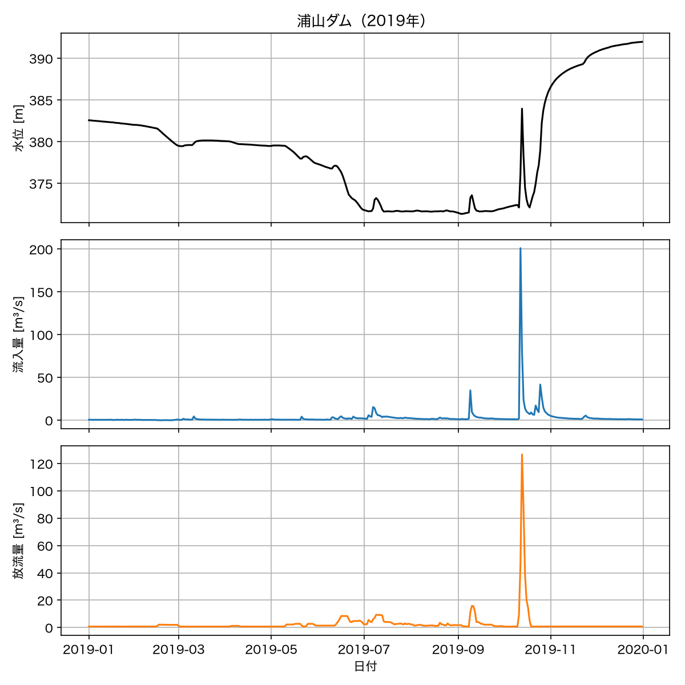
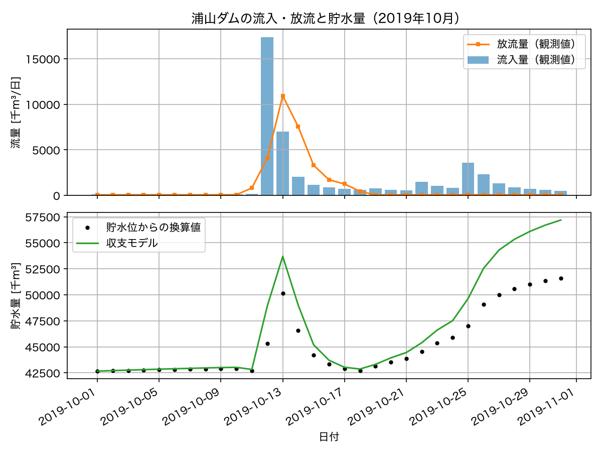
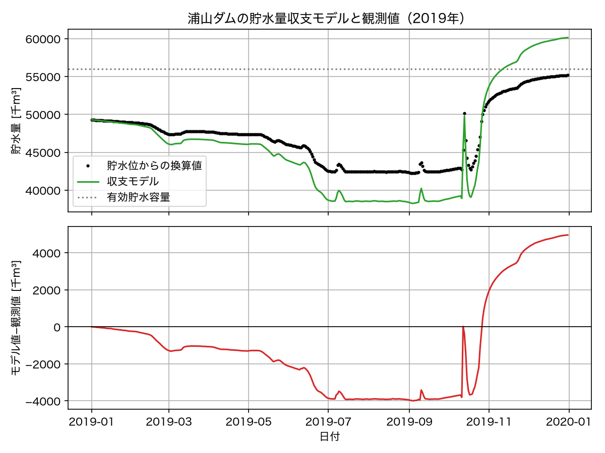
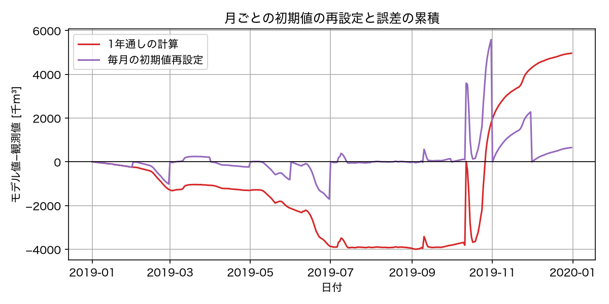

# 第6回　河川流量とダム貯水量

### 今回の位置付け

1. 現象の理解
2. <span style="color:red">仮定の設定</span>
3. <span style="color:red">数理モデルの構築</span>
4. 数値シミュレーション
5. <span style="color:red">データとの比較</span>
6. パラメタ推定
7. モデルの検証と改善

- 第5回まで：人口モデルのパラメタを観測値から推定した．
- **第6回**：保存則からダムの貯水量のモデルを構築し，観測流量を**外部入力**として与える．
  - モデルの構築：流入・流出と貯水量の変化を，単位をそろえて結び付ける．
  - データとの比較：貯水位と貯水量の対応を仮定し，計算結果との差を調べる．

### 到達目標

- 蓄積量の時間変化率が流入流量と流出流量の差に等しいという保存則から，貯水量の微分方程式 $V' = Q_{\mathrm{in}}(t) - Q_{\mathrm{out}}(t)$ を導ける
- 流量の単位 m³/s と貯水量の単位 千m³ を整合させる換算を，自分で導いて実行できる
- 観測された貯水位と，モデルの状態変数である貯水量が別の量であることを説明し，両者を結ぶ近似上の仮定を明示できる
- 離散的な観測値を補間して`solve_ivp`の右辺から参照し，外部入力付きの初期値問題を解ける
- モデルの計算結果と観測値を同じ図に示し，ずれが時間とともに蓄積する理由を説明できる

<!--
**今回の流れ**（105分の目安）

| 段階 | 内容 | 時間 |
| --- | --- | --- |
| 1 | 人口モデルとの違い，ダムのデータの確認（演習0） | 10分 |
| 2 | 保存則，単位の整合，貯水位と貯水量の関係（演習1・2） | 25分 |
| 3 | 観測値の補間と`solve_ivp`による1か月の計算 | 20分 |
| 4 | 1年間の計算，誤差の蓄積，期間を変える演習（演習3・4） | 35分 |
| 5 | 欠測・観測誤差・時間間隔の議論，まとめ，課題の説明 | 15分 |
-->

## 準備

````{note} 演習0：作業フォルダとNotebookの準備

1. ターミナルで第6回の作業フォルダを作成せよ．データフォルダは第1回以来の共通のものを使う．

```bash
mkdir -p ~/applied_programming_ii/06
cd ~/applied_programming_ii/06
mkdir -p notebooks reports/figures
```

- **コードの補足**：`mkdir -p`は必要な親フォルダも作成し，`cd`は作業フォルダを移動する．

実行後の構成は次のとおりである．`data`は各回で共通に使用し，`README.md`とNotebookは続く手順で作成する．

```text
applied_programming_ii/
├── data/
└── 06/
    ├── README.md
    ├── notebooks/
    │   └── reservoir_balance.ipynb
    └── reports/
        └── figures/
```

2. 講義サイトの[授業用データ一覧](../data/README.md)から`dam_urayama_daily.csv`をダウンロードし，`~/applied_programming_ii/data/`に置く．

3. `notebooks/reservoir_balance.ipynb`を新規作成せよ．

4. `06`フォルダに`README.md`を作り，次の内容を記入せよ．

```markdown
# 応用プログラミングII 第6回

- 氏名：
- 学籍番号：

## 今日の目標

保存則からダム貯水量のモデルを作り，観測された流入量と放流量を入力として計算し，観測された貯水位と比べる．

## データの確認

- 出典：
- 期間：
- 時間間隔：
- 単位（貯水位，流入量，放流量）：
- 欠損値：

## 演習1：単位の換算表

## 演習2：貯水位と貯水量の対応についての仮定

## 演習3

- 変更した条件・計算結果：
- 図から読み取れる傾向：
- 考察：

## 演習4

- 変更した条件・計算結果：
- 図から読み取れる傾向：
- 考察：

- 計算した期間：
- 期間の終わりでのモデルと観測の差：
- 気づいたこと：

## 課題1

## 課題2の考察
```

5. Notebookの最初のコードセルに以下を入力し，実行できることを確認せよ．

```python
from pathlib import Path

import numpy as np
import pandas as pd
import matplotlib.pyplot as plt
from scipy.integrate import solve_ivp

plt.rcParams["font.family"] = "Hiragino Sans"  # 日本語表示用（macOS）

PROJECT_DIR = Path.home() / "applied_programming_ii" / "06"
DATA_DIR = Path.home() / "applied_programming_ii" / "data"
FIGURE_DIR = PROJECT_DIR / "reports" / "figures"
FIGURE_DIR.mkdir(parents=True, exist_ok=True)

print("作業フォルダ:", PROJECT_DIR)
print("ダムデータの有無:", (DATA_DIR / "dam_urayama_daily.csv").exists())
```

```{dropdown} コードの補足

- `PROJECT_DIR`と`DATA_DIR`：作業用フォルダと共通データの場所を指定する．
- `FIGURE_DIR.mkdir(...)`：図の保存先を作成する．`exist_ok=True`により，既に存在する場合も実行を続ける．
- `.exists()`：指定したファイルが存在すれば`True`を返す．
```

出力例（`ユーザー名`の部分は実行環境によって異なる）：

```text
作業フォルダ: /Users/ユーザー名/applied_programming_ii/06
ダムデータの有無: True
```
````

## 復習と今回の準備

以下の数値出力は実行例である．数値解・推定値の末尾や評価回数，終了理由は，ライブラリのバージョンや実行環境によって異なる場合がある．

- 初期値問題：初期値と右辺の関数を`solve_ivp`に渡し，指定した時刻での解を求める．
- 観測値との比較：モデルと観測値を同じ単位・同じ時刻にそろえ，差の時系列を確認する．
- 人口モデルとの違い：人口モデルでは変化率が状態変数から決まった．今回は流入量と放流量を時間の関数として右辺に与える．

## 導入：浦山ダムの観測データ

### データの出典と確認

今回使うのは，埼玉県秩父市にある浦山ダムの日データである．
浦山ダムは荒川水系浦山川にある重力式コンクリートダムで，水資源機構が管理している．
データは国土交通省の[ダム諸量データベース](https://mudam.nilim.go.jp/)から取得し，授業用に整形したものである．
出典の詳細と利用条件は[授業用データ一覧](../data/README.md)にある．

データを読み込んだら，第3回で人口データに対して行ったのと同じ手順で，期間，時間間隔，単位，欠損値を確認する．

```python
dam = pd.read_csv(DATA_DIR / "dam_urayama_daily.csv", parse_dates=["date"])

print(dam.head())
print(dam.tail())
print("期間:", dam["date"].min().date(), "〜", dam["date"].max().date(), " 行数:", len(dam))
print("欠損値の数:")
print(dam.isna().sum())

# 日付の間隔がすべて1日であることを確認する．
intervals = dam["date"].diff().dt.days.dropna()
print("日付の間隔（日）の種類:", sorted(intervals.unique().tolist()))
```

```{dropdown} コードの補足

- `parse_dates=["date"]`：日付の列を日時型として読み込む．
- `head()`・`tail()`・`isna().sum()`：先頭・末尾のデータと，列ごとの欠損値数を確認する．
- `diff().dt.days`：隣り合う日付の差を日数で表す．先頭の欠損値を除き，`unique().tolist()`で間隔の種類をリストにする．
```

出力例：

```text
        date  water_level_m  inflow_m3s  outflow_m3s
0 2015-01-01         380.37        0.72         0.72
1 2015-01-02         380.37        0.72         0.72
2 2015-01-03         380.37        0.72         0.72
3 2015-01-04         380.37        0.72         0.72
4 2015-01-05         380.37        0.72         0.72
           date  water_level_m  inflow_m3s  outflow_m3s
3282 2023-12-27         370.43        0.58         1.52
3283 2023-12-28         370.34        0.48         1.52
3284 2023-12-29         370.24        0.48         1.51
3285 2023-12-30         370.14        0.58         1.51
3286 2023-12-31         370.04        0.47         1.51
期間: 2015-01-01 〜 2023-12-31  行数: 3287
欠損値の数:
date             0
water_level_m    0
inflow_m3s       0
outflow_m3s      0
dtype: int64
日付の間隔（日）の種類: [1.0]
```

| 列 | 意味 | 単位 |
| --- | --- | --- |
| `date` | 日付 | — |
| `water_level_m` | 日平均貯水位（標高） | m |
| `inflow_m3s` | 日平均流入量 | m³/s |
| `outflow_m3s` | 日平均放流量（発電と用水の取水を含む） | m³/s |

貯水位は毎正時の観測値を24で割った平均であり，流入量は貯水位の変化と放流量から逆算された値である．
放流量はゲートの開度などから水理公式で計算した値である．
つまり，3つの列はどれも生の測定値ではなく，測定と計算を経た観測量である．

### 2019年の観測値の可視化

2019年を主な対象とする．
この年の10月12日には台風19号（令和元年東日本台風）が関東地方を通過し，秩父では1日で511 mmの雨が観測された．

```python
year = 2019
dam_year = dam[dam["date"].dt.year == year].reset_index(drop=True)
print(f"対象年: {year}年，観測日数: {len(dam_year)}日")
print("流入量の最大値:", dam_year["inflow_m3s"].max(), "m^3/s  日付:", dam_year.loc[dam_year["inflow_m3s"].idxmax(), "date"].date())
print("放流量の最大値:", dam_year["outflow_m3s"].max(), "m^3/s  日付:", dam_year.loc[dam_year["outflow_m3s"].idxmax(), "date"].date())
```

- **コードの補足**：`.dt.year == year`：指定した年の行を選ぶ．`reset_index(drop=True)`で行番号を0から付け直す．
- **コードの補足**：`idxmax()`：最大値の行番号を返す．`.loc[行番号, "date"]`で対応する日付を取り出す．

出力例：

```text
対象年: 2019年，観測日数: 365日
流入量の最大値: 201.11 m^3/s  日付: 2019-10-12
放流量の最大値: 126.62 m^3/s  日付: 2019-10-13
```

```python
fig, axes = plt.subplots(3, 1, figsize=(8, 8), sharex=True)
axes[0].plot(dam_year["date"], dam_year["water_level_m"], color="black")
axes[0].set_ylabel("水位 [m]")
axes[0].set_title(f"浦山ダム（{year}年）")
axes[1].plot(dam_year["date"], dam_year["inflow_m3s"], color="tab:blue", label="流入量")
axes[1].set_ylabel("流入量 [m³/s]")
axes[2].plot(dam_year["date"], dam_year["outflow_m3s"], color="tab:orange", label="放流量")
axes[2].set_ylabel("放流量 [m³/s]")
axes[2].set_xlabel("日付")
for ax in axes:
    ax.grid(True)
fig.tight_layout()
fig.savefig(FIGURE_DIR / f"dam_observed_{year}.png", dpi=150)
plt.show()
```

- **コードの補足**：`plt.subplots(3, 1, sharex=True)`：日付の横軸を共有し，水位・流入量・放流量を上下3段に並べる．



貯水位は夏に低く冬に高い．
これは，7月から9月の洪水期に水位を制限水位（EL. 372.0 m）以下に下げて洪水を受け止める容量を確保する，というダムの運用による．
流入量は普段は1 m³/s前後だが，台風の日には200 m³/sを超える．
放流量は流入量に比べて変化が緩やかで，人が操作している量であることが分かる．

## 数理モデルの仮定

### 保存則

ダムの貯水池を1つの容器と考える．
容器の中の水の量を $V(t)$ とすると，水は流れ込むか流れ出るかのどちらかでしか増減しない．
したがって，

$$
\text{貯水量の変化率} = \text{流入量} - \text{流出量}
$$

である．
これは，水の密度を一定としたときの**質量保存則**の体積による表現である．流入・流出は単位時間あたりの体積として定義する．
ただし，モデルにするには次の仮定を明示する必要がある．

- 貯水池に入る水は，データに記録された流入量だけである．湖面に直接降る雨や，湖底からの湧水は無視する
- 貯水池から出る水は，データに記録された放流量だけである．蒸発，漏水，湖底への浸透は無視する
- 日平均流量を日ごとの代表時刻の値として扱い，隣接する値の間を線形補間する．日内の変動は再現しない

これらの仮定のどれかが崩れると，モデルの計算結果は観測から外れる．
どの程度外れるかを後で確かめる．

### 微分方程式

状態変数を貯水量 $V(t)$，流入量を $Q_{\mathrm{in}}(t)$，放流量を $Q_{\mathrm{out}}(t)$ とすると，保存則は

$$
\frac{dV}{dt} = Q_{\mathrm{in}}(t) - Q_{\mathrm{out}}(t),
\qquad V(t_0) = V_0
$$

となる．
第1回の言葉で各要素を整理する．

| 要素 | 内容 |
| --- | --- |
| 状態変数 | 貯水量 $V(t)$ |
| 観測量 | 貯水位（m），流入量（m³/s），放流量（m³/s） |
| パラメタ | なし |
| 初期条件 | 計算を始める日の貯水量 $V_0$ |
| 外部入力 | $Q_{\mathrm{in}}(t)$，$Q_{\mathrm{out}}(t)$．観測データで与える |
| 仮定 | 出入りは流入量と放流量のみ．日平均流量を代表時刻に配置し線形補間する |

右辺に $V$ が現れないことに注意する．
このモデルでは，貯水量の変化は貯水量自身に依存せず，外部入力だけで決まる．
式の形は $x' = f(t, x)$ の特別な場合であり，第2回で学んだ`solve_ivp`がそのまま使える．

### 単位の整合

流入量と放流量の単位は m³/s である．
一方，貯水量は，ダムの諸元表では 千m³ で表され，日データの時間単位は日である．
微分方程式の両辺の単位を合わせるには，流量を千m³／日に換算しなければならない．

1日は $24 \times 60 \times 60 = 86400$ 秒なので，1 m³/s の流れが1日続くと $86400$ m³，すなわち $86.4$ 千m³ になる．

$$
1\ \mathrm{m^3/s} = 86400\ \mathrm{m^3}/\text{日} = 86.4\ \text{千}\mathrm{m^3}/\text{日}
$$

````{note} 演習1：単位の換算

1. 上の換算を自分で導き，`README.md`の「演習1」に式を記せ．
2. 次の関数を定義し，浦山ダムの2019年の流入量の最大値（201.11 m³/s）を千m³／日に換算する．有効貯水容量56,000千m³の何%にあたるかも計算せよ．

```python
SECONDS_PER_DAY = 24 * 60 * 60


def m3s_to_1000m3_per_day(flow_m3s):
    """流量 [m^3/s] を [千m^3/日] に換算する．"""
    return flow_m3s * SECONDS_PER_DAY / 1000


V_EFFECTIVE = 56000.0   # 有効貯水容量 [千m^3]

q_max = dam_year["inflow_m3s"].max()
q_max_daily = m3s_to_1000m3_per_day(q_max)
print(f"最大流入量 {q_max:.2f} m^3/s = {q_max_daily:.1f} 千m^3/日")
print(f"有効貯水容量に対する割合: {100 * q_max_daily / V_EFFECTIVE:.1f} %")
print(f"平年の流入量 1.0 m^3/s = {m3s_to_1000m3_per_day(1.0):.1f} 千m^3/日")
```

- **コードの補足**：`SECONDS_PER_DAY / 1000`：秒から日への換算と，m³から千m³への換算をまとめた係数である．割合は最大流入量が1日続いたときの水量を有効貯水容量で割って求める．

出力例：

```text
最大流入量 201.11 m^3/s = 17375.9 千m^3/日
有効貯水容量に対する割合: 31.0 %
平年の流入量 1.0 m^3/s = 86.4 千m^3/日
```

3. 換算を忘れて m³/s のまま貯水量（千m³）に足すと，結果はおよそ何倍違ってしまうか．
````

### 貯水位と貯水量の対応

ここで，観測量と状態変数の食い違いに直面する．
モデルの状態変数は貯水量 $V$（千m³）だが，データにあるのは貯水位 $h$（m）である．
貯水量と貯水位の関係はダムごとに異なる曲線で表され，貯水池の形（水位が高いほど湖面が広い）に依存する．
この曲線は今回のデータには含まれていない．

そこで，次の**近似上の仮定**を明示して進める．

- 貯水量は，最低水位 EL. 304.0 m で0，常時満水位 EL. 393.3 m で有効貯水容量 56,000 千m³ になる
- その間では，貯水量は貯水位に対して線形に変化する

$$
V = V_{\mathrm{eff}} \cdot \frac{h - h_{\min}}{h_{\mathrm{full}} - h_{\min}},
\qquad
V_{\mathrm{eff}} = 56000,\ h_{\min} = 304.0,\ h_{\mathrm{full}} = 393.3
$$

このとき，貯水位1 mあたりの貯水量は $56000 / 89.3 \approx 627$ 千m³ である．
これは湖面の面積が約0.63 km²で水位によらず一定，と仮定したことに相当する．
水位・容量関係の局所的な傾きはその水位での湖面積に対応する．実際の傾きは水位に依存するため，一定値による換算は近似である．
この仮定の粗さが，後で見る誤差の一部になる．

```python
LEVEL_MIN = 304.0     # 最低水位 [m]
LEVEL_FULL = 393.3    # 常時満水位 [m]


def level_to_volume(level_m):
    """貯水位 [m] を貯水量 [千m^3] に換算する．最低水位と常時満水位の間で線形とみなす近似．"""
    return V_EFFECTIVE * (level_m - LEVEL_MIN) / (LEVEL_FULL - LEVEL_MIN)


slope = V_EFFECTIVE / (LEVEL_FULL - LEVEL_MIN)
print(f"貯水位1 mあたりの貯水量（線形近似）: {slope:.1f} 千m^3/m")
for level in [304.0, 350.0, 372.0, 393.3]:
    print(f"貯水位 {level:6.1f} m -> 貯水量 {level_to_volume(level):8.1f} 千m^3")

dam_year["volume_1000m3"] = level_to_volume(dam_year["water_level_m"])
print(dam_year[["date", "water_level_m", "volume_1000m3"]].head())
```

- **コードの補足**：`level_to_volume`：最低水位を基準とする線形換算を，1つの水位にも配列にも適用できる．`dam_year["volume_1000m3"]`に換算後の列を追加する．

出力例：

```text
貯水位1 mあたりの貯水量（線形近似）: 627.1 千m^3/m
貯水位  304.0 m -> 貯水量      0.0 千m^3
貯水位  350.0 m -> 貯水量  28846.6 千m^3
貯水位  372.0 m -> 貯水量  42642.8 千m^3
貯水位  393.3 m -> 貯水量  56000.0 千m^3
        date  water_level_m  volume_1000m3
0 2019-01-01         382.58   49277.491601
1 2019-01-02         382.57   49271.220605
2 2019-01-03         382.55   49258.678611
3 2019-01-04         382.53   49246.136618
4 2019-01-05         382.52   49239.865622
```

````{note} 演習2：観測量と状態変数の対応を書く

`README.md`の「演習2」に次を記せ．

1. 観測量（貯水位）と状態変数（貯水量）を結ぶために置いた仮定を，自分の言葉で1〜2行で説明せよ．
2. 水位によって湖面積が変わると，一定の傾きによる換算にはどのような誤差が生じ得るか．誤差の大小を確かめるために必要な追加資料も挙げよ．
3. 第1回で扱ったバッテリー残量の例（表示は%，状態変数は電荷量）と，今回の貯水位と貯水量の関係の共通点を1行で記せ．
````

```{tip} オープンデータの3つの役割
今回のデータは3通りの使われ方をする．
流入量と放流量はモデルへの**入力**，貯水位から換算した貯水量は計算結果と比べる**比較用データ**，初日の貯水位から換算した貯水量は**初期条件**である．流入量の算出にも貯水位が使われているため，これらは独立した観測ではない．
同じCSVの中の列でも，モデルの中での役割は異なる．
第7回では，同じデータがパラメタ推定の対象にもなる．
```

## Pythonによる実装

### 観測値の補間と右辺からの参照

`solve_ivp`は，計算の途中で任意の時刻 $t$ における右辺の値を要求する．
観測値は1日ごとの離散値なので，観測のない時刻の値を何らかの方法で決めなければならない．
最も単純なのは，隣り合う観測値を直線でつなぐ線形補間で，`np.interp`で行える．

時間の変数 $t$ は，計算を始める日を0とした日数とする．
補間に使う時刻の配列，流入量の配列，放流量の配列は，右辺の関数に引数として渡す．

```python
def reservoir_rhs(t, V, t_data, qin_data, qout_data):
    """dV/dt = Q_in(t) - Q_out(t) の右辺．流入量と放流量は観測値を線形補間して使う．

    t_data: 観測時刻の配列 [日]
    qin_data, qout_data: 観測された流入量と放流量の配列 [千m^3/日]
    """
    q_in = np.interp(t, t_data, qin_data)
    q_out = np.interp(t, t_data, qout_data)
    return q_in - q_out


# 2日分の仮の入力で，中間時刻の補間を確認する．
rate_example = reservoir_rhs(0.5, 100.0, [0.0, 1.0], [80.0, 120.0], [60.0, 80.0])
print(f"0.5日後の貯水量の変化率: {rate_example:.1f} 千m^3/日")
```

```{dropdown} コードの補足

- `np.interp(t, t_data, ...)`：隣り合う観測時刻の値を線形補間し，任意の時刻`t`での流量を求める．
- 動作確認：0.5日後の流入量は100，放流量は70千m³/日なので，差は30千m³/日となる．
- `V`：`solve_ivp`に渡す右辺の第2引数として受け取る．今回の変化率は流量の入力だけで決まる．
```

出力例：

```text
0.5日後の貯水量の変化率: 30.0 千m^3/日
```

### 1か月の計算：2019年10月

まず台風を含む2019年10月の1か月間を計算する．
観測された流量を千m³／日に換算し，初日の貯水位から初期条件を決め，`solve_ivp`を呼ぶ．
入力が1日ごとに折れ曲がる関数なので，`max_step=1.0`を指定して計算の刻み幅が1日を超えないようにする．

```python
month = dam[(dam["date"] >= "2019-10-01") & (dam["date"] <= "2019-10-31")].reset_index(drop=True)

# 観測値をモデルの単位に揃える
t_obs = np.arange(len(month), dtype=float)                       # 10月1日を0とした日数 [日]
qin_obs = m3s_to_1000m3_per_day(month["inflow_m3s"].values)      # [千m^3/日]
qout_obs = m3s_to_1000m3_per_day(month["outflow_m3s"].values)    # [千m^3/日]
V_obs = level_to_volume(month["water_level_m"].values)           # [千m^3]

# 初期条件と計算区間
V0 = V_obs[0]
t_span = (t_obs[0], t_obs[-1])

sol = solve_ivp(reservoir_rhs, t_span, [V0], t_eval=t_obs, args=(t_obs, qin_obs, qout_obs), max_step=1.0)
V_model = sol.y[0]

print("成功したか:", sol.success)
print(f"{'日付':>12} {'流入':>8} {'放流':>8} {'モデルV':>9} {'観測V':>9} {'差':>8}")
for i in range(8, 18):
    print(f"{str(month['date'][i].date()):>12} {qin_obs[i]:8.0f} {qout_obs[i]:8.0f} {V_model[i]:9.0f} {V_obs[i]:9.0f} {V_model[i] - V_obs[i]:8.0f}")
```

```{dropdown} コードの補足

- `args=(t_obs, qin_obs, qout_obs)`：観測時刻と流量の配列を右辺の追加引数に渡す．
- `max_step=1.0`：内部の計算刻み幅の上限を1日に設定する．`t_eval`は解を出力する時刻の指定であり，役割が異なる．
- 出力の単位：流入・放流は千m³/日，モデルV・観測V・差は千m³である．差はモデル値から観測値を引いた値である．
```

出力例：

```text
成功したか: True
          日付       流入       放流      モデルV       観測V        差
  2019-10-09       90       62     43004     42894      111
  2019-10-10       93       67     43026     42912      114
  2019-10-11      162      816     42822     42718      104
  2019-10-12    17376     4079     48915     45320     3595
  2019-10-13     6994    10940     53694     50155     3539
  2019-10-14     2049     7550     49015     46575     2440
  2019-10-15     1184     3307     45189     44204      985
  2019-10-16      876     1712     43702     43333      369
  2019-10-17      742     1250     43032     42900      132
  2019-10-18      616      444     42863     42718      145
```

```python
fig, axes = plt.subplots(2, 1, figsize=(8, 6), sharex=True)
axes[0].bar(month["date"], qin_obs, color="tab:blue", alpha=0.6, label="流入量（観測値）")
axes[0].plot(month["date"], qout_obs, color="tab:orange", marker="s", markersize=3, label="放流量（観測値）")
axes[0].set_ylabel("流量 [千m³/日]")
axes[0].set_title("浦山ダムの流入・放流と貯水量（2019年10月）")
axes[0].legend()
axes[1].plot(month["date"], V_obs, color="black", marker="o", markersize=3, linestyle="none", label="貯水位からの換算値")
axes[1].plot(month["date"], V_model, color="tab:green", label="収支モデル")
axes[1].set_ylabel("貯水量 [千m³]")
axes[1].set_xlabel("日付")
axes[1].legend()
for ax in axes:
    ax.grid(True)
fig.autofmt_xdate(rotation=30)
fig.tight_layout()
fig.savefig(FIGURE_DIR / "reservoir_october_2019.png", dpi=150)
plt.show()
```

- **コードの補足**：`axes[0].bar`：流入量を棒グラフで示す．下段では，貯水位から換算した貯水量を点，計算した貯水量を線で重ねる．
- `fig.autofmt_xdate(rotation=30)`：日付の目盛りを30度傾け，文字の重なりを避ける．



台風の日（10月12日）に，モデルの貯水量は観測値より約3,600千m³大きく跳ね上がる．
流入量 17,376 千m³／日に対して放流量が 4,079 千m³／日なので，保存則によれば貯水量はその差の分だけ増えるはずだが，貯水位から換算した観測値の増え方はそれより小さい．
水位・容量関係の傾きが一定でないことや，日平均値の配置・補間方法が差の要因として考えられる．
この比較だけでは要因を特定できず，実際の水位・容量曲線や時間単位のデータによる確認が必要である．

## 1年間の計算と誤差の蓄積

### 2019年の1年間

同じ手順を2019年の1年間に広げる．

```python
def simulate_reservoir(dam_window):
    """観測データの一区間 dam_window を受け取り，保存則モデルの計算結果と観測貯水量を返す．"""
    t_data = np.arange(len(dam_window), dtype=float)
    qin_data = m3s_to_1000m3_per_day(dam_window["inflow_m3s"].values)
    qout_data = m3s_to_1000m3_per_day(dam_window["outflow_m3s"].values)
    V_observed = level_to_volume(dam_window["water_level_m"].values)
    solution = solve_ivp(reservoir_rhs, (t_data[0], t_data[-1]), [V_observed[0]], t_eval=t_data, args=(t_data, qin_data, qout_data), max_step=1.0)
    return t_data, solution.y[0], V_observed


t_year, V_model_year, V_obs_year = simulate_reservoir(dam_year)
error_year = V_model_year - V_obs_year

print(f"初日の貯水量:            {V_obs_year[0]:9.0f} 千m^3")
print(f"最終日の観測貯水量:      {V_obs_year[-1]:9.0f} 千m^3")
print(f"最終日のモデル貯水量:    {V_model_year[-1]:9.0f} 千m^3")
print(f"最終日の差:              {error_year[-1]:9.0f} 千m^3（有効貯水容量の {100 * error_year[-1] / V_EFFECTIVE:.1f} %）")
print(f"差の二乗平均平方根 RMSE: {np.sqrt(np.mean(error_year ** 2)):9.0f} 千m^3")
```

- **コードの補足**：`simulate_reservoir`：対象期間のデータから時刻・流量・初期値を用意し，時刻とモデル値と比較用の貯水量を返す．
- **コードの補足**：`error_year`：モデル値から比較用の貯水量を引いた差である．その二乗平均の平方根がRMSEである．

出力例：

```text
初日の貯水量:                49277 千m^3
最終日の観測貯水量:          55178 千m^3
最終日のモデル貯水量:        60143 千m^3
最終日の差:                   4965 千m^3（有効貯水容量の 8.9 %）
差の二乗平均平方根 RMSE:      2907 千m^3
```

```python
fig, axes = plt.subplots(2, 1, figsize=(8, 6), sharex=True)
axes[0].plot(dam_year["date"], V_obs_year, color="black", marker="o", markersize=2, linestyle="none", label="貯水位からの換算値")
axes[0].plot(dam_year["date"], V_model_year, color="tab:green", label="収支モデル")
axes[0].axhline(V_EFFECTIVE, color="gray", linestyle=":", label="有効貯水容量")
axes[0].set_ylabel("貯水量 [千m³]")
axes[0].set_title(f"浦山ダムの貯水量収支モデルと観測値（{year}年）")
axes[0].legend()
axes[1].plot(dam_year["date"], error_year, color="tab:red")
axes[1].axhline(0, color="black", linewidth=0.8)
axes[1].set_ylabel("モデル値−観測値 [千m³]")
axes[1].set_xlabel("日付")
for ax in axes:
    ax.grid(True)
fig.tight_layout()
fig.savefig(FIGURE_DIR / f"reservoir_balance_{year}.png", dpi=150)
plt.show()
```

- **コードの補足**：`axhline(V_EFFECTIVE)`：有効貯水容量を水平線で示す．下段はモデル値と比較用データの差の時系列であり，0の線を基準に偏りを読む．



### 収支の確認

1年間の流入量の合計，放流量の合計，観測された貯水量の変化を並べると，保存則がどの程度成り立っているかが一目で分かる．

```python
total_in = m3s_to_1000m3_per_day(dam_year["inflow_m3s"]).sum()
total_out = m3s_to_1000m3_per_day(dam_year["outflow_m3s"]).sum()
observed_change = V_obs_year[-1] - V_obs_year[0]

print(f"年間流入量の合計:       {total_in:9.0f} 千m^3")
print(f"年間放流量の合計:       {total_out:9.0f} 千m^3")
print(f"流入 - 放流:            {total_in - total_out:9.0f} 千m^3")
print(f"観測された貯水量の変化: {observed_change:9.0f} 千m^3")
print(f"説明できない差:         {(total_in - total_out) - observed_change:9.0f} 千m^3")
```

- **コードの補足**：`.sum()`：各日の日平均流量から求めた1日分の水量を合計する．一方，モデルは代表時刻間の線形補間を積分するため，この合計とモデルの貯水量変化は厳密には一致しない．

出力例：

```text
年間流入量の合計:           96084 千m^3
年間放流量の合計:           85217 千m^3
流入 - 放流:                10867 千m^3
観測された貯水量の変化:      5901 千m^3
説明できない差:              4966 千m^3
```

流入から放流を引いた量は約10,900千m³だが，貯水位から換算した貯水量の変化は約5,900千m³で，5,000千m³ほど合わない．
この差は，1日あたりに直せばわずか14千m³（0.16 m³/s）にすぎない．
しかし，微分方程式を時間で積分するということは，毎日の小さな差を足し続けることである．
流量入力に同じ符号の偏りがあれば，その時間積分が累積誤差となる．一方，水位から貯水量への換算誤差は比較値や初期値に影響するものであり，必ずしも時間とともに加算されるわけではない．
これが**誤差の蓄積**であり，外部入力を持つモデルで常に意識すべき点である．

````{note} 演習3：期間を変えて計算する

1. `year`を`2020`から`2023`のいずれかに変え，1年間の図と収支表を作り直す．最終日の差と RMSE を`README.md`に記録せよ．
2. 年によって差の大きさや符号が違うか．どの年が最も合い，どの年が最も合わないか．
3. 差が大きい年について，貯水位の図を見て，水位が高い期間と低い期間のどちらで差が広がっているかを調べる．
````

````{note} 演習4：初期条件を途中で合わせ直す

このモデルの右辺は $V$ に依存しないため，同じ入力を与えた2つの解の差は時間によらず一定となる．したがって，初期値の誤差を減少させる仕組みはない．
そこで，1か月ごとに観測値で初期条件を置き直して計算し，ずれが蓄積しないようにする．

```python
segments = []
for month_number in range(1, 13):
    segment = dam_year[dam_year["date"].dt.month == month_number].reset_index(drop=True)
    t_seg, V_seg_model, V_seg_obs = simulate_reservoir(segment)
    segments.append(pd.DataFrame({"date": segment["date"], "V_model": V_seg_model, "V_obs": V_seg_obs}))
monthly_reset = pd.concat(segments, ignore_index=True)
monthly_error = monthly_reset["V_model"] - monthly_reset["V_obs"]

print(f"1年通しで計算した場合の RMSE:     {np.sqrt(np.mean(error_year ** 2)):8.0f} 千m^3")
print(f"毎月初期条件を置き直した場合の RMSE: {np.sqrt(np.mean(monthly_error ** 2)):8.0f} 千m^3")
```

```{dropdown} コードの補足

- `segments.append(...)`：月ごとの計算結果をリストに追加する．
- `pd.concat(..., ignore_index=True)`：各月の結果を縦に連結し，行番号を付け直す．
- 初期条件：各月の最初の観測水位から換算した貯水量で計算を開始し，その月の結果を比較する．
```

出力例：

```text
1年通しで計算した場合の RMSE:         2907 千m^3
毎月初期条件を置き直した場合の RMSE:      885 千m^3
```

```python
fig, ax = plt.subplots(figsize=(8, 4))
ax.plot(dam_year["date"], error_year, color="tab:red", label="1年通しの計算")
ax.plot(monthly_reset["date"], monthly_error, color="tab:purple", label="毎月の初期値再設定")
ax.axhline(0, color="black", linewidth=0.8)
ax.set_title("月ごとの初期値の再設定と誤差の累積")
ax.set_xlabel("日付")
ax.set_ylabel("モデル値−観測値 [千m³]")
ax.grid(True)
ax.legend()
fig.tight_layout()
fig.savefig(FIGURE_DIR / "reservoir_error_reset.png", dpi=150)
plt.show()
```

- **コードの補足**：同じ日付の軸に，1年通しの計算と月ごとに初期値を再設定した計算の差を重ねる．



1. 置き直しによって RMSE はどれだけ小さくなったか．
2. 置き直しをしても残る差は，何によるものだと考えられるか．台風の月に注目する．
3. 観測値で初期条件を置き直すという操作は，各月初の時点で利用可能な情報だけに基づく予測と言えるか．言えるとすればどの範囲でか．
````

## モデルの限界と改善の問い

保存則に基づく計算でも，観測値との差が生じた．
換算・補間の近似，入力の観測誤差，無視した流入・流出が候補となるため，それぞれを区別して検討する．

**観測量との対応**．
貯水位から貯水量への換算を線形とみなしたが，実際の貯水池は上が広い．
水位の高い時期に差が大きいことは，線形換算の適用範囲を再検討する根拠となるが，それだけで差の原因を断定できない．
実際の水位・容量曲線が手に入れば，`level_to_volume`を差し替えるだけでモデルの他の部分は変えずに済む．
第7回では，この換算の傾きをデータから推定することを試みる．

**入力の観測誤差**．
流入量は直接測られた量ではなく，貯水位の変化と放流量から逆算された値である．
放流量もゲート開度からの計算値である．
両者に数%の誤差があれば，年間では数千千m³の差になる．

**欠測と時間間隔**．
今回のデータには欠損がなかったが，実際の観測データでは欠測が珍しくない．
線形補間で埋めるか，その期間を計算から除くか，方針を決めて記録する必要がある．
また，日平均値を使うと，台風の日のように1日の中で流量が激しく変わる場合の情報が失われる．
時間データが手に入れば，`t_data`の間隔を変えるだけで同じコードが使える．

**無視した出入り**．
蒸発，漏水，湖面への降雨は無視した．
これらによる正味の損失流量を時間によらず一定と近似するなら，右辺に定数の損失項を加えられる．


## まとめ

- 保存則：貯水量の変化率を流入流量と流出流量の差で表す．
- 単位と観測モデル：流量の単位をそろえ，貯水位と貯水量を結ぶ仮定を明示する．
- 観測データの役割：流量を補間して外部入力に用い，初期条件と比較用データを区別する．入力の偏りは時間積分によって蓄積する．
- 次回：格子探索に代わる数値最適化を学び，Logisticモデルと貯水位・貯水量の換算係数を推定する．

```{dropdown} 復習用の確認事項

1. 蓄積量の時間変化率が流入流量と流出流量の差に等しいという保存則を微分方程式にするとき，明示しておくべき仮定は何か．3つ挙げよ．
2. 1 m³/s の流れが1日続くと何千m³になるか．導出の過程を含めて説明せよ．
3. 今回の微分方程式には未知パラメタがなく，右辺は観測流量の補間値である．それでも計算結果が観測から外れた理由を，観測量と状態変数の対応，および流量誤差の時間積分を使って説明せよ．
4. 同じCSVファイルの中で，モデルへの入力として使った列，初期条件として使った値，検証用データとして使った列はそれぞれ何か．
```

## 課題

````{warning} 課題1：単位の換算表と1か月の収支計算

1. m³/s，m³/日，千m³/日，千m³/月（30日）の間の換算表を作り，浦山ダムの平年の流入量1.0 m³/sと台風時の流入量201.11 m³/sをそれぞれの単位で表せ．
2. 2019年10月以外の任意の1か月を選び，「1か月の計算」と同じ2段の図を作って`reports/figures/`に保存せよ．
3. その月の流入量の合計，放流量の合計，観測された貯水量の変化を収支表にまとめ，説明できない差が有効貯水容量の何%かを記せ．
````

````{warning} 課題2：誤差が時間とともに広がる理由

2019年の1年間の図（モデルと観測の差の時系列）を見て，次を200字程度で説明せよ．

差は一様に広がるのではなく，ある時期に急に広がり，ある時期は横ばいになる．
どの時期に広がっているか，その時期の貯水位や流入量の特徴は何か，そしてそれは今回置いた仮定のどれと関係しているか．
観測値との差の時期・符号・大きさを示し，見直す仮定とその根拠を1つ挙げよ．
````

### 提出先・期限

- 提出場所：WebClass「第6回課題」
- 提出物：
  - `README.md`
  - Notebookファイル`reservoir_balance.ipynb`
- 提出期限：2026年11月14日(土)23:59

## 自主学習用の発展課題

任意で取り組み，結果をNotebookに追記せよ．

### 一定の損失項の追加

蒸発や漏水を，1日あたり一定量 $c$ 千m³の損失として右辺に加える．

$$
\frac{dV}{dt} = Q_{\mathrm{in}}(t) - Q_{\mathrm{out}}(t) - c
$$

```python
def reservoir_rhs_with_loss(t, V, t_data, qin_data, qout_data, loss):
    """dV/dt = Q_in(t) - Q_out(t) - loss の右辺．loss は一定の損失 [千m^3/日]．"""
    return np.interp(t, t_data, qin_data) - np.interp(t, t_data, qout_data) - loss


t_data = np.arange(len(dam_year), dtype=float)
qin_data = m3s_to_1000m3_per_day(dam_year["inflow_m3s"].values)
qout_data = m3s_to_1000m3_per_day(dam_year["outflow_m3s"].values)

print(f"{'loss [千m^3/日]':>16} {'最終日の差':>12} {'RMSE':>10}")
for loss in [0.0, 5.0, 10.0, 14.0, 20.0]:
    sol_loss = solve_ivp(reservoir_rhs_with_loss, (t_data[0], t_data[-1]), [V_obs_year[0]], t_eval=t_data, args=(t_data, qin_data, qout_data, loss), max_step=1.0)
    err = sol_loss.y[0] - V_obs_year
    print(f"{loss:16.1f} {err[-1]:12.0f} {np.sqrt(np.mean(err ** 2)):10.0f}")
```

- **コードの補足**：`loss`：右辺から差し引く一定の損失流量で，単位は千m³/日である．候補ごとに計算し直し，最終日の差と全期間のRMSEを比較する．

出力例：

```text
   loss [千m^3/日]        最終日の差       RMSE
             0.0         4965       2907
             5.0         3145       3292
            10.0         1325       3929
            14.0         -131       4551
            20.0        -2315       5592
```

````{note} 発展課題：一定の損失項を加える

1. 最終日の差を0にする $c$ はいくらか．それは m³/s に直すとどのくらいか．
2. 最終日の差を0にする $c$ を選んでも，RMSE はかえって大きくなる．一定の損失項では誤差を説明できないのはなぜか．誤差の時系列の形（夏に負，秋以降に正）から検討せよ．
3. 一定の損失という仮定は，蒸発を表すのに適切か．蒸発が季節によって変わるとすれば，どのような項にすべきか．
````
