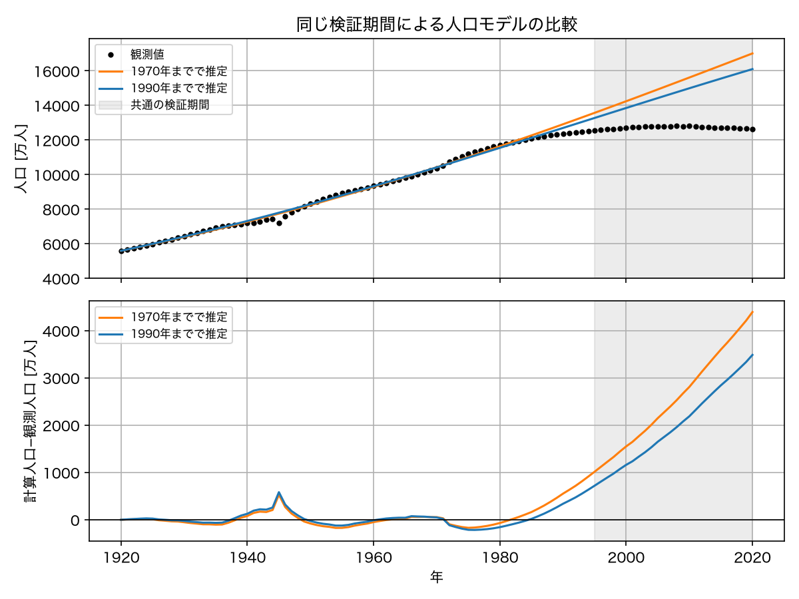
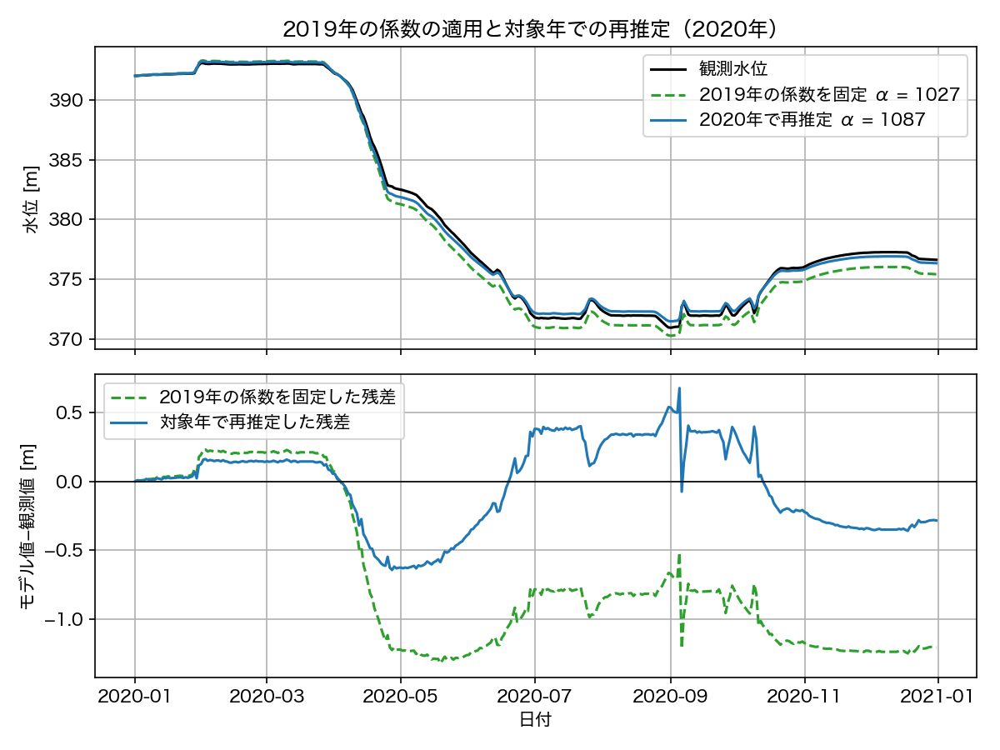
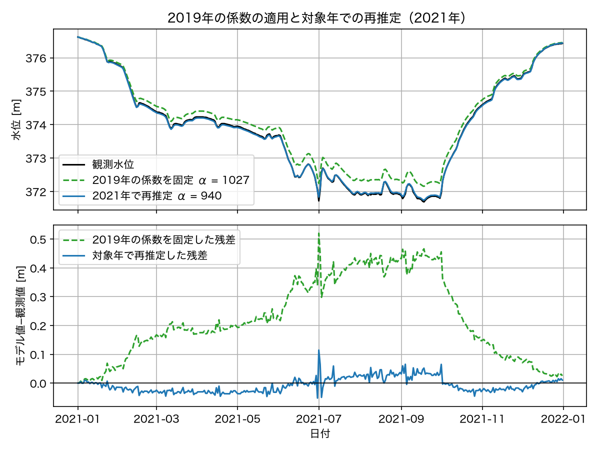
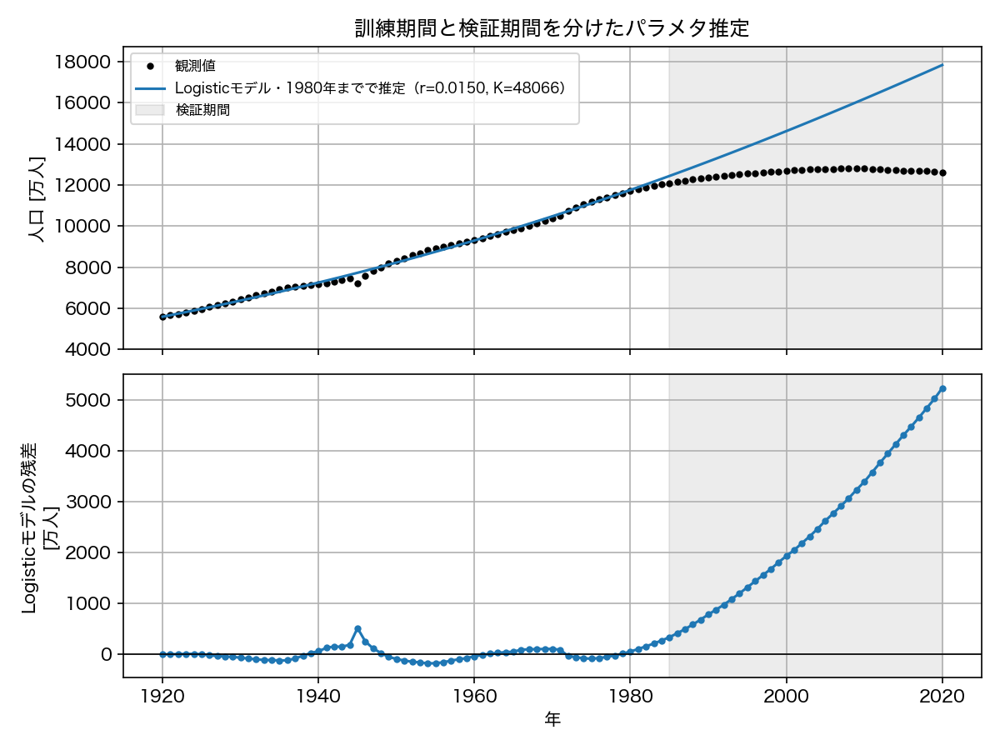
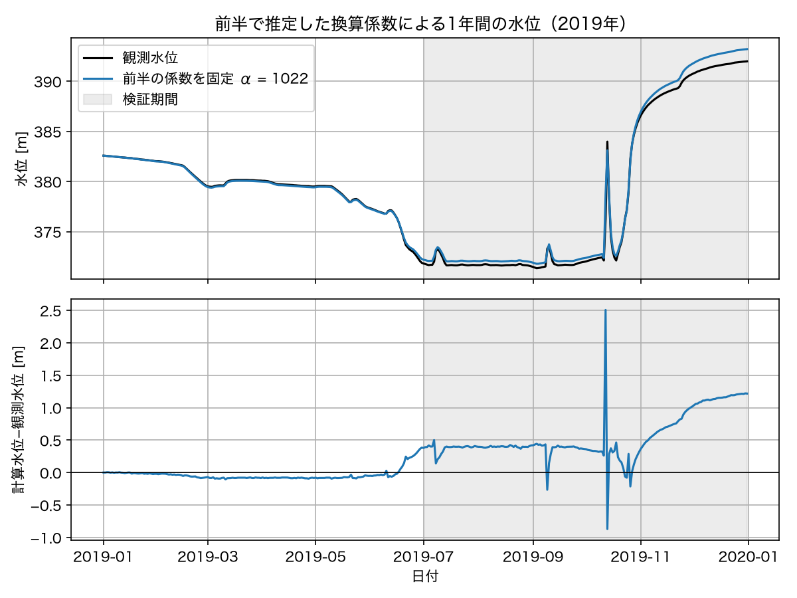
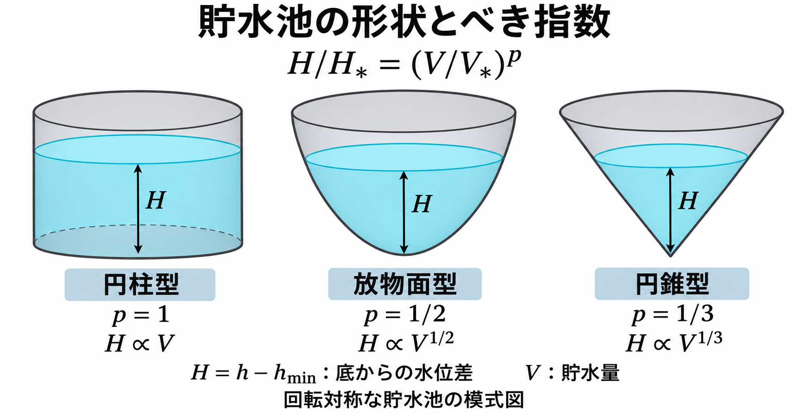

# 第7回　パラメタ推定

### 今回の位置付け

1. 現象の理解
2. 仮定の設定
3. 数理モデルの構築
4. 数値シミュレーション
5. データとの比較
6. <span style="color:red">パラメタ推定</span>
7. モデルの検証と改善

- **第5回**：人口のパラメタを格子探索で推定し，ヒートマップから誤差の小さい領域とパラメタの関係を調べた．
- **第6回**：保存則からダムの収支モデルを作り，有効貯水容量と最低水位・常時満水位から水位と貯水量の換算係数を設定した．
- **第7回**：第5回と同じ推定問題を**数値最適化**で解き，得られた係数を**推定に使わないデータ**に適用する．さらに第6回で仮定した換算係数を推定対象に変える．

**候補の探し方**と**未使用データでの確かめ方**を，人口とダムのモデルで学ぶ．

### 到達目標

- **第5回との比較**：格子探索と`least_squares`が，**同じ最小二乗の推定問題**を異なる手順で解くことを説明できる．
- **数値最適化の実装**：微分方程式の計算と残差関数を組み合わせ，全格子点を評価せずにパラメタを推定できる．
- **探索結果の確認**：探索の初期値・範囲・停止結果を確認し，小さい目的関数値を得たこととモデルの妥当性を区別できる．
- **人口モデルの検証**：データを訓練期間と検証期間に分け，**係数を固定した将来期間の誤差**を評価できる．
- **ダムの観測モデルの推定**：貯水量を観測水位へ換算して残差を定義し，ある年で推定した換算係数を別の年で評価できる．
- **推定結果の報告**：**探索の成否・未使用データへの適用結果・係数の物理的な解釈**を分けて報告できる．

<!--
**今回の流れ**（105分の目安）

| 段階 | 内容 | 時間 |
| --- | --- | --- |
| 1 | 準備と第5回との比較，同じ最小二乗問題（演習0） | 10分 |
| 2 | 数値最適化，格子探索との比較，探索初期値（演習1） | 25分 |
| 3 | 人口の訓練・検証，推定期間と残差（演習2） | 30分 |
| 4 | ダムの観測モデルの推定，別の年への適用（演習3） | 30分 |
| 5 | 3つの確認事項，課題の説明 | 10分 |
-->

## 準備

````{note} 演習0：作業フォルダとNotebookの準備

1. ターミナルで第7回の作業フォルダを作成せよ．

```bash
mkdir -p ~/applied_programming_ii/07
cd ~/applied_programming_ii/07
mkdir -p notebooks reports/figures
```

- **コードの補足**：`mkdir -p`は必要な親フォルダも作成し，`cd`は作業フォルダを移動する．

実行後の構成は次のとおりである．`data`は各回で共通に使用し，`README.md`とNotebookは続く手順で作成する．

```text
applied_programming_ii/
├── data/
└── 07/
    ├── README.md
    ├── notebooks/
    │   └── parameter_estimation.ipynb
    └── reports/
        └── figures/
```

2. `~/applied_programming_ii/data/`に`population_japan.csv`と`dam_urayama_daily.csv`があることを確認せよ．なければ，{download}`人口データ <../data/population_japan.csv>`と{download}`浦山ダムの日データ <../data/dam_urayama_daily.csv>`をダウンロードして保存せよ．

3. `notebooks/parameter_estimation.ipynb`を新規作成せよ．

4. `07`フォルダに`README.md`を作り，次の内容を記入せよ．

```markdown
# 応用プログラミングII 第7回

- 氏名：
- 学籍番号：

## 今日の目標

第5回と同じ最小二乗の推定問題を数値最適化で解き，人口では将来期間，ダムでは別の年へ係数を固定して適用し，結果を評価する．

## 演習1：探索初期値による推定結果の比較

1. 最小のcostに到達した初期値：
2. 初期値を変更した推定（Notebookに推定結果を出力）

## 演習2：同じ検証期間での比較

1. 推定と誤差評価（Notebookに計算結果を出力）
2. 人口と残差の比較（Notebookに図を出力）
3. 訓練期間のRMSEだけで予測精度を判断できるか：

## 演習3：対象年による換算係数の比較

1. 水位と残差の比較（Notebookに図を出力）
2. 対象年で再推定した換算係数：

## 課題1：訓練期間を選んだ推定結果の報告

1. 推定と誤差評価（Notebookに計算結果を出力）
2. 探索初期値による違い（Notebookに比較表を出力）
3. 人口と残差の比較（Notebookに図を出力）
4. 見直す仮定：

## 課題2：ダムの前半での推定と後半での検証

1. 推定と誤差評価（Notebookに計算結果を出力）
2. 水位と残差の比較（Notebookに図を出力）

```

5. 以下のコードをNotebookの最初のコードセルにまとめて入力し，実行せよ．計算・描画に使うライブラリと保存先を設定し，CSVファイルの有無を確認する．

```python
from pathlib import Path

import numpy as np
import pandas as pd
import matplotlib.pyplot as plt
from scipy.integrate import solve_ivp
from scipy.optimize import least_squares

plt.rcParams["font.family"] = "Hiragino Sans"  # 日本語表示用（macOS）

PROJECT_DIR = Path.home() / "applied_programming_ii" / "07"
DATA_DIR = Path.home() / "applied_programming_ii" / "data"
FIGURE_DIR = PROJECT_DIR / "reports" / "figures"
FIGURE_DIR.mkdir(parents=True, exist_ok=True)

print("作業フォルダ:", PROJECT_DIR)
print("人口データの有無:", (DATA_DIR / "population_japan.csv").exists())
print("ダムデータの有無:", (DATA_DIR / "dam_urayama_daily.csv").exists())
```

- **コードの補足**：今回追加した`scipy.optimize.least_squares`は残差関数を使ってパラメタを推定する関数である．

出力例：

```text
作業フォルダ: /Users/ユーザー名/applied_programming_ii/07
人口データの有無: True
ダムデータの有無: True
```
````

## 第5回との比較の準備

### 推定方法と評価方法

**推定の基準は同じで，候補の選び方が変わる**．

| 観点 | 第5回（格子探索） | 第7回（数値最適化） |
| --- | --- | --- |
| 候補の選択 | 用意した全格子点を評価 | <span style="color:red">残差の変化から次の候補を計算</span> |
| 結果の確認 | 格子の刻みと低誤差領域 | 探索初期値・範囲・停止結果 |
| データによる評価 | 当てはまりと残差 | 係数を固定した未使用期間の誤差 |

※ 以下の実行例における推定値の末尾・評価回数・終了理由は実行環境によって異なる場合がある．

### 比較でそろえる条件

探索方法の効果を比べるため，**モデル・データ・初期条件・誤差の測り方をそろえる**．

- $t$ ：1920年からの経過年数．
- $N(t)$ ：人口（万人）．
- $r$ ：人口増加率（/年）．
- $K$ ：環境収容力（万人）．
- $N_0=N(0)$ ：1920年の初期人口（万人）．

| 条件 | 共通にする内容 |
| --- | --- |
| データ | 1920〜2020年の年次人口．単位は万人 |
| モデル | 定数 $r,K$ のLogistic方程式．外部入力はなし |
| 初期条件 | 1920年の観測人口 $N_0=5596.3$ 万人 |
| 誤差の測り方 | <span style="color:red">観測年ごとの人口の差を同じ重みで評価したMSE</span> |
| モデル値の計算 | 各方法で得た係数を同じ`solve_ivp`の設定で評価 |

人口モデルと初期条件は第4・5回と同じである．

$$
\frac{dN}{dt}=rN\left(1-\frac{N}{K}\right),\qquad N(0)=N_0.
$$

出生・死亡・人口移動は個別に分けず，期間全体を定数 $r,K$ で表す．

### 人口データと初期条件の準備

人口を万人，時刻を1920年からの経過年数にそろえ，初期人口を1920年の観測値に固定する．出典は[授業用データ一覧](../data/README.md)を参照する．

```python
population = pd.read_csv(DATA_DIR / "population_japan.csv")
population["population_10k"] = population["total_population_thousand"] / 10
t_obs = (population["year"] - 1920).values.astype(float)
y_obs = population["population_10k"].values
N0 = y_obs[0]
print(f"観測点: {len(t_obs)}，期間: {population['year'].min()}〜{population['year'].max()}年，初期人口: {N0:.1f} 万人")
```

出力例：

```text
観測点: 101，期間: 1920〜2020年，初期人口: 5596.3 万人
```

### 計算関数と第5回の基準値

第5回の係数も`solve_ivp`で評価し直し，**同じ計算方法でMSEを比較する**．

推定するパラメタの組を $\theta=(r,K)$ と書く．この組から観測時刻での人口を求める関数と平均二乗誤差の関数を定義する．

```python
def logistic_rhs(t, N, r, K):
    """Logisticモデル dN/dt = r N (1 - N/K) の右辺．"""
    return r * N * (1 - N / K)


def simulate_logistic(theta, t_eval, N0):
    """パラメタ theta = (r, K) でLogisticモデルを解き，時刻 t_eval での N を返す．"""
    r, K = theta
    sol = solve_ivp(
        logistic_rhs,
        (t_eval[0], t_eval[-1]),
        [N0],
        t_eval=t_eval,
        args=(r, K),
        rtol=1e-06,
    )
    return sol.y[0]


def mean_squared_error(y_true, y_pred):
    """平均二乗誤差 (1/n) sum (y_true - y_pred)^2 を返す．"""
    return np.mean((y_true - y_pred) ** 2)
```

第5回の101×101格子で得た最良の組 $(r,K)=(0.0275,14800)$ を上で定義した関数で評価し，比較の基準となるMSEを求める．

```python
# 第5回の101×101格子で得た最良の組
theta_grid = (0.0275, 14800.0)
mse_grid = mean_squared_error(y_obs, simulate_logistic(theta_grid, t_obs, N0))
print(f"第5回の格子上の最良の組 (r, K) = {theta_grid}: MSE = {mse_grid:.1f} （RMSE = {np.sqrt(mse_grid):.1f} 万人）")
```

出力例：

```text
第5回の格子上の最良の組 (r, K) = (0.0275, 14800.0): MSE = 115105.5 （RMSE = 339.3 万人）
```

## 格子探索から数値最適化への移行

- **格子探索の計算量**：パラメタが $p$ 個，各 $m$ 候補なら評価回数は $m^p$ ．各50候補では，2パラメタで2,500回，4パラメタで6,250,000回になる．
- **数値最適化の進め方**：現在の候補の近くで残差の変化を調べ，次の候補を決める．今回の設定では，パラメタを少しずらした計算から変化を求める．

1. パラメタの組 $\theta$ の探索開始値を $\theta_0$ として与える．
2. 候補 $\theta$ を固定した初期値問題を解き，その解を各観測時刻で評価して観測値との差を求める．
3. 候補の近くでの残差の変化を使い，二乗和を小さくする次の候補を計算する．
4. 候補を評価・更新し，停止条件を満たすまで繰り返す．

**モデルの計算と残差関数を用意し，候補の更新を`least_squares`に任せる**．探索の開始点と停止結果は，計算後に確認する．

### 残差と最小二乗の基準

- **観測時刻** $t_i$ ：1920年からの経過年数． $i=1,\ldots,n$ は観測点の番号で， $0=t_1<\cdots<t_n$ とする．
- **観測人口** $y_i$ ：時刻 $t_i$ の人口（万人）．初期人口は $N_0=y_1$ に固定する．

**候補を固定した初期値問題**

候補 $\theta=(r,K)$ を固定したときの解を $N(t;\theta)$ と書く．観測期間全体で解が存在する候補を扱う．

$$
\begin{cases}
\displaystyle \frac{d}{dt}N(t;\theta)
=rN(t;\theta)\left(1-\frac{N(t;\theta)}{K}\right),
& 0\leq t\leq t_n,\\[4pt]
N(0;\theta)=N_0.
\end{cases}
$$

候補ごとに解き直すが，**初期人口は共通**であり， $N_0$ に固定する．

**観測時刻での残差配列**

- **残差** $e_i(\theta)$ ：計算人口 $N(t_i;\theta)$ から観測人口 $y_i$ を引いた差．
- **残差ベクトル** $\boldsymbol e(\theta)$ ：各時刻の残差を順に並べたもの．コードでは1次元配列で表す．

$$
e_i(\theta)=N(t_i;\theta)-y_i,
\qquad
\boldsymbol e(\theta)=
\begin{pmatrix}
N(t_1;\theta)-y_1\\
\vdots\\
N(t_n;\theta)-y_n
\end{pmatrix}.
$$

**1920年から計算した1本の曲線を各観測時刻で評価する**．残差は正なら過大評価，負なら過小評価を表す．第5回とは符号が逆だが，二乗和は同じである．

**最小二乗法**は，次の残差二乗和 $J(\theta)$ を最小にする方法である．

$$
J(\theta)=\sum_{i=1}^{n}e_i(\theta)^2.
$$

実装では数値解から残差を求める．各尺度の関係は次のとおりである．

| 尺度 | 計算式 | 用途 |
| --- | --- | --- |
| MSE | $J/n$ | 第5回との比較 |
| 残差二乗和 | $J$ | 最小二乗の推定問題の定義 |
| `least_squares`の`cost` | $J/2$ | 最適化の出力の確認 |

**同じデータなら3つの最小化で選ばれるパラメタは同じ**である．第5回の $J$ はMSE，今回の $J$ は残差二乗和を表す．大きな残差の影響も確認するため，推定後は残差の時系列を描く．

## `least_squares`によるパラメタ推定

### 残差関数の定義

第5回はMSEを1つ返したが，今回は**観測点ごとの残差配列**を返す関数（残差関数）を用意する．
パラメタ，観測データ，初期人口を引数とする．

```python
def residuals(theta, t_obs, y_obs, N0):
    return simulate_logistic(theta, t_obs, N0) - y_obs
```

- **コードの補足**：返す値は観測点数と同じ長さの配列である．二乗和への集約は`least_squares`が行う．

- **探索の初期値**：反復計算を始めるパラメタの組．第5回の格子探索を参考に設定する．
- **微分方程式の初期条件**：計算開始時の人口 $N_0$ ．最初の観測人口に固定する．

### 推定の実行

- **`least_squares`**：残差関数の第1引数であるパラメタを更新し，残差二乗和を小さくする関数
- 使い方：`result = least_squares(fun, x0, args=(...))`

| 引数名 | 今回渡す値 | 意味 |
| --- | --- | --- |
| `fun` | `residuals` | 残差配列を返す関数．関数名を渡す |
| `x0` | `theta_initial` | 探索の開始値を並べた配列．今回は`[r, K]`の順 |
| `args` | `(t_obs, y_obs, N0)` | 残差関数の第2引数以降に渡す固定値．関数の定義と同じ順で並べる |

この指定により，`least_squares`は候補の`theta`を変えながら，`residuals(theta, t_obs, y_obs, N0)`を繰り返し呼び出す．**観測データと初期人口を固定し，`theta`だけを更新する**．

- 戻り値：推定値と計算の終了状況をまとめた**結果オブジェクト**（`OptimizeResult`）．`result`に保存し，ドットに続けて項目名を書くと各値を取り出せる．

| 取り出し方 | 得られる値 |
| --- | --- |
| `result.x` | 推定したパラメタの配列．今回は`[r, K]`の順 |
| `result.fun` | 推定したパラメタでの残差配列．観測点ごとに1つの値を持つ |
| `result.cost` | 残差二乗和の半分 $J/2$ （今回の設定） |
| `result.success` | 停止条件を満たしたかを表す真偽値 |
| `result.message` | 終了理由を表す文字列 |
| `result.nfev` | 残差関数の評価回数．今回の設定では数値微分用の追加評価を含まない |

例えば，`r_hat, K_hat = result.x`で推定した2つの係数を取り出す．引数と戻り値の詳細は[SciPyの公式説明](https://docs.scipy.org/doc/scipy/reference/generated/scipy.optimize.least_squares.html)を参照する．

探索の初期値を設定し，全期間の残差からパラメタを推定する．

```python
theta_initial = [0.03, 13000.0]
```

同じ残差関数を使ってパラメタを推定する．

```python
result = least_squares(residuals, theta_initial, args=(t_obs, y_obs, N0))
```

停止条件を満たしたかを確認し，推定値・目的関数値・RMSE・評価回数を表示する．

```python
r_hat, K_hat = result.x
print("停止条件を満たしたか:", result.success, " 状態:", result.message)
print(f"推定値: r = {r_hat:.5f} /年,  K = {K_hat:.1f} 万人")
print(f"目的関数（残差二乗和の半分）: {result.cost:.1f}")
print(f"RMSE: {np.sqrt(np.mean(result.fun ** 2)):.1f} 万人")
print(f"残差関数の評価回数: {result.nfev}")
```

出力例：

```text
停止条件を満たしたか: True  状態: `ftol` termination condition is satisfied.
推定値: r = 0.02759 /年,  K = 14753.8 万人
目的関数（残差二乗和の半分）: 5807180.6
RMSE: 339.1 万人
残差関数の評価回数: 7
```

**停止条件は，目的関数の減少量・パラメタの更新量・勾配のいずれかが十分小さいかを判定する**．当てはまりの良さはRMSEと残差の図で確認する．

- **`ftol`**：目的関数の減少量に関する停止条件．
- **`xtol`**：パラメタの更新量に関する停止条件．
- **`gtol`**：目的関数の勾配に関する停止条件．

評価回数の上限で終了した場合，`success`は`False`になる．

```{dropdown} 補足：停止条件とftolの判定

`tol`はtolerance（許容値）の略で，`f`は目的関数，`x`はパラメタ，`g`は勾配に対応する．`nfev`はnumber of function evaluationsの略である．

`ftol=1e-8`では，costの減少量を更新前のcostの約1億分の1と比較する．目的関数を $F(\theta)=J(\theta)/2$ とし，更新前後の値を $F_{\mathrm{before}}$，$F_{\mathrm{after}}$ とする．減少量 $\Delta F=F_{\mathrm{before}}-F_{\mathrm{after}}$ について次の条件を調べる．

$$
\Delta F < \mathtt{ftol} \times F_{\mathrm{before}}
=10^{-8} \times F_{\mathrm{before}}.
$$

例えば更新前のcostが $5807180.6$ なら，減少量の閾値は約 $0.0581$ である．さらに，次の候補を計算するための近似モデルが予測した減少量と実際の減少量が十分に整合していれば，`ftol`の停止条件を満たす．**現在のcostに対して改善が十分小さくなったこと**を判定している．当てはまりの良さは別にRMSEと残差の図で確認する．引数と戻り値の詳細は[SciPyの公式説明](https://docs.scipy.org/doc/scipy/reference/generated/scipy.optimize.least_squares.html)を参照する．
```

### 格子探索との比較と改善量の解釈

同じデータと数値積分の設定で，格子探索と最適化後のMSEを比較する．

```python
mse_fitted = np.mean(result.fun ** 2)
improvement_percent = 100 * (mse_grid - mse_fitted) / mse_grid
print(f"格子探索の係数: r = {theta_grid[0]:.5f}, K = {theta_grid[1]:.1f}")
print(f"最適化後の係数: r = {r_hat:.5f}, K = {K_hat:.1f}")
print(f"格子探索の係数のMSE: {mse_grid:.1f}")
print(f"最適化後のMSE: {mse_fitted:.1f}")
print(f"MSEの減少率: {improvement_percent:.3f}%")
```

- **コードの補足**：`result.fun`は最適化後の残差配列である．二乗の平均を取ると，格子探索と同じ尺度のMSEになる．

出力例：

```text
格子探索の係数: r = 0.02750, K = 14800.0
最適化後の係数: r = 0.02759, K = 14753.8
格子探索の係数のMSE: 115105.5
最適化後のMSE: 114993.7
MSEの減少率: 0.097%
```

- **今回の改善量**：MSEは約0.1%減少した．第5回の格子探索ですでに最小値に近い候補を得ていた．
- **探索方法の利点**：全格子点を調べ直さず，格子点の間も探索できる．パラメタ数や1回の計算時間が増えると有用になる．

一方，変えたのは係数の探し方であり，定数 $r,K$ のLogisticモデルという仮定は同じである．探索を精密にしても人口減少への転換を表す仕組みは加わらない．将来期間への適用は後の訓練・検証の比較で別に評価する．

(estimation-starting-points)=
### 初期値依存性

**同じデータでも，探索の開始値によって結果が変わる場合がある**．第5回のヒートマップと照合しながら，4組の開始値で推定値・cost・評価回数を比較する．

```python
initial_guesses = [
    [0.10, 10000.0],
    [0.05, 30000.0],
    [0.03, 13000.0],
    [0.01, 20000.0],
]
```

初期値の候補ごとに推定し，推定値・cost・評価回数を比較する．

```python
print(f"{'初期値 (r, K)':>22} {'推定 r':>10} {'推定 K':>10} {'cost':>12} {'評価回数':>8}")
for guess in initial_guesses:
    res = least_squares(residuals, guess, args=(t_obs, y_obs, N0))
    print(f"{str(guess):>22} {res.x[0]:10.5f} {res.x[1]:10.1f} {res.cost:12.1f} {res.nfev:8d}")
```

- **コードの補足**：各組は`[r, K]`の順で，開始値のrが大きい順に並べている．`for`文で1組ずつ独立に推定し，costと評価回数を比較する．

出力例：

```text
            初期値 (r, K)       推定 r       推定 K         cost     評価回数
        [0.1, 10000.0]    0.06375    10000.0  157753795.5       22
       [0.05, 30000.0]    0.02759    14753.8    5807180.6        6
       [0.03, 13000.0]    0.02759    14753.8    5807180.6        7
       [0.01, 20000.0]    0.02759    14753.8    5807180.6       10
```

````{note} 演習1：探索初期値による推定結果の比較

1. 本文の4つの結果を比較し，<span style="color:red">最小のcostに到達した初期値をREADMEに記せ</span>．表示桁数で一致する結果は同程度とみなせ．
2. 探索初期値を`[0.5, 6000.0]`に変更する．次の【】を埋めて実行し，本文と同じ形式の<span style="color:red">推定結果をNotebookに出力せよ</span>．

本文のループ内の処理をコピーし，追加の1組について計算する．

```python
guess = 【追加する探索初期値 [r, K]】
print(f"{'初期値 (r, K)':>22} {'推定 r':>10} {'推定 K':>10} {'cost':>12} {'評価回数':>8}")
res = least_squares(【least_squaresの引数】)
print(f"{str(guess):>22} {res.x[0]:10.5f} {res.x[1]:10.1f} {res.cost:12.1f} {res.nfev:8d}")
```
````

````{visible-answer} 演習1の解答例

**1．最小のcostに到達した初期値**

`[0.05, 30000.0]`，`[0.03, 13000.0]`，`[0.01, 20000.0]`の3組である．本文の表示桁数では同じcostとなる．

**2．初期値を変更した推定**

本文のループ内と同じ処理を，追加の1組について実行する．見出しと表示形式も本文にそろえる．

`least_squares`には，残差関数`residuals`，探索初期値`guess`，固定する値`args=(t_obs, y_obs, N0)`を渡す．

```{code-block} python
:linenos:
:emphasize-lines: 1
:class: code-focus

guess = [0.5, 6000.0]
print(f"{'初期値 (r, K)':>22} {'推定 r':>10} {'推定 K':>10} {'cost':>12} {'評価回数':>8}")
res = least_squares(residuals, guess, args=(t_obs, y_obs, N0))
print(f"{str(guess):>22} {res.x[0]:10.5f} {res.x[1]:10.1f} {res.cost:12.1f} {res.nfev:8d}")
```

- **コードの補足**：観測データと残差関数は本文と同じに保ち，探索初期値だけを変更する．

出力例：

```text
            初期値 (r, K)       推定 r       推定 K         cost     評価回数
         [0.5, 6000.0]    0.41007     6304.3 1011378002.6      200
```

本文の最小costより大きく，評価回数は既定の上限200回に達している．`res.success`と`res.message`でも停止結果を確認できる．
````


(estimation-parameter-bounds)=
### パラメタの範囲指定

パラメタにはモデルの意味から決まる範囲がある．
ここでは増加または一定の人口を表すため， $r\geq0$ ， $K>N_0$ に制限する．計算では $K$ の下限を初期人口5596.3万人より大きい6000万人とする．
`bounds`で範囲を指定すると，設定した仮定と整合しない範囲での探索を防げる．

同じ探索初期値 `[0.5, 6000.0]` に範囲指定を加え，推定値とcostを比較する．

```python
lower_bounds = [0.0, 6000.0]       # r >= 0, K >= 6000 万人
upper_bounds = [1.0, 50000.0]      # r <= 1, K <= 50000 万人

result_bounded = least_squares(
    residuals, [0.5, 6000.0], args=(t_obs, y_obs, N0),
    bounds=(lower_bounds, upper_bounds),  # 追加箇所
)
print(f"範囲を指定した場合: r = {result_bounded.x[0]:.5f}, K = {result_bounded.x[1]:.1f}, cost = {result_bounded.cost:.1f}")
```

```{dropdown} コードの補足：boundsの指定

| 指定 | 役割 | このコードでの意味 |
| --- | --- | --- |
| `lower_bounds` | 各パラメタの下限 | $r\geq0$，$K\geq6000$ 万人 |
| `upper_bounds` | 各パラメタの上限 | $r\leq1$，$K\leq50000$ 万人 |
| `bounds=(lower_bounds, upper_bounds)` | 下限と上限の組を渡す | どちらも`x0`と同じ`[r, K]`の順で並べる |

探索の開始値も指定した範囲内に置く．この例では`[0.5, 6000.0]`が範囲内にある．
```

出力例：

```text
範囲を指定した場合: r = 0.02759, K = 14753.8, cost = 5807180.6
```

**範囲指定だけでは大域的な最小値は保証されない**．複数の開始値や粗い格子探索の結果と照合する．

(estimation-population-validation)=
## 人口モデル：未使用期間への適用

**推定に使ったデータへの当てはまりと，未使用期間の予測精度を分けて調べる**．

- **訓練期間**：1920〜1990年．この期間の観測人口だけで係数を推定する．
- **検証期間**：1995〜2020年．推定した係数を固定し，観測人口との誤差を評価する．

初期人口は1920年の値に固定し，検証期間も同じ解を延長して計算する．訓練・検証のデータを次のように取り出す．

```python
train_end = 1990
valid_start = train_end + 5
train_mask = population["year"] <= train_end
valid_mask = population["year"] >= valid_start

t_train, y_train = t_obs[train_mask], y_obs[train_mask]
t_valid, y_valid = t_obs[valid_mask], y_obs[valid_mask]
```

- **コードの補足**：`train_mask`・`valid_mask`：推定用と検証用のデータを選ぶ条件である．ここでは1991〜1994年はどちらの誤差評価にも含めない．

訓練・検証期間と，それぞれの観測点数を確認する．

```python
print(f"訓練期間: {len(t_train)} 点（1920〜{train_end}年）， 検証期間: {len(t_valid)} 点（{valid_start}〜2020年）")
```

訓練期間の観測値だけを残差関数へ渡し，範囲を指定してパラメタを推定する．

```python
result_train = least_squares(residuals, [0.03, 13000.0], args=(t_train, y_train, N0), bounds=(lower_bounds, upper_bounds))
r_train, K_train = result_train.x
```

訓練期間から求めたパラメタを表示する．

```python
print(f"訓練期間で推定: r = {r_train:.5f} /年,  K = {K_train:.1f} 万人")
```

出力例：

```text
訓練期間で推定: r = 0.01787 /年,  K = 25872.2 万人
```

推定したパラメタを固定して1920〜2020年を計算し，訓練期間と検証期間のRMSEと最終年の予測を確認する．

```python
# 推定したパラメタで全期間を計算する
y_fit_all = simulate_logistic(result_train.x, t_obs, N0)
rmse_train = np.sqrt(mean_squared_error(y_train, y_fit_all[train_mask]))
rmse_valid = np.sqrt(mean_squared_error(y_valid, y_fit_all[valid_mask]))
```

- **コードの補足**：`y_fit_all`：1920年の初期条件から全期間を計算し，訓練期間と検証期間に対応する値を取り出してRMSEを求める．

訓練期間と検証期間のRMSEと，2020年の予測人口を表示する．

```python
print(f"訓練期間のRMSE: {rmse_train:8.1f} 万人")
print(f"検証期間のRMSE: {rmse_valid:8.1f} 万人")
print(f"2020年の予測: {y_fit_all[-1]:.1f} 万人，観測: {y_obs[-1]:.1f} 万人")
```


出力例：

```text
訓練期間のRMSE:    141.0 万人
検証期間のRMSE:   2154.6 万人
2020年の予測: 16101.1 万人，観測: 12614.6 万人
```

- **推定値の変化**：1990年までで推定した $K$ は約25900万人で，全期間で推定した約14750万人より大きい．人口の増加が鈍る後半のデータを含めるかどうかで，推定値が変わる．
- **未使用期間の誤差**：訓練期間のRMSEは約140万人，検証期間のRMSEは約2150万人である．訓練期間に近い曲線を得ても，その後の人口を同じ精度で予測できるとは限らない．

(estimation-population-plot)=
### 観測値・モデル・残差の可視化

**誤差の大きさはRMSE，偏りが続く時期は残差の図で確認する**．描画用の年と残差を準備する．

```python
years = population["year"].values
residual_all = y_fit_all - y_obs
```

- **コードの補足**：`residual_all`はモデル値−観測値である．正なら過大予測，負なら過小予測を表す．

全期間の残差の最小値と最大値を確認する．

```python
print(f"Logisticモデルの残差の範囲: {residual_all.min():.1f} 〜 {residual_all.max():.1f} 万人")
```

出力例：

```text
Logisticモデルの残差の範囲: -215.3 〜 3486.5 万人
```

人口の観測値とLogisticモデルを上段，残差を下段に示す．

```python
fig, axes = plt.subplots(2, 1, figsize=(8, 6), sharex=True)

axes[0].plot(years, y_obs, color="black", marker="o", markersize=3, linestyle="none", label="観測値")
axes[0].plot(years, y_fit_all, color="tab:blue", label=f"Logisticモデル・{train_end}年までで推定（r={r_train:.4f}, K={K_train:.0f}）")
axes[0].axvspan(valid_start, 2020, color="gray", alpha=0.15, label="検証期間")
axes[0].set_ylabel("人口 [万人]")
axes[0].set_ylim(4000, 1.05 * max(y_obs.max(), y_fit_all.max()))
axes[0].set_title("訓練期間と検証期間を分けたパラメタ推定")
axes[0].legend(fontsize=8)

axes[1].plot(years, residual_all, color="tab:blue", marker="o", markersize=3)
axes[1].axhline(0, color="black", linewidth=0.8)
axes[1].axvspan(valid_start, 2020, color="gray", alpha=0.15)
axes[1].set_ylabel("Logisticモデルの残差\n[万人]")

axes[1].set_xlabel("年")

for ax in axes:
    ax.grid(True)
fig.tight_layout()
fig.savefig(FIGURE_DIR / f"population_fit_{train_end}.png", dpi=150)
plt.show()
```

```{dropdown} コードの補足

- `sharex=True`：人口と残差の横軸を共有する．
- `axvspan(valid_start, 2020, ...)`：検証期間を背景色で示す．`alpha`は背景色の不透明度である．
- `set_ylim`：観測値とモデル値の最大値に合わせ，予測曲線全体が収まる縦軸の範囲を設定する．
```


````{note} 演習2：同じ検証期間での比較

本文では訓練期間を変えると検証期間も変わる．ここでは**検証期間を1995〜2020年に固定**し，推定に使うデータの違いを比べる．

1. 訓練期間を1920〜1970年，1920〜1990年の2通りとする．次の【】を埋め，推定には各訓練期間のデータだけを使うこと．検証期間は両方とも1995〜2020年とする．[本文の全期間の計算とRMSEの表示](#estimation-population-validation)をコピーして実行し，両条件の推定値と訓練期間・検証期間のRMSEをまとめた<span style="color:red">計算結果をNotebookに出力せよ</span>．

訓練期間だけを切り替えられるように，データを選ぶ条件を作る．

```python
train_end = 1970  # 1970年までの計算後，1990へ変更して再実行する
valid_start = 1995
train_mask = 【選んだ訓練終了年までの年を選ぶ条件】
valid_mask = 【両条件に共通する検証期間の年を選ぶ条件】
t_train, y_train = t_obs[train_mask], y_obs[train_mask]
t_valid, y_valid = t_obs[valid_mask], y_obs[valid_mask]
```

残差関数へどのデータを渡すかを考え，推定を実行する．

```python
result_train = least_squares(
    residuals, [0.03, 13000.0],
    args=【推定に使う時刻・観測人口・初期人口の組】,
    bounds=(lower_bounds, upper_bounds),
)
r_train, K_train = result_train.x
```

各条件で計算した人口の配列を，次の名前で保存する．本文の全期間の計算を実行した後に対応する行を追加せよ．

```python
# 1970年までで推定した計算の後
y_fit_1970 = y_fit_all
```

1990年までで推定した計算の後にも，人口の配列を保存する．

```python
y_fit_1990 = y_fit_all
```

2. [本文の人口と残差の描画](#estimation-population-plot)を変更し，上段に観測人口と2本の推定曲線，下段にそれぞれの残差を示す．両方の図で1995〜2020年に背景色を付け，<span style="color:red">比較図をNotebookに出力せよ</span>．

3. 設問1の数値を根拠に，<span style="color:red">訓練期間のRMSEだけで予測精度を判断できるかをREADMEに1〜2文で記せ</span>．
````

````{visible-answer} 演習2の解答例

**1．検証期間を固定した2通りの推定**

本文の`train_mask`は訓練終了年までを選ぶ条件，`valid_mask`は検証開始年以降を選ぶ条件にする．**訓練終了年を変えても，検証開始年は1995年に固定する**．

訓練期間を1970年までに設定し，共通の検証データを取り出す．

```{code-block} python
:linenos:
:emphasize-lines: 1,2
:class: code-focus

train_end = 1970
valid_start = 1995
train_mask = population["year"] <= train_end
valid_mask = population["year"] >= valid_start
t_train, y_train = t_obs[train_mask], y_obs[train_mask]
t_valid, y_valid = t_obs[valid_mask], y_obs[valid_mask]
```

本文と同じ残差関数へ，訓練データと初期人口を渡す．

```python
result_train = least_squares(residuals, [0.03, 13000.0], args=(t_train, y_train, N0), bounds=(lower_bounds, upper_bounds))
r_train, K_train = result_train.x
```

本文と同じ手順で全期間を計算し，両期間のRMSEを求めて人口の配列を保存する．

```python
# 推定したパラメタで全期間を計算する
y_fit_all = simulate_logistic(result_train.x, t_obs, N0)
rmse_train = np.sqrt(mean_squared_error(y_train, y_fit_all[train_mask]))
rmse_valid = np.sqrt(mean_squared_error(y_valid, y_fit_all[valid_mask]))
y_fit_1970 = y_fit_all
```

推定値と，訓練期間と検証期間のRMSEを表示する．

```python
print(f"訓練期間: 1920〜{train_end}年，検証期間: {valid_start}〜2020年")
print(f"推定値: r = {r_train:.5f} /年，K = {K_train:.1f} 万人")
print(f"訓練期間のRMSE: {rmse_train:.1f} 万人")
print(f"共通の検証期間のRMSE: {rmse_valid:.1f} 万人")
```

出力例：

```text
訓練期間: 1920〜1970年，検証期間: 1995〜2020年
推定値: r = 0.01605 /年，K = 34902.2 万人
訓練期間のRMSE: 122.1 万人
共通の検証期間のRMSE: 2755.2 万人
```

訓練期間を1990年までに設定し，共通の検証データを取り出す．

```{code-block} python
:linenos:
:emphasize-lines: 1
:class: code-focus

train_end = 1990
valid_start = 1995
train_mask = population["year"] <= train_end
valid_mask = population["year"] >= valid_start
t_train, y_train = t_obs[train_mask], y_obs[train_mask]
t_valid, y_valid = t_obs[valid_mask], y_obs[valid_mask]
```

本文と同じ残差関数へ，訓練データと初期人口を渡す．

```python
result_train = least_squares(residuals, [0.03, 13000.0], args=(t_train, y_train, N0), bounds=(lower_bounds, upper_bounds))
r_train, K_train = result_train.x
```

本文と同じ手順で全期間を計算し，両期間のRMSEを求めて人口の配列を保存する．

```python
# 推定したパラメタで全期間を計算する
y_fit_all = simulate_logistic(result_train.x, t_obs, N0)
rmse_train = np.sqrt(mean_squared_error(y_train, y_fit_all[train_mask]))
rmse_valid = np.sqrt(mean_squared_error(y_valid, y_fit_all[valid_mask]))
y_fit_1990 = y_fit_all
```

推定値と，訓練期間と検証期間のRMSEを表示する．

```python
print(f"訓練期間: 1920〜{train_end}年，検証期間: {valid_start}〜2020年")
print(f"推定値: r = {r_train:.5f} /年，K = {K_train:.1f} 万人")
print(f"訓練期間のRMSE: {rmse_train:.1f} 万人")
print(f"共通の検証期間のRMSE: {rmse_valid:.1f} 万人")
```

出力例：

```text
訓練期間: 1920〜1990年，検証期間: 1995〜2020年
推定値: r = 0.01787 /年，K = 25872.2 万人
訓練期間のRMSE: 141.0 万人
共通の検証期間のRMSE: 2154.6 万人
```

**2．人口と残差の比較図**

本文の描画にもう1本の曲線を加える．2つの残差は，保存した人口の配列から同じ観測人口を引いて求める．

描画に使う年と，2通りの残差を準備する．

```python
years = population["year"].values
residual_1970 = y_fit_1970 - y_obs
residual_1990 = y_fit_1990 - y_obs
```

本文の2段の図に2通りの人口と残差を重ね，共通の検証期間を示す．

```{code-block} python
:linenos:
:emphasize-lines: 4,11
:class: code-focus

fig, axes = plt.subplots(2, 1, figsize=(8, 6), sharex=True)
axes[0].plot(years, y_obs, color="black", marker="o", markersize=3, linestyle="none", label="観測値")
axes[0].plot(years, y_fit_1970, color="tab:orange", label="1970年までで推定")
axes[0].plot(years, y_fit_1990, color="tab:blue", label="1990年までで推定")
axes[0].axvspan(valid_start, 2020, color="gray", alpha=0.15, label="共通の検証期間")
axes[0].set_ylabel("人口 [万人]")
axes[0].set_ylim(4000, 1.05 * max(y_obs.max(), y_fit_1970.max(), y_fit_1990.max()))
axes[0].set_title("同じ検証期間による人口モデルの比較")
axes[0].legend(fontsize=8)
axes[1].plot(years, residual_1970, color="tab:orange", label="1970年までで推定")
axes[1].plot(years, residual_1990, color="tab:blue", label="1990年までで推定")
axes[1].axhline(0, color="black", linewidth=0.8)
axes[1].axvspan(valid_start, 2020, color="gray", alpha=0.15)
axes[1].set_ylabel("計算人口−観測人口 [万人]")
axes[1].set_xlabel("年")
axes[1].legend(fontsize=8)
for ax in axes:
    ax.grid(True)
fig.tight_layout()
fig.savefig(FIGURE_DIR / "population_common_validation.png", dpi=150)
plt.show()
```



**3．訓練期間のRMSEと予測精度**

**訓練期間のRMSEだけでは予測精度を判断できない**．1970年までのモデルは訓練期間のRMSEが約122万人で，1990年までの約141万人より小さいが，共通の検証期間では約2755万人となり，1990年までの約2155万人より大きい．
````

## ダムモデル：観測量への換算を含む推定

**貯水量を観測水位へ換算してから，残差を求める**．

- **人口モデル**：計算した人口を観測人口と直接比較する．
- **ダムモデル**：計算した貯水量を水位へ換算し，観測水位と比較する．

### 観測モデルと推定する係数

第6回では，有効貯水容量を常時満水位と最低水位の差で割り，換算の傾きを約627千m³/mとした．今回は**換算の傾きをデータから推定する**．収支式と流量の補間は第6回と同じにする．

- **状態と時刻**： $V(t)$ は貯水量（千m³）， $t$ は対象年の初日からの日数．
- **水位と換算係数**： $h(t)$ は水位（m）， $h_{\min}=304.0$ mは基準水位， $\alpha$ は換算の傾き（千m³/m）．
- **外部入力**： $Q_{\mathrm{in}}(t)$ と $Q_{\mathrm{out}}(t)$ は流入・放流流量（千m³/日）．

$$
V(t) = \alpha\,(h(t) - h_{\min}),
\qquad
\frac{dV}{dt} = Q_{\mathrm{in}}(t) - Q_{\mathrm{out}}(t)
$$

観測点数を $m$ とし， $i=0,\ldots,m-1$ を観測点の番号とする．

- $t_i$ ：対象年の初日からの経過日数． $t_0=0$ とする．
- $h_i$ ：時刻 $t_i$ の観測水位（m）．
- $V(t_i;\alpha)$ ：候補の $\alpha$ で求めた時刻 $t_i$ の貯水量（千m³）．

貯水量を水位へ換算した計算水位を $\hat h(t_i;\alpha)$ とし，観測水位との差を残差にする．

$$
\hat{h}(t_i;\alpha) = h_{\min} + \frac{V(t_i;\alpha)}{\alpha},
\qquad
e_i(\alpha) = \hat{h}(t_i;\alpha) - h_i
$$

初日の観測水位を $h_0$ ，初期貯水量を $V_0$ とする． $V_0=\alpha(h_0-h_{\min})$ を候補の $\alpha$ ごとに設定し直し，初日以降の水位変化が合うように係数を選ぶ．

| 処理 | 人口モデル | ダムモデル |
| --- | --- | --- |
| 推定するもの | 増加率 $r$ と環境収容力 $K$ | 水位・貯水量の換算係数 $\alpha$ |
| 微分方程式の解 | 人口 $N(t)$ | 貯水量 $V(t)$ |
| 観測と比べる量 | 人口 $N(t)$ | 換算後の水位 $h_{\min}+V(t)/\alpha$ |
| 残差の単位 | 万人 | m |
| 共通する処理 | モデルの計算 → 観測量の計算 → 残差配列 → 最小二乗の推定 | 同左 |

```{tip} 仮定
:class: simple

- **観測モデル**：対象年を通じて同じ正の換算係数 $\alpha$ を使い，水位と貯水量を線形に結び付ける．
- **収支モデルと入力**：第6回と同じ収支式と流量の線形補間を使う．流量と最低水位 $h_{\min}$ は固定し，換算係数だけを推定する．
```

第6回と同じく，流入量は貯水位の変化と放流量から逆算された値である．この当てはめは独立な観測による容量曲線の検証とは区別する．

(estimation-dam-preparation)=
### データの準備と残差関数

2019年の水位と流量を取り出し，第6回と同じ単位にそろえる．

```python
dam = pd.read_csv(DATA_DIR / "dam_urayama_daily.csv", parse_dates=["date"])
```

対象年を指定し，その年のデータを取り出す．

```python
year = 2019
dam_year = dam[dam["date"].dt.year == year].reset_index(drop=True)
```

- **コードの補足**：年を指定する条件で行を選び，`reset_index(drop=True)`で行番号を0から付け直す．

流量の単位換算に使う定数と，水位の基準を設定する．

```python
SECONDS_PER_DAY = 24 * 60 * 60
LEVEL_MIN = 304.0
```

流量を千m³/日に換算する関数を定義する．

```python
def m3s_to_1000m3_per_day(flow_m3s):
    """流量 [m^3/s] を [千m^3/日] に換算する．"""
    return flow_m3s * SECONDS_PER_DAY / 1000
```

- **コードの補足**：1 m³/sは86.4千m³/日に相当する．`LEVEL_MIN`は第6回と同じ最低水位304.0 mである．

時刻・流入量・放流量・水位の配列を作る．

```python
t_dam = np.arange(len(dam_year), dtype=float)
qin_dam = m3s_to_1000m3_per_day(dam_year["inflow_m3s"].values)
qout_dam = m3s_to_1000m3_per_day(dam_year["outflow_m3s"].values)
h_dam = dam_year["water_level_m"].values
```

- **コードの補足**：流量は千m³/日，水位はmで扱う．時刻配列は第6回と同じく初日を0とした経過日数である．

対象年と，観測水位の範囲を確認する．

```python
print(f"対象年: {year}年，水位の範囲: {h_dam.min():.2f} 〜 {h_dam.max():.2f} m")
```

出力例：

```text
対象年: 2019年，水位の範囲: 371.35 〜 391.99 m
```

第6回と同じく，補間した流入量と放流量の差を微分方程式の右辺にする．

```python
def reservoir_rhs(t, V, t_data, qin_data, qout_data):
    """dV/dt = Q_in(t) - Q_out(t) の右辺．入力は観測値の線形補間．"""
    return np.interp(t, t_data, qin_data) - np.interp(t, t_data, qout_data)
```

- **コードの補足**：`np.interp`で日平均流量を線形補間し，任意の計算時刻の流入量と放流量を求める．

換算係数`alpha`から初期貯水量を決め，収支モデルの計算結果を水位へ換算する．

```python
def simulate_level(alpha, t_data, qin_data, qout_data, h_data):
    """傾き alpha で貯水量を計算し，貯水位に戻して返す．初期条件は初日の観測貯水位から決める．"""
    V0 = alpha * (h_data[0] - LEVEL_MIN)
    sol = solve_ivp(
        reservoir_rhs,
        (t_data[0], t_data[-1]),
        [V0],
        t_eval=t_data,
        args=(t_data, qin_data, qout_data),
        max_step=1.0,
    )
    return LEVEL_MIN + sol.y[0] / alpha
```

```{dropdown} コードの補足

- 初期貯水量と計算後の水位への換算に，同じ`alpha`を使う．
- `max_step=1.0`は内部の計算刻み幅の上限を1日にする．
- `sol.y[0]`から貯水量を取り出し，`LEVEL_MIN + sol.y[0] / alpha`で水位へ戻す．
```

候補の換算係数で計算した水位と観測水位の差を残差配列として返す．

```python
def residuals_level(theta, t_data, qin_data, qout_data, h_data):
    """傾き theta[0] における貯水位の残差（モデル - 観測）を返す．"""
    return simulate_level(theta[0], t_data, qin_data, qout_data, h_data) - h_data
```

- **コードの補足**：`theta[0]`で1つの推定パラメタを取り出す．残差は人口の例と同じくモデル値−観測値で，単位はmである．

(estimation-dam-estimate)=
### 換算係数の推定と水位の比較

第6回の係数での誤差を計算してから，水位の残差二乗和を最小にする係数を推定する．探索範囲100〜5000千m³/mは計算上の範囲であり，真の係数がこの範囲にあることを保証するものではない．

```python
alpha_assumed = 56000.0 / (393.3 - 304.0)
residual_assumed = residuals_level([alpha_assumed], t_dam, qin_dam, qout_dam, h_dam)
rmse_assumed = np.sqrt(np.mean(residual_assumed ** 2))
```

第6回の換算係数と，水位のRMSEを表示する．

```python
print(f"第6回の仮定 alpha = {alpha_assumed:.1f} 千m^3/m のとき，貯水位の RMSE = {rmse_assumed:.2f} m")
```

- **コードの補足**：有効貯水容量と水位の差から求めた`alpha_assumed`を比較の基準と探索の初期値に使う．

出力例：

```text
第6回の仮定 alpha = 627.1 千m^3/m のとき，貯水位の RMSE = 4.64 m
```

水位の残差二乗和を最小にする換算係数を求め，RMSEを計算する．

```python
result_alpha = least_squares(residuals_level, [alpha_assumed], args=(t_dam, qin_dam, qout_dam, h_dam), bounds=([100.0], [5000.0]))
alpha_hat = result_alpha.x[0]
rmse_alpha = np.sqrt(np.mean(result_alpha.fun ** 2))
```

- **コードの補足**：`bounds`で係数を100〜5000千m³/mに制限する．

推定した換算係数と水位のRMSE，係数に対応する面積を確認する．

```python
print(f"推定した alpha = {alpha_hat:.1f} 千m^3/m のとき，貯水位の RMSE = {rmse_alpha:.2f} m（評価回数 {result_alpha.nfev}）")
print(f"推定された湖面の面積に相当する値: {alpha_hat / 1000:.2f} km^2")
```

- **コードの補足**：`alpha_hat / 1000`は線形換算の傾きに対応する面積をkm²で表す．

出力例：

```text
推定した alpha = 1027.0 千m^3/m のとき，貯水位の RMSE = 0.47 m（評価回数 6）
推定された湖面の面積に相当する値: 1.03 km^2
```
仮定した係数と推定した係数で，図に示す水位を計算する．

```python
h_assumed = simulate_level(alpha_assumed, t_dam, qin_dam, qout_dam, h_dam)
h_fitted = simulate_level(alpha_hat, t_dam, qin_dam, qout_dam, h_dam)
```

観測水位と計算水位を上段，それぞれの残差を下段に示す．

```python
fig, axes = plt.subplots(2, 1, figsize=(8, 6), sharex=True)
axes[0].plot(dam_year["date"], h_dam, color="black", label="観測水位")
axes[0].plot(dam_year["date"], h_assumed, color="tab:green", linestyle="--", label=f"仮定した係数 α = {alpha_assumed:.0f}")
axes[0].plot(dam_year["date"], h_fitted, color="tab:blue", label=f"推定した係数 α = {alpha_hat:.0f}")
axes[0].set_ylabel("水位 [m]")
axes[0].set_title(f"浦山ダムの水位・貯水量関係の傾きの推定（{year}年）")
axes[0].legend()
axes[1].plot(dam_year["date"], h_assumed - h_dam, color="tab:green", linestyle="--", label="仮定した係数での残差")
axes[1].plot(dam_year["date"], h_fitted - h_dam, color="tab:blue", label="推定した係数での残差")
axes[1].axhline(0, color="black", linewidth=0.8)
axes[1].set_ylabel("モデル値−観測値 [m]")
axes[1].set_xlabel("日付")
axes[1].legend()
for ax in axes:
    ax.grid(True)
fig.tight_layout()
fig.savefig(FIGURE_DIR / f"dam_alpha_estimation_{year}.png", dpi=150)
plt.show()
```

- **コードの補足**：上段は観測水位と2通りのモデル水位，下段はそれぞれのモデル値−観測値である．同じ係数に同じ色を使い，上下の対応を示す．


- **当てはまりの改善**：傾きは約627から約1,030千m³/mへ変わり，水位のRMSEは約4.6から約0.5 mへ下がった．
- **係数の解釈**：面積では約1.0 km²に相当するが，2019年のデータと線形換算の仮定から得た値である．実際の容量曲線や湖面積との照合には独立な資料が必要になる．

**別の年でも使えるか**を調べるため，次は2019年の係数を固定して2020年へ適用する．

### 別の年への適用と再推定の区別

2019年で求めた換算係数を保存する．以降，`alpha_reference`は固定し，対象年の水位の残差から選び直さない．

```python
alpha_reference = alpha_hat
```

2020年の水位と流量を取り出し，第6回と同じ単位へ換算する．換算関数・最低水位・収支モデルは2019年の計算と共通である．

```python
year = 2020
dam_year = dam[dam["date"].dt.year == year].reset_index(drop=True)
t_dam = np.arange(len(dam_year), dtype=float)
qin_dam = m3s_to_1000m3_per_day(dam_year["inflow_m3s"].values)
qout_dam = m3s_to_1000m3_per_day(dam_year["outflow_m3s"].values)
h_dam = dam_year["water_level_m"].values
```

対象年と，観測水位の範囲を確認する．

```python
print(f"対象年: {year}年，水位の範囲: {h_dam.min():.2f} 〜 {h_dam.max():.2f} m")
```

- **コードの補足**：対象年だけを変更する．`h_dam[0]`はこの年の計算を始める水位である．

出力例：

```text
対象年: 2020年，水位の範囲: 370.96 〜 393.07 m
```

2019年の係数を固定したまま2020年の水位を計算し，2020年の観測水位とのRMSEを求める．

```python
h_reference = simulate_level(alpha_reference, t_dam, qin_dam, qout_dam, h_dam)
rmse_reference = np.sqrt(np.mean((h_reference - h_dam) ** 2))
print(f"2019年の係数を固定: alpha = {alpha_reference:.1f} 千m^3/m，RMSE = {rmse_reference:.3f} m")
```

- **コードの補足**：`simulate_level`は対象年の初日の観測水位から初期貯水量を設定する．係数は2019年の値を保ち，初日以降の水位変化を評価する．

出力例：

```text
2019年の係数を固定: alpha = 1027.0 千m^3/m，RMSE = 0.896 m
```

次に2020年の水位を使って係数を選び直す．このRMSEは2020年への当てはまりを表す．

```python
result_alpha = least_squares(
    residuals_level,
    [alpha_assumed],
    args=(t_dam, qin_dam, qout_dam, h_dam),
    bounds=([100.0], [5000.0]),
)
alpha_hat = result_alpha.x[0]
rmse_alpha = np.sqrt(np.mean(result_alpha.fun ** 2))
h_fitted = simulate_level(alpha_hat, t_dam, qin_dam, qout_dam, h_dam)
print("停止結果:", result_alpha.success, result_alpha.message)
print(f"対象年で再推定: alpha = {alpha_hat:.1f} 千m^3/m，RMSE = {rmse_alpha:.3f} m")
```

- **コードの補足**：残差関数に渡すデータを2020年にすると，その年を訓練データとした再推定になる．`alpha_reference`は更新しない．

出力例：

```text
停止結果: True `xtol` termination condition is satisfied.
対象年で再推定: alpha = 1087.3 千m^3/m，RMSE = 0.320 m
```

`xtol`はパラメタの更新量に関する停止条件である．この停止結果と別の年への適用誤差は分けて確認する．

係数を固定した計算と再推定した計算について水位と残差を上下2段で比較する．

```python
fig, axes = plt.subplots(2, 1, figsize=(8, 6), sharex=True)
axes[0].plot(dam_year["date"], h_dam, color="black", label="観測水位")
axes[0].plot(dam_year["date"], h_reference, color="tab:green", linestyle="--", label=f"2019年の係数を固定 α = {alpha_reference:.0f}")
axes[0].plot(dam_year["date"], h_fitted, color="tab:blue", label=f"{year}年で再推定 α = {alpha_hat:.0f}")
axes[0].set_ylabel("水位 [m]")
axes[0].set_title(f"2019年の係数の適用と対象年での再推定（{year}年）")
axes[0].legend()
axes[1].plot(dam_year["date"], h_reference - h_dam, color="tab:green", linestyle="--", label="2019年の係数を固定した残差")
axes[1].plot(dam_year["date"], h_fitted - h_dam, color="tab:blue", label="対象年で再推定した残差")
axes[1].axhline(0, color="black", linewidth=0.8)
axes[1].set_ylabel("モデル値−観測値 [m]")
axes[1].set_xlabel("日付")
axes[1].legend()
for ax in axes:
    ax.grid(True)
fig.tight_layout()
fig.savefig(FIGURE_DIR / f"dam_alpha_transfer_{year}.png", dpi=150)
plt.show()
```

- **コードの補足**：緑の破線は2019年の係数を2020年へ適用した結果，青の実線は2020年の水位で係数を選び直した結果である．



2019年の係数を固定した場合のRMSEは約0.896 mで，2019年の当てはまりを表す約0.472 mより大きい．2020年で再推定すると約0.320 mになるが，この値は2020年の水位を使って係数を選んだ後の誤差である．**別の年への適用結果には固定した係数のRMSEを報告し，再推定したRMSEとは分ける**．

人口の例では検証期間の人口を初期条件や推定に使わずに計算した．ダムでは対象年全体の観測流量と初日の観測水位を与えている．したがってここで調べたのは観測入力の下で換算係数を別の年に適用できるかであり，将来の流量と水位をまとめて予測する性能ではない．

````{note} 演習3：対象年による換算係数の比較

1. 2021〜2023年から1年を選ぶ．次の【】を埋めた後，「別の年への適用と再推定の区別」の固定係数による計算・再推定・描画を再実行し，<span style="color:red">水位と残差の比較図をNotebookに出力せよ</span>．`alpha_reference`は2019年の推定値を保つこと．

本文の対象年と抽出条件を変更し，時刻・流量・水位を準備する．

```python
year = 【2021〜2023から選んだ年】
dam_year = dam[【date 列の年が year に等しい行を選ぶ条件】].reset_index(drop=True)
t_dam = np.arange(len(dam_year), dtype=float)
qin_dam = m3s_to_1000m3_per_day(dam_year["inflow_m3s"].values)
qout_dam = m3s_to_1000m3_per_day(dam_year["outflow_m3s"].values)
h_dam = dam_year["water_level_m"].values
print(f"対象年: {year}年，水位の範囲: {h_dam.min():.2f} 〜 {h_dam.max():.2f} m")
```

2. <span style="color:red">対象年で再推定した換算係数をREADMEに記せ</span>．

固定した係数のRMSEが別の年への適用結果を表す．再推定後のRMSEはその年への当てはまりを表す．
````

````{visible-answer} 演習3の解答例

**1．2021年の水位と残差の比較図**

設問1の【】を`2021`と`dam["date"].dt.year == year`で埋める．続けて本文の固定係数による計算・再推定・描画のコードを実行する．`alpha_reference`を代入するセルは再実行せず，2019年の係数を保つ．

```text
対象年: 2021年，水位の範囲: 371.69 〜 376.62 m
2019年の係数を固定: alpha = 1027.0 千m^3/m，RMSE = 0.265 m
対象年で再推定: alpha = 939.8 千m^3/m，RMSE = 0.027 m
```

再利用した描画コードから，次の比較図を得る．



**2．再推定した換算係数**

2021年で再推定した換算係数は，約939.8千m³/mである．

````

## まとめ

| 確認すること | 今回の結果と確認方法 |
| --- | --- |
| 探索で小さい誤差を得たか | 格子探索からのMSE改善は約0.1%．開始点・範囲・停止結果を照合する |
| 未使用データでも使えるか | 人口では将来期間のRMSE，ダムでは2019年の係数を固定した別の年のRMSEを調べる |
| 係数を現実の量として解釈できるか | モデルの仮定とデータの作られ方を確認し，独立な資料と照合する |

**探索の成功，当てはまりの改善，将来への適用は別に確認する**．格子探索は低誤差領域を調べる準備にも使える．次回はタンクモデルの構造とパラメタ数を変え，推定結果への影響を調べる．

## 課題

````{warning} 課題1：訓練期間を選んだ推定結果の報告

人口のLogisticモデルについて，**本文のコードの訓練終了年を変更**して推定する．準備で読み込んだ人口データと，本文で定義した`residuals`・`simulate_logistic`・`mean_squared_error`を使う．計算には本文と同じモデル・初期人口・探索初期値・範囲を使う．

1. [人口モデルの訓練・検証](#estimation-population-validation)のコードをコピーし，訓練終了年を1960〜2010年から選んだ年へ変更する．次の【】に処理を記入して順に実行し，推定値と訓練期間・検証期間のRMSEを含む<span style="color:red">計算結果をNotebookに出力せよ</span>．

訓練・検証の期間を設定し，それぞれの時刻と観測人口を取り出す．

```python
【訓練・検証期間を設定し，t_train・y_train・t_valid・y_validを取り出す処理】
print(f"訓練期間: {len(t_train)} 点（1920〜{train_end}年）， 検証期間: {len(t_valid)} 点（{valid_start}〜2020年）")
```

訓練データだけを使い，本文と同じ探索初期値と範囲で推定する．

```python
【訓練データで推定し，result_train・r_train・K_trainに結果を保存する処理】
print(f"訓練期間で推定: r = {r_train:.5f} /年,  K = {K_train:.1f} 万人")
print("停止結果:", result_train.success, result_train.message)
```

推定した係数を固定して全期間を計算し，訓練期間と検証期間のRMSEを求める．

```python
【推定した係数で全期間のy_fit_allを計算し，rmse_train・rmse_validを求める処理】
print(f"訓練期間のRMSE: {rmse_train:8.1f} 万人")
print(f"検証期間のRMSE: {rmse_valid:8.1f} 万人")
print(f"2020年の予測: {y_fit_all[-1]:.1f} 万人，観測: {y_obs[-1]:.1f} 万人")
```

2. [初期値依存性](#estimation-starting-points)の`initial_guesses`と`for`文をコピーする．渡すデータを設問1の訓練データに変更し，[範囲指定](#estimation-parameter-bounds)の`bounds`を加え，4組の初期値での<span style="color:red">推定結果の比較表をNotebookに出力せよ</span>．

訓練期間のデータと同じ範囲を使って開始点だけを変更する．

```python
print(f"{'初期値 (r, K)':>22} {'推定 r':>10} {'推定 K':>10} {'cost':>12} {'評価回数':>8}")
【各探索初期値で推定し，推定値・cost・評価回数・停止結果を表示するfor文】
```

3. [人口と残差の可視化](#estimation-population-plot)をコピーし，設問1の計算結果を使う．次の【】に描画用の配列を準備する処理を記入し，<span style="color:red">人口と残差の図をNotebookに出力せよ</span>．

各年のモデル値と観測値の差を求める．

```python
【描画に使うyearsと，全期間の残差residual_allを準備する処理】
print(f"Logisticモデルの残差の範囲: {residual_all.min():.1f} 〜 {residual_all.max():.1f} 万人")
```

4. 設問3の図を根拠に，定数 $r,K$ のモデルについて<span style="color:red">見直す仮定を1つ挙げ，READMEに2〜3文で説明せよ</span>．

````

````{visible-answer} 課題1の解答例

**1．推定と誤差評価の出力**

Logisticモデルの $r,K$ を推定する．初期人口は5596.3万人，目的関数は人口の残差二乗和である．探索初期値は`[0.03, 13000.0]`，範囲は $0\leq r\leq1$，$6000\leq K\leq50000$ 万人とする．本文の関数と人口データを準備した状態から実行する．

訓練終了を1980年に変更し，推定用と検証用のデータを取り出す．

```{code-block} python
:linenos:
:emphasize-lines: 1
:class: code-focus

train_end = 1980
valid_start = train_end + 5
train_mask = population["year"] <= train_end
valid_mask = population["year"] >= valid_start

t_train, y_train = t_obs[train_mask], y_obs[train_mask]
t_valid, y_valid = t_obs[valid_mask], y_obs[valid_mask]
```

- **コードの補足**：パラメタの範囲と初期条件を固定して，推定に使う期間だけを変更する．

訓練・検証期間と，それぞれの観測点数を確認する．

```python
print(f"訓練期間: {len(t_train)} 点（1920〜{train_end}年）， 検証期間: {len(t_valid)} 点（{valid_start}〜2020年）")
```

訓練データだけで推定し，係数と停止結果を確認する．

```python
result_train = least_squares(residuals, [0.03, 13000.0], args=(t_train, y_train, N0), bounds=(lower_bounds, upper_bounds))
r_train, K_train = result_train.x
```

訓練期間から求めたパラメタを表示する．

```python
print(f"訓練期間で推定: r = {r_train:.5f} /年,  K = {K_train:.1f} 万人")
print("停止結果:", result_train.success, result_train.message)
```

係数を固定して全期間を計算し，訓練期間と検証期間のRMSEを求める．

```python
# 推定したパラメタで全期間を計算する
y_fit_all = simulate_logistic(result_train.x, t_obs, N0)
rmse_train = np.sqrt(mean_squared_error(y_train, y_fit_all[train_mask]))
rmse_valid = np.sqrt(mean_squared_error(y_valid, y_fit_all[valid_mask]))
```

訓練期間と検証期間のRMSEと，2020年の予測人口を表示する．

```python
print(f"訓練期間のRMSE: {rmse_train:8.1f} 万人")
print(f"検証期間のRMSE: {rmse_valid:8.1f} 万人")
print(f"2020年の予測: {y_fit_all[-1]:.1f} 万人，観測: {y_obs[-1]:.1f} 万人")
```

出力例：

```text
訓練期間で推定: r = 0.01500 /年,  K = 48065.8 万人
停止結果: True `ftol` termination condition is satisfied.
訓練期間のRMSE:    115.6 万人
検証期間のRMSE:   2851.2 万人
2020年の予測: 17843.8 万人，観測: 12614.6 万人
```

**2．探索初期値による推定結果の比較表**

本文の4組をrの降順で試す．残差関数へ渡すデータを訓練期間に変更し，同じ範囲を指定する．

```{code-block} python
:linenos:
:emphasize-lines: 12-13
:class: code-focus

initial_guesses = [
    [0.10, 10000.0],
    [0.05, 30000.0],
    [0.03, 13000.0],
    [0.01, 20000.0],
]

print(f"{'初期値 (r, K)':>22} {'推定 r':>10} {'推定 K':>10} {'cost':>12} {'評価回数':>8}")
for guess in initial_guesses:
    res = least_squares(
        residuals, guess,
        args=(t_train, y_train, N0),
        bounds=(lower_bounds, upper_bounds),
    )
    print(f"{str(guess):>22} {res.x[0]:10.5f} {res.x[1]:10.1f} {res.cost:12.1f} {res.nfev:8d}")
    print("停止結果:", res.success, res.message)
```

出力例：

```text
            初期値 (r, K)       推定 r       推定 K         cost     評価回数
        [0.1, 10000.0]    0.01500    48065.7     407449.5       31
停止結果: True `ftol` termination condition is satisfied.
       [0.05, 30000.0]    0.01500    48065.8     407449.5       25
停止結果: True `ftol` termination condition is satisfied.
       [0.03, 13000.0]    0.01500    48065.8     407449.5       27
停止結果: True `ftol` termination condition is satisfied.
       [0.01, 20000.0]    0.01500    48065.8     407449.5       22
停止結果: True `ftol` termination condition is satisfied.
```

4組とも $r\approx0.01500$，$K\approx48066$ 万人，cost $\approx407449.5$ を得る．いずれも停止条件を満たすが，探索範囲全体の最小値を得たことの証明にはならない．

**3．人口と残差の図**

推定した係数の人口と観測人口の差を計算する．

```python
years = population["year"].values
residual_all = y_fit_all - y_obs
```

全期間の残差の最小値と最大値を確認する．

```python
print(f"Logisticモデルの残差の範囲: {residual_all.min():.1f} 〜 {residual_all.max():.1f} 万人")
```

本文と同じ2段の図で人口と残差を描く．

```python
fig, axes = plt.subplots(2, 1, figsize=(8, 6), sharex=True)

axes[0].plot(years, y_obs, color="black", marker="o", markersize=3, linestyle="none", label="観測値")
axes[0].plot(years, y_fit_all, color="tab:blue", label=f"Logisticモデル・{train_end}年までで推定（r={r_train:.4f}, K={K_train:.0f}）")
axes[0].axvspan(valid_start, 2020, color="gray", alpha=0.15, label="検証期間")
axes[0].set_ylabel("人口 [万人]")
axes[0].set_ylim(4000, 1.05 * max(y_obs.max(), y_fit_all.max()))
axes[0].set_title("訓練期間と検証期間を分けたパラメタ推定")
axes[0].legend(fontsize=8)

axes[1].plot(years, residual_all, color="tab:blue", marker="o", markersize=3)
axes[1].axhline(0, color="black", linewidth=0.8)
axes[1].axvspan(valid_start, 2020, color="gray", alpha=0.15)
axes[1].set_ylabel("Logisticモデルの残差\n[万人]")

axes[1].set_xlabel("年")

for ax in axes:
    ax.grid(True)
fig.tight_layout()
fig.savefig(FIGURE_DIR / f"population_fit_{train_end}.png", dpi=150)
plt.show()
```



**4．見直す仮定**

検証期間では人口を過大予測し，差が大きくなる．定数 $r,K$ で人口増加の鈍化を表し続ける仮定を見直し，出生・死亡・人口移動の統計と照合する．


````

````{warning} 課題2：ダムの前半での推定と後半での検証

2019年の1〜6月を訓練期間，7〜12月を検証期間とし，前半で推定した換算係数を固定して後半へ適用する．**人口モデルの期間分割と，ダムモデルの推定・描画を組み合わせる**．関数は本文で定義した`simulate_level`と`residuals_level`を使う．

1. [ダムのデータの準備](#estimation-dam-preparation)の`year = 2019`による抽出と配列の準備をコピーして実行する．[人口モデルの期間分割](#estimation-population-validation)を参考に次の【】を埋め，前半で係数を推定して1年間を計算し，係数と訓練期間・検証期間のRMSEを含む<span style="color:red">計算結果をNotebookに出力せよ</span>．初期値は1月1日の観測水位から設定し，7月1日も同じ解を継続して計算すること．

第6回の月の抽出と同じ日付の比較を使い，前半・後半を分ける．人口モデルの`t_obs[train_mask]`と同じ方法で，時刻・流量・水位を取り出す．

```python
【前半・後半を選ぶtrain_mask・valid_maskを作り，前半のt_train・qin_train・qout_train・h_trainを取り出す処理】
```

[換算係数の推定](#estimation-dam-estimate)の残差関数と同じ初期値・範囲を使い，渡すデータを前半に変更する．

```python
【本文と同じ探索初期値・範囲で前半のデータから推定し，result_alpha_train・alpha_trainに結果を保存する処理】
```

ダムの`simulate_level`で全期間を計算し，人口モデルと同じマスクによる抽出を使って，前半・後半の残差からRMSEを求める．表示には本文の推定値とRMSEの表示コードを変更して使え．

```python
【係数を固定して全期間のh_fit_allと残差residual_damを計算し，rmse_train・rmse_validを求める処理】
```

2. [ダムの水位・残差の描画](#estimation-dam-estimate)をコピーし，上段を観測水位と設問1の計算水位，下段を残差に変更する．[人口の描画](#estimation-population-plot)の`axvspan`で検証期間に背景色を付け，<span style="color:red">水位と残差の図をNotebookに出力せよ</span>．背景表示の範囲には，次の`valid_start`・`valid_end`を使う．

第6回のデータ確認で使った`min()`・`max()`を使い，検証期間の日付から背景表示の始めと終わりを求める．

```python
【検証期間の日付からvalid_start・valid_endを求める処理】
```

検証期間にも観測された流入量・放流量を入力する．ここで評価するのは，観測入力の下で前半の換算係数を後半へ適用した結果である．
````

````{visible-answer} 課題2の解答例

**1．前半での推定と，両期間のRMSE**

本文のダムの関数を使い，対象データを2019年に戻す．

2019年の行を取り出し，時刻・流量・水位の配列を準備する．

```python
year = 2019
dam_year = dam[dam["date"].dt.year == year].reset_index(drop=True)
t_dam = np.arange(len(dam_year), dtype=float)
qin_dam = m3s_to_1000m3_per_day(dam_year["inflow_m3s"].values)
qout_dam = m3s_to_1000m3_per_day(dam_year["outflow_m3s"].values)
h_dam = dam_year["water_level_m"].values
```

人口モデルと同じく条件で期間を分け，前半のデータを取り出す．

```{code-block} python
:linenos:
:emphasize-lines: 1,2
:class: code-focus

train_mask = dam_year["date"] <= "2019-06-30"
valid_mask = dam_year["date"] >= "2019-07-01"
t_train = t_dam[train_mask]
qin_train = qin_dam[train_mask]
qout_train = qout_dam[train_mask]
h_train = h_dam[train_mask]
```

- **コードの補足**：前半の時刻も1月1日を0とした日数である．配列の抽出方法は人口モデルと同じである．

本文の係数推定の引数を前半の配列に変更する．

```{code-block} python
:linenos:
:emphasize-lines: 4
:class: code-focus

alpha_assumed = 56000.0 / (393.3 - 304.0)
result_alpha_train = least_squares(
    residuals_level, [alpha_assumed],
    args=(t_train, qin_train, qout_train, h_train),
    bounds=([100.0], [5000.0]),
)
alpha_train = result_alpha_train.x[0]
```

- **コードの補足**：残差関数へ渡す観測水位は前半だけなので，後半の水位は係数の推定に使われない．

推定した係数で1年間を計算し，同じ解から訓練期間と検証期間のRMSEを求める．

```python
h_fit_all = simulate_level(alpha_train, t_dam, qin_dam, qout_dam, h_dam)
residual_dam = h_fit_all - h_dam
rmse_train = np.sqrt(np.mean(residual_dam[train_mask] ** 2))
rmse_valid = np.sqrt(np.mean(residual_dam[valid_mask] ** 2))
```

- **コードの補足**：`simulate_level`は1月1日の水位`h_dam[0]`から初期値を決める．7月1日に初期値を設定し直す処理は加えない．

期間ごとの観測点数，停止結果，推定した係数とRMSEを表示する．

```python
print(f"訓練期間: 2019年1〜6月，{len(t_train)} 点")
print(f"検証期間: 2019年7〜12月，{len(t_dam[valid_mask])} 点")
print("停止結果:", result_alpha_train.success, result_alpha_train.message)
print(f"前半で推定した係数: alpha = {alpha_train:.1f} 千m^3/m")
print(f"訓練期間のRMSE: {rmse_train:.3f} m")
print(f"検証期間のRMSE: {rmse_valid:.3f} m")
```

出力例：

```text
訓練期間: 2019年1〜6月，181 点
検証期間: 2019年7〜12月，184 点
停止結果: True `ftol` termination condition is satisfied.
前半で推定した係数: alpha = 1022.4 千m^3/m
訓練期間のRMSE: 0.093 m
検証期間のRMSE: 0.659 m
```

**2．水位・残差と検証期間の図**

本文のダムの描画に，人口モデルの検証期間の背景表示を組み合わせる．

検証期間の日付を取り出し，その最小値と最大値を描画範囲にする．

```python
valid_dates = dam_year["date"][valid_mask]
valid_start = valid_dates.min()
valid_end = valid_dates.max()
```

上段に水位，下段に残差を描き，後半を背景色で示す．

```{code-block} python
:linenos:
:emphasize-lines: 4,10
:class: code-focus

fig, axes = plt.subplots(2, 1, figsize=(8, 6), sharex=True)
axes[0].plot(dam_year["date"], h_dam, color="black", label="観測水位")
axes[0].plot(dam_year["date"], h_fit_all, color="tab:blue", label=f"前半の係数を固定 α = {alpha_train:.0f}")
axes[0].axvspan(valid_start, valid_end, color="gray", alpha=0.15, label="検証期間")
axes[0].set_ylabel("水位 [m]")
axes[0].set_title("前半で推定した換算係数による1年間の水位（2019年）")
axes[0].legend()
axes[1].plot(dam_year["date"], residual_dam, color="tab:blue")
axes[1].axhline(0, color="black", linewidth=0.8)
axes[1].axvspan(valid_start, valid_end, color="gray", alpha=0.15)
axes[1].set_ylabel("計算水位−観測水位 [m]")
axes[1].set_xlabel("日付")
for ax in axes:
    ax.grid(True)
fig.tight_layout()
fig.savefig(FIGURE_DIR / "dam_halfyear_validation_2019.png", dpi=150)
plt.show()
```

- **コードの補足**：`valid_start`・`valid_end`には日付列から取り出した日時の値が入り，人口モデルと同じ`axvspan`で期間を示せる．



訓練期間のRMSEは約0.093 m，検証期間のRMSEは約0.659 mである．前半に当てはまる係数でも，後半の水位を同じ精度で再現できるとは限らない．水位域によらず同じ換算係数を使う仮定や流量の補間を検討する手掛かりになるが，この比較だけではずれの原因を特定できない．
````

### 提出先・期限

- 提出場所：WebClass「第7回課題」
- 提出物：
  - `README.md`
  - Notebookファイル`parameter_estimation.ipynb`
- 提出期限：2026年11月21日(土)23:59


## 自主学習用の発展課題

### 貯水池の形状とべき指数の推定

**換算関係を直線からべき乗へ変更する**．基準水位からの差 $H=h-h_{\min}$ を用いる．

水位差と貯水量を比で表すため，次の基準値を定める．添字の $*$ は**固定した基準値**を表す．

| 記号 | 意味 | 今回の設定 |
| --- | --- | --- |
| $H_*$ | **基準水位差**．常時満水位と基準水位 $h_{\min}$ の差 | $393.3-304.0=89.3$ m |
| $V_*$ | **基準貯水量**．水位差 $H_*$ に対応させる貯水量 | 有効貯水容量56000千m³ |
| $p$ | 水位差と貯水量の関係の曲がり方を表す**べき指数** | 無次元．観測データから推定 |

基準値 $H_*,V_*$ を固定し，指数 $p$ を推定する．

$$
\frac{H(t)}{H_*}=\left(\frac{V(t)}{V_*}\right)^p,
\qquad
\hat h(t)=h_{\min}+H_*\left(\frac{V(t)}{V_*}\right)^p.
$$

 $H/H_*$ と $V/V_*$ はどちらも無次元なので，水位や貯水量の単位を変えても指数の意味は変わらない． $p=1$ は第6回の仮定 $V/H=V_*/H_*\approx627.1$ に対応し，本文で推定した線形係数 $\alpha\approx1027.0$ を使うモデルとは区別する．

初期貯水量も同じ関係から計算する．収支式と流量の線形補間は本文と共通にする．

$$
V_0=V_*\left(\frac{h_0-h_{\min}}{H_*}\right)^{1/p},
\qquad
\frac{dV}{dt}=Q_{\mathrm{in}}(t)-Q_{\mathrm{out}}(t).
$$

**形状との対応**

湖面積を $A(H)$ とすると $A(H)=dV/dH$ なので，この仮定は湖面積の水位による変化も定める．

$$
A(H)=\frac{V_*}{pH_*}\left(\frac{H}{H_*}\right)^{1/p-1}.
$$

 $V$ を千m³， $H$ をmで表す場合，この式の $A$ の単位は千m²である．次の表の記号 $\propto$ は比例を表す．

| 回転対称な貯水池の例 | 体積と水位差の関係 | 指数 $p$ |
| --- | --- | --- |
| 円柱型 | $V\propto H$ | $1$ |
| 放物面型 | $V\propto H^2$ | $1/2$ |
| 円錐型 | $V\propto H^3$ | $1/3$ |



図では基準水位304 mを仮想的な底とする．**形状と指数の対応を示す模式図**であり，実際の湖底形状とは区別する．

**計算の準備**

2019年のデータを取り出し，本文と同じ流量の単位にそろえる．

```python
year = 2019
dam_year = dam[dam["date"].dt.year == year].reset_index(drop=True)
t_dam = np.arange(len(dam_year), dtype=float)
qin_dam = m3s_to_1000m3_per_day(dam_year["inflow_m3s"].values)
qout_dam = m3s_to_1000m3_per_day(dam_year["outflow_m3s"].values)
h_dam = dam_year["water_level_m"].values

H_REF = 393.3 - LEVEL_MIN
V_REF = 56000.0
```

- **コードの補足**：尺度の`H_REF`と`V_REF`を固定し，関係の曲がり方を表す指数だけを変える．

本文の`reservoir_rhs`を再利用し，候補の指数に応じた初期貯水量と水位を計算する．

```python
def simulate_level_power(power, t_data, qin_data, qout_data, h_data):
    V0 = V_REF * ((h_data[0] - LEVEL_MIN) / H_REF) ** (1 / power)
    sol = solve_ivp(
        reservoir_rhs, (t_data[0], t_data[-1]), [V0],
        t_eval=t_data, args=(t_data, qin_data, qout_data), max_step=1.0,
    )
    return LEVEL_MIN + H_REF * (sol.y[0] / V_REF) ** power

def residuals_level_power(theta, t_data, qin_data, qout_data, h_data):
    return simulate_level_power(theta[0], t_data, qin_data, qout_data, h_data) - h_data
```

```{dropdown} コードの補足

- `** (1 / power)`は観測水位から初期貯水量を求める逆変換である．
- `** power`で貯水量を水位へ戻す．初期条件と計算後の換算に同じ指数を使う．
- この式は $V\geq0$，$H\geq0$ を仮定する．以下では円錐型から円柱型に対応する $1/3\leq p\leq1$ を探索する．
```

````{note} 発展課題：べき指数の推定と形状の解釈

1. 次の【】を埋め，2019年の水位から指数 $p$ を推定する．探索初期値は`[0.5]`，範囲は`([1 / 3], [1.0])`とし，推定値・RMSE・停止結果を含む<span style="color:red">推定結果をNotebookに出力せよ</span>．

本文の係数推定を指数の推定に変更する．

```python
result_power = least_squares(
    【べき乗モデルの残差関数】, [0.5],
    args=(t_dam, qin_dam, qout_dam, h_dam),
    bounds=【指数の下限と上限】,
)
power_hat = 【推定した指数を取り出す処理】
rmse_power = 【推定後の残差配列から求めるRMSE】
print("停止結果:", result_power.success, result_power.message)
print(f"推定した指数 p = {power_hat:.4f}，RMSE = {rmse_power:.3f} m")
```

2. 本文の線形換算と今回のべき乗換算による水位・残差を，本文と同じ2段の図で比較する．<span style="color:red">比較図をNotebookに出力せよ</span>．
3. 推定した $p$ を湖面積の式に代入し，<span style="color:red">水位が上がると湖面積がどう変わるかをNotebookに説明せよ</span>．
````

````{visible-answer} 発展課題の解答例

**1．べき指数の推定**

残差関数をべき乗モデルに変更し，指数を推定する．

```python
result_power = least_squares(
    residuals_level_power, [0.5],
    args=(t_dam, qin_dam, qout_dam, h_dam),
    bounds=([1 / 3], [1.0]),
)
power_hat = result_power.x[0]
rmse_power = np.sqrt(np.mean(result_power.fun ** 2))
print("停止結果:", result_power.success, result_power.message)
print(f"推定した指数 p = {power_hat:.4f}，RMSE = {rmse_power:.3f} m")
```

出力例：

```text
停止結果: True `ftol` termination condition is satisfied.
推定した指数 p = 0.5262，RMSE = 0.190 m
```

**2．線形モデルとの比較**

本文で保存した2019年の線形係数と，推定した指数で水位を計算する．

```python
h_linear = simulate_level(alpha_reference, t_dam, qin_dam, qout_dam, h_dam)
h_power = simulate_level_power(power_hat, t_dam, qin_dam, qout_dam, h_dam)
```

本文の水位・残差の描画を使い，線形換算とべき乗換算を比較する．

```python
fig, axes = plt.subplots(2, 1, figsize=(8, 6), sharex=True)
axes[0].plot(dam_year["date"], h_dam, color="black", label="観測水位")
axes[0].plot(dam_year["date"], h_linear, color="tab:green", linestyle="--", label=f"線形換算 α = {alpha_reference:.0f}")
axes[0].plot(dam_year["date"], h_power, color="tab:blue", label=f"べき乗換算 p = {power_hat:.3f}")
axes[0].set_ylabel("水位 [m]")
axes[0].set_title(f"水位・貯水量関係の関数形による比較（{year}年）")
axes[0].legend()
axes[1].plot(dam_year["date"], h_linear - h_dam, color="tab:green", linestyle="--", label="線形換算の残差")
axes[1].plot(dam_year["date"], h_power - h_dam, color="tab:blue", label="べき乗換算の残差")
axes[1].axhline(0, color="black", linewidth=0.8)
axes[1].set_ylabel("モデル値−観測値 [m]")
axes[1].set_xlabel("日付")
axes[1].legend()
for ax in axes:
    ax.grid(True)
fig.tight_layout()
fig.savefig(FIGURE_DIR / "dam_power_estimation_2019.png", dpi=150)
plt.show()
```

- **コードの補足**：流量・対象年・初日の観測水位はそろえ，換算関係の違いを比較する．


線形係数とべき指数は，どちらも2019年の水位から求めた1パラメタの推定である．関数形によって当てはまりは変わるが，別の年への適用結果は別に評価する必要がある．

**3．形状の解釈**

$p\approx0.526$ は $1/2$ に近い．このモデルでは $A(H)\propto H^{1/p-1}$ の指数が正になるため，水位が高くなるほど湖面積が大きくなる形状を表す．放物面型に近い関係だが，実際の湖底が放物面であると断定はできない．

基準水位・基準容量を固定した近似の下で求めた値であり，流量の補間や観測誤差も推定に影響する．さらに流入量は貯水量変化と放流量から逆算されている．実際の水位・容量曲線や測量資料と照合して形状の仮定を検討する．
````
