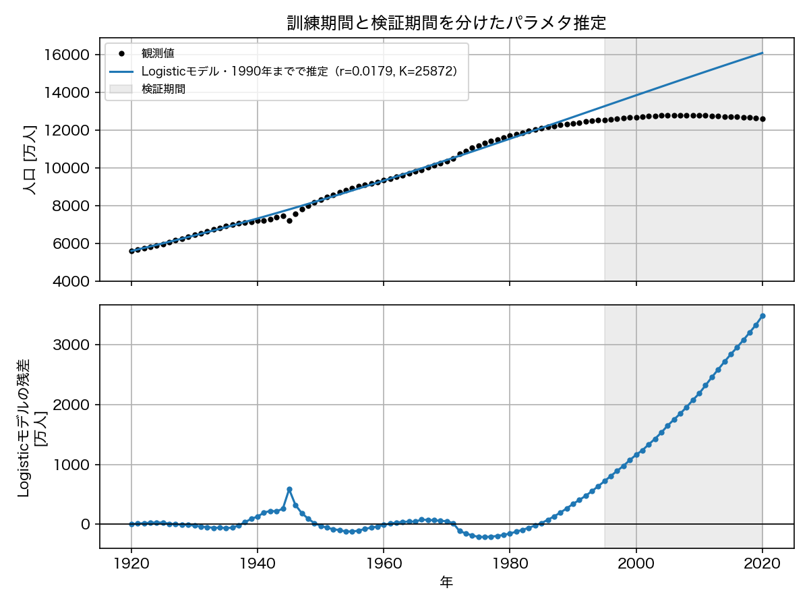
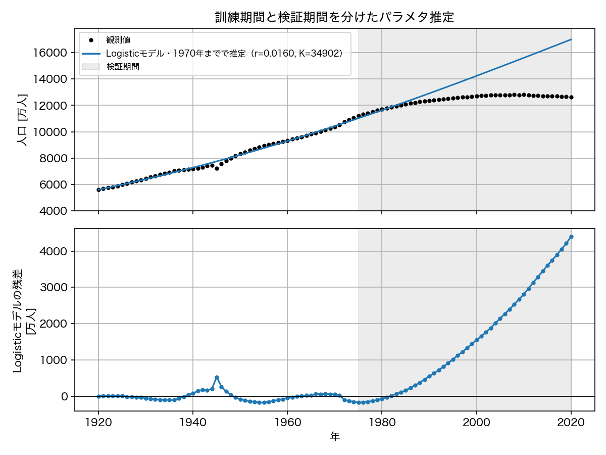
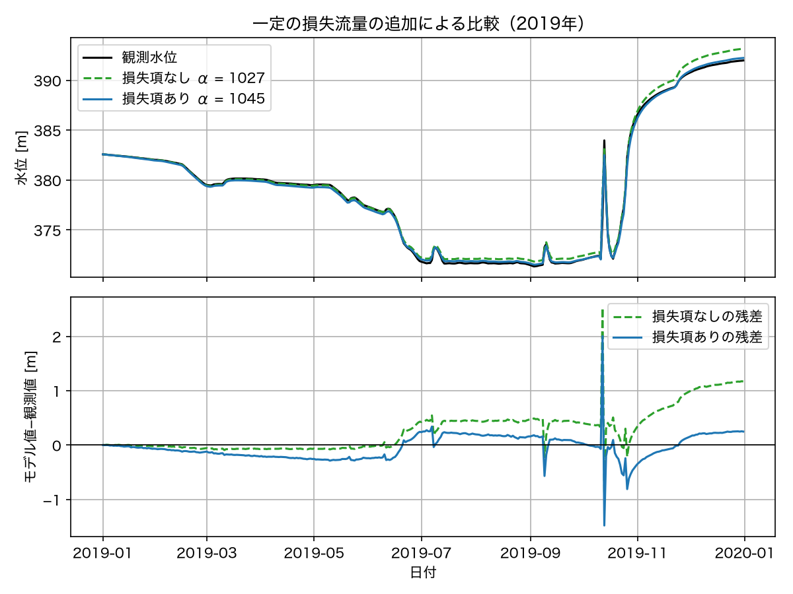

# 第7回　パラメタ推定

### 今回の位置付け

1. 現象の理解
2. 仮定の設定
3. 数理モデルの構築
4. 数値シミュレーション
5. データとの比較
6. <span style="color:red">パラメタ推定</span>
7. モデルの検証と改善

- **第5回**：人口のパラメタを格子探索で推定し，ヒートマップから誤差の小さい領域とパラメタの関係を調べた．
- **第6回**：保存則からダムの収支モデルを作り，水位と貯水量の換算係数を諸元から仮定した．
- **第7回**：第5回と同じ推定問題を**数値最適化**で解き，得られた係数を**推定に使わないデータ**に適用する．さらに第6回で仮定した換算係数を推定対象に変える．

第5回でも観測データに合うパラメタを推定していた．今回新しく扱うのは**候補の探し方**と**推定結果の確かめ方**である．人口データでは探索方法の変更と将来期間への適用を分けて調べ，ダムデータでは観測量への換算を含む推定と別の年への適用を調べる．

### 到達目標

- **第5回との比較**：格子探索と`least_squares`が，**同じ最小二乗の推定問題**を異なる手順で解くことを説明できる．
- **数値最適化の実装**：微分方程式の計算と残差関数を組み合わせ，全格子点を評価せずにパラメタを推定できる．
- **探索結果の確認**：探索の初期値・範囲・停止結果を確認し，小さい目的関数値を得たこととモデルの妥当性を区別できる．
- **人口モデルの検証**：データを訓練期間と検証期間に分け，**係数を固定した将来期間の誤差**を評価できる．
- **ダムの観測モデルの推定**：貯水量を観測水位へ換算して残差を定義し，ある年で推定した換算係数を別の年で評価できる．
- **推定結果の報告**：**探索の成否・未使用データへの適用結果・係数の物理的な解釈**を分けて報告できる．

<!--
**今回の流れ**（105分の目安）

| 段階 | 内容 | 時間 |
| --- | --- | --- |
| 1 | 準備と第5回との比較，同じ最小二乗問題（演習0） | 10分 |
| 2 | 数値最適化，格子探索との比較，探索初期値（演習1） | 25分 |
| 3 | 人口の訓練・検証，推定期間と残差（演習2・3） | 30分 |
| 4 | ダムの観測モデルの推定，別の年への適用（演習4） | 30分 |
| 5 | 3つの確認事項，課題の説明 | 10分 |
-->

## 準備

````{note} 演習0：作業フォルダとNotebookの準備

1. ターミナルで第7回の作業フォルダを作成せよ．

```bash
mkdir -p ~/applied_programming_ii/07
cd ~/applied_programming_ii/07
mkdir -p notebooks reports/figures
```

- **コードの補足**：`mkdir -p`は必要な親フォルダも作成し，`cd`は作業フォルダを移動する．

実行後の構成は次のとおりである．`data`は各回で共通に使用し，`README.md`とNotebookは続く手順で作成する．

```text
applied_programming_ii/
├── data/
└── 07/
    ├── README.md
    ├── notebooks/
    │   └── parameter_estimation.ipynb
    └── reports/
        └── figures/
```

2. `~/applied_programming_ii/data/`に`population_japan.csv`と`dam_urayama_daily.csv`があることを確認せよ．なければ，{download}`人口データ <../data/population_japan.csv>`と{download}`浦山ダムの日データ <../data/dam_urayama_daily.csv>`をダウンロードして保存せよ．

3. `notebooks/parameter_estimation.ipynb`を新規作成せよ．

4. `07`フォルダに`README.md`を作り，次の内容を記入せよ．

```markdown
# 応用プログラミングII 第7回

- 氏名：
- 学籍番号：

## 今日の目標

第5回と同じ最小二乗の推定問題を数値最適化で解き，人口では将来期間，ダムでは別の年へ係数を固定して適用し，結果を評価する．

## 格子探索と数値最適化の比較

1. 同じ条件で評価した格子探索の係数・最適化後の係数とMSEの減少率：
2. MSEの改善量が小さい場合にも，今回の探索方法を使う意義：

## 推定条件

- モデル：
- 推定するパラメタ：
- 目的関数：
- 訓練期間：
- 検証期間：
- 探索の初期値：
- 微分方程式の初期条件：
- パラメタの範囲：

## 演習1：探索初期値による推定結果の比較

1. 最も小さいcostに到達した初期値と，推定値・評価回数：
2. 異なる結果となった初期値とcostの比較：
3. 追加した初期値での推定値・cost・終了理由：
4. ヒートマップと複数開始点の比較で確かめること：

## 演習2：訓練期間の長さによる比較

1. 比較した訓練期間： （Notebookに推定値・RMSEと人口・残差の図を出力）
2. Kの変化と，推定に使うデータの特徴：
3. 訓練・検証のRMSEが最小の設定と，比較時の注意：

## 演習3：残差の時系列の解釈

1. 残差が正・負となる時期：
2. 1940年代の変化について考えられる要因と，確認に必要な資料：
3. 残差の傾向から判断できることと，判断できないこと：

## 演習4：対象年による換算係数の比較

1. 選んだ年・2019年の係数を固定した場合と再推定した場合のRMSE： （Notebookに水位と残差の図を出力）
2. 再推定した係数・観測水位の範囲と，2019年との比較：
3. 別の年への適用結果と，再推定による当てはまりの違い：

## 課題1：訓練期間を選んだ推定結果の報告

1. 推定条件・推定値・訓練と検証のRMSE：
2. 探索初期値による違いと停止結果：
3. 残差から見直す仮定と根拠： （Notebookに人口と残差の図を出力）
4. 訓練終了を5年延ばした場合の係数の変化・第5回との比較時の注意：

## 課題2の考察

1. 数値最適化と人口予測に関する主張への賛否・根拠：
2. ダムの再推定と別の年への適用に関する主張への賛否・根拠：
```

5. 以下のコードをNotebookの最初のコードセルにまとめて入力し，実行せよ．計算・描画に使うライブラリと保存先を設定し，CSVファイルの有無を確認する．

```python
from pathlib import Path

import numpy as np
import pandas as pd
import matplotlib.pyplot as plt
from scipy.integrate import solve_ivp
from scipy.optimize import least_squares

plt.rcParams["font.family"] = "Hiragino Sans"  # 日本語表示用（macOS）

PROJECT_DIR = Path.home() / "applied_programming_ii" / "07"
DATA_DIR = Path.home() / "applied_programming_ii" / "data"
FIGURE_DIR = PROJECT_DIR / "reports" / "figures"
FIGURE_DIR.mkdir(parents=True, exist_ok=True)

print("作業フォルダ:", PROJECT_DIR)
print("人口データの有無:", (DATA_DIR / "population_japan.csv").exists())
print("ダムデータの有無:", (DATA_DIR / "dam_urayama_daily.csv").exists())
```

- **コードの補足**：今回追加した`scipy.optimize.least_squares`は残差関数を使ってパラメタを推定する関数である．

出力例（`ユーザー名`の部分は実行環境によって異なる）：

```text
作業フォルダ: /Users/ユーザー名/applied_programming_ii/07
人口データの有無: True
ダムデータの有無: True
```
````

## 第5回との比較の準備

### 推定方法と評価方法

第5回の格子探索も観測値とモデル値の二乗誤差を小さくする**最小二乗の推定**である．今回は同じ推定問題を`least_squares`で解き，推定に使わないデータへの適用結果を調べる．

| 観点 | 第5回（格子探索） | 第7回（数値最適化） |
| --- | --- | --- |
| 候補の選択 | 用意した全格子点を評価 | <span style="color:red">残差の変化から次の候補を計算</span> |
| 結果の確認 | 格子の刻みと低誤差領域 | 探索初期値・範囲・停止結果 |
| データによる評価 | 当てはまりと残差 | 係数を固定した未使用期間の誤差 |

※ 以下の実行例における推定値の末尾・評価回数・終了理由は実行環境によって異なる場合がある．

### 比較でそろえる条件

格子探索から数値最適化へ変えたときの効果を調べるため，**モデル・データ・初期条件・誤差の測り方をそろえる**．この節では人口モデルの計算を準備し，第5回で得た係数によるMSEを比較の基準として求める．

| 条件 | 共通にする内容 |
| --- | --- |
| データ | 1920〜2020年の年次人口．単位は万人 |
| モデル | 定数 $r,K$ のLogistic方程式．外部入力はなし |
| 初期条件 | 1920年の観測人口 $N_0=5596.3$ 万人 |
| 誤差の測り方 | <span style="color:red">観測年ごとの人口の差を同じ重みで評価したMSE</span> |
| モデル値の計算 | 各方法で得た係数を同じ`solve_ivp`の設定で評価 |

人口モデルと初期条件は第4・5回と同じである．

$$
\frac{dN}{dt}=rN\left(1-\frac{N}{K}\right),\qquad N(0)=N_0.
$$

出生・死亡・人口移動の効果は個別の項に分けず，期間全体を同じ定数 $r,K$ で表す．これらの仮定を保ったまま，**係数の探し方を変更したときの結果**を比較する．推定に使うデータを訓練期間に限定する計算は，後の「人口モデル：未使用期間への適用」で扱う．

### 人口データと初期条件の準備

第3〜5回と同じ人口データを読み込み，千人から万人へ換算する．出典・列の意味は[授業用データ一覧](../data/README.md)を参照する．

```python
population = pd.read_csv(DATA_DIR / "population_japan.csv")
population["population_10k"] = population["total_population_thousand"] / 10
t_obs = (population["year"] - 1920).values.astype(float)
y_obs = population["population_10k"].values
N0 = y_obs[0]
print(f"観測点: {len(t_obs)}，期間: {population['year'].min()}〜{population['year'].max()}年，初期人口: {N0:.1f} 万人")
```

- **コードの補足**：`t_obs`は1920年を0とする経過年数，`y_obs`は万人単位の人口である．`N0`は最初の観測人口に固定する．

出力例：

```text
観測点: 101，期間: 1920〜2020年，初期人口: 5596.3 万人
```

### 計算関数と第5回の基準値

第5回の細かい格子探索では解析解を使った．今回は数値最適化に使う`solve_ivp`で第5回の係数も評価し直す．**解の計算方法による差を探索方法の効果に混ぜない**ため，両方に同じ計算関数を使う．

パラメタの組から観測時刻での人口を求める関数と平均二乗誤差の関数を定義する．

```python
def logistic_rhs(t, N, r, K):
    """Logisticモデル dN/dt = r N (1 - N/K) の右辺．"""
    return r * N * (1 - N / K)


def simulate_logistic(theta, t_eval, N0):
    """パラメタ theta = (r, K) でLogisticモデルを解き，時刻 t_eval での N を返す．"""
    r, K = theta
    sol = solve_ivp(logistic_rhs, (t_eval[0], t_eval[-1]), [N0], t_eval=t_eval, args=(r, K), rtol=1e-6)
    return sol.y[0]


def mean_squared_error(y_true, y_pred):
    """平均二乗誤差 (1/n) sum (y_true - y_pred)^2 を返す．"""
    return np.mean((y_true - y_pred) ** 2)
```

- **コードの補足**：`simulate_logistic`は観測時刻での人口を返す．`rtol=1e-6`は数値積分の相対許容誤差を指定する．

第5回の101×101格子で得た最良の組 $(r,K)=(0.0275,14800)$ を上で定義した関数で評価し，比較の基準となるMSEを求める．

```python
# 第5回の101×101格子で得た最良の組
theta_grid = (0.0275, 14800.0)
mse_grid = mean_squared_error(y_obs, simulate_logistic(theta_grid, t_obs, N0))
print(f"第5回の格子上の最良の組 (r, K) = {theta_grid}: MSE = {mse_grid:.1f} （RMSE = {np.sqrt(mse_grid):.1f} 万人）")
```

- **コードの補足**：`theta_grid`は第5回で選んだ係数の組である．`mse_grid`に同じ数値解で評価し直したMSEを保存し，後で最適化後のMSEと比較する．

出力例：

```text
第5回の格子上の最良の組 (r, K) = (0.0275, 14800.0): MSE = 115105.5 （RMSE = 339.3 万人）
```

ここで求めたMSE約115105.5を基準とし，後の「格子探索との比較と改善量の解釈」で数値最適化による変化を確認する．

## 格子探索から数値最適化への移行

格子探索では刻み幅を半分にすると候補数が増える．パラメタが $p$ 個あり，各 $m$ 通りの候補を用意すると，モデルの評価回数は $m^p$ になる．各50通りでは2パラメタで2,500回，4パラメタで6,250,000回であり，1回0.01秒でも後者は約17時間かかる．

数値最適化では全ての候補を先に並べる代わりに，**現在の候補の近くで残差がどう変わるか**を調べ，次に試す候補を決める．今回の設定ではライブラリがパラメタを少しずらして残差の変化を数値的に調べる．

1. 探索の開始値 $\theta_0$ を与える．
2. その候補で微分方程式を解き，観測時刻の残差配列を求める．
3. 候補の近くでの残差の変化を使い，二乗和を小さくする次の候補を計算する．
4. 候補を評価・更新し，停止条件を満たすまで繰り返す．

第5回では候補を選ぶ部分を二重の`for`文で書いた．今回はその部分を`least_squares`に任せ，モデルの計算と残差の定義を自分で用意する．少ない評価回数で推定できる場合がある一方，**探索の開始点と停止結果の確認**が必要になる．

### 残差と最小二乗の基準

観測値 $y_i$ とモデル値 $\hat y(t_i;\theta)$ から，残差とその二乗和を定義する．

$$
e_i(\theta)=\hat y(t_i;\theta)-y_i,
\qquad J(\theta)=\sum_{i=1}^{n}e_i(\theta)^2.
$$

残差は正なら過大評価，負なら過小評価を表す．第5回とは符号が逆だが，二乗すると同じ値になる．

| 尺度 | 計算式 | 用途 |
| --- | --- | --- |
| MSE | $J/n$ | 第5回との比較 |
| 残差二乗和 | $J$ | 最小二乗の推定問題の定義 |
| `least_squares`の`cost` | $J/2$ | 最適化の出力の確認 |

**同じデータなら3つを最小にするパラメタは同じ**である．第5回では $J$ をMSEと呼んだが，今回は残差二乗和として定義する．人口の差の単位と各年の重みは第5回と同じに保つ．二乗和は大きな残差の影響を受けやすいため，推定後は残差の時系列も確認する．

## `least_squares`によるパラメタ推定

### 残差関数の定義と推定の実行

第5回の`objective_logistic`はMSEを1つ返した．今回は**観測点ごとの残差配列**を返す関数を渡す．`least_squares`が残差の変化から次の候補を決める．

パラメタを第1引数，観測データと初期人口を残りの引数にして残差関数を定義する．

```python
def residuals(theta, t_obs, y_obs, N0):
    return simulate_logistic(theta, t_obs, N0) - y_obs
```

- **コードの補足**：返す値は観測点数と同じ長さの配列である．二乗和への集約は`least_squares`が行う．

第5回の格子探索を参考に，パラメタ探索の出発点を与えて推定する．微分方程式の初期条件 $N_0$ は最初の観測人口に固定している．

```python
theta_initial = [0.03, 13000.0]

result = least_squares(residuals, theta_initial, args=(t_obs, y_obs, N0))
```

- **コードの補足**：`args`で観測時刻・観測人口・固定した初期人口を残差関数へ渡す．

停止条件を満たしたかを確認し，推定値・目的関数値・RMSE・評価回数を表示する．

```python
r_hat, K_hat = result.x
print("停止条件を満たしたか:", result.success, " 状態:", result.message)
print(f"推定値: r = {r_hat:.5f} /年,  K = {K_hat:.1f} 万人")
print(f"目的関数（残差二乗和の半分）: {result.cost:.1f}")
print(f"RMSE: {np.sqrt(np.mean(result.fun ** 2)):.1f} 万人")
print(f"残差関数の評価回数: {result.nfev}")
```

```{dropdown} コードの補足

- `result.x`・`result.fun`：推定されたパラメタと，その推定値での残差配列である．
- `result.cost`：残差二乗和の半分，すなわち $J/2$ である．`result.nfev`は評価回数（探索中に残差関数を呼び出した回数）を表す．既定の手法では数値微分用の追加評価はこの回数に含まれない．
- `result.success`・`result.message`：停止条件を満たしたかと終了理由を示す．出力の`ftol`は目的関数の減少量に関する停止条件を表す．
```

出力例：

```text
停止条件を満たしたか: True  状態: `ftol` termination condition is satisfied.
推定値: r = 0.02759 /年,  K = 14753.8 万人
目的関数（残差二乗和の半分）: 5807180.6
RMSE: 339.1 万人
残差関数の評価回数: 7
```

この例では少ない探索評価で停止条件を満たしている．ただし`nfev`は全てのモデル評価を数えた値ではないため，格子探索の候補数との比をそのまま速度向上率とはみなさない．引数と戻り値の詳細は[SciPyの公式説明](https://docs.scipy.org/doc/scipy/reference/generated/scipy.optimize.least_squares.html)で確認できる．

### 格子探索との比較と改善量の解釈

最適化後のMSEと格子探索の係数を同じ数値解で評価したMSEを比べる．この比較では人口データ・初期条件・誤差の測り方・数値積分の設定をそろえている．

```python
mse_fitted = np.mean(result.fun ** 2)
improvement_percent = 100 * (mse_grid - mse_fitted) / mse_grid
print(f"格子探索の係数: r = {theta_grid[0]:.5f}, K = {theta_grid[1]:.1f}")
print(f"最適化後の係数: r = {r_hat:.5f}, K = {K_hat:.1f}")
print(f"格子探索の係数のMSE: {mse_grid:.1f}")
print(f"最適化後のMSE: {mse_fitted:.1f}")
print(f"MSEの減少率: {improvement_percent:.3f}%")
```

- **コードの補足**：`result.fun`は最適化後の残差配列である．二乗の平均を取ると，格子探索と同じ尺度のMSEになる．

出力例：

```text
格子探索の係数: r = 0.02750, K = 14800.0
最適化後の係数: r = 0.02759, K = 14753.8
格子探索の係数のMSE: 115105.5
最適化後のMSE: 114993.7
MSEの減少率: 0.097%
```

MSEの改善は約0.1%にとどまる．第5回の細かい格子がすでに良い当てはまりの領域を捉えていたためである．**今回の探索方法の意義は全格子点を細かく調べ続けずに，格子点の間も含めて候補を更新できること**にある．この利点は微分方程式を解く費用やパラメタ数が増えたときに重要になる．

一方，変えたのは係数の探し方であり，定数 $r,K$ のLogisticモデルという仮定は同じである．探索を精密にしても人口減少への転換を表す仕組みは加わらない．将来期間への適用は後の訓練・検証の比較で別に評価する．

この比較結果と改善量が小さくても数値最適化を使う意義をREADMEの「格子探索と数値最適化の比較」に記録する．

### 初期値依存性

数値最適化の結果は探索の初期値に依存し，異なる極小点や停止点に到達することがある．ここでの初期値はパラメタ探索の開始値であり，微分方程式の初期条件とは区別する．
格子探索では調べた全候補の最小値を選べたが，数値最適化では開始点からの更新で到達した候補を得る．そこで第5回のヒートマップで低誤差領域を把握した上で，複数の開始点を比較する．
複数の初期値から推定し，到達したパラメタ・目的関数値・評価回数を比較する．

```python
initial_guesses = [
    [0.03, 13000.0],
    [0.01, 20000.0],
    [0.10, 10000.0],
    [0.05, 30000.0],
]

print(f"{'初期値 (r, K)':>22} {'推定 r':>10} {'推定 K':>10} {'cost':>12} {'評価回数':>8}")
for guess in initial_guesses:
    res = least_squares(residuals, guess, args=(t_obs, y_obs, N0))
    print(f"{str(guess):>22} {res.x[0]:10.5f} {res.x[1]:10.1f} {res.cost:12.1f} {res.nfev:8d}")
```

- **コードの補足**：`for guess in initial_guesses`：探索の初期値を1組ずつ渡して推定を繰り返す．`cost`と評価回数も並べ，到達した点と計算量の違いを確認する．

出力例：

```text
            初期値 (r, K)       推定 r       推定 K         cost     評価回数
       [0.03, 13000.0]    0.02759    14753.8    5807180.6        7
       [0.01, 20000.0]    0.02759    14753.8    5807180.6       10
        [0.1, 10000.0]    0.06375    10000.0  157753795.5       22
       [0.05, 30000.0]    0.02759    14753.8    5807180.6        6
```

````{note} 演習1：探索初期値による推定結果の比較

1. 4つの結果から，最も小さいcostに到達した初期値と対応する推定値・評価回数を記せ．表示桁数で一致する結果は同程度とみなせ．
2. 異なる推定値に到達した初期値を挙げ，costが最小の結果の何倍か求めよ．
3. 探索初期値を`[0.5, 6000.0]`に変更し，上記と同様に`初期値 (r, K)，推定 r，推定 K，cost，評価回数`を出力して他の結果と比較せよ．
````

````{visible-answer} 演習1の解答例

**1・2．探索初期値の比較**

`[0.03, 13000.0]`，`[0.01, 20000.0]`，`[0.05, 30000.0]`では，表示桁数の範囲で $r=0.02759$，$K=14753.8$ 万人，cost $=5807180.6$ を得る．評価回数は順に7，10，6回である．`[0.10, 10000.0]`では異なる値に到達し，costは約27.2倍になる．

**3．追加した初期値**

「残差関数の定義と推定の実行」のうち，探索初期値の設定・推定を行うセルと結果を表示するセルをコピーし，`theta_initial`を`[0.5, 6000.0]`に変更して実行する．

```text
停止条件を満たしたか: False  状態: The maximum number of function evaluations is exceeded.
推定値: r = 0.41007 /年,  K = 6304.3 万人
目的関数（残差二乗和の半分）: 1011378002.6
RMSE: 4475.2 万人
残差関数の評価回数: 200
```

評価回数の上限に達して終了した例である．この出力だけでは局所的な極小点・パラメタの尺度・数値微分の影響のどれが原因かは特定できない．

**4．確認する点**

ヒートマップは低誤差領域の位置と広がりを示す．複数開始点の比較は最適化の結果が開始点に依存するかを調べる．両者を組み合わせても，全範囲の最小値を得たことの証明にはならない．
````


### パラメタの範囲指定

パラメタにはモデルの意味から決まる範囲がある．
ここでは増加または一定の人口を表すため， $r\geq0$ ， $K>N_0$ に制限する．計算では $K$ の下限を初期人口5596.3万人より大きい6000万人とする．
`bounds`で範囲を指定すると，設定した仮定と整合しない範囲での探索を防げる．

同じ探索初期値 `[0.5, 6000.0]` に範囲指定を加え，推定値とcostを比較する．

```python
lower_bounds = [0.0, 6000.0]       # r >= 0, K >= 6000 万人
upper_bounds = [1.0, 50000.0]      # r <= 1, K <= 50000 万人

result_bounded = least_squares(residuals, [0.5, 6000.0], args=(t_obs, y_obs, N0), bounds=(lower_bounds, upper_bounds))
print(f"範囲を指定した場合: r = {result_bounded.x[0]:.5f}, K = {result_bounded.x[1]:.1f}, cost = {result_bounded.cost:.1f}")
```

- **コードの補足**：`bounds=(lower_bounds, upper_bounds)`：各パラメタの下限と上限を同じ順番で指定する．ここでは $r$ を0〜1， $K$ を6000〜50000万人に制限する．

出力例：

```text
範囲を指定した場合: r = 0.02759, K = 14753.8, cost = 5807180.6
```

範囲を指定しても，局所解の問題が完全に消えるわけではない．
複数の初期値を試すこと，第5回のような粗い格子探索で低誤差領域の位置と広がりを調べておくことが，最適化の前の準備として有効である．

## 人口モデル：未使用期間への適用

ここまでは第5回との比較のために1920〜2020年の全データを使った．MSEが小さくなったことはこの期間への当てはまりが改善したことを示す．しかし，2020年の人口も係数の選択に使っているため，その当てはまりから，1990年の時点で2020年を予測できたとは判断できない．

そこで**推定に使うデータを過去の期間に限定し，その係数を固定して後の期間を計算する**．第5回で考えた外挿の不確かさを実際の未使用データとの誤差として評価する．

未使用期間の予測精度を確かめるため，データを次の2つに分ける．

- **訓練期間**：パラメタの推定に使う期間
- **検証期間**：推定したモデルの予測を観測と比べる期間

時系列データでは過去を訓練，未来を検証にするのが自然である．
ここでは1990年までを訓練，1995年から2020年を検証とする．訓練期間の最終年を変えると，検証開始年も5年後へ変わるように指定する．

検証期間の観測人口は`least_squares`へ渡さず，RMSEと残差の評価に使う．微分方程式の初期条件は引き続き1920年の観測人口に固定し，検証期間の人口から設定し直さない．

```python
train_end = 1990
valid_start = train_end + 5
train_mask = population["year"] <= train_end
valid_mask = population["year"] >= valid_start

t_train, y_train = t_obs[train_mask], y_obs[train_mask]
t_valid, y_valid = t_obs[valid_mask], y_obs[valid_mask]
print(f"訓練期間: {len(t_train)} 点（1920〜{train_end}年）， 検証期間: {len(t_valid)} 点（{valid_start}〜2020年）")
```

- **コードの補足**：`train_mask`と`valid_mask`はそれぞれの期間に含まれる年を選ぶ条件である．

訓練期間の観測値だけを残差関数へ渡し，範囲を指定してパラメタを推定する．

```python
result_train = least_squares(residuals, [0.03, 13000.0], args=(t_train, y_train, N0), bounds=(lower_bounds, upper_bounds))
r_train, K_train = result_train.x
print(f"訓練期間で推定: r = {r_train:.5f} /年,  K = {K_train:.1f} 万人")
```

- **コードの補足**：`result_train.x`から，訓練期間で推定した`r_train`と`K_train`を取り出す．

推定したパラメタを固定して1920〜2020年を計算し，訓練・検証期間のRMSEと最終年の予測を確認する．

```python
# 推定したパラメタで全期間を計算する
y_fit_all = simulate_logistic(result_train.x, t_obs, N0)
rmse_train = np.sqrt(mean_squared_error(y_train, y_fit_all[train_mask]))
rmse_valid = np.sqrt(mean_squared_error(y_valid, y_fit_all[valid_mask]))
print(f"訓練期間の RMSE: {rmse_train:8.1f} 万人")
print(f"検証期間の RMSE: {rmse_valid:8.1f} 万人")
print(f"2020年の予測: {y_fit_all[-1]:.1f} 万人，観測: {y_obs[-1]:.1f} 万人")
```

```{dropdown} コードの補足

- `y_fit_all`は1920年の初期条件から推定したパラメタで全期間を計算した人口である．
- 訓練・検証のマスクで対応する年を取り出し，それぞれのRMSEを求める．
- 1991〜1994年の値も計算するが，どちらのRMSEにも含めない．
```

出力例：

```text
訓練期間: 71 点（1920〜1990年）， 検証期間: 26 点（1995〜2020年）
訓練期間で推定: r = 0.01787 /年,  K = 25872.2 万人
訓練期間の RMSE:    141.0 万人
検証期間の RMSE:   2154.6 万人
2020年の予測: 16101.1 万人，観測: 12614.6 万人
```

- **推定値の変化**：1990年までで推定した $K$ は約25900万人で，全期間で推定した約14750万人より大きい．人口の増加が鈍る後半のデータを含めるかどうかで，推定値が変わる．
- **未使用期間の誤差**：訓練RMSEは約140万人，検証RMSEは約2150万人である．訓練期間に近い曲線を得ても，その後の人口を同じ精度で予測できるとは限らない．

### 観測値・モデル・残差の可視化

推定結果を報告するときは推定値の数字だけでなく，データと推定モデルを重ねた図と残差の時系列を示す．
残差に時間的な偏りがあれば，モデルの構造，パラメタの設定，観測過程のいずれに原因があるかを検討する．

```python
years = population["year"].values
residual_all = y_fit_all - y_obs
print(f"Logisticモデルの残差の範囲: {residual_all.min():.1f} 〜 {residual_all.max():.1f} 万人")
```

- **コードの補足**：`residual_all`はモデル値−観測値である．正なら過大予測，負なら過小予測を表す．

出力例：

```text
Logisticモデルの残差の範囲: -215.3 〜 3486.5 万人
```

人口の観測値とLogisticモデルを上段，残差を下段に示す．

```python
fig, axes = plt.subplots(2, 1, figsize=(8, 6), sharex=True)

axes[0].plot(years, y_obs, color="black", marker="o", markersize=3, linestyle="none", label="観測値")
axes[0].plot(years, y_fit_all, color="tab:blue", label=f"Logisticモデル・{train_end}年までで推定（r={r_train:.4f}, K={K_train:.0f}）")
axes[0].axvspan(valid_start, 2020, color="gray", alpha=0.15, label="検証期間")
axes[0].set_ylabel("人口 [万人]")
axes[0].set_ylim(4000, 1.05 * max(y_obs.max(), y_fit_all.max()))
axes[0].set_title("訓練期間と検証期間を分けたパラメタ推定")
axes[0].legend(fontsize=8)

axes[1].plot(years, residual_all, color="tab:blue", marker="o", markersize=3)
axes[1].axhline(0, color="black", linewidth=0.8)
axes[1].axvspan(valid_start, 2020, color="gray", alpha=0.15)
axes[1].set_ylabel("Logisticモデルの残差\n[万人]")

axes[1].set_xlabel("年")

for ax in axes:
    ax.grid(True)
fig.tight_layout()
fig.savefig(FIGURE_DIR / f"population_fit_{train_end}.png", dpi=150)
plt.show()
```

```{dropdown} コードの補足

- `sharex=True`：人口と残差の横軸を共有する．
- `axvspan(valid_start, 2020, ...)`：検証期間を背景色で示す．`alpha`は背景色の不透明度である．
- `set_ylim`：観測値とモデル値の最大値に合わせ，予測曲線全体が収まる縦軸の範囲を設定する．
```



````{note} 演習2：訓練期間の長さによる比較

1. 訓練期間の終わりを1970年，1990年，2010年の3通りとし，Logisticモデルの推定値と訓練・検証のRMSEを出力せよ．各条件で「観測値・モデル・残差の可視化」も再実行し，人口と残差の図をNotebookに示せ．
2. 訓練期間を長くしたときの $K$ の変化を記し，人口増加の鈍化を示すデータとの関係を説明せよ．
3. 訓練RMSEが最小の設定と検証RMSEが最小の設定を答えよ．ただし設定ごとに検証対象の年と期間の長さが変わることも記せ．
````

````{visible-answer} 演習2の解答例

**1．条件を変える手順**

「人口モデル：未使用期間への適用」の最初の3つのコードセルと「観測値・モデル・残差の可視化」の2つのコードセルをコピーする．最初の`train_end`だけを1970，1990，2010へ変更して各条件を実行する．1990年の図と出力は本文と同じになる．

| 訓練終了年 | 推定 $r$［/年］ | 推定 $K$［万人］ | 訓練RMSE［万人］ | 検証RMSE［万人］ |
| --- | ---: | ---: | ---: | ---: |
| 1970 | 0.01605 | 34902.2 | 122.1 | 2089.0 |
| 1990 | 0.01787 | 25872.2 | 141.0 | 2154.6 |
| 2010 | 0.02467 | 16122.3 | 269.0 | 1112.2 |

再実行した描画コードから，次の人口と残差の図を得る．




**2．Kの変化**

人口増加が鈍る後半のデータを含めると，推定される $K$ は小さくなる．ここで変えたのは推定データであり，探索方法ではない．

**3．RMSEの比較**

訓練RMSEは1970年まで，検証RMSEは2010年までで推定した設定が最小になる．ただし検証期間はそれぞれ1975〜2020年，1995〜2020年，2015〜2020年と異なるため，同じ将来期間に対する精度の比較にはなっていない．
````

````{note} 演習3：残差の時系列の解釈

`train_end = 1990`に戻し，訓練・検証期間の設定から人口と残差の描画までを順に再実行せよ．得られた図を使い，次を`README.md`に記せ．

1. 訓練期間のLogisticモデルの残差が正・負となる時期をそれぞれ挙げよ．
2. 1940年代の人口の急な変化についてモデルに含まれていない要因を1つ挙げ，確認に必要な資料も記せ．図だけから原因を断定しないこと．
3. 残差に時間的な偏りがある場合に見直す点を述べよ．偏りが目立たない場合でも，モデルが正しいと断定できるか答えよ．
````

````{visible-answer} 演習3の解答例

**1．残差の符号**

1990年までで推定した本文の図では例えば1925年・1945年・1970年・1990年は正，1935年・1950年・1980年は負である．特に1945年は約583万人の過大評価，1980年は約157万人の過小評価となる．時期によって同じ符号が続く傾向が見られる．

**2．急な変化に関係しうる要因**

戦争に伴う死亡や人口移動を候補として挙げる．定数 $r,K$ のLogisticモデルではこれらによる急な変化を個別に表していない．確認には当時の出生・死亡・人口移動の統計と人口データの集計範囲・推計方法の説明が必要になる．残差の図だけで，各要因の寄与は決められない．

**3．残差の傾向とモデルの評価**

- **偏りがある場合**：定数の係数で表す仮定，モデルに含めていない要因，観測・集計方法の変化を見直す．
- **偏りが目立たない場合**：その図では明確な時間的傾向が見つからなかったと言える．モデルが正しいことや，将来の予測精度まで保証するものではないため，未使用期間の誤差も確認する．
````

## ダムモデル：観測量への換算を含む推定

人口の例では微分方程式の解である人口をそのまま観測人口と比較できた．ダムの例では解である貯水量とCSVにある観測水位の単位も意味も異なる．**モデルの状態から観測される量を計算し，その量で残差を定義する**という手順を加える．

第6回の収支式と流量データを使い，諸元から仮定していた換算係数を推定する．その後，2019年の係数を固定して2020年へ適用し，2020年で係数を選び直した結果と区別する．

### 観測モデルと推定する係数

第6回では貯水位 $h$ から貯水量 $V$ への換算を傾き約627千m³/mの線形関係とした．
これはダムの諸元から仮定した値で，計算貯水量と水位からの換算値は最終的に約5,000千m³ずれた．この差に対し，今回は線形の換算関係を保ち，その傾きを未知のパラメタ $\alpha$ として推定する．損失項の追加や流量の補間方法の変更はこの比較には含めない．

$$
V(t) = \alpha\,(h(t) - h_{\min}),
\qquad
\frac{dV}{dt} = Q_{\mathrm{in}}(t) - Q_{\mathrm{out}}(t)
$$

$V$ は直接観測されないので，残差は観測量である貯水位で定義する．
モデルの貯水量を $\alpha$ で割って貯水位に戻し，時刻 $t_i$ の観測水位 $h_i$ との差を残差とする．

$$
\hat{h}(t_i;\alpha) = h_{\min} + \frac{V(t_i)}{\alpha},
\qquad
e_i(\alpha) = \hat{h}(t_i;\alpha) - h_i
$$

初期貯水量も $V_0=\alpha(h_0-h_{\min})$ とし，候補の $\alpha$ ごとに設定し直す．したがって最初の観測水位は初期条件に使う．その後の水位変化が合うように係数を選ぶ．

| 処理 | 人口モデル | ダムモデル |
| --- | --- | --- |
| 推定するもの | 増加率 $r$ と環境収容力 $K$ | 水位・貯水量の換算係数 $\alpha$ |
| 微分方程式の解 | 人口 $N(t)$ | 貯水量 $V(t)$ |
| 観測と比べる量 | 人口 $N(t)$ | 換算後の水位 $h_{\min}+V(t)/\alpha$ |
| 残差の単位 | 万人 | m |
| 共通する処理 | モデルの計算 → 観測量の計算 → 残差配列 → 最小二乗の推定 | 同左 |

```{tip} 仮定
:class: simple

- **観測モデル**：対象年を通じて同じ正の換算係数 $\alpha$ を使い，水位と貯水量を線形に結び付ける．
- **収支モデルと入力**：第6回と同じ収支式と流量の線形補間を使う．流量と最低水位 $h_{\min}$ は固定し，換算係数だけを推定する．
```

第6回と同じく，流入量は貯水位の変化と放流量から逆算された値である．この当てはめは独立な観測による容量曲線の検証とは区別する．

### データの準備と残差関数

2019年の水位と流量を取り出し，第6回と同じ単位にそろえる．

```python
dam = pd.read_csv(DATA_DIR / "dam_urayama_daily.csv", parse_dates=["date"])
year = 2019
dam_year = dam[dam["date"].dt.year == year].reset_index(drop=True)
```

- **コードの補足**：年を指定する条件で行を選び，`reset_index(drop=True)`で行番号を0から付け直す．

流量の単位換算に使う定数と，水位の基準を設定する．

```python
SECONDS_PER_DAY = 24 * 60 * 60
LEVEL_MIN = 304.0


def m3s_to_1000m3_per_day(flow_m3s):
    """流量 [m^3/s] を [千m^3/日] に換算する．"""
    return flow_m3s * SECONDS_PER_DAY / 1000
```

- **コードの補足**：1 m³/sは86.4千m³/日に相当する．`LEVEL_MIN`は第6回と同じ最低水位304.0 mである．

時刻・流入量・放流量・水位の配列を作り，対象年の水位の範囲を確認する．

```python
t_dam = np.arange(len(dam_year), dtype=float)
qin_dam = m3s_to_1000m3_per_day(dam_year["inflow_m3s"].values)
qout_dam = m3s_to_1000m3_per_day(dam_year["outflow_m3s"].values)
h_dam = dam_year["water_level_m"].values
print(f"対象年: {year}年，水位の範囲: {h_dam.min():.2f} 〜 {h_dam.max():.2f} m")
```

- **コードの補足**：流量は千m³/日，水位はmで扱う．時刻配列は第6回と同じく初日を0とした経過日数である．

出力例：

```text
対象年: 2019年，水位の範囲: 371.35 〜 391.99 m
```

候補の換算係数ごとに初期貯水量を設定し，収支モデルで得た貯水量を水位へ戻す．その水位と観測水位の差を残差関数で返す．

```python
def reservoir_rhs(t, V, t_data, qin_data, qout_data):
    """dV/dt = Q_in(t) - Q_out(t) の右辺．入力は観測値の線形補間．"""
    return np.interp(t, t_data, qin_data) - np.interp(t, t_data, qout_data)
```

- **コードの補足**：`np.interp`で日平均流量を線形補間し，任意の計算時刻の流入量と放流量を求める．

換算係数`alpha`から初期貯水量を決め，収支モデルの計算結果を水位へ換算する．

```python
def simulate_level(alpha, t_data, qin_data, qout_data, h_data):
    """傾き alpha で貯水量を計算し，貯水位に戻して返す．初期条件は初日の観測貯水位から決める．"""
    V0 = alpha * (h_data[0] - LEVEL_MIN)
    sol = solve_ivp(reservoir_rhs, (t_data[0], t_data[-1]), [V0], t_eval=t_data, args=(t_data, qin_data, qout_data), max_step=1.0)
    return LEVEL_MIN + sol.y[0] / alpha
```

```{dropdown} コードの補足

- 初期貯水量と計算後の水位への換算に，同じ`alpha`を使う．
- `max_step=1.0`は内部の計算刻み幅の上限を1日にする．
- `sol.y[0]`から貯水量を取り出し，`LEVEL_MIN + sol.y[0] / alpha`で水位へ戻す．
```

候補の換算係数で計算した水位と観測水位の差を残差配列として返す．

```python
def residuals_level(theta, t_data, qin_data, qout_data, h_data):
    """傾き theta[0] における貯水位の残差（モデル - 観測）を返す．"""
    return simulate_level(theta[0], t_data, qin_data, qout_data, h_data) - h_data
```

- **コードの補足**：`theta[0]`で1つの推定パラメタを取り出す．残差は人口の例と同じくモデル値−観測値で，単位はmである．

### 換算係数の推定と水位の比較

第6回の係数での誤差を計算してから，水位の残差二乗和を最小にする係数を推定する．探索範囲100〜5000千m³/mは計算上の範囲であり，真の係数がこの範囲にあることを保証するものではない．

```python
alpha_assumed = 56000.0 / (393.3 - 304.0)
rmse_assumed = np.sqrt(np.mean(residuals_level([alpha_assumed], t_dam, qin_dam, qout_dam, h_dam) ** 2))
print(f"第6回の仮定 alpha = {alpha_assumed:.1f} 千m^3/m のとき，貯水位の RMSE = {rmse_assumed:.2f} m")
```

- **コードの補足**：諸元から仮定した`alpha_assumed`を比較の基準と探索の初期値に使う．

水位の残差二乗和を最小にする換算係数を求め，RMSEと面積に相当する値を表示する．

```python
result_alpha = least_squares(residuals_level, [alpha_assumed], args=(t_dam, qin_dam, qout_dam, h_dam), bounds=([100.0], [5000.0]))
alpha_hat = result_alpha.x[0]
rmse_alpha = np.sqrt(np.mean(result_alpha.fun ** 2))
print(f"推定した alpha = {alpha_hat:.1f} 千m^3/m のとき，貯水位の RMSE = {rmse_alpha:.2f} m（評価回数 {result_alpha.nfev}）")
print(f"推定された湖面の面積に相当する値: {alpha_hat / 1000:.2f} km^2")
```

- **コードの補足**：`bounds`で係数を100〜5000千m³/mに制限する．`alpha_hat / 1000`は線形換算の傾きに対応する面積をkm²で表す．

出力例：

```text
第6回の仮定 alpha = 627.1 千m^3/m のとき，貯水位の RMSE = 4.64 m
推定した alpha = 1027.0 千m^3/m のとき，貯水位の RMSE = 0.47 m（評価回数 6）
推定された湖面の面積に相当する値: 1.03 km^2
```

仮定した係数と推定した係数でそれぞれ水位を計算し，最終日の値を比較する．

```python
h_assumed = simulate_level(alpha_assumed, t_dam, qin_dam, qout_dam, h_dam)
h_fitted = simulate_level(alpha_hat, t_dam, qin_dam, qout_dam, h_dam)
print(f"最終日の観測水位: {h_dam[-1]:.2f} m")
print(f"仮定した換算係数での水位: {h_assumed[-1]:.2f} m")
print(f"推定した換算係数での水位: {h_fitted[-1]:.2f} m")
```

- **コードの補足**：`h_assumed`と`h_fitted`：それぞれ仮定した換算係数と推定した換算係数で，全期間の水位を計算する．`[-1]`で最終日の値を取り出す．

出力例：

```text
最終日の観測水位: 391.99 m
仮定した換算係数での水位: 399.91 m
推定した換算係数での水位: 393.16 m
```

観測水位と計算水位を上段，それぞれの残差を下段に示す．

```python
fig, axes = plt.subplots(2, 1, figsize=(8, 6), sharex=True)
axes[0].plot(dam_year["date"], h_dam, color="black", label="観測水位")
axes[0].plot(dam_year["date"], h_assumed, color="tab:green", linestyle="--", label=f"仮定した係数 α = {alpha_assumed:.0f}")
axes[0].plot(dam_year["date"], h_fitted, color="tab:blue", label=f"推定した係数 α = {alpha_hat:.0f}")
axes[0].set_ylabel("水位 [m]")
axes[0].set_title(f"浦山ダムの水位・貯水量関係の傾きの推定（{year}年）")
axes[0].legend()
axes[1].plot(dam_year["date"], h_assumed - h_dam, color="tab:green", linestyle="--", label="仮定した係数での残差")
axes[1].plot(dam_year["date"], h_fitted - h_dam, color="tab:blue", label="推定した係数での残差")
axes[1].axhline(0, color="black", linewidth=0.8)
axes[1].set_ylabel("モデル値−観測値 [m]")
axes[1].set_xlabel("日付")
axes[1].legend()
for ax in axes:
    ax.grid(True)
fig.tight_layout()
fig.savefig(FIGURE_DIR / f"dam_alpha_estimation_{year}.png", dpi=150)
plt.show()
```

- **コードの補足**：上段は観測水位と2通りのモデル水位，下段はそれぞれのモデル値−観測値である．同じ係数に同じ色を使い，上下の対応を示す．


推定された傾きは約1,030千m³/mで，諸元から仮定した627千m³/mより6割以上大きい．
面積に直せば約1.0 km²の湖面に相当し，採用した線形観測モデルでの有効な換算係数として解釈できる．実際の湖面積を独立に測定した値ではない．
貯水位の RMSE は約4.6 mから約0.5 mに下がる．

しかし，この $\alpha$ は2019年のデータに対する目的関数を最小化する一定の傾きであって，水位・容量曲線そのものではない．
別の年にも同じ係数が適用できるかを確かめるため，次に $\alpha$ を2019年の推定値に固定して2020年を計算する．対象年ごとに係数を選び直すと，各年への当てはまりは調べられるが，2019年の係数を別の年でも使えるかという問いには答えられない．

### 別の年への適用と再推定の区別

2019年で求めた換算係数を保存する．以降，`alpha_reference`は固定し，対象年の水位の残差から選び直さない．

```python
alpha_reference = alpha_hat
```

2020年の水位と流量を取り出し，第6回と同じ単位へ換算する．換算関数・最低水位・収支モデルは2019年の計算と共通である．

```python
year = 2020
dam_year = dam[dam["date"].dt.year == year].reset_index(drop=True)
t_dam = np.arange(len(dam_year), dtype=float)
qin_dam = m3s_to_1000m3_per_day(dam_year["inflow_m3s"].values)
qout_dam = m3s_to_1000m3_per_day(dam_year["outflow_m3s"].values)
h_dam = dam_year["water_level_m"].values
print(f"対象年: {year}年，水位の範囲: {h_dam.min():.2f} 〜 {h_dam.max():.2f} m")
```

- **コードの補足**：対象年だけを変更する．`h_dam[0]`はこの年の計算を始める水位である．

出力例：

```text
対象年: 2020年，水位の範囲: 370.96 〜 393.07 m
```

2019年の係数を固定したまま2020年の水位を計算し，2020年の観測水位とのRMSEを求める．

```python
h_reference = simulate_level(alpha_reference, t_dam, qin_dam, qout_dam, h_dam)
rmse_reference = np.sqrt(np.mean((h_reference - h_dam) ** 2))
print(f"2019年の係数を固定: alpha = {alpha_reference:.1f} 千m^3/m，RMSE = {rmse_reference:.3f} m")
```

- **コードの補足**：`simulate_level`は対象年の初日の観測水位から初期貯水量を設定する．係数は2019年の値を保ち，初日以降の水位変化を評価する．

出力例：

```text
2019年の係数を固定: alpha = 1027.0 千m^3/m，RMSE = 0.896 m
```

次に2020年の水位を使って係数を選び直す．このRMSEは2020年への当てはまりを表す．

```python
result_alpha = least_squares(
    residuals_level,
    [alpha_assumed],
    args=(t_dam, qin_dam, qout_dam, h_dam),
    bounds=([100.0], [5000.0]),
)
alpha_hat = result_alpha.x[0]
rmse_alpha = np.sqrt(np.mean(result_alpha.fun ** 2))
h_fitted = simulate_level(alpha_hat, t_dam, qin_dam, qout_dam, h_dam)
print("停止結果:", result_alpha.success, result_alpha.message)
print(f"対象年で再推定: alpha = {alpha_hat:.1f} 千m^3/m，RMSE = {rmse_alpha:.3f} m")
```

- **コードの補足**：残差関数に渡すデータを2020年にすると，その年を訓練データとした再推定になる．`alpha_reference`は更新しない．

出力例：

```text
停止結果: True `xtol` termination condition is satisfied.
対象年で再推定: alpha = 1087.3 千m^3/m，RMSE = 0.320 m
```

`xtol`はパラメタの更新量に関する停止条件である．この停止結果と別の年への適用誤差は分けて確認する．

係数を固定した計算と再推定した計算について水位と残差を上下2段で比較する．

```python
fig, axes = plt.subplots(2, 1, figsize=(8, 6), sharex=True)
axes[0].plot(dam_year["date"], h_dam, color="black", label="観測水位")
axes[0].plot(dam_year["date"], h_reference, color="tab:green", linestyle="--", label=f"2019年の係数を固定 α = {alpha_reference:.0f}")
axes[0].plot(dam_year["date"], h_fitted, color="tab:blue", label=f"{year}年で再推定 α = {alpha_hat:.0f}")
axes[0].set_ylabel("水位 [m]")
axes[0].set_title(f"2019年の係数の適用と対象年での再推定（{year}年）")
axes[0].legend()
axes[1].plot(dam_year["date"], h_reference - h_dam, color="tab:green", linestyle="--", label="2019年の係数を固定した残差")
axes[1].plot(dam_year["date"], h_fitted - h_dam, color="tab:blue", label="対象年で再推定した残差")
axes[1].axhline(0, color="black", linewidth=0.8)
axes[1].set_ylabel("モデル値−観測値 [m]")
axes[1].set_xlabel("日付")
axes[1].legend()
for ax in axes:
    ax.grid(True)
fig.tight_layout()
fig.savefig(FIGURE_DIR / f"dam_alpha_transfer_{year}.png", dpi=150)
plt.show()
```

- **コードの補足**：緑の破線は2019年の係数を2020年へ適用した結果，青の実線は2020年の水位で係数を選び直した結果である．


2019年の係数を固定した場合のRMSEは約0.896 mで，2019年の当てはまりを表す約0.472 mより大きい．2020年で再推定すると約0.320 mになるが，この値は2020年の水位を使って係数を選んだ後の誤差である．**別の年への適用結果には固定した係数のRMSEを報告し，再推定したRMSEとは分ける**．

人口の例では検証期間の人口を初期条件や推定に使わずに計算した．ダムでは対象年全体の観測流量と初日の観測水位を与えている．したがってここで調べたのは観測入力の下で換算係数を別の年に適用できるかであり，将来の流量と水位をまとめて予測する性能ではない．

````{note} 演習4：対象年による換算係数の比較

2021〜2023年から1年を選び，「別の年への適用と再推定の区別」の`year`を変更して比較せよ．`alpha_reference`は2019年の推定値に固定すること．

1. 2019年の係数を固定した水位と対象年で係数を再推定した水位についてRMSEを求めよ．選んだ年と2つのRMSEをREADMEに記し，水位と残差の比較図をNotebookに出力せよ．
2. 再推定した係数と観測水位の範囲を記し，2019年と比較せよ．係数の違いを調べるために必要な資料を1つ挙げよ．
3. 2つのRMSEのうち，2019年の係数を別の年へ適用した結果を表すのはどちらか答えよ．再推定したRMSEが小さいことから言えることと言えないことを説明せよ．
````

````{visible-answer} 演習4の解答例

**1．2021年への適用と再推定**

「別の年への適用と再推定の区別」の`year = 2020`から描画までをコピーし，`year = 2021`に変更して実行する．`alpha_reference`を代入するセルは再実行せず，2019年の係数を保つ．

```text
対象年: 2021年，水位の範囲: 371.69 〜 376.62 m
2019年の係数を固定: alpha = 1027.0 千m^3/m，RMSE = 0.265 m
対象年で再推定: alpha = 939.8 千m^3/m，RMSE = 0.027 m
```

再利用した描画コードから，次の比較図を得る．


**2．係数と水位範囲の比較**

2019年の係数は約1027.0千m³/m，2021年で再推定した係数は約939.8千m³/mである．水位の範囲は2019年が371.35〜391.99 m，2021年が371.69〜376.62 mであり，2021年はより狭い水位域を通る．水位・容量曲線を入手し，各年の水位域における傾きと比較する．係数の違いをそのまま湖面の形の変化とみなすことはできない．

**3．2つのRMSEの意味**

2019年の係数を別の年へ適用した結果は固定した係数による約0.265 mである．再推定後の約0.027 mは2021年に合わせて係数を選び直した結果を表す．その年への当てはまりは改善しているが，2021年の係数をさらに別の年でも使えることや，実際の湖面積を正確に測定したことまでは示していない．
````

## まとめ

| 確認すること | 今回の結果と確認方法 |
| --- | --- |
| 探索で小さい誤差を得たか | 格子探索からのMSE改善は約0.1%．開始点・範囲・停止結果を照合する |
| 未使用データでも使えるか | 人口では将来期間のRMSE，ダムでは2019年の係数を固定した別の年のRMSEを調べる |
| 係数を現実の量として解釈できるか | モデルの仮定とデータの作られ方を確認し，独立な資料と照合する |

**探索の成功，当てはまりの改善，将来への適用は別に確認する**．格子探索は低誤差領域を調べる準備にも使える．次回はタンクモデルの構造とパラメタ数を変え，推定結果への影響を調べる．

## 課題

````{warning} 課題1：訓練期間を選んだ推定結果の報告

人口のLogisticモデルについて訓練期間の終わりを自分で1つ選び（1960年から2010年の間），次の推定と比較を行え．数値と考察は`README.md`の「課題1」に記し，図はNotebookに出力せよ．

1. モデル・推定するパラメタ・目的関数・訓練と検証の期間・探索初期値と範囲・微分方程式の初期条件を記し，推定値と両期間のRMSEを示せ．
2. 本文と同じ4組の探索初期値から推定し，推定値・cost・停止結果を比較せよ．
3. 人口と残差の図をNotebookに出力し，残差から見直す仮定を1つ挙げて根拠を記せ．
4. 訓練終了を5年延ばして係数の変化を記せ．この変化を探索方法の効果や信頼区間と解釈できるか，第5回との比較条件にも触れて説明せよ．検証期間は各設定で訓練終了の5年後から2020年までとする．
````

````{hidden-answer} 課題1の解答例

**1．推定条件と結果**

Logisticモデルの $r,K$ を推定する．初期人口は5596.3万人，目的関数は人口の残差二乗和である．探索初期値は`[0.03, 13000.0]`，範囲は $0\leq r\leq1$，$6000\leq K\leq50000$ 万人とする．

本文の訓練・検証の設定から描画までをコピーし，`train_end = 1980`に変更する．訓練は1920〜1980年，検証は1985〜2020年となる．

```text
訓練期間で推定: r = 0.01500 /年,  K = 48065.8 万人
訓練期間の RMSE:    115.6 万人
検証期間の RMSE:   2851.2 万人
2020年の予測: 17843.8 万人，観測: 12614.6 万人
```

**2．探索初期値の比較**

「初期値依存性」のループをコピーし，残差関数に渡すデータと範囲を訓練用に変更する．変更した推定の呼び出しを強調する．

```{code-block} python
:linenos:
:emphasize-lines: 3
:class: code-focus

# initial_guessesは本文の4組を使う．
for guess in initial_guesses:
    res = least_squares(residuals, guess, args=(t_train, y_train, N0), bounds=(lower_bounds, upper_bounds))
    print(guess, res.x, res.cost, res.success, res.message)
```

4組とも $r\approx0.01500$，$K\approx48065.8$ 万人，cost $\approx407449.5$ を得る．いずれも停止条件を満たすが，探索範囲全体の最小値を得たことの証明にはならない．

**3．残差と見直す仮定**

再利用した描画コードから，次の人口と残差の図を得る．


検証期間では人口を過大予測し，差が大きくなる．定数 $r,K$ で人口増加の鈍化を表し続ける仮定を見直し，出生・死亡・人口移動の統計と照合する．

**4．期間の変更と第5回との比較**

`train_end = 1985`に変更して同じ計算を再実行すると，$r=0.01614$，$K=34675.4$ 万人，訓練RMSE約119.6万人，検証RMSE約2575.0万人を得る．$K$ の変化は約−13390万人だが，これは推定データを変えた2条件の差であり，信頼区間ではない．

第5回は全期間のデータを使ったため，今回との推定値の差を探索方法だけの効果とは解釈できない．全期間・同じ数値解にそろえた本文の比較では，格子探索からのMSEの改善は約0.1%だった．
````

````{warning} 課題2：推定と検証の区別

次の主張についてそれぞれ賛成か反対かを明らかにし，今回の計算結果を根拠にして各200字程度で論じよ．

1. 「第5回の格子探索より細かくパラメタを推定できたので，今回の人口モデルは2050年の人口予測にも使える．」
2. 「2020年のダムデータで換算係数を推定し直すとRMSEが約0.320 mになったので，2019年の換算係数を2020年へ適用しても同程度の誤差になる．」
````

````{hidden-answer} 課題2の解答例

**1．人口の推定方法と予測性能**

この根拠だけで2050年の予測に使えるという主張には反対である．数値最適化は同じモデル・データに対する係数の探し方を変えたもので，モデルに人口減少を表す仕組みを加えてはいない．全期間でのMSEの改善は約0.1%である．1990年までで推定した例では訓練RMSE約141万人に対して検証RMSEは約2155万人だった．2050年への適用を判断するには未使用期間の誤差と定数の係数を将来も使う仮定を検討する必要がある．

**2．ダムの固定した係数と再推定した係数**

反対である．約0.320 mは2020年の水位を使って換算係数を約1087.3千m³/mに選び直した後の当てはまりを表す．2019年で推定した約1027.0千m³/mを固定して2020年へ適用した場合，RMSEは約0.896 mだった．両者は同じ流量と初日の水位を使うが，係数の選択に使ったデータが違う．別の年への適用結果として報告するのは固定した係数の誤差であり，再推定後の誤差を代わりに使うことはできない．
````

### 提出先・期限

- 提出場所：WebClass「第7回課題」
- 提出物：
  - `README.md`
  - Notebookファイル`parameter_estimation.ipynb`
- 提出期限：2026年11月21日(土)23:59


## 自主学習用の発展課題

### 換算係数と一定の損失流量の同時推定

本文では第6回と同じ収支式を保ち，換算係数だけを推定した．ここでは第6回の損失項を加え，換算係数 $\alpha$ と一定の損失流量 $c$ を同時に推定する．これは探索方法を変える比較から，**モデルの構造とパラメタ数を変える比較**への発展である．

$$
\frac{dV}{dt}=Q_{\mathrm{in}}(t)-Q_{\mathrm{out}}(t)-c,
\qquad V_0=\alpha(h_0-h_{\min}),
\qquad \hat h(t)=h_{\min}+\frac{V(t)}{\alpha}.
$$

正の $c$ は貯水量を減らす向きの補正で，単位は千m³/日である．ここでは $c\geq0$ として損失を表す．

「別の年への適用と再推定の区別」のデータ抽出セルをコピーして`year = 2019`に変更し，流量と水位の配列を作り直す．換算関数と最低水位は本文の設定を使う．

損失項がない場合の比較には，本文で保存した2019年の係数を使う．

```python
alpha_hat = alpha_reference
```

本文の水位計算に損失流量を追加し，2つのパラメタを受け取る残差関数を定義する．

```{code-block} python
:linenos:
:emphasize-lines: 2
:class: code-focus

def reservoir_rhs_with_loss(t, V, t_data, qin_data, qout_data, loss):
    return np.interp(t, t_data, qin_data) - np.interp(t, t_data, qout_data) - loss
```

- **コードの補足**：`loss`を千m³/日の一定流量として，流入量と放流量の差から引く．

換算係数と損失流量を受け取り，損失項を加えたモデルの水位を計算する．

```{code-block} python
:linenos:
:emphasize-lines: 2,4
:class: code-focus

def simulate_level_with_loss(theta, t_data, qin_data, qout_data, h_data):
    alpha, loss = theta
    V0 = alpha * (h_data[0] - LEVEL_MIN)
    sol = solve_ivp(reservoir_rhs_with_loss, (t_data[0], t_data[-1]), [V0], t_eval=t_data, args=(t_data, qin_data, qout_data, loss), max_step=1.0)
    return LEVEL_MIN + sol.y[0] / alpha
```

- **コードの補足**：`alpha, loss = theta`で候補の2つの値を取り出し，`args`の最後に`loss`を加えて右辺へ渡す．

2つのパラメタで計算した水位から，観測水位を引いた残差配列を返す．

```python
def residuals_level_with_loss(theta, t_data, qin_data, qout_data, h_data):
    return simulate_level_with_loss(theta, t_data, qin_data, qout_data, h_data) - h_data
```

- **コードの補足**：`least_squares`へ渡すパラメタ配列は換算係数・損失流量の順に並べる．


````{note} 発展課題：2パラメタの推定と解釈

1. 本文の換算係数の推定コードを変更し， $\alpha,c$ を同時に推定せよ．探索の初期値は `[alpha_assumed, 0.0]`，下限は `[100.0, 0.0]`，上限は `[5000.0, 100.0]` とせよ．推定値とRMSEを記し， $c$ をm³/sにも換算せよ．
2. 損失項がない場合と加えた場合の水位・残差を描き，同じ訓練データでのRMSEが下がった理由を説明せよ．
3. 推定した $c$ を蒸発量や漏水量と解釈できるか答え，確認に必要な資料を挙げよ．
````

````{hidden-answer} 発展課題の解答例

**1．推定値と誤差**

残差関数・探索の初期値・範囲を2パラメタ用に変更し，水位の残差を最小にする組を求める．

```{code-block} python
:linenos:
:emphasize-lines: 1-2
:class: code-focus

result_two = least_squares(residuals_level_with_loss, [alpha_assumed, 0.0], args=(t_dam, qin_dam, qout_dam, h_dam), bounds=([100.0, 0.0], [5000.0, 100.0]))
alpha_two, loss_two = result_two.x
print("停止結果:", result_two.success, result_two.message)
print(f"alpha = {alpha_two:.1f} 千m^3/m")
print(f"損失流量 = {loss_two:.3f} 千m^3/日 = {loss_two * 1000 / SECONDS_PER_DAY:.4f} m^3/s")
print(f"RMSE = {np.sqrt(np.mean(result_two.fun ** 2)):.3f} m")
```

- **コードの補足**：1つの係数を推定した本文と同じ呼び出し方で，パラメタ配列を2要素にする．

出力例：

```text
停止結果: True `xtol` termination condition is satisfied.
alpha = 1045.1 千m^3/m
損失流量 = 2.119 千m^3/日 = 0.0245 m^3/s
RMSE = 0.238 m
```

**2．水位と残差の比較**

それぞれの推定値で水位を計算し，RMSEを比較する．

```python
h_single = simulate_level(alpha_hat, t_dam, qin_dam, qout_dam, h_dam)
h_two = simulate_level_with_loss(result_two.x, t_dam, qin_dam, qout_dam, h_dam)
print(f"損失項なしのRMSE: {np.sqrt(np.mean((h_single - h_dam) ** 2)):.3f} m")
print(f"損失項ありのRMSE: {np.sqrt(np.mean((h_two - h_dam) ** 2)):.3f} m")
```

出力例：

```text
損失項なしのRMSE: 0.472 m
損失項ありのRMSE: 0.238 m
```

本文と同じ2段の図で，損失項の有無による水位と残差の違いを示す．

```python
fig, axes = plt.subplots(2, 1, figsize=(8, 6), sharex=True)
axes[0].plot(dam_year["date"], h_dam, color="black", label="観測水位")
axes[0].plot(dam_year["date"], h_single, color="tab:green", linestyle="--", label=f"損失項なし α = {alpha_hat:.0f}")
axes[0].plot(dam_year["date"], h_two, color="tab:blue", label=f"損失項あり α = {alpha_two:.0f}")
axes[0].set_ylabel("水位 [m]")
axes[0].set_title(f"一定の損失流量の追加による比較（{year}年）")
axes[0].legend()
axes[1].plot(dam_year["date"], h_single - h_dam, color="tab:green", linestyle="--", label="損失項なしの残差")
axes[1].plot(dam_year["date"], h_two - h_dam, color="tab:blue", label="損失項ありの残差")
axes[1].axhline(0, color="black", linewidth=0.8)
axes[1].set_ylabel("モデル値−観測値 [m]")
axes[1].set_xlabel("日付")
axes[1].legend()
for ax in axes:
    ax.grid(True)
fig.tight_layout()
fig.savefig(FIGURE_DIR / "dam_alpha_loss_2019.png", dpi=150)
plt.show()
```



損失項のないモデルは拡張したモデルで $c=0$ とした場合に含まれる．したがって同じデータで同じ目的関数を厳密に最小化できれば，パラメタを追加した側の最小値は増加しない．**訓練データへの当てはまりの改善だけでは将来予測や物理的な解釈の改善までは示せない**．

**3．損失流量の解釈**

<span style="color:red">推定値だけから，実際の蒸発量や漏水量とは判断できない．</span>水位から貯水量への換算や流量の補間の誤差も， $c$ によって補われる可能性がある．さらにCSVの流入量は貯水量変化と放流量から逆算されている．容量曲線，流量の算出方法，蒸発量・湖面積・漏水の観測資料と照合し，同じ出入りを二重に数えていないか確認する．
````
