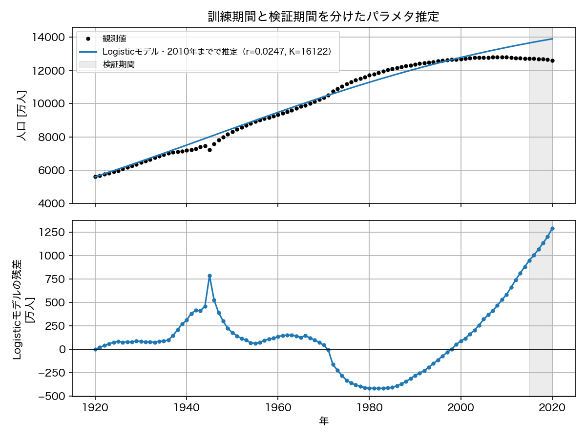
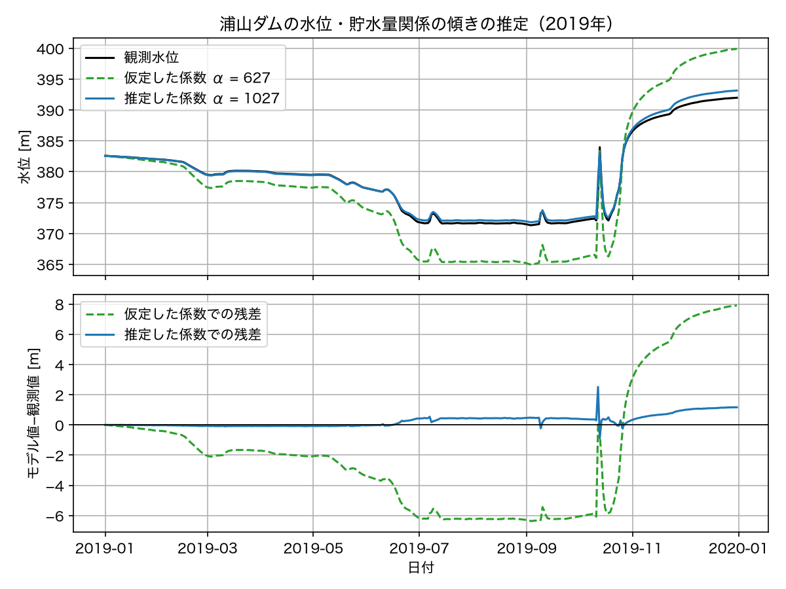
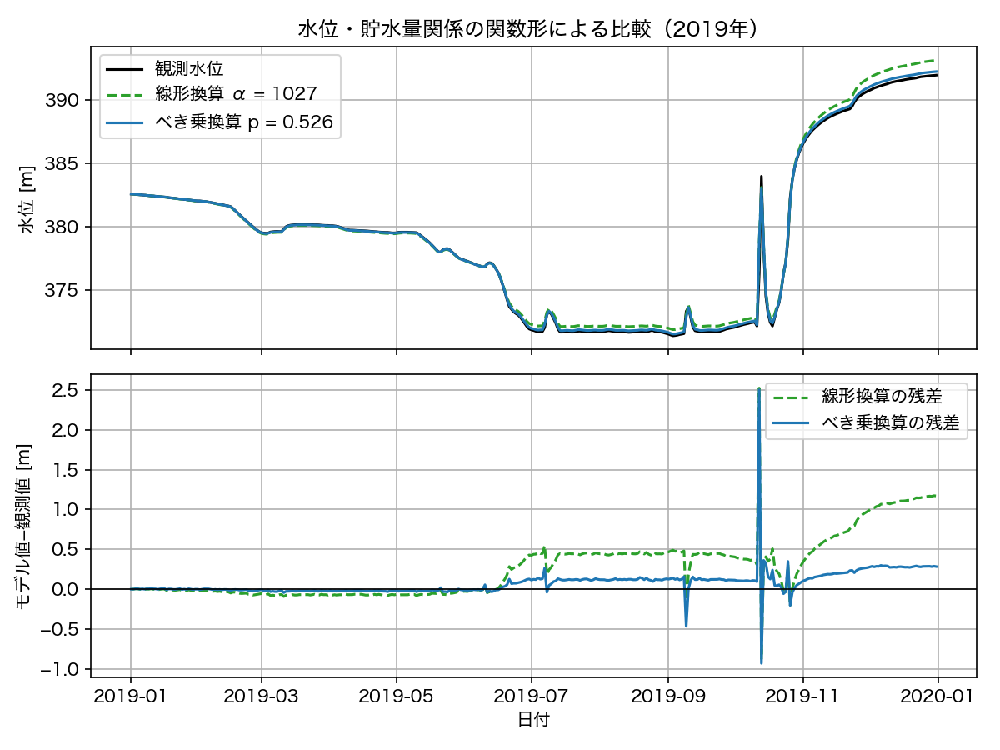

# 第7回　パラメタ推定

### 今回の位置付け

1. 現象の理解
2. 仮定の設定
3. 数理モデルの構築
4. 数値シミュレーション
5. データとの比較
6. <span style="color:red">パラメタ推定</span>
7. モデルの検証と改善

- **第5回**：人口のパラメタを格子探索で推定し，ヒートマップから誤差の小さい領域とパラメタの関係を調べた．
- **第6回**：保存則からダムの収支モデルを作り，水位と貯水量の換算係数を諸元から仮定した．
- **第7回**：第5回と同じ推定問題を**数値最適化**で解き，得られた係数を**推定に使わないデータ**に適用する．さらに第6回で仮定した換算係数を推定対象に変える．

**候補の探し方**と**未使用データでの確かめ方**を，人口とダムのモデルで学ぶ．

### 到達目標

- **第5回との比較**：格子探索と`least_squares`が，**同じ最小二乗の推定問題**を異なる手順で解くことを説明できる．
- **数値最適化の実装**：微分方程式の計算と残差関数を組み合わせ，全格子点を評価せずにパラメタを推定できる．
- **探索結果の確認**：探索の初期値・範囲・停止結果を確認し，小さい目的関数値を得たこととモデルの妥当性を区別できる．
- **人口モデルの検証**：データを訓練期間と検証期間に分け，**係数を固定した将来期間の誤差**を評価できる．
- **ダムの観測モデルの推定**：貯水量を観測水位へ換算して残差を定義し，ある年で推定した換算係数を別の年で評価できる．
- **推定結果の報告**：**探索の成否・未使用データへの適用結果・係数の物理的な解釈**を分けて報告できる．

<!--
**今回の流れ**（105分の目安）

| 段階 | 内容 | 時間 |
| --- | --- | --- |
| 1 | 準備と第5回との比較，同じ最小二乗問題（演習0） | 10分 |
| 2 | 数値最適化，格子探索との比較，探索初期値（演習1） | 25分 |
| 3 | 人口の訓練・検証，推定期間と残差（演習2） | 30分 |
| 4 | ダムの観測モデルの推定，別の年への適用（演習3） | 30分 |
| 5 | 3つの確認事項，課題の説明 | 10分 |
-->

## 準備

````{note} 演習0：作業フォルダとNotebookの準備

1. ターミナルで第7回の作業フォルダを作成せよ．

```bash
mkdir -p ~/applied_programming_ii/07
cd ~/applied_programming_ii/07
mkdir -p notebooks reports/figures
```

- **コードの補足**：`mkdir -p`は必要な親フォルダも作成し，`cd`は作業フォルダを移動する．

実行後の構成は次のとおりである．`data`は各回で共通に使用し，`README.md`とNotebookは続く手順で作成する．

```text
applied_programming_ii/
├── data/
└── 07/
    ├── README.md
    ├── notebooks/
    │   └── parameter_estimation.ipynb
    └── reports/
        └── figures/
```

2. `~/applied_programming_ii/data/`に`population_japan.csv`と`dam_urayama_daily.csv`があることを確認せよ．なければ，{download}`人口データ <../data/population_japan.csv>`と{download}`浦山ダムの日データ <../data/dam_urayama_daily.csv>`をダウンロードして保存せよ．

3. `notebooks/parameter_estimation.ipynb`を新規作成せよ．

4. `07`フォルダに`README.md`を作り，次の内容を記入せよ．

```markdown
# 応用プログラミングII 第7回

- 氏名：
- 学籍番号：

## 今日の目標

第5回と同じ最小二乗の推定問題を数値最適化で解き，人口では将来期間，ダムでは別の年へ係数を固定して適用し，結果を評価する．

## 格子探索と数値最適化の比較

1. 同じ条件で評価した格子探索の係数・最適化後の係数とMSEの減少率：
2. MSEの改善量が小さい場合にも，今回の探索方法を使う意義：

## 推定条件

- モデル：
- 推定するパラメタ：
- 目的関数：
- 訓練期間：
- 検証期間：
- 探索の初期値：
- 微分方程式の初期条件：
- パラメタの範囲：

## 演習1：探索初期値による推定結果の比較

1. 最も小さいcostに到達した初期値と，推定値・評価回数：
2. 異なる結果となった初期値とcostの比較：
3. 追加した初期値・推定値・cost・評価回数： （Notebookに同じ形式で出力）

## 演習2：訓練期間と残差の比較

1. 比較した訓練終了年： （Notebookに推定値・RMSEと人口・残差の図を出力）
2. 1990年までで推定した場合の1945年・1980年の残差： （Notebookに数値を出力）
3. 訓練RMSEが最小の訓練終了年・検証RMSEが最小の訓練終了年：

## 演習3：対象年による換算係数の比較

1. 選んだ年・2019年の係数を固定した場合と再推定した場合のRMSE： （Notebookに水位と残差の図を出力）
2. 再推定した係数・観測水位の範囲：
3. 2つのRMSEの差： （Notebookに数値を出力）

## 課題1：訓練期間を選んだ推定結果の報告

1. 推定条件・推定値・訓練と検証のRMSE：
2. 探索初期値による違いと停止結果：
3. 残差から見直す仮定と根拠： （Notebookに人口と残差の図を出力）
4. 訓練終了を5年延ばした場合の係数の変化・第5回との比較時の注意：

## 課題2：ダムの係数の推定と別の年への適用

1. 2019年で推定した係数・RMSE・停止結果：
2. 選んだ年・固定した係数と再推定した係数によるRMSE・再推定した係数：
3. 2つのRMSEの差・別の年への適用結果として報告するRMSE： （Notebookに水位と残差の図を出力）
```

5. 以下のコードをNotebookの最初のコードセルにまとめて入力し，実行せよ．計算・描画に使うライブラリと保存先を設定し，CSVファイルの有無を確認する．

```python
from pathlib import Path

import numpy as np
import pandas as pd
import matplotlib.pyplot as plt
from scipy.integrate import solve_ivp
from scipy.optimize import least_squares

plt.rcParams["font.family"] = "Hiragino Sans"  # 日本語表示用（macOS）

PROJECT_DIR = Path.home() / "applied_programming_ii" / "07"
DATA_DIR = Path.home() / "applied_programming_ii" / "data"
FIGURE_DIR = PROJECT_DIR / "reports" / "figures"
FIGURE_DIR.mkdir(parents=True, exist_ok=True)

print("作業フォルダ:", PROJECT_DIR)
print("人口データの有無:", (DATA_DIR / "population_japan.csv").exists())
print("ダムデータの有無:", (DATA_DIR / "dam_urayama_daily.csv").exists())
```

- **コードの補足**：今回追加した`scipy.optimize.least_squares`は残差関数を使ってパラメタを推定する関数である．

出力例：

```text
作業フォルダ: /Users/ユーザー名/applied_programming_ii/07
人口データの有無: True
ダムデータの有無: True
```
````

## 第5回との比較の準備

### 推定方法と評価方法

**推定の基準は同じで，候補の選び方が変わる**．

| 観点 | 第5回（格子探索） | 第7回（数値最適化） |
| --- | --- | --- |
| 候補の選択 | 用意した全格子点を評価 | <span style="color:red">残差の変化から次の候補を計算</span> |
| 結果の確認 | 格子の刻みと低誤差領域 | 探索初期値・範囲・停止結果 |
| データによる評価 | 当てはまりと残差 | 係数を固定した未使用期間の誤差 |

※ 以下の実行例における推定値の末尾・評価回数・終了理由は実行環境によって異なる場合がある．

### 比較でそろえる条件

探索方法の効果を比べるため，**モデル・データ・初期条件・誤差の測り方をそろえる**．

 $t$ を1920年からの経過年数， $N(t)$ を人口（万人）， $r$ を人口増加率（/年）， $K$ を環境収容力（万人）とする． $N_0=N(0)$ は1920年の初期人口である．

| 条件 | 共通にする内容 |
| --- | --- |
| データ | 1920〜2020年の年次人口．単位は万人 |
| モデル | 定数 $r,K$ のLogistic方程式．外部入力はなし |
| 初期条件 | 1920年の観測人口 $N_0=5596.3$ 万人 |
| 誤差の測り方 | <span style="color:red">観測年ごとの人口の差を同じ重みで評価したMSE</span> |
| モデル値の計算 | 各方法で得た係数を同じ`solve_ivp`の設定で評価 |

人口モデルと初期条件は第4・5回と同じである．

$$
\frac{dN}{dt}=rN\left(1-\frac{N}{K}\right),\qquad N(0)=N_0.
$$

出生・死亡・人口移動は個別に分けず，期間全体を定数 $r,K$ で表す．

### 人口データと初期条件の準備

人口を万人，時刻を1920年からの経過年数にそろえ，初期人口を1920年の観測値に固定する．出典は[授業用データ一覧](../data/README.md)を参照する．

```python
population = pd.read_csv(DATA_DIR / "population_japan.csv")
population["population_10k"] = population["total_population_thousand"] / 10
t_obs = (population["year"] - 1920).values.astype(float)
y_obs = population["population_10k"].values
N0 = y_obs[0]
print(f"観測点: {len(t_obs)}，期間: {population['year'].min()}〜{population['year'].max()}年，初期人口: {N0:.1f} 万人")
```

出力例：

```text
観測点: 101，期間: 1920〜2020年，初期人口: 5596.3 万人
```

### 計算関数と第5回の基準値

第5回の係数も`solve_ivp`で評価し直し，**同じ計算方法でMSEを比較する**．

推定するパラメタの組を $\theta=(r,K)$ と書く．この組から観測時刻での人口を求める関数と平均二乗誤差の関数を定義する．

```python
def logistic_rhs(t, N, r, K):
    """Logisticモデル dN/dt = r N (1 - N/K) の右辺．"""
    return r * N * (1 - N / K)


def simulate_logistic(theta, t_eval, N0):
    """パラメタ theta = (r, K) でLogisticモデルを解き，時刻 t_eval での N を返す．"""
    r, K = theta
    sol = solve_ivp(
        logistic_rhs,
        (t_eval[0], t_eval[-1]),
        [N0],
        t_eval=t_eval,
        args=(r, K),
        rtol=1e-06,
    )
    return sol.y[0]


def mean_squared_error(y_true, y_pred):
    """平均二乗誤差 (1/n) sum (y_true - y_pred)^2 を返す．"""
    return np.mean((y_true - y_pred) ** 2)
```

第5回の101×101格子で得た最良の組 $(r,K)=(0.0275,14800)$ を上で定義した関数で評価し，比較の基準となるMSEを求める．

```python
# 第5回の101×101格子で得た最良の組
theta_grid = (0.0275, 14800.0)
mse_grid = mean_squared_error(y_obs, simulate_logistic(theta_grid, t_obs, N0))
print(f"第5回の格子上の最良の組 (r, K) = {theta_grid}: MSE = {mse_grid:.1f} （RMSE = {np.sqrt(mse_grid):.1f} 万人）")
```

出力例：

```text
第5回の格子上の最良の組 (r, K) = (0.0275, 14800.0): MSE = 115105.5 （RMSE = 339.3 万人）
```

## 格子探索から数値最適化への移行

- **格子探索の計算量**：パラメタが $p$ 個，各 $m$ 候補なら評価回数は $m^p$ ．各50候補では，2パラメタで2,500回，4パラメタで6,250,000回になる．
- **数値最適化の進め方**：現在の候補の近くで残差の変化を調べ，次の候補を決める．今回の設定では，パラメタを少しずらした計算から変化を求める．

1. パラメタの組 $\theta$ の探索開始値を $\theta_0$ として与える．
2. 候補 $\theta$ を固定した初期値問題を解き，その解を各観測時刻で評価して観測値との差を求める．
3. 候補の近くでの残差の変化を使い，二乗和を小さくする次の候補を計算する．
4. 候補を評価・更新し，停止条件を満たすまで繰り返す．

**モデルの計算と残差関数を用意し，候補の更新を`least_squares`に任せる**．探索の開始点と停止結果は，計算後に確認する．

### 残差と最小二乗の基準

- **観測時刻 $t_i$ **：1920年からの経過年数． $i=1,\ldots,n$ は観測点の番号で， $0=t_1<\cdots<t_n$ とする．
- **観測人口 $y_i$ **：時刻 $t_i$ の人口（万人）．初期人口は $N_0=y_1$ に固定する．

**候補を固定した初期値問題**

候補 $\theta=(r,K)$ を固定したときの解を $N(t;\theta)$ と書く．観測期間全体で解が存在する候補を扱う．

$$
\begin{cases}
\displaystyle \frac{d}{dt}N(t;\theta)
=rN(t;\theta)\left(1-\frac{N(t;\theta)}{K}\right),
& 0\leq t\leq t_n,\\[4pt]
N(0;\theta)=N_0.
\end{cases}
$$

**候補ごとに解き直すが，初期人口 $N_0$ は共通**である．

**観測時刻での残差配列**

- **残差 $e_i(\theta)$ **：計算人口 $N(t_i;\theta)$ から観測人口 $y_i$ を引いた差．
- **残差ベクトル $\boldsymbol e(\theta)$ **：各時刻の残差を順に並べたもの．コードでは1次元配列で表す．

$$
e_i(\theta)=N(t_i;\theta)-y_i,
\qquad
\boldsymbol e(\theta)=
\begin{pmatrix}
N(t_1;\theta)-y_1\\
\vdots\\
N(t_n;\theta)-y_n
\end{pmatrix}.
$$

**1920年から計算した1本の曲線を各観測時刻で評価する**．残差は正なら過大評価，負なら過小評価を表す．第5回とは符号が逆だが，二乗和は同じである．

**最小二乗法**は，次の残差二乗和 $J(\theta)$ を最小にする方法である．

$$
J(\theta)=\sum_{i=1}^{n}e_i(\theta)^2.
$$

実装では数値解から残差を求める．各尺度の関係は次のとおりである．

| 尺度 | 計算式 | 用途 |
| --- | --- | --- |
| MSE | $J/n$ | 第5回との比較 |
| 残差二乗和 | $J$ | 最小二乗の推定問題の定義 |
| `least_squares`の`cost` | $J/2$ | 最適化の出力の確認 |

**同じデータなら3つの最小化で選ばれるパラメタは同じ**である．第5回の $J$ はMSE，今回の $J$ は残差二乗和を表す．大きな残差の影響も確認するため，推定後は残差の時系列を描く．

## `least_squares`によるパラメタ推定

### 残差関数の定義と推定の実行

第5回はMSEを1つ返した．今回は**観測点ごとの残差配列**を返す関数を用意する．

パラメタを第1引数，観測データと初期人口を残りの引数にして残差関数を定義する．

```python
def residuals(theta, t_obs, y_obs, N0):
    return simulate_logistic(theta, t_obs, N0) - y_obs
```

- **コードの補足**：返す値は観測点数と同じ長さの配列である．二乗和への集約は`least_squares`が行う．

- **探索の初期値**：反復計算を始めるパラメタの組．第5回の格子探索を参考に設定する．
- **微分方程式の初期条件**：計算開始時の人口 $N_0$ ．最初の観測人口に固定する．

探索の初期値を設定し，全期間の残差からパラメタを推定する．

```python
theta_initial = [0.03, 13000.0]
```

同じ残差関数を使ってパラメタを推定する．

```python
result = least_squares(residuals, theta_initial, args=(t_obs, y_obs, N0))
```

```{dropdown} コードの補足：least_squaresの引数

| 引数名 | このコードで渡す値 | 役割 |
| --- | --- | --- |
| `fun` | `residuals` | 候補のパラメタから残差配列を返す関数．関数名を渡す |
| `x0` | `theta_initial` | 探索の開始値．`[r, K]`の順に並べる |
| `args` | `(t_obs, y_obs, N0)` | 残差関数の第2引数以降へ渡す固定値．観測時刻・観測人口・初期人口の順に対応する |

`fun`と`x0`は位置で指定する．`least_squares`は`theta`を更新し，`residuals(theta, t_obs, y_obs, N0)`を繰り返し呼び出す．
```

停止条件を満たしたかを確認し，推定値・目的関数値・RMSE・評価回数を表示する．

```python
r_hat, K_hat = result.x
print("停止条件を満たしたか:", result.success, " 状態:", result.message)
print(f"推定値: r = {r_hat:.5f} /年,  K = {K_hat:.1f} 万人")
print(f"目的関数（残差二乗和の半分）: {result.cost:.1f}")
print(f"RMSE: {np.sqrt(np.mean(result.fun ** 2)):.1f} 万人")
print(f"残差関数の評価回数: {result.nfev}")
```

- **コードの補足**：`result.x`は推定された係数，`result.fun`はその係数での残差配列である．

出力例：

```text
停止条件を満たしたか: True  状態: `ftol` termination condition is satisfied.
推定値: r = 0.02759 /年,  K = 14753.8 万人
目的関数（残差二乗和の半分）: 5807180.6
RMSE: 339.1 万人
残差関数の評価回数: 7
```

**停止条件は，それ以上の改善が小さくなったかを判定する**．当てはまりの良さはRMSEと残差の図で確認する．

- **`ftol`**：目的関数の減少量に関する停止条件．
- **`xtol`**：パラメタの更新量に関する停止条件．
- **`gtol`**：目的関数の勾配に関する停止条件．
- **`nfev`**：残差関数の評価回数．今回の設定では数値微分用の追加評価を含まず，反復回数とも異なる．

評価回数の上限で終了した場合，`success`は`False`になる．

```{dropdown} 補足：停止条件とftolの判定

`tol`はtolerance（許容値）の略で，`f`は目的関数，`x`はパラメタ，`g`は勾配に対応する．`nfev`はnumber of function evaluationsの略である．

`ftol=1e-8`では，costの減少量を更新前のcostの約1億分の1と比較する．目的関数を $F(\theta)=J(\theta)/2$ とし，更新前後の値を $F_{\mathrm{before}}$，$F_{\mathrm{after}}$ とする．減少量 $\Delta F=F_{\mathrm{before}}-F_{\mathrm{after}}$ について次の条件を調べる．

$$
\Delta F < \mathtt{ftol} \times F_{\mathrm{before}}
=10^{-8} \times F_{\mathrm{before}}.
$$

例えば更新前のcostが $5807180.6$ なら，減少量の閾値は約 $0.0581$ である．さらに，次の候補を計算するための近似モデルが予測した減少量と実際の減少量が十分に整合していれば，`ftol`の停止条件を満たす．**現在のcostに対して改善が十分小さくなったこと**を判定している．当てはまりの良さは別にRMSEと残差の図で確認する．引数と戻り値の詳細は[SciPyの公式説明](https://docs.scipy.org/doc/scipy/reference/generated/scipy.optimize.least_squares.html)を参照する．
```

### 格子探索との比較と改善量の解釈

同じデータと数値積分の設定で，格子探索と最適化後のMSEを比較する．

```python
mse_fitted = np.mean(result.fun ** 2)
improvement_percent = 100 * (mse_grid - mse_fitted) / mse_grid
print(f"格子探索の係数: r = {theta_grid[0]:.5f}, K = {theta_grid[1]:.1f}")
print(f"最適化後の係数: r = {r_hat:.5f}, K = {K_hat:.1f}")
print(f"格子探索の係数のMSE: {mse_grid:.1f}")
print(f"最適化後のMSE: {mse_fitted:.1f}")
print(f"MSEの減少率: {improvement_percent:.3f}%")
```

- **コードの補足**：`result.fun`は最適化後の残差配列である．二乗の平均を取ると，格子探索と同じ尺度のMSEになる．

出力例：

```text
格子探索の係数: r = 0.02750, K = 14800.0
最適化後の係数: r = 0.02759, K = 14753.8
格子探索の係数のMSE: 115105.5
最適化後のMSE: 114993.7
MSEの減少率: 0.097%
```

- **今回の改善量**：MSEは約0.1%減少した．第5回の格子探索ですでに最小値に近い候補を得ていた．
- **探索方法の利点**：全格子点を調べ直さず，格子点の間も探索できる．パラメタ数や1回の計算時間が増えると有用になる．

一方，変えたのは係数の探し方であり，定数 $r,K$ のLogisticモデルという仮定は同じである．探索を精密にしても人口減少への転換を表す仕組みは加わらない．将来期間への適用は後の訓練・検証の比較で別に評価する．

この比較結果と改善量が小さくても数値最適化を使う意義をREADMEの「格子探索と数値最適化の比較」に記録する．

### 初期値依存性

**同じデータでも，探索の開始値によって結果が変わる場合がある**．第5回のヒートマップと照合しながら，4組の開始値で推定値・cost・評価回数を比較する．

```python
initial_guesses = [
    [0.10, 10000.0],
    [0.05, 30000.0],
    [0.03, 13000.0],
    [0.01, 20000.0],
]
```

初期値の候補ごとに推定し，推定値・cost・評価回数を比較する．

```python
print(f"{'初期値 (r, K)':>22} {'推定 r':>10} {'推定 K':>10} {'cost':>12} {'評価回数':>8}")
for guess in initial_guesses:
    res = least_squares(residuals, guess, args=(t_obs, y_obs, N0))
    print(f"{str(guess):>22} {res.x[0]:10.5f} {res.x[1]:10.1f} {res.cost:12.1f} {res.nfev:8d}")
```

- **コードの補足**：各組は`[r, K]`の順で，開始値のrが大きい順に並べている．`for`文で1組ずつ独立に推定し，costと評価回数を比較する．

出力例：

```text
            初期値 (r, K)       推定 r       推定 K         cost     評価回数
        [0.1, 10000.0]    0.06375    10000.0  157753795.5       22
       [0.05, 30000.0]    0.02759    14753.8    5807180.6        6
       [0.03, 13000.0]    0.02759    14753.8    5807180.6        7
       [0.01, 20000.0]    0.02759    14753.8    5807180.6       10
```

````{note} 演習1：探索初期値による推定結果の比較

1. 本文の4つの結果から，最も小さいcostに到達した初期値と対応する推定値・評価回数を記せ．表示桁数で一致する結果は同程度とみなせ．
2. 異なる推定値に到達した初期値を挙げ，costが最小の結果の何倍か求めよ．
3. 探索初期値を`[0.5, 6000.0]`に変更する．次の【】を埋めて実行し，本文と同じ形式で推定値・cost・評価回数を出力せよ．

本文のループ内の処理をコピーし，追加の1組について計算する．

```python
guess = 【追加する探索初期値 [r, K]】
print(f"{'初期値 (r, K)':>22} {'推定 r':>10} {'推定 K':>10} {'cost':>12} {'評価回数':>8}")
res = least_squares(residuals, 【探索初期値】, args=(t_obs, y_obs, N0))
print(f"{str(guess):>22} {res.x[0]:10.5f} {res.x[1]:10.1f} {res.cost:12.1f} {res.nfev:8d}")
```
````

````{visible-answer} 演習1の解答例

**1．同程度の最小costに到達した初期値**

本文の出力例では次の3組が表示桁数の範囲で同じ $r=0.02759$，$K=14753.8$ 万人，cost $=5807180.6$ を与える．

| 探索初期値 `[r, K]` | 評価回数 |
| --- | ---: |
| `[0.05, 30000.0]` | 6 |
| `[0.03, 13000.0]` | 7 |
| `[0.01, 20000.0]` | 10 |

**2．異なる推定値に到達した初期値**

`[0.10, 10000.0]`では $r=0.06375$，$K=10000.0$ 万人，cost $=157753795.5$ を得る．最小のcostとの比は $157753795.5/5807180.6\approx27.2$ である．

**3．追加した初期値の出力と比較**

本文のループ内と同じ処理を，追加の1組について実行する．見出しと表示形式も本文にそろえる．

```{code-block} python
:linenos:
:emphasize-lines: 1
:class: code-focus

guess = [0.5, 6000.0]
print(f"{'初期値 (r, K)':>22} {'推定 r':>10} {'推定 K':>10} {'cost':>12} {'評価回数':>8}")
res = least_squares(residuals, guess, args=(t_obs, y_obs, N0))
print(f"{str(guess):>22} {res.x[0]:10.5f} {res.x[1]:10.1f} {res.cost:12.1f} {res.nfev:8d}")
```

- **コードの補足**：観測データと残差関数は本文と同じに保ち，探索初期値だけを変更する．

出力例：

```text
            初期値 (r, K)       推定 r       推定 K         cost     評価回数
         [0.5, 6000.0]    0.41007     6304.3 1011377744.9      200
```

costは4組の最小値の約174.2倍で，評価回数も多い．この例では既定の評価回数の上限200回に達して終了している．`res.success`と`res.message`でも停止結果を確認できる．
````


### パラメタの範囲指定

パラメタにはモデルの意味から決まる範囲がある．
ここでは増加または一定の人口を表すため， $r\geq0$ ， $K>N_0$ に制限する．計算では $K$ の下限を初期人口5596.3万人より大きい6000万人とする．
`bounds`で範囲を指定すると，設定した仮定と整合しない範囲での探索を防げる．

同じ探索初期値 `[0.5, 6000.0]` に範囲指定を加え，推定値とcostを比較する．

```python
lower_bounds = [0.0, 6000.0]       # r >= 0, K >= 6000 万人
upper_bounds = [1.0, 50000.0]      # r <= 1, K <= 50000 万人

result_bounded = least_squares(
    residuals, [0.5, 6000.0], args=(t_obs, y_obs, N0),
    bounds=(lower_bounds, upper_bounds),  # 追加箇所
)
print(f"範囲を指定した場合: r = {result_bounded.x[0]:.5f}, K = {result_bounded.x[1]:.1f}, cost = {result_bounded.cost:.1f}")
```

```{dropdown} コードの補足：boundsの指定

| 指定 | 役割 | このコードでの意味 |
| --- | --- | --- |
| `lower_bounds` | 各パラメタの下限 | $r\geq0$，$K\geq6000$ 万人 |
| `upper_bounds` | 各パラメタの上限 | $r\leq1$，$K\leq50000$ 万人 |
| `bounds=(lower_bounds, upper_bounds)` | 下限と上限の組を渡す | どちらも`x0`と同じ`[r, K]`の順で並べる |

探索の開始値も指定した範囲内に置く．この例では`[0.5, 6000.0]`が範囲内にある．
```

出力例：

```text
範囲を指定した場合: r = 0.02759, K = 14753.8, cost = 5807180.6
```

**範囲指定だけでは大域的な最小値は保証されない**．複数の開始値や粗い格子探索の結果と照合する．

## 人口モデル：未使用期間への適用

**推定に使ったデータへの当てはまりと，未使用期間の予測精度を分けて調べる**．

- **訓練期間**：1920〜1990年．この期間の観測人口だけで係数を推定する．
- **検証期間**：1995〜2020年．推定した係数を固定し，観測人口との誤差を評価する．

初期人口は1920年の値に固定し，検証期間も同じ解を延長して計算する．訓練・検証のデータを次のように取り出す．

```python
train_end = 1990
valid_start = train_end + 5
train_mask = population["year"] <= train_end
valid_mask = population["year"] >= valid_start

t_train, y_train = t_obs[train_mask], y_obs[train_mask]
t_valid, y_valid = t_obs[valid_mask], y_obs[valid_mask]
```

- **コードの補足**：`train_mask`・`valid_mask`：推定用と検証用のデータを選ぶ条件である．ここでは1991〜1994年はどちらの誤差評価にも含めない．

訓練・検証期間と，それぞれの観測点数を確認する．

```python
print(f"訓練期間: {len(t_train)} 点（1920〜{train_end}年）， 検証期間: {len(t_valid)} 点（{valid_start}〜2020年）")
```

訓練期間の観測値だけを残差関数へ渡し，範囲を指定してパラメタを推定する．

```python
result_train = least_squares(residuals, [0.03, 13000.0], args=(t_train, y_train, N0), bounds=(lower_bounds, upper_bounds))
r_train, K_train = result_train.x
```

訓練期間から求めたパラメタを表示する．

```python
print(f"訓練期間で推定: r = {r_train:.5f} /年,  K = {K_train:.1f} 万人")
```

推定したパラメタを固定して1920〜2020年を計算し，訓練・検証期間のRMSEと最終年の予測を確認する．

```python
# 推定したパラメタで全期間を計算する
y_fit_all = simulate_logistic(result_train.x, t_obs, N0)
rmse_train = np.sqrt(mean_squared_error(y_train, y_fit_all[train_mask]))
rmse_valid = np.sqrt(mean_squared_error(y_valid, y_fit_all[valid_mask]))
```

- **コードの補足**：`y_fit_all`：1920年の初期条件から全期間を計算し，訓練期間と検証期間に対応する値を取り出してRMSEを求める．

訓練・検証のRMSEと，2020年の予測人口を表示する．

```python
print(f"訓練期間の RMSE: {rmse_train:8.1f} 万人")
print(f"検証期間の RMSE: {rmse_valid:8.1f} 万人")
print(f"2020年の予測: {y_fit_all[-1]:.1f} 万人，観測: {y_obs[-1]:.1f} 万人")
```


出力例：

```text
訓練期間の RMSE:    141.0 万人
検証期間の RMSE:   2154.6 万人
2020年の予測: 16101.1 万人，観測: 12614.6 万人
```

- **推定値の変化**：1990年までで推定した $K$ は約25900万人で，全期間で推定した約14750万人より大きい．人口の増加が鈍る後半のデータを含めるかどうかで，推定値が変わる．
- **未使用期間の誤差**：訓練RMSEは約140万人，検証RMSEは約2150万人である．訓練期間に近い曲線を得ても，その後の人口を同じ精度で予測できるとは限らない．

(estimation-population-plot)=
### 観測値・モデル・残差の可視化

**誤差の大きさはRMSE，偏りが続く時期は残差の図で確認する**．描画用の年と残差を準備する．

```python
years = population["year"].values
residual_all = y_fit_all - y_obs
```

- **コードの補足**：`residual_all`はモデル値−観測値である．正なら過大予測，負なら過小予測を表す．

全期間の残差の最小値と最大値を確認する．

```python
print(f"Logisticモデルの残差の範囲: {residual_all.min():.1f} 〜 {residual_all.max():.1f} 万人")
```

出力例：

```text
Logisticモデルの残差の範囲: -215.3 〜 3486.5 万人
```

人口の観測値とLogisticモデルを上段，残差を下段に示す．

```python
fig, axes = plt.subplots(2, 1, figsize=(8, 6), sharex=True)

axes[0].plot(years, y_obs, color="black", marker="o", markersize=3, linestyle="none", label="観測値")
axes[0].plot(years, y_fit_all, color="tab:blue", label=f"Logisticモデル・{train_end}年までで推定（r={r_train:.4f}, K={K_train:.0f}）")
axes[0].axvspan(valid_start, 2020, color="gray", alpha=0.15, label="検証期間")
axes[0].set_ylabel("人口 [万人]")
axes[0].set_ylim(4000, 1.05 * max(y_obs.max(), y_fit_all.max()))
axes[0].set_title("訓練期間と検証期間を分けたパラメタ推定")
axes[0].legend(fontsize=8)

axes[1].plot(years, residual_all, color="tab:blue", marker="o", markersize=3)
axes[1].axhline(0, color="black", linewidth=0.8)
axes[1].axvspan(valid_start, 2020, color="gray", alpha=0.15)
axes[1].set_ylabel("Logisticモデルの残差\n[万人]")

axes[1].set_xlabel("年")

for ax in axes:
    ax.grid(True)
fig.tight_layout()
fig.savefig(FIGURE_DIR / f"population_fit_{train_end}.png", dpi=150)
plt.show()
```

```{dropdown} コードの補足

- `sharex=True`：人口と残差の横軸を共有する．
- `axvspan(valid_start, 2020, ...)`：検証期間を背景色で示す．`alpha`は背景色の不透明度である．
- `set_ylim`：観測値とモデル値の最大値に合わせ，予測曲線全体が収まる縦軸の範囲を設定する．
```


````{note} 演習2：訓練期間と残差の比較

1. 訓練終了年を1970，1990，2010の3通りに変更する．次の【】を埋め，各条件で本文の推定・全期間の計算・可視化のコードを続けて実行せよ．推定値・訓練と検証のRMSE・人口と残差の図をNotebookに出力せよ．

本文の期間設定をコピーし，訓練終了年を1つずつ変更する．

```python
train_end = 【1970，1990，2010のいずれか】
valid_start = train_end + 5
train_mask = population["year"] <= train_end
valid_mask = population["year"] >= valid_start
t_train, y_train = t_obs[train_mask], y_obs[train_mask]
t_valid, y_valid = t_obs[valid_mask], y_obs[valid_mask]
```

2. `train_end = 1990`に戻して推定・全期間の計算・可視化を再実行せよ．次の【】を埋めて1945年と1980年の残差を順に出力し，正負と過大評価・過小評価の対応を確認せよ．

本文の期間抽出と同じく年の条件で残差を選び，`[0]`でその年の値を取り出す．

```python
target_year = 【1945 または 1980】
year_mask = population["year"] == target_year
print(f"{target_year}年の残差: {residual_all[year_mask][0]:.1f} 万人")
```

3. 訓練RMSEが最小の設定と検証RMSEが最小の設定について，それぞれの訓練終了年を記せ．

検証対象の年は条件ごとに異なるため，同じ将来期間に対する予測精度の比較にはなっていない．
````

````{visible-answer} 演習2の解答例

**1．訓練期間ごとの計算と描画**

設問1の【】には1970，1990，2010を1つずつ入れる．各条件で本文の推定・全期間の計算・可視化のコードを続けて実行する．

| 訓練終了年 | 推定 $r$［/年］ | 推定 $K$［万人］ | 訓練RMSE［万人］ | 検証RMSE［万人］ |
| --- | ---: | ---: | ---: | ---: |
| 1970 | 0.01605 | 34902.2 | 122.1 | 2089.0 |
| 1990 | 0.01787 | 25872.2 | 141.0 | 2154.6 |
| 2010 | 0.02467 | 16122.3 | 269.0 | 1112.2 |

再実行した描画コードから，次の図を得る．1990年の図は本文と同じになる．




**2．指定した年の残差**

`train_end = 1990`に戻して本文の5つのコードセルを再実行する．年の条件を使って残差を取り出す．1945年の値を表示した後，`target_year = 1980`に変更して同じコードを実行する．

```python
target_year = 1945
year_mask = population["year"] == target_year
print(f"{target_year}年の残差: {residual_all[year_mask][0]:.1f} 万人")
```

- **コードの補足**：年の条件に一致する要素を選び，`[0]`でその値を取り出す．残差はモデル値−観測値である．

出力例：

```text
1945年の残差: 583.2 万人
1980年の残差: -156.8 万人
```

1945年は正で過大評価，1980年は負で過小評価となる．

**3．RMSEが最小の設定**

訓練RMSEは1970年まで，検証RMSEは2010年までで推定した設定が最小になる．
````

## ダムモデル：観測量への換算を含む推定

**貯水量を観測水位へ換算してから，残差を求める**．

- **人口モデル**：計算した人口を観測人口と直接比較する．
- **ダムモデル**：計算した貯水量を水位へ換算し，観測水位と比較する．

### 観測モデルと推定する係数

第6回では換算の傾きを諸元から約627千m³/mとした．今回は**傾き $\alpha$ をデータから推定する**．収支式と流量の補間は第6回と同じにする．

- **状態と時刻**： $V(t)$ は貯水量（千m³）， $t$ は対象年の初日からの日数．
- **水位と換算係数**： $h(t)$ は水位（m）， $h_{\min}=304.0$ mは基準水位， $\alpha$ は換算の傾き（千m³/m）．
- **外部入力**： $Q_{\mathrm{in}}(t)$ と $Q_{\mathrm{out}}(t)$ は流入・放流流量（千m³/日）．

$$
V(t) = \alpha\,(h(t) - h_{\min}),
\qquad
\frac{dV}{dt} = Q_{\mathrm{in}}(t) - Q_{\mathrm{out}}(t)
$$

観測水位を $h_i$ ，貯水量から換算した計算水位を $\hat h(t_i;\alpha)$ とし，両者の差を残差にする．

$$
\hat{h}(t_i;\alpha) = h_{\min} + \frac{V(t_i)}{\alpha},
\qquad
e_i(\alpha) = \hat{h}(t_i;\alpha) - h_i
$$

初日の観測水位を $h_0$ ，初期貯水量を $V_0$ とする． $V_0=\alpha(h_0-h_{\min})$ を候補の $\alpha$ ごとに設定し直し，初日以降の水位変化が合うように係数を選ぶ．

| 処理 | 人口モデル | ダムモデル |
| --- | --- | --- |
| 推定するもの | 増加率 $r$ と環境収容力 $K$ | 水位・貯水量の換算係数 $\alpha$ |
| 微分方程式の解 | 人口 $N(t)$ | 貯水量 $V(t)$ |
| 観測と比べる量 | 人口 $N(t)$ | 換算後の水位 $h_{\min}+V(t)/\alpha$ |
| 残差の単位 | 万人 | m |
| 共通する処理 | モデルの計算 → 観測量の計算 → 残差配列 → 最小二乗の推定 | 同左 |

```{tip} 仮定
:class: simple

- **観測モデル**：対象年を通じて同じ正の換算係数 $\alpha$ を使い，水位と貯水量を線形に結び付ける．
- **収支モデルと入力**：第6回と同じ収支式と流量の線形補間を使う．流量と最低水位 $h_{\min}$ は固定し，換算係数だけを推定する．
```

第6回と同じく，流入量は貯水位の変化と放流量から逆算された値である．この当てはめは独立な観測による容量曲線の検証とは区別する．

### データの準備と残差関数

2019年の水位と流量を取り出し，第6回と同じ単位にそろえる．

```python
dam = pd.read_csv(DATA_DIR / "dam_urayama_daily.csv", parse_dates=["date"])
```

対象年を指定し，その年のデータを取り出す．

```python
year = 2019
dam_year = dam[dam["date"].dt.year == year].reset_index(drop=True)
```
```

- **コードの補足**：年を指定する条件で行を選び，`reset_index(drop=True)`で行番号を0から付け直す．

流量の単位換算に使う定数と，水位の基準を設定する．

```python
SECONDS_PER_DAY = 24 * 60 * 60
LEVEL_MIN = 304.0
```

流量を千m³/日に換算する関数を定義する．

```python
def m3s_to_1000m3_per_day(flow_m3s):
    """流量 [m^3/s] を [千m^3/日] に換算する．"""
    return flow_m3s * SECONDS_PER_DAY / 1000
```
```

- **コードの補足**：1 m³/sは86.4千m³/日に相当する．`LEVEL_MIN`は第6回と同じ最低水位304.0 mである．

時刻・流入量・放流量・水位の配列を作り，対象年の水位の範囲を確認する．

```python
t_dam = np.arange(len(dam_year), dtype=float)
qin_dam = m3s_to_1000m3_per_day(dam_year["inflow_m3s"].values)
qout_dam = m3s_to_1000m3_per_day(dam_year["outflow_m3s"].values)
h_dam = dam_year["water_level_m"].values
```

- **コードの補足**：流量は千m³/日，水位はmで扱う．時刻配列は第6回と同じく初日を0とした経過日数である．

出力例：

```text
対象年: 2019年，水位の範囲: 371.35 〜 391.99 m
```

第6回と同じく，補間した流入量と放流量の差を微分方程式の右辺にする．

```python
def reservoir_rhs(t, V, t_data, qin_data, qout_data):
    """dV/dt = Q_in(t) - Q_out(t) の右辺．入力は観測値の線形補間．"""
    return np.interp(t, t_data, qin_data) - np.interp(t, t_data, qout_data)
```

- **コードの補足**：`np.interp`で日平均流量を線形補間し，任意の計算時刻の流入量と放流量を求める．

換算係数`alpha`から初期貯水量を決め，収支モデルの計算結果を水位へ換算する．

```python
def simulate_level(alpha, t_data, qin_data, qout_data, h_data):
    """傾き alpha で貯水量を計算し，貯水位に戻して返す．初期条件は初日の観測貯水位から決める．"""
    V0 = alpha * (h_data[0] - LEVEL_MIN)
    sol = solve_ivp(
        reservoir_rhs,
        (t_data[0], t_data[-1]),
        [V0],
        t_eval=t_data,
        args=(t_data, qin_data, qout_data),
        max_step=1.0,
    )
    return LEVEL_MIN + sol.y[0] / alpha
```

```{dropdown} コードの補足

- 初期貯水量と計算後の水位への換算に，同じ`alpha`を使う．
- `max_step=1.0`は内部の計算刻み幅の上限を1日にする．
- `sol.y[0]`から貯水量を取り出し，`LEVEL_MIN + sol.y[0] / alpha`で水位へ戻す．
```

候補の換算係数で計算した水位と観測水位の差を残差配列として返す．

```python
def residuals_level(theta, t_data, qin_data, qout_data, h_data):
    """傾き theta[0] における貯水位の残差（モデル - 観測）を返す．"""
    return simulate_level(theta[0], t_data, qin_data, qout_data, h_data) - h_data
```

- **コードの補足**：`theta[0]`で1つの推定パラメタを取り出す．残差は人口の例と同じくモデル値−観測値で，単位はmである．

### 換算係数の推定と水位の比較

第6回の係数での誤差を計算してから，水位の残差二乗和を最小にする係数を推定する．探索範囲100〜5000千m³/mは計算上の範囲であり，真の係数がこの範囲にあることを保証するものではない．

```python
alpha_assumed = 56000.0 / (393.3 - 304.0)
residual_assumed = residuals_level([alpha_assumed], t_dam, qin_dam, qout_dam, h_dam)
rmse_assumed = np.sqrt(np.mean(residual_assumed ** 2))
```

第6回の換算係数と，水位のRMSEを表示する．

```python
print(f"第6回の仮定 alpha = {alpha_assumed:.1f} 千m^3/m のとき，貯水位の RMSE = {rmse_assumed:.2f} m")
```

- **コードの補足**：諸元から仮定した`alpha_assumed`を比較の基準と探索の初期値に使う．

水位の残差二乗和を最小にする換算係数を求め，RMSEと面積に相当する値を表示する．

```python
result_alpha = least_squares(residuals_level, [alpha_assumed], args=(t_dam, qin_dam, qout_dam, h_dam), bounds=([100.0], [5000.0]))
alpha_hat = result_alpha.x[0]
rmse_alpha = np.sqrt(np.mean(result_alpha.fun ** 2))
```

- **コードの補足**：`bounds`で係数を100〜5000千m³/mに制限する．

推定した換算係数と水位のRMSE，係数に対応する面積を確認する．

```python
print(f"推定した alpha = {alpha_hat:.1f} 千m^3/m のとき，貯水位の RMSE = {rmse_alpha:.2f} m（評価回数 {result_alpha.nfev}）")
print(f"推定された湖面の面積に相当する値: {alpha_hat / 1000:.2f} km^2")
```

- **コードの補足**：`bounds`で係数を100〜5000千m³/mに制限する．`alpha_hat / 1000`は線形換算の傾きに対応する面積をkm²で表す．

出力例：

```text
推定した alpha = 1027.0 千m^3/m のとき，貯水位の RMSE = 0.47 m（評価回数 6）
推定された湖面の面積に相当する値: 1.03 km^2
```
仮定した係数と推定した係数でそれぞれ水位を計算し，最終日の値を比較する．

```python
h_assumed = simulate_level(alpha_assumed, t_dam, qin_dam, qout_dam, h_dam)
h_fitted = simulate_level(alpha_hat, t_dam, qin_dam, qout_dam, h_dam)
```

最終日の観測水位と，2つの係数での計算水位を比較する．

```python
print(f"最終日の観測水位: {h_dam[-1]:.2f} m")
print(f"仮定した換算係数での水位: {h_assumed[-1]:.2f} m")
print(f"推定した換算係数での水位: {h_fitted[-1]:.2f} m")
```

- **コードの補足**：`h_assumed`と`h_fitted`：それぞれ仮定した換算係数と推定した換算係数で，全期間の水位を計算する．`[-1]`で最終日の値を取り出す．


出力例：

```text
最終日の観測水位: 391.99 m
仮定した換算係数での水位: 399.91 m
推定した換算係数での水位: 393.16 m
```
観測水位と計算水位を上段，それぞれの残差を下段に示す．

```python
fig, axes = plt.subplots(2, 1, figsize=(8, 6), sharex=True)
axes[0].plot(dam_year["date"], h_dam, color="black", label="観測水位")
axes[0].plot(dam_year["date"], h_assumed, color="tab:green", linestyle="--", label=f"仮定した係数 α = {alpha_assumed:.0f}")
axes[0].plot(dam_year["date"], h_fitted, color="tab:blue", label=f"推定した係数 α = {alpha_hat:.0f}")
axes[0].set_ylabel("水位 [m]")
axes[0].set_title(f"浦山ダムの水位・貯水量関係の傾きの推定（{year}年）")
axes[0].legend()
axes[1].plot(dam_year["date"], h_assumed - h_dam, color="tab:green", linestyle="--", label="仮定した係数での残差")
axes[1].plot(dam_year["date"], h_fitted - h_dam, color="tab:blue", label="推定した係数での残差")
axes[1].axhline(0, color="black", linewidth=0.8)
axes[1].set_ylabel("モデル値−観測値 [m]")
axes[1].set_xlabel("日付")
axes[1].legend()
for ax in axes:
    ax.grid(True)
fig.tight_layout()
fig.savefig(FIGURE_DIR / f"dam_alpha_estimation_{year}.png", dpi=150)
plt.show()
```

- **コードの補足**：上段は観測水位と2通りのモデル水位，下段はそれぞれのモデル値−観測値である．同じ係数に同じ色を使い，上下の対応を示す．



- **当てはまりの改善**：傾きは約627から約1,030千m³/mへ変わり，水位のRMSEは約4.6から約0.5 mへ下がった．
- **係数の解釈**：面積では約1.0 km²に相当するが，2019年のデータと線形換算の仮定から得た値である．実際の容量曲線や湖面積との照合には独立な資料が必要になる．

**別の年でも使えるか**を調べるため，次は2019年の係数を固定して2020年へ適用する．

### 別の年への適用と再推定の区別

2019年で求めた換算係数を保存する．以降，`alpha_reference`は固定し，対象年の水位の残差から選び直さない．

```python
alpha_reference = alpha_hat
```

2020年の水位と流量を取り出し，第6回と同じ単位へ換算する．換算関数・最低水位・収支モデルは2019年の計算と共通である．

```python
year = 2020
dam_year = dam[dam["date"].dt.year == year].reset_index(drop=True)
t_dam = np.arange(len(dam_year), dtype=float)
qin_dam = m3s_to_1000m3_per_day(dam_year["inflow_m3s"].values)
qout_dam = m3s_to_1000m3_per_day(dam_year["outflow_m3s"].values)
h_dam = dam_year["water_level_m"].values
```

対象年と，観測水位の範囲を確認する．

```python
print(f"対象年: {year}年，水位の範囲: {h_dam.min():.2f} 〜 {h_dam.max():.2f} m")
```

- **コードの補足**：対象年だけを変更する．`h_dam[0]`はこの年の計算を始める水位である．

出力例：

```text
対象年: 2020年，水位の範囲: 370.96 〜 393.07 m
```

2019年の係数を固定したまま2020年の水位を計算し，2020年の観測水位とのRMSEを求める．

```python
h_reference = simulate_level(alpha_reference, t_dam, qin_dam, qout_dam, h_dam)
rmse_reference = np.sqrt(np.mean((h_reference - h_dam) ** 2))
print(f"2019年の係数を固定: alpha = {alpha_reference:.1f} 千m^3/m，RMSE = {rmse_reference:.3f} m")
```

- **コードの補足**：`simulate_level`は対象年の初日の観測水位から初期貯水量を設定する．係数は2019年の値を保ち，初日以降の水位変化を評価する．

出力例：

```text
2019年の係数を固定: alpha = 1027.0 千m^3/m，RMSE = 0.896 m
```

次に2020年の水位を使って係数を選び直す．このRMSEは2020年への当てはまりを表す．

```python
result_alpha = least_squares(
    residuals_level,
    [alpha_assumed],
    args=(t_dam, qin_dam, qout_dam, h_dam),
    bounds=([100.0], [5000.0]),
)
alpha_hat = result_alpha.x[0]
rmse_alpha = np.sqrt(np.mean(result_alpha.fun ** 2))
h_fitted = simulate_level(alpha_hat, t_dam, qin_dam, qout_dam, h_dam)
print("停止結果:", result_alpha.success, result_alpha.message)
print(f"対象年で再推定: alpha = {alpha_hat:.1f} 千m^3/m，RMSE = {rmse_alpha:.3f} m")
```

- **コードの補足**：残差関数に渡すデータを2020年にすると，その年を訓練データとした再推定になる．`alpha_reference`は更新しない．

出力例：

```text
停止結果: True `xtol` termination condition is satisfied.
対象年で再推定: alpha = 1087.3 千m^3/m，RMSE = 0.320 m
```

`xtol`はパラメタの更新量に関する停止条件である．この停止結果と別の年への適用誤差は分けて確認する．

係数を固定した計算と再推定した計算について水位と残差を上下2段で比較する．

```python
fig, axes = plt.subplots(2, 1, figsize=(8, 6), sharex=True)
axes[0].plot(dam_year["date"], h_dam, color="black", label="観測水位")
axes[0].plot(dam_year["date"], h_reference, color="tab:green", linestyle="--", label=f"2019年の係数を固定 α = {alpha_reference:.0f}")
axes[0].plot(dam_year["date"], h_fitted, color="tab:blue", label=f"{year}年で再推定 α = {alpha_hat:.0f}")
axes[0].set_ylabel("水位 [m]")
axes[0].set_title(f"2019年の係数の適用と対象年での再推定（{year}年）")
axes[0].legend()
axes[1].plot(dam_year["date"], h_reference - h_dam, color="tab:green", linestyle="--", label="2019年の係数を固定した残差")
axes[1].plot(dam_year["date"], h_fitted - h_dam, color="tab:blue", label="対象年で再推定した残差")
axes[1].axhline(0, color="black", linewidth=0.8)
axes[1].set_ylabel("モデル値−観測値 [m]")
axes[1].set_xlabel("日付")
axes[1].legend()
for ax in axes:
    ax.grid(True)
fig.tight_layout()
fig.savefig(FIGURE_DIR / f"dam_alpha_transfer_{year}.png", dpi=150)
plt.show()
```

- **コードの補足**：緑の破線は2019年の係数を2020年へ適用した結果，青の実線は2020年の水位で係数を選び直した結果である．


2019年の係数を固定した場合のRMSEは約0.896 mで，2019年の当てはまりを表す約0.472 mより大きい．2020年で再推定すると約0.320 mになるが，この値は2020年の水位を使って係数を選んだ後の誤差である．**別の年への適用結果には固定した係数のRMSEを報告し，再推定したRMSEとは分ける**．

人口の例では検証期間の人口を初期条件や推定に使わずに計算した．ダムでは対象年全体の観測流量と初日の観測水位を与えている．したがってここで調べたのは観測入力の下で換算係数を別の年に適用できるかであり，将来の流量と水位をまとめて予測する性能ではない．

````{note} 演習3：対象年による換算係数の比較

1. 2021〜2023年から1年を選ぶ．次の【】を埋めた後，「別の年への適用と再推定の区別」の固定係数による計算・再推定・描画のコードを続けて実行せよ．選んだ年と2つのRMSEをREADMEに記し，水位と残差の図をNotebookに出力せよ．`alpha_reference`は2019年の推定値を保つこと．

本文の対象年と抽出条件を変更し，時刻・流量・水位を準備する．

```python
year = 【2021〜2023から選んだ年】
dam_year = dam[【date 列の年が year に等しい行を選ぶ条件】].reset_index(drop=True)
t_dam = np.arange(len(dam_year), dtype=float)
qin_dam = m3s_to_1000m3_per_day(dam_year["inflow_m3s"].values)
qout_dam = m3s_to_1000m3_per_day(dam_year["outflow_m3s"].values)
h_dam = dam_year["water_level_m"].values
print(f"対象年: {year}年，水位の範囲: {h_dam.min():.2f} 〜 {h_dam.max():.2f} m")
```

2. 再推定した係数と観測水位の範囲を記せ．
3. 次の【】を埋め，固定した係数と再推定した係数によるRMSEの差を出力せよ．

本文で計算した2つのRMSEの差を求める．

```python
print(f"固定した係数のRMSE − 再推定後のRMSE: {【2つのRMSEの差】: .3f} m")
```

固定した係数のRMSEが別の年への適用結果を表す．再推定後のRMSEはその年への当てはまりを表す．
````

````{visible-answer} 演習3の解答例

**1．2021年への適用と再推定**

設問1の【】を`2021`と`dam["date"].dt.year == year`で埋める．続けて本文の固定係数による計算・再推定・描画のコードを実行する．`alpha_reference`を代入するセルは再実行せず，2019年の係数を保つ．

```text
対象年: 2021年，水位の範囲: 371.69 〜 376.62 m
2019年の係数を固定: alpha = 1027.0 千m^3/m，RMSE = 0.265 m
対象年で再推定: alpha = 939.8 千m^3/m，RMSE = 0.027 m
```

再利用した描画コードから，次の比較図を得る．


**2．係数と水位範囲の比較**

2019年の係数は約1027.0千m³/m，2021年で再推定した係数は約939.8千m³/mである．水位の範囲は2019年が371.35〜391.99 m，2021年が371.69〜376.62 mであり，2021年はより狭い水位域を通る．水位・容量曲線を入手し，各年の水位域における傾きと比較する．係数の違いをそのまま湖面の形の変化とみなすことはできない．

**3．2つのRMSEの差**

固定した係数のRMSEから再推定後のRMSEを引く．

```python
print(f"固定した係数のRMSE − 再推定後のRMSE: {rmse_reference - rmse_alpha: .3f} m")
```

出力は約0.238 mとなる．

- **別の年への適用**：2019年の係数を固定したRMSEは約0.265 m．
- **対象年への当てはめ**：2021年で再推定したRMSEは約0.027 m．この値は2021年の水位を使って係数を選び直した結果である．
````

## まとめ

| 確認すること | 今回の結果と確認方法 |
| --- | --- |
| 探索で小さい誤差を得たか | 格子探索からのMSE改善は約0.1%．開始点・範囲・停止結果を照合する |
| 未使用データでも使えるか | 人口では将来期間のRMSE，ダムでは2019年の係数を固定した別の年のRMSEを調べる |
| 係数を現実の量として解釈できるか | モデルの仮定とデータの作られ方を確認し，独立な資料と照合する |

**探索の成功，当てはまりの改善，将来への適用は別に確認する**．格子探索は低誤差領域を調べる準備にも使える．次回はタンクモデルの構造とパラメタ数を変え，推定結果への影響を調べる．

## 課題

````{warning} 課題1：訓練期間を選んだ推定結果の報告

人口のLogisticモデルについて訓練期間を変え，推定値と未使用期間の誤差を比較する．数値と考察はREADMEに記し，コードと図はNotebookに残せ．

1. 訓練終了年を1960〜2010年から1つ選び，次の【】を埋めて実行せよ．モデル・推定するパラメタ・目的関数・訓練と検証の期間・探索初期値と範囲・微分方程式の初期条件を記し，推定値と両期間のRMSEを示せ．

訓練・検証の期間を設定し，それぞれの時刻と観測人口を取り出す．

```python
train_end = 【選んだ訓練終了年】
valid_start = 【訓練終了の5年後】
train_mask = 【訓練期間の年を選ぶ条件】
valid_mask = 【検証期間の年を選ぶ条件】
【t_train と y_train に訓練期間のデータを代入する処理】
【t_valid と y_valid に検証期間のデータを代入する処理】
print(f"訓練期間: {len(t_train)} 点（1920〜{train_end}年）， 検証期間: {len(t_valid)} 点（{valid_start}〜2020年）")
```

訓練データだけを使い，本文と同じ探索初期値と範囲で推定する．

```python
result_train = least_squares(
    【残差関数・探索初期値・訓練データの args・範囲の bounds】
)
r_train, K_train = 【推定したパラメタの配列】
print(f"訓練期間で推定: r = {r_train:.5f} /年,  K = {K_train:.1f} 万人")
print("停止結果:", result_train.success, result_train.message)
```

推定した係数を固定して全期間を計算し，訓練・検証のRMSEを求める．

```python
y_fit_all = 【推定した係数と1920年の初期人口による全期間の計算】
rmse_train = 【訓練期間の観測値と計算値から求めるRMSE】
rmse_valid = 【検証期間の観測値と計算値から求めるRMSE】
print(f"訓練期間の RMSE: {rmse_train:8.1f} 万人")
print(f"検証期間の RMSE: {rmse_valid:8.1f} 万人")
print(f"2020年の予測: {y_fit_all[-1]:.1f} 万人，観測: {y_obs[-1]:.1f} 万人")
```

2. 本文の`initial_guesses`にある4組から推定する．次の【】を埋め，推定値・cost・停止結果を比較せよ．

訓練期間のデータと同じ範囲を使って開始点だけを変更する．

```python
print(f"{'初期値 (r, K)':>22} {'推定 r':>10} {'推定 K':>10} {'cost':>12} {'評価回数':>8}")
for guess in initial_guesses:
    res = least_squares(
        【残差関数・現在の探索初期値・訓練データの args・範囲の bounds】
    )
    print(f"{str(guess):>22} {res.x[0]:10.5f} {res.x[1]:10.1f} {res.cost:12.1f} {res.nfev:8d}")
    print("停止結果:", res.success, res.message)
```

3. 次の【】を埋めて残差を求め，本文の人口と残差の描画コードを実行せよ．残差から見直す仮定を1つ挙げ，根拠を記せ．

各年のモデル値と観測値の差を求める．

```python
years = population["year"].values
residual_all = 【全期間のモデル値 − 観測値】
print(f"Logisticモデルの残差の範囲: {residual_all.min():.1f} 〜 {residual_all.max():.1f} 万人")
```

4. 訓練終了を5年延ばし，設問1の期間設定・推定・全期間の計算を再実行して係数の変化を記せ．この変化を探索方法の効果や信頼区間と解釈できるか，第5回との比較条件にも触れて簡潔に説明せよ．検証期間は各設定で訓練終了の5年後から2020年までとする．
````

````{visible-answer} 課題1の解答例

**1．推定条件と結果**

Logisticモデルの $r,K$ を推定する．初期人口は5596.3万人，目的関数は人口の残差二乗和である．探索初期値は`[0.03, 13000.0]`，範囲は $0\leq r\leq1$，$6000\leq K\leq50000$ 万人とする．本文の関数と人口データを準備した状態から実行する．

訓練終了を1980年に変更し，推定用と検証用のデータを取り出す．

```{code-block} python
:linenos:
:emphasize-lines: 1
:class: code-focus

train_end = 1980
valid_start = train_end + 5
train_mask = population["year"] <= train_end
valid_mask = population["year"] >= valid_start

t_train, y_train = t_obs[train_mask], y_obs[train_mask]
t_valid, y_valid = t_obs[valid_mask], y_obs[valid_mask]
```

- **コードの補足**：パラメタの範囲と初期条件を固定して，推定に使う期間だけを変更する．

訓練・検証期間と，それぞれの観測点数を確認する．

```python
print(f"訓練期間: {len(t_train)} 点（1920〜{train_end}年）， 検証期間: {len(t_valid)} 点（{valid_start}〜2020年）")
```

訓練データだけで推定し，係数と停止結果を確認する．

```python
result_train = least_squares(residuals, [0.03, 13000.0], args=(t_train, y_train, N0), bounds=(lower_bounds, upper_bounds))
r_train, K_train = result_train.x
```

訓練期間から求めたパラメタを表示する．

```python
print(f"訓練期間で推定: r = {r_train:.5f} /年,  K = {K_train:.1f} 万人")
print("停止結果:", result_train.success, result_train.message)
```

係数を固定して全期間を計算し，訓練・検証のRMSEを求める．

```python
# 推定したパラメタで全期間を計算する
y_fit_all = simulate_logistic(result_train.x, t_obs, N0)
rmse_train = np.sqrt(mean_squared_error(y_train, y_fit_all[train_mask]))
rmse_valid = np.sqrt(mean_squared_error(y_valid, y_fit_all[valid_mask]))
```

訓練・検証のRMSEと，2020年の予測人口を表示する．

```python
print(f"訓練期間の RMSE: {rmse_train:8.1f} 万人")
print(f"検証期間の RMSE: {rmse_valid:8.1f} 万人")
print(f"2020年の予測: {y_fit_all[-1]:.1f} 万人，観測: {y_obs[-1]:.1f} 万人")
```

出力例：

```text
訓練期間で推定: r = 0.01500 /年,  K = 48065.8 万人
停止結果: True `ftol` termination condition is satisfied.
訓練期間の RMSE:    115.6 万人
検証期間の RMSE:   2851.2 万人
2020年の予測: 17843.8 万人，観測: 12614.6 万人
```

**2．探索初期値の比較**

本文の4組をrの降順で試す．残差関数へ渡すデータを訓練期間に変更し，同じ範囲を指定する．

```{code-block} python
:linenos:
:emphasize-lines: 12-13
:class: code-focus

initial_guesses = [
    [0.10, 10000.0],
    [0.05, 30000.0],
    [0.03, 13000.0],
    [0.01, 20000.0],
]

print(f"{'初期値 (r, K)':>22} {'推定 r':>10} {'推定 K':>10} {'cost':>12} {'評価回数':>8}")
for guess in initial_guesses:
    res = least_squares(
        residuals, guess,
        args=(t_train, y_train, N0),
        bounds=(lower_bounds, upper_bounds),
    )
    print(f"{str(guess):>22} {res.x[0]:10.5f} {res.x[1]:10.1f} {res.cost:12.1f} {res.nfev:8d}")
    print("停止結果:", res.success, res.message)
```

4組とも $r\approx0.01500$，$K\approx48065.8$ 万人，cost $\approx407449.5$ を得る．いずれも停止条件を満たすが，探索範囲全体の最小値を得たことの証明にはならない．

**3．残差と見直す仮定**

推定した係数の人口と観測人口の差を計算する．

```python
years = population["year"].values
residual_all = y_fit_all - y_obs
```

全期間の残差の最小値と最大値を確認する．

```python
print(f"Logisticモデルの残差の範囲: {residual_all.min():.1f} 〜 {residual_all.max():.1f} 万人")
```

本文と同じ2段の図で人口と残差を描く．

```python
fig, axes = plt.subplots(2, 1, figsize=(8, 6), sharex=True)

axes[0].plot(years, y_obs, color="black", marker="o", markersize=3, linestyle="none", label="観測値")
axes[0].plot(years, y_fit_all, color="tab:blue", label=f"Logisticモデル・{train_end}年までで推定（r={r_train:.4f}, K={K_train:.0f}）")
axes[0].axvspan(valid_start, 2020, color="gray", alpha=0.15, label="検証期間")
axes[0].set_ylabel("人口 [万人]")
axes[0].set_ylim(4000, 1.05 * max(y_obs.max(), y_fit_all.max()))
axes[0].set_title("訓練期間と検証期間を分けたパラメタ推定")
axes[0].legend(fontsize=8)

axes[1].plot(years, residual_all, color="tab:blue", marker="o", markersize=3)
axes[1].axhline(0, color="black", linewidth=0.8)
axes[1].axvspan(valid_start, 2020, color="gray", alpha=0.15)
axes[1].set_ylabel("Logisticモデルの残差\n[万人]")

axes[1].set_xlabel("年")

for ax in axes:
    ax.grid(True)
fig.tight_layout()
fig.savefig(FIGURE_DIR / f"population_fit_{train_end}.png", dpi=150)
plt.show()
```


検証期間では人口を過大予測し，差が大きくなる．定数 $r,K$ で人口増加の鈍化を表し続ける仮定を見直し，出生・死亡・人口移動の統計と照合する．

**4．期間の変更と第5回との比較**

第1問の最初のセルを`train_end = 1985`に変更し，設定・推定・全期間の計算を再実行する．

| 訓練終了年 | 推定 $r$［/年］ | 推定 $K$［万人］ | 訓練RMSE［万人］ | 検証RMSE［万人］ |
| --- | ---: | ---: | ---: | ---: |
| 1980 | 0.01500 | 48065.8 | 115.6 | 2851.2 |
| 1985 | 0.01614 | 34675.4 | 119.6 | 2575.0 |

$K$ の変化は約−13390万人だが，これは推定データを変えた2条件の差であり，信頼区間ではない．検証対象の年も変わるため，RMSEを同じ将来期間の予測精度としては比較できない．

第5回は全期間のデータを使ったため，今回との推定値の差を探索方法だけの効果とは解釈できない．全期間・同じ数値解にそろえた本文の比較では，格子探索からのMSEの改善は約0.1%だった．
````

````{warning} 課題2：ダムの係数の推定と別の年への適用

本文で定義した`simulate_level`と`residuals_level`を使い，2019年で推定した係数を別の年へ適用せよ．選んだ年と指定した数値はREADMEに記し，コードと図はNotebookに残せ．

1. 次の【】を埋めて2019年の換算係数を推定し，係数・RMSE・停止結果を記せ．

2019年の行を取り出し，時刻・流入量・放流量・水位を準備する．

```python
year = 2019
dam_year = 【year に一致する年の行を抽出し，行番号を振り直す処理】
t_dam = 【初日を0とした経過日数の配列】
qin_dam = 【流入量の配列を千m^3/日に換算する処理】
qout_dam = 【放流量の配列を千m^3/日に換算する処理】
h_dam = 【観測水位の配列】
```

水位の残差二乗和を最小にする係数を求め，別の年にも使う値として保存する．

```python
result_alpha = least_squares(
    【残差関数・探索初期値・2019年のデータの args・範囲の bounds】
)
alpha_reference = 【推定した係数を取り出す処理】
rmse_alpha = 【推定後の残差配列から求めるRMSE】
print("停止結果:", result_alpha.success, result_alpha.message)
print(f"2019年の係数: alpha = {alpha_reference:.1f} 千m^3/m，RMSE = {rmse_alpha:.3f} m")
```

2. 2020〜2023年から1年を選び，次の【】を埋めて計算せよ．固定した係数と再推定した係数によるRMSE，対象年で再推定した係数を記せ．

対象年のデータを準備する．`alpha_reference`は設問1の値を保つ．

```python
year = 【2020〜2023から選んだ年】
【dam_year・t_dam・qin_dam・qout_dam・h_dam を対象年のデータで準備する5行の処理】
```

2019年の係数を固定して水位とRMSEを求める．

```python
h_reference = 【2019年の係数を固定した対象年の水位の計算】
rmse_reference = 【h_reference と h_dam から求めるRMSE】
print(f"2019年の係数を固定: alpha = {alpha_reference:.1f} 千m^3/m，RMSE = {rmse_reference:.3f} m")
```

対象年の観測水位を使って係数を再推定し，その係数による水位を計算する．

```python
result_alpha = least_squares(
    【残差関数・探索初期値・対象年のデータの args・範囲の bounds】
)
alpha_hat = 【対象年で再推定した係数を取り出す処理】
rmse_alpha = 【再推定後の残差配列から求めるRMSE】
h_fitted = 【再推定した係数による対象年の水位の計算】
print("停止結果:", result_alpha.success, result_alpha.message)
print(f"対象年で再推定: alpha = {alpha_hat:.1f} 千m^3/m，RMSE = {rmse_alpha:.3f} m")
```

3. 本文の「別の年への適用と再推定の区別」の描画コードで水位と残差を比較せよ．2つのRMSEの差を計算し，別の年への適用結果として報告するRMSEを記せ．
````

````{visible-answer} 課題2の解答例

**1．2019年の係数の推定**

本文と同じ条件で2019年のデータを準備する．

```python
year = 2019
dam_year = dam[dam["date"].dt.year == year].reset_index(drop=True)
t_dam = np.arange(len(dam_year), dtype=float)
qin_dam = m3s_to_1000m3_per_day(dam_year["inflow_m3s"].values)
qout_dam = m3s_to_1000m3_per_day(dam_year["outflow_m3s"].values)
h_dam = dam_year["water_level_m"].values
```

2019年で推定した係数を`alpha_reference`に保存する．

```python
result_alpha = least_squares(
    residuals_level, [alpha_assumed],
    args=(t_dam, qin_dam, qout_dam, h_dam),
    bounds=([100.0], [5000.0]),
)
alpha_reference = result_alpha.x[0]
rmse_alpha = np.sqrt(np.mean(result_alpha.fun ** 2))
print("停止結果:", result_alpha.success, result_alpha.message)
print(f"2019年の係数: alpha = {alpha_reference:.1f} 千m^3/m，RMSE = {rmse_alpha:.3f} m")
```

係数は約1027.0千m³/m，RMSEは約0.472 mとなる．`result_alpha.success`は`True`で，この実行例では`ftol`の停止条件を満たす．

**2．2020年への適用と再推定**

設問2では2020年を選び，データを取り出す5行は設問1と同じ処理にする．

```python
year = 2020
dam_year = dam[dam["date"].dt.year == year].reset_index(drop=True)
t_dam = np.arange(len(dam_year), dtype=float)
qin_dam = m3s_to_1000m3_per_day(dam_year["inflow_m3s"].values)
qout_dam = m3s_to_1000m3_per_day(dam_year["outflow_m3s"].values)
h_dam = dam_year["water_level_m"].values
```

固定した係数で水位とRMSEを計算する．

```python
h_reference = simulate_level(alpha_reference, t_dam, qin_dam, qout_dam, h_dam)
rmse_reference = np.sqrt(np.mean((h_reference - h_dam) ** 2))
print(f"2019年の係数を固定: alpha = {alpha_reference:.1f} 千m^3/m，RMSE = {rmse_reference:.3f} m")
```

同じ2020年の水位を使って係数を再推定する．

```python
result_alpha = least_squares(
    residuals_level, [alpha_assumed],
    args=(t_dam, qin_dam, qout_dam, h_dam),
    bounds=([100.0], [5000.0]),
)
alpha_hat = result_alpha.x[0]
rmse_alpha = np.sqrt(np.mean(result_alpha.fun ** 2))
h_fitted = simulate_level(alpha_hat, t_dam, qin_dam, qout_dam, h_dam)
print("停止結果:", result_alpha.success, result_alpha.message)
print(f"対象年で再推定: alpha = {alpha_hat:.1f} 千m^3/m，RMSE = {rmse_alpha:.3f} m")
```

固定した係数のRMSEは約0.896 m，再推定した係数は約1087.3千m³/m，再推定後のRMSEは約0.320 mとなる．

**3．水位・残差の図とRMSEの差**

設問2の計算に続けて本文の描画コードを実行すると，本文と同じ2020年の比較図を得る．RMSEの差は演習3と同じ式で求める．

```python
print(f"固定した係数のRMSE − 再推定後のRMSE: {rmse_reference - rmse_alpha: .3f} m")
```

差は約0.576 mである．別の年への適用結果として報告するのは，2019年の係数を固定した場合の約0.896 mである．再推定後の約0.320 mは2020年の水位を使って係数を選び直した後の当てはまりを表す．
````

### 提出先・期限

- 提出場所：WebClass「第7回課題」
- 提出物：
 - `README.md`
 - Notebookファイル`parameter_estimation.ipynb`
- 提出期限：2026年11月21日(土)23:59


## 自主学習用の発展課題

### 貯水池の形状とべき指数の推定

**換算関係を直線からべき乗へ変更する**．基準水位からの差 $H=h-h_{\min}$ を用いる．

水位差と貯水量を比で表すため，次の基準値を定める．添字の $*$ は**固定した基準値**を表す．

| 記号 | 意味 | 今回の設定 |
| --- | --- | --- |
| $H_*$ | **基準水位差**．常時満水位と基準水位 $h_{\min}$ の差 | $393.3-304.0=89.3$ m |
| $V_*$ | **基準貯水量**．水位差 $H_*$ に対応させる貯水量 | 有効貯水容量56000千m³ |
| $p$ | 水位差と貯水量の関係の曲がり方を表す**べき指数** | 無次元．観測データから推定 |

基準値 $H_*,V_*$ を固定し，指数 $p$ を推定する．

$$
\frac{H(t)}{H_*}=\left(\frac{V(t)}{V_*}\right)^p,
\qquad
\hat h(t)=h_{\min}+H_*\left(\frac{V(t)}{V_*}\right)^p.
$$

 $H/H_*$ と $V/V_*$ はどちらも無次元なので，水位や貯水量の単位を変えても指数の意味は変わらない． $p=1$ は第6回の仮定 $V/H=V_*/H_*\approx627.1$ に対応し，本文で推定した線形係数 $\alpha\approx1027.0$ を使うモデルとは区別する．

初期貯水量も同じ関係から計算する．収支式と流量の線形補間は本文と共通にする．

$$
V_0=V_*\left(\frac{h_0-h_{\min}}{H_*}\right)^{1/p},
\qquad
\frac{dV}{dt}=Q_{\mathrm{in}}(t)-Q_{\mathrm{out}}(t).
$$

**形状との対応**

湖面積を $A(H)$ とすると $A(H)=dV/dH$ なので，この仮定は湖面積の水位による変化も定める．

$$
A(H)=\frac{V_*}{pH_*}\left(\frac{H}{H_*}\right)^{1/p-1}.
$$

 $V$ を千m³， $H$ をmで表す場合，この式の $A$ の単位は千m²である．次の表の記号 $\propto$ は比例を表す．

| 回転対称な貯水池の例 | 体積と水位差の関係 | 指数 $p$ |
| --- | --- | --- |
| 円柱型 | $V\propto H$ | $1$ |
| 放物面型 | $V\propto H^2$ | $1/2$ |
| 円錐型 | $V\propto H^3$ | $1/3$ |


図では基準水位304 mを仮想的な底とする．**形状と指数の対応を示す模式図**であり，実際の湖底形状とは区別する．

**計算の準備**

2019年のデータを取り出し，本文と同じ流量の単位にそろえる．

```python
year = 2019
dam_year = dam[dam["date"].dt.year == year].reset_index(drop=True)
t_dam = np.arange(len(dam_year), dtype=float)
qin_dam = m3s_to_1000m3_per_day(dam_year["inflow_m3s"].values)
qout_dam = m3s_to_1000m3_per_day(dam_year["outflow_m3s"].values)
h_dam = dam_year["water_level_m"].values

H_REF = 393.3 - LEVEL_MIN
V_REF = 56000.0
```

- **コードの補足**：尺度の`H_REF`と`V_REF`を固定し，関係の曲がり方を表す指数だけを変える．

本文の`reservoir_rhs`を再利用し，候補の指数に応じた初期貯水量と水位を計算する．

```python
def simulate_level_power(power, t_data, qin_data, qout_data, h_data):
    V0 = V_REF * ((h_data[0] - LEVEL_MIN) / H_REF) ** (1 / power)
    sol = solve_ivp(
        reservoir_rhs, (t_data[0], t_data[-1]), [V0],
        t_eval=t_data, args=(t_data, qin_data, qout_data), max_step=1.0,
    )
    return LEVEL_MIN + H_REF * (sol.y[0] / V_REF) ** power

- **コードの補足**：`alpha, loss = theta`で2つの値を取り出し，右辺の追加引数に`loss`を渡す．

def residuals_level_power(theta, t_data, qin_data, qout_data, h_data):
    return simulate_level_power(theta[0], t_data, qin_data, qout_data, h_data) - h_data
```

```{dropdown} コードの補足

- `** (1 / power)`は観測水位から初期貯水量を求める逆変換である．
- `** power`で貯水量を水位へ戻す．初期条件と計算後の換算に同じ指数を使う．
- この式は $V\geq0$，$H\geq0$ を仮定する．以下では円錐型から円柱型に対応する $1/3\leq p\leq1$ を探索する．
```

````{note} 発展課題：べき指数の推定と形状の解釈

1. 次の【】を埋め，2019年の水位の残差二乗和を最小にする指数 $p$ を推定せよ．探索初期値は`[0.5]`，範囲は`([1 / 3], [1.0])`とし，推定値・RMSE・停止結果を示せ．

本文の係数推定を指数の推定に変更する．

```python
result_power = least_squares(
    【べき乗モデルの残差関数】, [0.5],
    args=(t_dam, qin_dam, qout_dam, h_dam),
    bounds=【指数の下限と上限】,
)
power_hat = 【推定した指数を取り出す処理】
rmse_power = 【推定後の残差配列から求めるRMSE】
print("停止結果:", result_power.success, result_power.message)
print(f"推定した指数 p = {power_hat:.4f}，RMSE = {rmse_power:.3f} m")
```

2. 本文で推定した線形係数と今回のべき乗モデルについて，水位・残差を比較する図をNotebookに出力せよ．また $p=1$ でのRMSEも計算し，どの線形モデルに対応するか説明せよ．
3. 推定した $p$ で水位が上がると湖面積がどう変わるか答えよ．この値だけから実際の貯水池の形状を断定できるか，確かめるために必要な資料も挙げよ．
````

````{visible-answer} 発展課題の解答例

**1．べき指数の推定**

残差関数をべき乗モデルに変更し，指数を推定する．

```python
result_power = least_squares(
    residuals_level_power, [0.5],
    args=(t_dam, qin_dam, qout_dam, h_dam),
    bounds=([1 / 3], [1.0]),
)
power_hat = result_power.x[0]
rmse_power = np.sqrt(np.mean(result_power.fun ** 2))
print("停止結果:", result_power.success, result_power.message)
print(f"推定した指数 p = {power_hat:.4f}，RMSE = {rmse_power:.3f} m")
```

出力例：

```text
停止結果: True `ftol` termination condition is satisfied.
推定した指数 p = 0.5262，RMSE = 0.190 m
```

**2．線形モデルとの比較**

本文で保存した2019年の線形係数と，推定した指数で水位を計算する．$p=1$ も同じ関数で確認する．

```python
h_linear = simulate_level(alpha_reference, t_dam, qin_dam, qout_dam, h_dam)
h_power = simulate_level_power(power_hat, t_dam, qin_dam, qout_dam, h_dam)
h_power_one = simulate_level_power(1.0, t_dam, qin_dam, qout_dam, h_dam)
print(f"本文で推定した線形係数のRMSE: {np.sqrt(np.mean((h_linear - h_dam) ** 2)):.3f} m")
print(f"べき乗モデルのRMSE: {rmse_power:.3f} m")
print(f"p = 1のRMSE: {np.sqrt(np.mean((h_power_one - h_dam) ** 2)):.3f} m")
```

出力例：

```text
本文で推定した線形係数のRMSE: 0.472 m
べき乗モデルのRMSE: 0.190 m
p = 1のRMSE: 4.635 m
```

本文の水位・残差の描画を使い，線形換算とべき乗換算を比較する．

```python
fig, axes = plt.subplots(2, 1, figsize=(8, 6), sharex=True)
axes[0].plot(dam_year["date"], h_dam, color="black", label="観測水位")
axes[0].plot(dam_year["date"], h_linear, color="tab:green", linestyle="--", label=f"線形換算 α = {alpha_reference:.0f}")
axes[0].plot(dam_year["date"], h_power, color="tab:blue", label=f"べき乗換算 p = {power_hat:.3f}")
axes[0].set_ylabel("水位 [m]")
axes[0].set_title(f"水位・貯水量関係の関数形による比較（{year}年）")
axes[0].legend()
axes[1].plot(dam_year["date"], h_linear - h_dam, color="tab:green", linestyle="--", label="線形換算の残差")
axes[1].plot(dam_year["date"], h_power - h_dam, color="tab:blue", label="べき乗換算の残差")
axes[1].axhline(0, color="black", linewidth=0.8)
axes[1].set_ylabel("モデル値−観測値 [m]")
axes[1].set_xlabel("日付")
axes[1].legend()
for ax in axes:
    ax.grid(True)
fig.tight_layout()
fig.savefig(FIGURE_DIR / "dam_power_estimation_2019.png", dpi=150)
plt.show()
```

- **コードの補足**：流量・対象年・初日の観測水位はそろえ，換算関係の違いを比較する．



$p=1$ は第6回の固定係数約627.1千m³/mに対応する．本文の推定係数約1027.0千m³/mとべき指数は，どちらも2019年の水位から求めた1パラメタの推定である．この例では関数形を変えると当てはまりが改善したが，その改善だけでは別の年への適用結果は分からない．

**3．形状の解釈**

$p\approx0.526$ は $1/2$ に近い．このモデルでは $A(H)\propto H^{1/p-1}$ の指数が正になるため，水位が高くなるほど湖面積が大きくなる形状を表す．放物面型に近い関係だが，実際の湖底が放物面であると断定はできない．

基準水位・基準容量を固定した近似の下で求めた値であり，流量の補間や観測誤差も推定に影響する．さらに流入量は貯水量変化と放流量から逆算されている．実際の水位・容量曲線や測量資料と照合して形状の仮定を検討する．
````
