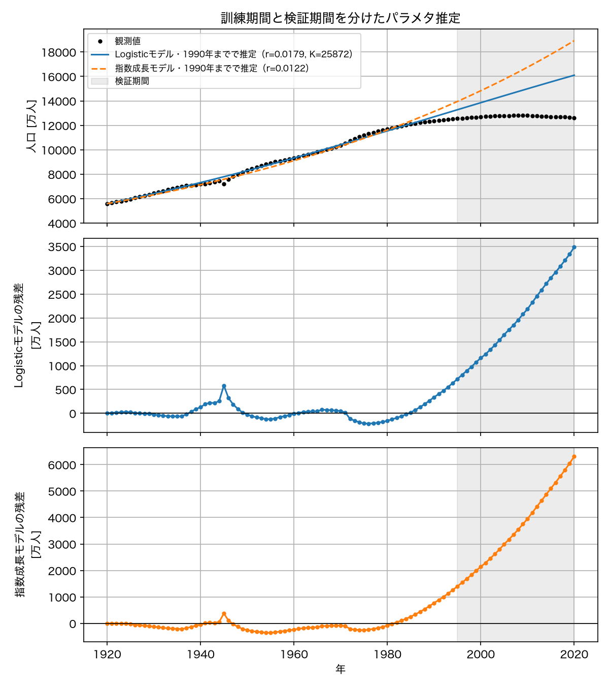
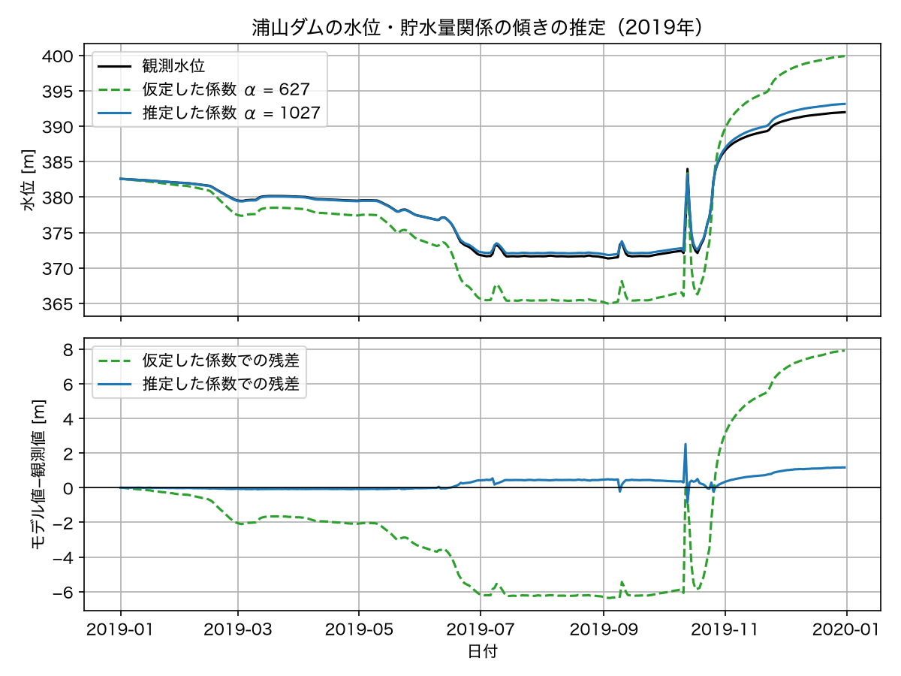

# 第7回　パラメタ推定

### 今回の位置付け

1. 現象の理解
2. 仮定の設定
3. 数理モデルの構築
4. 数値シミュレーション
5. データとの比較
6. <span style="color:red">パラメタ推定</span>
7. モデルの検証と改善

- 第5・6回：格子探索による推定と，観測流量を入力とするダムモデルを扱った．
- **第7回**：**数値最適化**を用いてパラメタを推定する．
  - 推定の実装：残差関数を定義し，`least_squares`でLogisticモデルとダムの換算係数を推定する．
  - 推定結果の検証：初期値による違いと，推定に使わない期間での誤差を確認する．

### 到達目標

- 観測値 $y_i$ とモデル予測 $\hat{y}(t_i;\theta)$ の差から，パラメタ $\theta$ の関数としての目的関数を定義できる
- パラメタサーチ（格子の全探索）と数値最適化（局所的な情報を用いた反復探索）の関係を説明できる
- `scipy.optimize.least_squares`を使って微分方程式モデルのパラメタを推定し，結果の妥当性を確認できる
- 初期値依存性，パラメタの範囲指定，局所解の問題を具体例で説明できる
- データを訓練期間と検証期間に分け，当てはまりの良さと予測の良さが別であることを示せる
- 推定値だけでなく，データ，推定モデル，残差を可視化して報告できる

<!--
**今回の流れ**（105分の目安）

| 段階 | 内容 | 時間 |
| --- | --- | --- |
| 1 | 第5回のヒートマップの復習，格子探索の限界（演習0） | 10分 |
| 2 | 残差と目的関数，最小二乗法，最適化の考え方 | 25分 |
| 3 | `least_squares`によるLogisticモデルの推定，初期値と範囲の指定 | 20分 |
| 4 | 訓練・検証の分割，残差の可視化，ダムデータへの応用（演習1〜4） | 35分 |
| 5 | 推定と検証の区別，まとめ，課題の説明 | 15分 |
-->

## 準備

````{note} 演習0：作業フォルダとNotebookの準備

1. ターミナルで第7回の作業フォルダを作成せよ．

```bash
mkdir -p ~/applied_programming_ii/07
cd ~/applied_programming_ii/07
mkdir -p notebooks reports/figures
```

- **コードの補足**：`mkdir -p`は必要な親フォルダも作成し，`cd`は作業フォルダを移動する．

実行後の構成は次のとおりである．`data`は各回で共通に使用し，`README.md`とNotebookは続く手順で作成する．

```text
applied_programming_ii/
├── data/
└── 07/
    ├── README.md
    ├── notebooks/
    │   └── parameter_estimation.ipynb
    └── reports/
        └── figures/
```

2. `~/applied_programming_ii/data/`に`population_japan.csv`と`dam_urayama_daily.csv`があることを確認せよ．なければ[授業用データ一覧](../data/README.md)からダウンロードせよ．

3. `notebooks/parameter_estimation.ipynb`を新規作成せよ．

4. `07`フォルダに`README.md`を作り，次の内容を記入せよ．

```markdown
# 応用プログラミングII 第7回

- 氏名：
- 学籍番号：

## 今日の目標

観測データからモデルのパラメタを最小二乗法で推定し，訓練期間と検証期間の誤差を比べて結果を評価する．

## 推定条件

- モデル：
- 推定するパラメタ：
- 目的関数：
- 訓練期間：
- 検証期間：
- 初期値：
- パラメタの範囲：

## 演習1：初期値を変えた結果

| 初期値 (r, K) | 推定値 r | 推定値 K | 目的関数の値 | 評価回数 |
| --- | --- | --- | --- | --- |

## 演習2

- 変更した条件・計算結果：
- 図から読み取れる傾向：
- 考察：

## 演習3

- 変更した条件・計算結果：
- 図から読み取れる傾向：
- 考察：

## 演習4：ダムの換算の傾き

## 課題1

## 課題2の考察
```

5. Notebookの最初のコードセルに以下を入力し，実行できることを確認せよ．今回から`scipy.optimize`を使う．

```python
from pathlib import Path

import numpy as np
import pandas as pd
import matplotlib.pyplot as plt
from scipy.integrate import solve_ivp
from scipy.optimize import least_squares

plt.rcParams["font.family"] = "Hiragino Sans"  # 日本語表示用（macOS）

PROJECT_DIR = Path.home() / "applied_programming_ii" / "07"
DATA_DIR = Path.home() / "applied_programming_ii" / "data"
FIGURE_DIR = PROJECT_DIR / "reports" / "figures"
FIGURE_DIR.mkdir(parents=True, exist_ok=True)

print("作業フォルダ:", PROJECT_DIR)
print("人口データの有無:", (DATA_DIR / "population_japan.csv").exists())
print("ダムデータの有無:", (DATA_DIR / "dam_urayama_daily.csv").exists())
```

```{dropdown} コードの補足

- `least_squares`：残差関数を使ってパラメタを推定するために読み込む．
- `FIGURE_DIR.mkdir(...)`：図の保存先を作成する．
- `.exists()`：人口・ダムの2つのCSVが共通データフォルダにあるかを確認する．
```

出力例（`ユーザー名`の部分は実行環境によって異なる）：

```text
作業フォルダ: /Users/ユーザー名/applied_programming_ii/07
人口データの有無: True
ダムデータの有無: True
```
````

## 復習と今回の準備

以下の数値出力は実行例である．数値解・推定値の末尾や評価回数，終了理由は，ライブラリのバージョンや実行環境によって異なる場合がある．

- 格子探索：第5回では候補ごとの目的関数を計算した．今回は残差関数を再利用し，数値最適化によってパラメタを更新する．
- 観測モデル：第6回では貯水位と貯水量を一定の傾きで換算した．後半ではこの傾きも推定対象にする．
- 比較の条件：観測値とモデル値の時刻・単位をそろえ，残差と誤差指標を計算する．

## 導入：格子探索の限界

第5回では，各パラメタを21通りまたは101通りに変えてヒートマップを作った．ここでは計算量の例として，各50通りの候補なら $50\times50=2500$ 回のモデル評価が必要になることを考える．
もし初期値 $N_0$ も未知として3つ目のパラメタにすると $50^3 = 125000$ 回，第11回のSIRモデルのように4つのパラメタがあれば $50^4 = 6250000$ 回になる．
1回のシミュレーションが0.01秒でも，4パラメタの格子には17時間かかる．

数値最適化では，現在のパラメタの近傍で残差がどう変化するかを利用して更新量を決める．
この方法では評価回数を格子探索より大幅に減らせる場合がある．ただし，必要な計算量はパラメタ数だけでなく，目的関数の性質や停止条件にも依存する．

人口データとLogisticモデルを読み込んで準備する．

```python
population = pd.read_csv(DATA_DIR / "population_japan.csv")
population["population_10k"] = population["total_population_thousand"] / 10

# 観測時刻は1920年を0とした年数，観測値は万人
t_obs = (population["year"] - 1920).values.astype(float)
y_obs = population["population_10k"].values
N0 = y_obs[0]

print("観測点の数:", len(t_obs), " 期間:", population["year"].min(), "〜", population["year"].max())
print(f"初期値 N0 = {N0:.1f} 万人")
```

- **コードの補足**：`t_obs`は1920年を0とする経過年数，`y_obs`は万人単位の観測人口である．`N0`は最初の観測人口に固定する．

出力例：

```text
観測点の数: 101  期間: 1920 〜 2020
初期値 N0 = 5596.3 万人
```

```python
def logistic_rhs(t, N, r, K):
    """Logisticモデル dN/dt = r N (1 - N/K) の右辺．"""
    return r * N * (1 - N / K)


def simulate_logistic(theta, t_eval, N0):
    """パラメタ theta = (r, K) でLogisticモデルを解き，時刻 t_eval での N を返す．"""
    r, K = theta
    sol = solve_ivp(logistic_rhs, (t_eval[0], t_eval[-1]), [N0], t_eval=t_eval, args=(r, K), rtol=1e-6)
    return sol.y[0]


def mean_squared_error(y_true, y_pred):
    """平均二乗誤差 (1/n) sum (y_true - y_pred)^2 を返す．"""
    return np.mean((y_true - y_pred) ** 2)


# 第5回のヒートマップで谷の底の近くにあった値
theta_grid = (0.028, 14800.0)
mse_grid = mean_squared_error(y_obs, simulate_logistic(theta_grid, t_obs, N0))
print(f"第5回の最良の組に近い (r, K) = {theta_grid}: MSE = {mse_grid:.1f} （RMSE = {np.sqrt(mse_grid):.1f} 万人）")
```

```{dropdown} コードの補足

- `simulate_logistic`：パラメタを受け取り，`solve_ivp`の解を観測時刻の配列に合わせて返す．
- `rtol=1e-6`：数値積分の相対許容誤差を指定する．
- `theta_grid`：第5回の最良の組に近い値で，数値最適化との比較に使う．
```

出力例：

```text
第5回の最良の組に近い (r, K) = (0.028, 14800.0): MSE = 120107.3 （RMSE = 346.6 万人）
```

## 残差と目的関数

### 残差

観測時刻 $t_i$ における観測値を $y_i$，パラメタ $\theta$ のモデルが与える予測を $\hat{y}(t_i;\theta)$ とする．
その差

$$
e_i(\theta) = \hat{y}(t_i;\theta) - y_i
\qquad (i = 1, \ldots, n)
$$

を**残差**と呼ぶ．
残差は観測点の数だけあり，パラメタを変えると全部が変わる．
当てはまりの程度を評価するため，残差ベクトルの大きさを目的関数で定量化する．第3〜5回の図では観測値から予測値を引いたが，本節の最適化関数では逆の符号を採用する．符号を全体で反転しても二乗和と推定値は変わらない．

### 目的関数と最小二乗法

残差をまとめて1つの数にしたものが目的関数である．
最もよく使われるのは残差の二乗和で，

$$
J(\theta) = \sum_{i=1}^{n} e_i(\theta)^2 = \sum_{i=1}^{n} \left( \hat{y}(t_i;\theta) - y_i \right)^2
$$

である．
これを最小にする $\theta$ を選ぶ方法を**最小二乗法**と呼ぶ．
第5回で使った平均二乗誤差 MSE は $J(\theta)/n$ であり，$n$ は定数なので，MSE を最小にする $\theta$ と $J$ を最小にする $\theta$ は同じである．

二乗を使う理由は，正負の残差が打ち消し合わないこと，大きな残差が目的関数値に与える寄与を大きくすること，そして微分ができて最適化の計算に向くことである．
一方で，1つの大きな外れ値に結果が引きずられやすいという欠点もある．

### 推定対象の選択

$J(\theta)$ は，$\theta$ を入力，誤差を出力とする関数である．
第5回のヒートマップは，この関数を $(r, K)$ 平面の上に描いたものにほかならない．
今回はこの関数の最小値を，`scipy.optimize.least_squares`に探させる．

```{tip} 目的関数の設計はモデル化の一部である
残差の二乗和は標準的だが，唯一の選択ではない．
人口のように値の桁が変わるデータでは，相対誤差 $(\hat{y}_i - y_i)/y_i$ を使う方が適切なこともある．
観測の信頼度が時期によって違うなら，重みを付けることもできる．
どの目的関数を使うかは，データの性質と目的から決める判断であり，結果に影響する．
```

## `least_squares`によるパラメタ推定

### 残差を返す関数

`least_squares`は，残差のベクトルを返す関数を受け取り，その二乗和を最小にするパラメタを探す．
目的関数を自分で計算する必要はなく，残差の配列を返せばよい．
関数の第1引数は推定するパラメタの配列，それ以降は`args`で渡す固定の情報である．

```python
def residuals(theta, t_obs, y_obs, N0):
    """パラメタ theta = (r, K) におけるLogisticモデルの残差ベクトル（モデル - 観測）を返す．"""
    return simulate_logistic(theta, t_obs, N0) - y_obs


residual_grid = residuals(theta_grid, t_obs, y_obs, N0)
print("残差の配列の形:", residual_grid.shape)
print(f"最初の観測時刻の残差: {residual_grid[0]:.1f} 万人")
```

- **コードの補足**：残差関数はMSEではなく，観測点ごとの差を配列で返す．初日のモデル値を観測人口に合わせているため，最初の残差は0となる．

出力例：

```text
残差の配列の形: (101,)
最初の観測時刻の残差: 0.0 万人
```

### 推定の実行

出発点となる初期値を与えて実行する．
第5回の格子探索で見当を付けた値を使う．

```python
theta_initial = [0.03, 13000.0]

result = least_squares(residuals, theta_initial, args=(t_obs, y_obs, N0))

r_hat, K_hat = result.x
print("収束したか:", result.success, " 状態:", result.message)
print(f"推定値: r = {r_hat:.5f} /年,  K = {K_hat:.1f} 万人")
print(f"目的関数（残差二乗和の半分）: {result.cost:.1f}")
print(f"RMSE: {np.sqrt(np.mean(result.fun ** 2)):.1f} 万人")
print(f"残差関数の評価回数: {result.nfev}")
```

```{dropdown} コードの補足

- `least_squares`：残差関数と探索の初期値を渡す．`args`には観測データと微分方程式の初期条件を指定する．
- `result.x`・`result.fun`：推定されたパラメタと，その推定値での残差配列である．
- `result.cost`：残差二乗和の半分である．`result.nfev`は残差関数の評価回数を表す．
- `result.success`・`result.message`：停止条件を満たしたかと終了理由を示す．出力の`ftol`は，目的関数の減少量に関する停止条件を表す．
```

出力例：

```text
収束したか: True  状態: `ftol` termination condition is satisfied.
推定値: r = 0.02759 /年,  K = 14753.8 万人
目的関数（残差二乗和の半分）: 5807180.6
RMSE: 339.1 万人
残差関数の評価回数: 7
```

残差関数の評価回数が10回足らずであることに注目する．
各50候補の格子探索なら2500回のモデル評価が必要になる．
数値最適化では全格子点を評価しない．なお，`result.nfev`に数値微分のための評価が含まれるかは実装・バージョンによるため，実測時間も併せて比較する．

### 初期値依存性

数値最適化の結果は探索の初期値に依存し，異なる極小点や停止点に到達することがある．ここでの初期値はパラメタ探索の開始値であり，微分方程式の初期条件とは区別する．
複数の初期値から始めて結果が一致するかを確かめるのが基本の作法である．

````{note} 演習1：初期値を変えて推定する

```python
initial_guesses = [
    [0.03, 13000.0],
    [0.01, 20000.0],
    [0.10, 10000.0],
    [0.05, 30000.0],
]

print(f"{'初期値 (r, K)':>22} {'推定 r':>10} {'推定 K':>10} {'cost':>12} {'評価回数':>8}")
for guess in initial_guesses:
    res = least_squares(residuals, guess, args=(t_obs, y_obs, N0))
    print(f"{str(guess):>22} {res.x[0]:10.5f} {res.x[1]:10.1f} {res.cost:12.1f} {res.nfev:8d}")
```

- **コードの補足**：`for guess in initial_guesses`：探索の初期値を1組ずつ渡して推定を繰り返す．`cost`と評価回数も並べ，到達した点と計算量の違いを確認する．

出力例：

```text
            初期値 (r, K)       推定 r       推定 K         cost     評価回数
       [0.03, 13000.0]    0.02759    14753.8    5807180.6        7
       [0.01, 20000.0]    0.02759    14753.8    5807180.6       10
        [0.1, 10000.0]    0.06375    10000.0  157753795.5       22
       [0.05, 30000.0]    0.02759    14753.8    5807180.6        6
```

1. 結果を`README.md`の「演習1」の表に転記する．
2. 4つの初期値から同じ推定値に到達したか．評価回数はどう違うか．
3. 初期値`[0.5, 6000.0]`を追加して実行せよ．何が起きるか．推定値と cost を他の結果と比べる．
````

```{visible-answer} 演習1の解答例
4つの初期値のうち3つからは，いずれも $r \approx 0.0276$，$K \approx 14750$ に到達する．
評価回数は初期値によって6回から10回程度で，到達点は同じである．

一方，初期値`[0.1, 10000.0]`からは，$K$ が10000のまま動かず，cost が約27倍大きい点で停止条件を満たして終了する場合がある．
初期値`[0.5, 6000.0]`ではさらに悪く，$K$ が初期人口5596万人に近い値に留まったまま評価回数の上限に達する．
$K$ が初期人口に近いと，人口は最初からほとんど増えない解になり，そこから $K$ を少し動かしても誤差がほとんど変わらないため，数値微分で残差の変化を十分に捉えられない場合がある．
この終了結果だけでは，局所的な極小点なのか，スケーリングや数値微分に起因する停止なのかを区別できない．`success`だけでなく，目的関数値，終了理由，初期値を変えた結果を確認する．
```

### パラメタの範囲指定

パラメタには，モデルの意味から決まる範囲がある．
ここでは正の内的自然増加率で人口増加を表すため，$r>0$，$K>N_0$ に制限する．減少を対象とする場合には別の範囲が適切なこともある．
`bounds`で範囲を指定すると，設定した仮定と整合しない範囲での探索を防げる．

```python
lower_bounds = [0.0, 6000.0]       # r >= 0, K >= 6000 万人
upper_bounds = [1.0, 50000.0]      # r <= 1, K <= 50000 万人

result_bounded = least_squares(residuals, [0.5, 6000.0], args=(t_obs, y_obs, N0), bounds=(lower_bounds, upper_bounds))
print(f"範囲を指定した場合: r = {result_bounded.x[0]:.5f}, K = {result_bounded.x[1]:.1f}, cost = {result_bounded.cost:.1f}")
```

- **コードの補足**：`bounds=(lower_bounds, upper_bounds)`：各パラメタの下限と上限を同じ順番で指定する．ここでは$r$を0〜1，$K$を6000〜50000万人に制限する．

出力例：

```text
範囲を指定した場合: r = 0.02759, K = 14753.8, cost = 5807180.6
```

範囲を指定しても，局所解の問題が完全に消えるわけではない．
複数の初期値を試すこと，第5回のような粗い格子探索で全体の地形を見ておくことが，最適化の前の準備として有効である．

## 訓練期間と検証期間

### 訓練期間と検証期間の役割

ここまでは1920年から2020年の全データを使って推定した．
推定では訓練データの残差を小さくするようパラメタを選ぶ．したがって，訓練誤差だけでは未使用データに対する予測精度を評価できない．

モデルが本当に現象を捉えているかを確かめるには，パラメタを決めるのに**使わなかった**データで予測を試す必要がある．
そのために，データを次の2つに分ける．

- **訓練期間**：パラメタの推定に使う期間
- **検証期間**：推定したモデルの予測を観測と比べる期間

時系列データでは，過去を訓練，未来を検証にするのが自然である．
ここでは1990年までを訓練，1995年から2020年を検証とする．

```python
train_mask = population["year"] <= 1990
valid_mask = population["year"] >= 1995

t_train, y_train = t_obs[train_mask], y_obs[train_mask]
t_valid, y_valid = t_obs[valid_mask], y_obs[valid_mask]
print(f"訓練期間: {len(t_train)} 点（1920〜1990年）， 検証期間: {len(t_valid)} 点（1995〜2020年）")

result_train = least_squares(residuals, [0.03, 13000.0], args=(t_train, y_train, N0), bounds=(lower_bounds, upper_bounds))
r_train, K_train = result_train.x
print(f"訓練期間で推定: r = {r_train:.5f} /年,  K = {K_train:.1f} 万人")

# 推定したパラメタで全期間を計算する
y_fit_all = simulate_logistic(result_train.x, t_obs, N0)
rmse_train = np.sqrt(mean_squared_error(y_train, y_fit_all[train_mask]))
rmse_valid = np.sqrt(mean_squared_error(y_valid, y_fit_all[valid_mask]))
print(f"訓練期間の RMSE: {rmse_train:8.1f} 万人")
print(f"検証期間の RMSE: {rmse_valid:8.1f} 万人")
print(f"2020年の予測: {y_fit_all[-1]:.1f} 万人，観測: {y_obs[-1]:.1f} 万人")
```

```{dropdown} コードの補足

- `train_mask`・`valid_mask`：推定用と検証用のデータを選ぶ条件である．ここでは1991〜1994年はどちらの誤差評価にも含めない．
- `result_train`：訓練期間の観測値だけを用いてパラメタを推定する．
- `y_fit_all`：1920年の初期条件から全期間を計算し，訓練期間と検証期間に対応する値を取り出してRMSEを求める．
```

出力例：

```text
訓練期間: 71 点（1920〜1990年）， 検証期間: 26 点（1995〜2020年）
訓練期間で推定: r = 0.01787 /年,  K = 25872.2 万人
訓練期間の RMSE:    141.0 万人
検証期間の RMSE:   2154.6 万人
2020年の予測: 16101.1 万人，観測: 12614.6 万人
```

1990年までのデータで推定すると，$K$ は約25,900万人と，全データで推定した約14,750万人の2倍近くになる．
1990年の時点では人口の頭打ちがまだ見えておらず，平衡人口 $K$ を十分に制約する情報が乏しかった．
訓練期間の RMSE は約140万人と小さいが，検証期間の RMSE は約2,150万人に跳ね上がる．
当てはまりの良さと予測の良さは別のものである．

### 指数成長モデルとの比較

第4回で比べた指数成長モデル $N' = rN$ も，同じ訓練期間で推定して検証期間の誤差を比べる．

```python
def residuals_exponential(theta, t_obs, y_obs, N0):
    """指数成長モデル N0 exp(r t) の残差ベクトルを返す．"""
    return N0 * np.exp(theta[0] * t_obs) - y_obs


result_exp = least_squares(residuals_exponential, [0.01], args=(t_train, y_train, N0))
y_exp_all = N0 * np.exp(result_exp.x[0] * t_obs)
print(f"指数成長モデル: r = {result_exp.x[0]:.5f} /年")
print(f"  訓練期間の RMSE: {np.sqrt(mean_squared_error(y_train, y_exp_all[train_mask])):8.1f} 万人")
print(f"  検証期間の RMSE: {np.sqrt(mean_squared_error(y_valid, y_exp_all[valid_mask])):8.1f} 万人")
```

- **コードの補足**：`theta[0]`：推定する唯一のパラメタ$r$を取り出す．指数成長モデルは解析解で計算し，Logisticモデルと同じ訓練期間・初期人口で比較する．

出力例：

```text
指数成長モデル: r = 0.01219 /年
  訓練期間の RMSE:    233.1 万人
  検証期間の RMSE:   3896.7 万人
```

### 観測値・モデル・残差の可視化

推定結果を報告するときは，推定値の数字だけでなく，データと推定モデルを重ねた図と，残差の時系列を示す．
残差に時間的な偏りがあれば，モデルの構造，パラメタの設定，観測過程のいずれに原因があるかを検討する．

```python
years = population["year"].values
residual_all = y_fit_all - y_obs
print(f"Logisticモデルの残差の範囲: {residual_all.min():.1f} 〜 {residual_all.max():.1f} 万人")
```

- **コードの補足**：`residual_all`はモデル値−観測値である．正なら過大予測，負なら過小予測を表す．

出力例：

```text
Logisticモデルの残差の範囲: -215.3 〜 3486.5 万人
```

```python
fig, axes = plt.subplots(3, 1, figsize=(8, 9), sharex=True)

axes[0].plot(years, y_obs, color="black", marker="o", markersize=3, linestyle="none", label="観測値")
axes[0].plot(years, y_fit_all, color="tab:blue", label=f"Logisticモデル・1990年までで推定（r={r_train:.4f}, K={K_train:.0f}）")
axes[0].plot(years, y_exp_all, color="tab:orange", linestyle="--", label=f"指数成長モデル・1990年までで推定（r={result_exp.x[0]:.4f}）")
axes[0].axvspan(1995, 2020, color="gray", alpha=0.15, label="検証期間")
axes[0].set_ylabel("人口 [万人]")
axes[0].set_ylim(4000, 1.05 * max(y_obs.max(), y_fit_all.max(), y_exp_all.max()))
axes[0].set_title("訓練期間と検証期間を分けたパラメタ推定")
axes[0].legend(fontsize=8)

axes[1].plot(years, residual_all, color="tab:blue", marker="o", markersize=3)
axes[1].axhline(0, color="black", linewidth=0.8)
axes[1].axvspan(1995, 2020, color="gray", alpha=0.15)
axes[1].set_ylabel("Logisticモデルの残差\n[万人]")

axes[2].plot(years, y_exp_all - y_obs, color="tab:orange", marker="o", markersize=3)
axes[2].axhline(0, color="black", linewidth=0.8)
axes[2].axvspan(1995, 2020, color="gray", alpha=0.15)
axes[2].set_ylabel("指数成長モデルの残差\n[万人]")
axes[2].set_xlabel("年")

for ax in axes:
    ax.grid(True)
fig.tight_layout()
fig.savefig(FIGURE_DIR / "logistic_fit_train_valid.png", dpi=150)
plt.show()
```

```{dropdown} コードの補足

- `sharex=True`：人口と2種類の残差の横軸を共有する．
- `axvspan(1995, 2020, ...)`：検証期間を背景色で示す．`alpha`は背景色の不透明度である．
- `set_ylim`：観測値と両モデルの最大値に合わせ，予測曲線全体が収まる縦軸の範囲を設定する．
```



````{note} 演習2：訓練期間の長さを変える

1. 訓練期間の終わりを`1970`，`1990`，`2010`の3通りに変え，それぞれ推定値 $r$，$K$，訓練期間と検証期間の RMSE を表にする．検証期間は訓練期間の終わりの5年後から2020年までとする．
2. 訓練期間を長くすると $K$ の推定値はどう変わるか．データのどの部分が $K$ を決めているか．
3. 訓練期間の RMSE が最も小さい設定と，検証期間の RMSE が最も小さい設定は同じか．
````

````{note} 演習3：残差の形を読む

「観測値・モデル・残差の可視化」の図の残差を見て，次を`README.md`に記せ．

1. Logisticモデルの残差は，訓練期間の中でも時期によって符号が偏っている．どの時期に正で，どの時期に負か．
2. 1940年代の残差が大きいのはなぜか．モデルに含まれていない現実の要因を挙げよ．
3. 残差が完全にランダムに見えるとき，見えないとき，それぞれモデルについて何が言えるか．
````

```{tip} 推定と検証は別の作業である
パラメタ推定では，モデルと目的関数を固定し，訓練データに対する目的関数を小さくするパラメタを求める．
検証では，推定に使用しなかったデータに対する予測誤差や残差の傾向を評価する．
前者がうまくいっても後者がうまくいくとは限らない．
第12回では，この区別を土台にして，複数のモデルを比較する方法を扱う．
```

## オープンデータへの応用：ダムの貯水位と貯水量の換算

### 貯水位・貯水量の換算係数の推定

第6回では，貯水位 $h$ から貯水量 $V$ への換算を傾き約627千m³/mの線形関係とした．
これはダムの諸元から仮定した値で，計算結果は観測から最終的に約5,000千m³ずれた．
この傾きを未知のパラメタ $\alpha$ とし，データから推定する．

$$
V(t) = \alpha\,(h(t) - h_{\min}),
\qquad
\frac{dV}{dt} = Q_{\mathrm{in}}(t) - Q_{\mathrm{out}}(t)
$$

$V$ は直接観測されないので，残差は観測量である貯水位で定義する．
モデルの貯水量を $\alpha$ で割って貯水位に戻し，観測された貯水位との差を残差とする．

$$
\hat{h}(t_i;\alpha) = h_{\min} + \frac{V(t_i)}{\alpha},
\qquad
e_i(\alpha) = \hat{h}(t_i;\alpha) - h_i
$$

これは，状態変数と観測量が一致しないときに，**観測モデル**を通して残差を定義する例である．

```python
dam = pd.read_csv(DATA_DIR / "dam_urayama_daily.csv", parse_dates=["date"])
dam_year = dam[dam["date"].dt.year == 2019].reset_index(drop=True)

SECONDS_PER_DAY = 24 * 60 * 60
LEVEL_MIN = 304.0


def m3s_to_1000m3_per_day(flow_m3s):
    """流量 [m^3/s] を [千m^3/日] に換算する．"""
    return flow_m3s * SECONDS_PER_DAY / 1000


t_dam = np.arange(len(dam_year), dtype=float)
qin_dam = m3s_to_1000m3_per_day(dam_year["inflow_m3s"].values)
qout_dam = m3s_to_1000m3_per_day(dam_year["outflow_m3s"].values)
h_dam = dam_year["water_level_m"].values


def reservoir_rhs(t, V, t_data, qin_data, qout_data):
    """dV/dt = Q_in(t) - Q_out(t) の右辺．入力は観測値の線形補間．"""
    return np.interp(t, t_data, qin_data) - np.interp(t, t_data, qout_data)


def simulate_level(alpha, t_data, qin_data, qout_data, h_data):
    """傾き alpha で貯水量を計算し，貯水位に戻して返す．初期条件は初日の観測貯水位から決める．"""
    V0 = alpha * (h_data[0] - LEVEL_MIN)
    sol = solve_ivp(reservoir_rhs, (t_data[0], t_data[-1]), [V0], t_eval=t_data, args=(t_data, qin_data, qout_data), max_step=1.0)
    return LEVEL_MIN + sol.y[0] / alpha


def residuals_level(theta, t_data, qin_data, qout_data, h_data):
    """傾き theta[0] における貯水位の残差（モデル - 観測）を返す．"""
    return simulate_level(theta[0], t_data, qin_data, qout_data, h_data) - h_data


alpha_assumed = 56000.0 / (393.3 - 304.0)
rmse_assumed = np.sqrt(np.mean(residuals_level([alpha_assumed], t_dam, qin_dam, qout_dam, h_dam) ** 2))
print(f"第6回の仮定 alpha = {alpha_assumed:.1f} 千m^3/m のとき，貯水位の RMSE = {rmse_assumed:.2f} m")

result_alpha = least_squares(residuals_level, [alpha_assumed], args=(t_dam, qin_dam, qout_dam, h_dam), bounds=([100.0], [5000.0]))
alpha_hat = result_alpha.x[0]
rmse_alpha = np.sqrt(np.mean(result_alpha.fun ** 2))
print(f"推定した alpha = {alpha_hat:.1f} 千m^3/m のとき，貯水位の RMSE = {rmse_alpha:.2f} m（評価回数 {result_alpha.nfev}）")
print(f"推定された湖面の面積に相当する値: {alpha_hat / 1000:.2f} km^2")
```

```{dropdown} コードの補足

- `simulate_level`：換算係数から初期貯水量を決め，計算した貯水量を水位に戻す．
- `residuals_level`：直接観測された水位とモデル水位の差を返す．推定する係数は1つなので`theta[0]`で取り出す．
- `bounds`：換算係数を100〜5000千m³/mの範囲で推定する．面積への換算では，千m³/mを1000で割ってkm²とする．
```

出力例：

```text
第6回の仮定 alpha = 627.1 千m^3/m のとき，貯水位の RMSE = 4.64 m
推定した alpha = 1027.0 千m^3/m のとき，貯水位の RMSE = 0.47 m（評価回数 6）
推定された湖面の面積に相当する値: 1.03 km^2
```

```python
h_assumed = simulate_level(alpha_assumed, t_dam, qin_dam, qout_dam, h_dam)
h_fitted = simulate_level(alpha_hat, t_dam, qin_dam, qout_dam, h_dam)
print(f"最終日の観測水位: {h_dam[-1]:.2f} m")
print(f"仮定した換算係数での水位: {h_assumed[-1]:.2f} m")
print(f"推定した換算係数での水位: {h_fitted[-1]:.2f} m")
```

- **コードの補足**：`h_assumed`と`h_fitted`：それぞれ仮定した換算係数と推定した換算係数で，全期間の水位を計算する．`[-1]`で最終日の値を取り出す．

出力例：

```text
最終日の観測水位: 391.99 m
仮定した換算係数での水位: 399.91 m
推定した換算係数での水位: 393.16 m
```

```python
fig, axes = plt.subplots(2, 1, figsize=(8, 6), sharex=True)
axes[0].plot(dam_year["date"], h_dam, color="black", label="観測水位")
axes[0].plot(dam_year["date"], h_assumed, color="tab:green", linestyle="--", label=f"仮定した係数 α = {alpha_assumed:.0f}")
axes[0].plot(dam_year["date"], h_fitted, color="tab:blue", label=f"推定した係数 α = {alpha_hat:.0f}")
axes[0].set_ylabel("水位 [m]")
axes[0].set_title("浦山ダムの水位・貯水量関係の傾きの推定（2019年）")
axes[0].legend()
axes[1].plot(dam_year["date"], h_assumed - h_dam, color="tab:green", linestyle="--", label="仮定した係数での残差")
axes[1].plot(dam_year["date"], h_fitted - h_dam, color="tab:blue", label="推定した係数での残差")
axes[1].axhline(0, color="black", linewidth=0.8)
axes[1].set_ylabel("モデル値−観測値 [m]")
axes[1].set_xlabel("日付")
axes[1].legend()
for ax in axes:
    ax.grid(True)
fig.tight_layout()
fig.savefig(FIGURE_DIR / "dam_alpha_estimation.png", dpi=150)
plt.show()
```

- **コードの補足**：上段は観測水位と2通りのモデル水位，下段はそれぞれのモデル値−観測値である．同じ係数に同じ色を使い，上下の対応を示す．



推定された傾きは約1,030千m³/mで，諸元から仮定した627千m³/mより6割以上大きい．
面積に直せば約1.0 km²の湖面に相当し，採用した線形観測モデルでの有効な換算係数として解釈できる．実際の湖面積を独立に測定した値ではない．
貯水位の RMSE は約4.6 mから約0.5 mに下がる．

しかし，この $\alpha$ は2019年のデータに対する目的関数を最小化する一定の傾きであって，水位・容量曲線そのものではない．
別の年，特に水位が大きく下がった年では，別の値が推定されるはずである．
1つの数で表せない関係を1つのパラメタで表している，という限界を意識する．

````{note} 演習4：推定の安定性を確かめる

1. 対象の年を`2020`から`2023`に変えて $\alpha$ を推定し，年ごとの推定値と RMSE を`README.md`の「演習4」に表にする．
2. 推定値は年によってどのくらい変わるか．水位の範囲が大きく違う年はあるか．
3. 第6回の発展課題で加えた一定の損失項 $c$ を第2のパラメタとして加え，$(\alpha, c)$ を同時に推定せよ．RMSE はさらに下がるか．$c$ の符号と大きさは物理的に妥当か．
````

```{visible-answer} 演習4の解答例：2パラメタの推定
残差関数を`theta = (alpha, c)`を受け取る形にし，右辺から`c`を引けばよい．
2019年では $\alpha \approx 1045$，$c \approx 2.1$ 千m³/日（約0.024 m³/s）が得られ，RMSE は約0.23 mまで下がる．
$c$ が正で，蒸発や漏水として無理のない大きさである．
ただし，元のモデルを $c=0$ として含む拡張では，同じデータに対する目的関数を厳密に最小化できれば，最小値は増加しない．
増えたパラメタに物理的な意味が付けられるか，別の年でも同じ値になるかを確かめない限り，改善とは言えない．
```

## モデルの限界と改善の問い

- 最小二乗法は残差の二乗和を最小にするだけであり，モデルの構造が正しいことは保証しない．どのモデルの中でパラメタを探すかは，推定の前に人が決める
- 数値最適化は初期値によって別の解に着くことがある．複数の初期値，パラメタの範囲，粗い格子探索を組み合わせて，見つけた解が本当に最小かを確かめる
- 訓練期間の当てはまりが良くても，検証期間の予測が悪いことがある．データが含んでいない情報（人口の頭打ち）は，どんな推定法でも取り出せない
- パラメタを増やすと当てはまりは良くなるが，推定値の意味と安定性が下がることがある．第8回でこの問題をタンクモデルで扱う
- 推定値には不確かさがある．残差の大きさだけではパラメタ推定値の不確かさを表せない．推定期間を変えたときの安定性を確認し，信頼区間などの定量的評価は発展事項とする

## まとめ

- 最小二乗法：パラメタの関数として残差を定義し，その二乗和を最小にする．
- 数値最適化：`least_squares`で推定し，初期値・範囲・停止結果を確認する．
- 検証：未使用期間の誤差と残差の図を調べ，適合度と予測性能を区別する．
- 次回：観測データとして与えていた流出量をモデル化し，タンクモデルの複雑さと推定の安定性を比較する．

```{dropdown} 復習用の確認事項

1. 残差，目的関数，最小二乗法の3つの言葉の関係を説明せよ．
2. 第5回のパラメタサーチと今回の数値最適化は，何が同じで何が違うか．それぞれの長所と短所を述べよ．
3. 最適化の停止条件を満たしても，大域的最小値を得たとは限らない．なぜか．どうすれば確かめられるか．
4. 訓練期間の RMSE が小さいのに検証期間の RMSE が大きい，という結果はモデルについて何を教えているか．人口データの例で説明せよ．
```

## 課題

````{warning} 課題1：推定結果の報告

人口のLogisticモデルについて，訓練期間の終わりを自分で1つ選び（1960年から2010年の間），次を含む短い報告を`README.md`の「課題1」に記せ．

1. 推定条件：モデル，推定するパラメタ，目的関数，訓練期間，検証期間，初期値，パラメタの範囲
2. 推定値 $r$，$K$ と，訓練期間・検証期間それぞれの RMSE
3. 複数の初期値から同じ推定値に到達したことの確認
4. データ，推定モデル，残差を1枚に描いた図（`reports/figures/`に保存）
5. 残差の時系列から読み取れる，モデルに足りない要因を1つ

適合度として訓練期間のRMSEを，推定の安定性として訓練期間を5年ずらしたときの推定値の変化幅を記せ．これらはパラメタの信頼区間とは区別する．
````

````{warning} 課題2：推定と検証の区別

次の主張について，賛成か反対かを明らかにし，今回の人口データの結果を根拠にして200字程度で論じよ．

「1920年から2020年の全データを使って推定したLogisticモデルの RMSE は約340万人と小さい．したがってこのモデルは2050年の人口予測に使える．」
````

### 提出先・期限

- 提出場所：WebClass「第7回課題」
- 提出物：
  - `README.md`
  - Notebookファイル`parameter_estimation.ipynb`
- 提出期限：2026年11月21日(土)23:59
