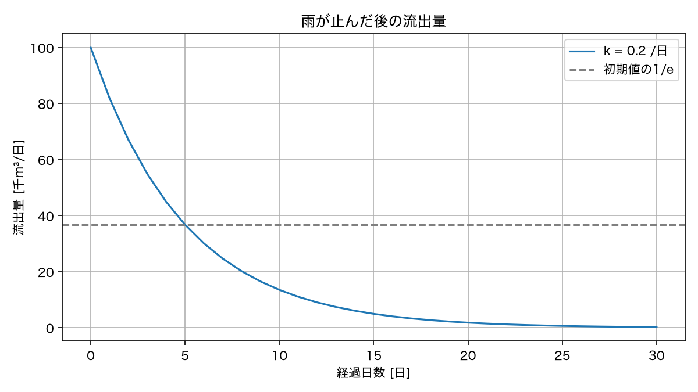
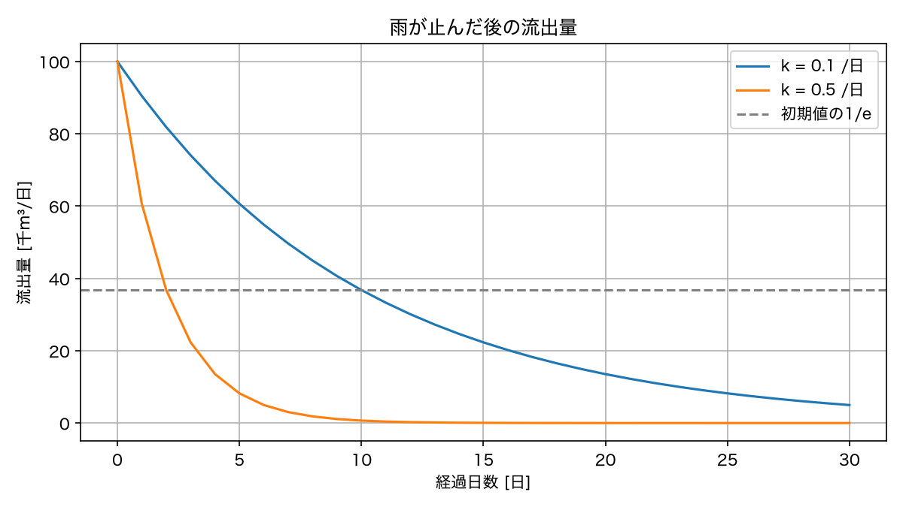
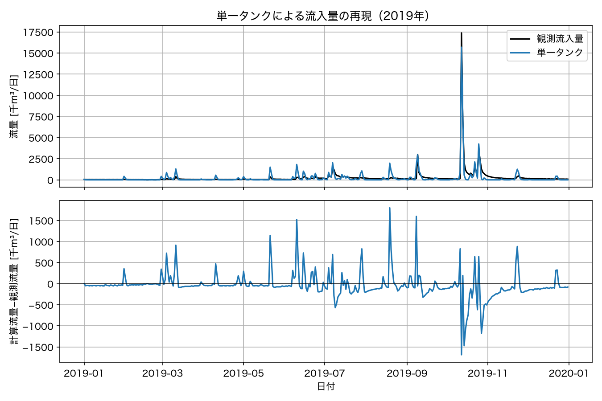
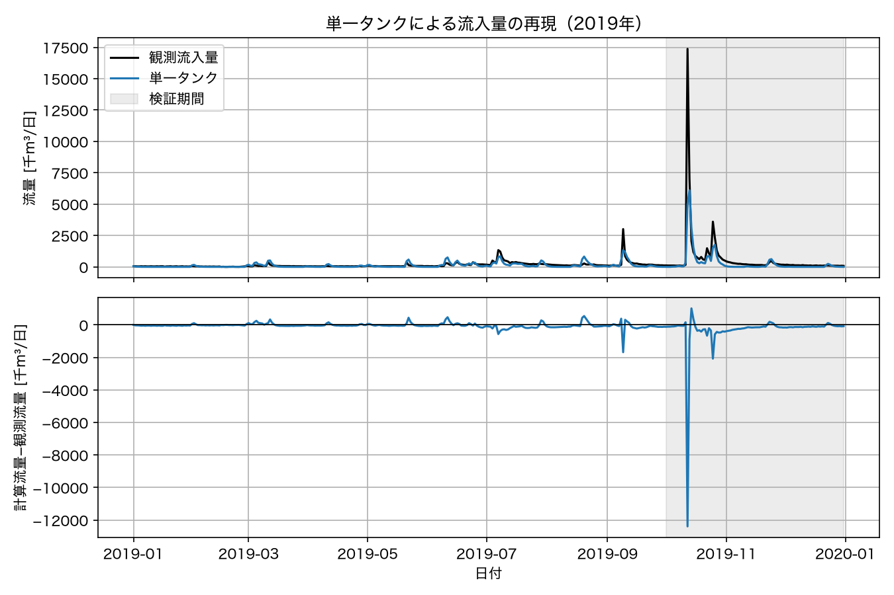
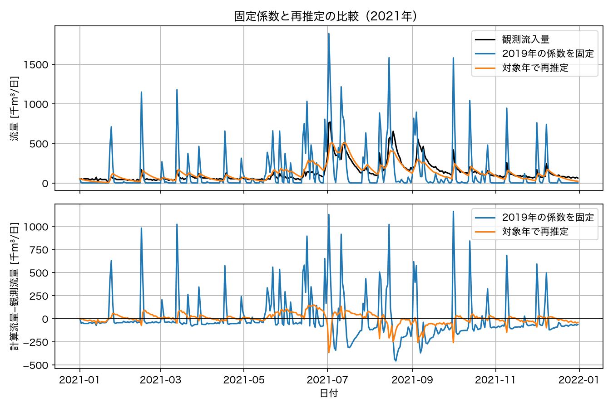

---
downloads:
  - file: ../data/dam_urayama_daily.csv
    filename: dam_urayama_daily.csv
    title: 浦山ダムの日データ（CSV）
  - file: ../data/precipitation_chichibu_daily.csv
    filename: precipitation_chichibu_daily.csv
    title: 秩父の日降水量（CSV）
---

# 第8回　河川・ダムモデルの発展

### 今回の位置付け

1. 現象の理解
2. <span style="color:red">仮定の設定</span>
3. <span style="color:red">数理モデルの構築</span>
4. 数値シミュレーション
5. データとの比較
6. パラメタ推定
7. <span style="color:red">モデルの検証と改善</span>

- **第6回**：流入量と放流量を観測データとして与え，ダムの貯水量を計算した．
- **第7回**：残差関数を作って係数を推定し，係数を固定した別の期間への適用結果を評価した．
- **第8回**：ダム上流の集水域を対象とし，**降水量からダムへの流入量を計算する**．貯留と流出の仮定を加え，単一タンクと並列2タンクを比較する．

### 到達目標

- **モデルの構築**：保存則と，流出量が貯留量に比例するという仮定から，単一タンクの微分方程式を立てられる．
- **係数の解釈**：降水量を水量に換算し，流出に寄与する割合と減衰の時定数を説明できる．
- **モデルの発展**：二つの貯留量を状態変数として計算し，異なる速さで減衰する流出を表せる．
- **比較と評価**：同じデータ・誤差指標で二つのモデルを比較し，係数を固定した未使用データへの適用結果を報告できる．

<!--
105分の目安：準備・降水量と流入量の確認15分，単位と単一タンク・演習1に25分，推定・演習2に20分，並列2タンク・演習3に25分，別年への適用とまとめ・課題に20分．補足・発展課題は自主学習用．
-->

## 準備

````{note} 演習0：作業フォルダとNotebookの準備

1. ターミナルで第8回の作業フォルダを作成せよ．

```bash
mkdir -p ~/applied_programming_ii/08
cd ~/applied_programming_ii/08
mkdir -p notebooks reports/figures
```

作成する構成は次のとおりである．`data`は各回で共通に使う．

```text
applied_programming_ii/
├── data/
└── 08/
    ├── README.md
    ├── notebooks/
    │   └── tank_model.ipynb
    └── reports/
        └── figures/
```

2. 講義タイトル右上のダウンロードボタン（下向き矢印）を開き，浦山ダムの日データ`dam_urayama_daily.csv`と秩父の日降水量`precipitation_chichibu_daily.csv`を`~/applied_programming_ii/data/`に保存せよ．すでに保存したファイルも使用できる．
3. `notebooks/tank_model.ipynb`を作成せよ．
4. `08`フォルダに次の内容の`README.md`を作成せよ．

```markdown
# 応用プログラミングII 第8回

- 氏名：
- 学籍番号：

## 今日の目標

降水量から流入量を計算するモデルを構築し，貯留・流出の仮定を変えた結果を比較する．

## 演習1：流出係数と減衰の速さ

1. 流出係数による比較（Notebookに図を出力）
2. 減衰が速い係数と，その時定数：

## 演習2：推定期間と未使用期間の誤差

1. 期間ごとの誤差（Notebookに計算結果を出力）
2. 流入量と残差（Notebookに図を出力）

## 演習3：タンクの番号と推定値の解釈

1. タンクの番号を入れ替えた比較（Notebookに計算結果を出力）
2. 応答の速いタンクと遅いタンクの時定数：

## 課題1：前半で推定したモデルの後半への適用

1. 単一タンクと並列2タンクの誤差（Notebookに比較表を出力）
2. 流入量と残差（Notebookに図を出力）
3. 後半の流入量をより小さいRMSEで再現したモデルと，数値による根拠：

## 課題2：別の年での係数の適用と再推定

1. 固定係数と再推定した係数（Notebookに比較表を出力）
2. 流入量と残差（Notebookに図を出力）
```

5. 次のコードをNotebookの最初のコードセルにまとめて入力し，実行せよ．ライブラリと保存先を設定し，必要なCSVを確認する．

<!-- cell:setup -->
```python
from pathlib import Path

import numpy as np
import pandas as pd
import matplotlib.pyplot as plt
from scipy.integrate import solve_ivp
from scipy.optimize import least_squares

plt.rcParams["font.family"] = "Hiragino Sans"
PROJECT_DIR = Path.home() / "applied_programming_ii" / "08"
DATA_DIR = Path.home() / "applied_programming_ii" / "data"
FIGURE_DIR = PROJECT_DIR / "reports" / "figures"
FIGURE_DIR.mkdir(parents=True, exist_ok=True)
print("ダムデータの有無:", (DATA_DIR / "dam_urayama_daily.csv").exists())
print("降水量データの有無:", (DATA_DIR / "precipitation_chichibu_daily.csv").exists())
```

出力例：

```text
ダムデータの有無: True
降水量データの有無: True
```

````

## 復習と降水量データの準備

### 保存則と観測量

- **保存則**：第6回の収支式は，貯留量の変化率を流入量と流出量の差で表した．今回は集水域に入る雨水と，そこからダムへ流れ出る水に適用する．
- **観測量**：ダムの`inflow_m3s`を比較対象にする．タンクからの流出が，ダムへの流入に対応する．
- **計算・推定**：`np.interp`で観測入力を補間し，`solve_ivp`で計算する．`least_squares`にはモデルの流量−観測流量の残差配列を返す．

### データの読み込みと日付の対応

降水量は気象庁の秩父観測所，流入量は浦山ダムの日データを使う．秩父の1地点の雨量で，集水域全体の降水量を代表させる近似を置く．列・出典・品質記号の扱いは[授業用データ一覧](../data/README.md)を参照する．

二つのCSVを読み込む．

<!-- cell:read -->
```python
dam = pd.read_csv(DATA_DIR / "dam_urayama_daily.csv", parse_dates=["date"])
rain = pd.read_csv(DATA_DIR / "precipitation_chichibu_daily.csv", parse_dates=["date"])
```

2019年を取り出し，同じ日付の観測値を対応させる．

<!-- cell:prepare -->
```python
year = 2019
dam_year = dam[dam["date"].dt.year == year].reset_index(drop=True)
rain_year = rain[rain["date"].dt.year == year].reset_index(drop=True)
data = pd.merge(dam_year, rain_year, on="date", how="inner")
```

- **コードの補足**：`pd.merge(..., on="date", how="inner")`は，両方に存在する日付を持つ行を結合する．

期間・行数・欠損値・日付の間隔を確認する．

<!-- cell:inspect -->
```python
print("期間:", data["date"].min().date(), "〜", data["date"].max().date())
print("行数:", len(data))
print("欠損値の数:")
print(data.isna().sum().to_string())
intervals = data["date"].diff().dt.days.dropna()
print("日付の間隔 [日]:", sorted(intervals.unique().tolist()))
```

出力例：

```text
期間: 2019-01-01 〜 2019-12-31
行数: 365
欠損値の数:
date                0
water_level_m       0
inflow_m3s          0
outflow_m3s         0
precipitation_mm    0
日付の間隔 [日]: [1.0]
```

この年は365日分が日付順に対応している．日降水量は1日間の合計水深で，単位はmmである．以下では，各値を1日で割った降水強度として代表時刻に配置し，日と日の間を線形補間する．日内の雨の集中を調べる場合は，時間ごとの降水データを使って比較する．

第6回と同じ単位換算関数を用意し，時刻と観測量の配列を作る．

<!-- cell:arrays -->
```python
SECONDS_PER_DAY = 24 * 60 * 60

def m3s_to_1000m3_per_day(flow_m3s):
    return flow_m3s * SECONDS_PER_DAY / 1000

t_data = np.arange(len(data), dtype=float)  # 時刻 [日]（1月1日を0とする）
rain_obs = data["precipitation_mm"].values  # 降水強度 [mm/日]（日降水量を1日で割った値）
qin_obs = m3s_to_1000m3_per_day(data["inflow_m3s"].values)  # 観測流入量 [千m^3/日]
```

上段に降水量，下段にダムへの流入量を描く．

<!-- cell:rain_plot -->
```python
fig, axes = plt.subplots(2, 1, figsize=(9, 6), sharex=True)
axes[0].bar(data["date"], rain_obs, color="tab:blue", width=1.0)
axes[0].set_ylabel("日降水量 [mm]")
axes[0].set_title(f"秩父の降水量と浦山ダムへの流入量（{year}年）")
axes[1].plot(data["date"], qin_obs, color="tab:blue")
axes[1].set_ylabel("流入量 [千m³/日]")
axes[1].set_xlabel("日付")
for ax in axes:
    ax.grid(True)
fig.tight_layout()
fig.savefig(FIGURE_DIR / "rain_inflow_2019.png", dpi=150)
plt.show()
```


10月の大きい降水量に対応して，流入量も増えている．**雨水が流域内に貯まり，時間をかけて流れ出る仕組み**をモデルに加える．

## 単一タンクモデルの構築

### 変数と仮定

集水域の貯留・流出を，一つの貯留量で近似する．このような貯留量と流出量の関係を表す線形貯留モデルは，[HEC-HMSの技術資料](https://www.hec.usace.army.mil/confluence/hmsdocs/hmstrm/baseflow/linear-reservoir-model)でも用いられている．

- $t$ ：対象年の初日からの経過日数．
- $S(t)$ ：集水域の貯留量（千m³）．
- $P(t)$ ：補間した降水強度（mm/日）．
- $A$ ：集水面積（km²）．浦山ダムでは51.6 km²を使う．
- $c$ ：降水量のうちモデルの流出に寄与する割合．無次元で， $0\leq c\leq1$ とする．
- $k$ ：貯留量に対する流出量の比例係数（1/日）． $k>0$ とする．
- $Q(t)$ ：タンクからの流出量（千m³/日）．ダムへの流入量と比較する．

```{tip} 仮定

- **雨水の入力**：流域全体に同じ雨が降り，そのうち一定の割合が貯留に寄与する．蒸発などを含む残りの分は，この期間の流出に寄与しないものとしてまとめる．
- **貯留からの流出**：流出量は貯留量に比例する．係数は対象期間を通じて一定とする．
- **観測との対応**：タンクから流れ出た水を，ダムへの流入量として比較する．
```

### 降水量から水量への換算

1 mmの雨が1 km²の面積に降ると，水量は次のようになる．

$$
10^{-3}\ \mathrm{m}\times10^6\ \mathrm{m^2}
=10^3\ \mathrm{m^3}=1\ \text{千}\mathrm{m^3}.
$$

したがって，上記の単位で表した $A$ と $P(t)$ の数値の積は，流域に降る水量（千m³/日）になる．

集水面積を設定し，年合計の水量を確認する．

<!-- cell:volume -->
```python
AREA_KM2 = 51.6  # 集水面積 [km^2]
rain_volume = AREA_KM2 * rain_obs  # 流域への降水の水量 [千m^3/日]
print(f"年降水量: {rain_obs.sum():.1f} mm")
print(f"降水量から換算した年水量: {rain_volume.sum():.1f} 千m^3")
print(f"観測流入量の年水量: {qin_obs.sum():.1f} 千m^3")
```

出力例：

```text
年降水量: 1865.5 mm
降水量から換算した年水量: 96259.8 千m^3
観測流入量の年水量: 96083.7 千m^3
```

年水量は日ごとの観測値を1日分ずつ合計した値である．この比較には，観測地点の雨が集水域全体を代表するという近似が含まれる．

### 保存則と観測モデル

単一タンクの状態方程式と観測モデルは，次のとおりである．

$$
\frac{dS}{dt}=cAP(t)-kS(t),\qquad Q(t)=kS(t).
$$

| 関係 | 入力から求める量 |
| --- | --- |
| 初期条件 | 初日の観測流入量 $Q_0$ と候補の $k$ から， $S(0)=Q_0/k$ を設定 |
| 保存則 | 初期貯留量と降水入力から，貯留量 $S(t)$ を計算 |
| 観測モデル | 貯留量から流出量 $Q(t)=kS(t)$ を計算 |
| データとの比較 | 計算流出量から観測流入量を引き，残差を計算 |

$Q_0$ は初日の観測値に固定する．初期貯留量は候補の $k$ ごとに設定し直すので，**独立に推定する係数は二つ**であり， $\theta=(c,k)$ と書く．

### 計算関数

降水入力を補間し，保存則の右辺を返す関数を定義する．

<!-- cell:tank_rhs -->
```python
def tank_rhs(t, S, t_data, rain_data, c, k):
    rain_input = c * AREA_KM2 * np.interp(t, t_data, rain_data)
    return rain_input - k * S
```

係数と初日の流入量から初期貯留量を設定し，計算した貯留量を流出量へ換算する．

<!-- cell:simulate_tank -->
```python
def simulate_tank(theta, t_data, rain_data, q0):
    c, k = theta
    S0 = q0 / k
    sol = solve_ivp(
        tank_rhs, (t_data[0], t_data[-1]), [S0],
        t_eval=t_data, args=(t_data, rain_data, c, k),
        max_step=0.25, rtol=1e-7, atol=1e-5,
    )
    return k * sol.y[0]
```

```{dropdown} コードの補足：関数の引数と計算条件

| 引数 | 内容 |
| --- | --- |
| `theta` | 係数を`[c, k]`の順に並べた配列 |
| `t_data`・`rain_data` | 入力の時刻と降水強度の配列 |
| `q0` | 計算開始時の観測流入量 |

戻り値は，`t_data`と同じ長さの流出量の配列である．`max_step=0.25`は計算刻みの上限を0.25日にする．`rtol`・`atol`は数値積分の相対・絶対許容誤差を指定し，係数を少し変えたときの残差の変化も調べられるよう，計算誤差を抑える設定である．
```

(tank-recession)=
### 雨が止んだ後の減衰と時定数

雨水の入力が0なら，第2回の減衰モデルと同じ式になる．初期貯留量を $S_0$ とすると，

$$
S(t)=S_0e^{-kt},\qquad Q(t)=Q_0e^{-kt},\qquad Q_0=kS_0.
$$

- **時定数**：減衰する量が初期値の $1/e$ になるまでの時間．このモデルでは $\tau=1/k$ （日）である．
- **係数との対応**： $k$ が大きいほど時定数は短くなり，貯留量・流出量が速く減衰する．

初日の流出量を100千m³/日，係数を0.2/日とし，30日間の無降雨の流出量を計算する．

<!-- cell:dry -->
```python
t_demo = np.arange(31, dtype=float)  # 時刻 [日]
rain_demo = np.zeros(len(t_demo))  # 降水強度 [mm/日]
q0_demo = 100.0  # 初日の流出量 [千m^3/日]
k_demo = 0.2  # 流出係数 [1/日]
q_demo = simulate_tank((0.7, k_demo), t_demo, rain_demo, q0_demo)
print(f"時定数: {1 / k_demo:.1f} 日")
print(f"5日後の流出量: {q_demo[5]:.2f} 千m^3/日")
```

- **コードの補足**：`np.zeros`は指定した長さの0の配列を作る．無降雨なので，係数`c`による雨水の入力は0である．

出力例：

```text
時定数: 5.0 日
5日後の流出量: 36.79 千m^3/日
```

流出量の減衰と，初期値の $1/e$ の水準を描く．

<!-- cell:dry_plot -->
```python
fig, ax = plt.subplots(figsize=(8, 4.5))
ax.plot(t_demo, q_demo, color="tab:blue", label=f"k = {k_demo:.1f} /日")
ax.axhline(q0_demo / np.e, color="gray", linestyle="--", label="初期値の1/e")
ax.set_title("雨が止んだ後の流出量")
ax.set_xlabel("経過日数 [日]")
ax.set_ylabel("流出量 [千m³/日]")
ax.grid(True)
ax.legend()
fig.tight_layout()
fig.savefig(FIGURE_DIR / "tank_recession.png", dpi=150)
plt.show()
```



````{note} 演習1：流出係数と減衰の速さ

1. 初日の流出量は本文と同じ100千m³/日とし， $k=0.1$ と $k=0.5$ の二つを比べる．次の【】を埋め，本文の描画にもう1本の曲線を加えて，<span style="color:red">比較図をNotebookに出力せよ</span>．

本文と同じ無降雨の入力を使い，二つの係数の流出量を準備する．

```python
q_slow = 【k=0.1として流出量を求める関数呼び出し】
q_fast = 【k=0.5として流出量を求める関数呼び出し】
```

2. 図と時定数の式を使い，<span style="color:red">減衰が速い係数とその時定数をREADMEに記せ</span>．
````

````{visible-answer} 演習1の解答例

**1．流出係数による比較図**

初日の流出量をそろえ，係数だけを変更する．初期貯留量は関数内で各係数に合わせて設定される．

<!-- cell:answer1_calc -->
```python
q_slow = simulate_tank((0.7, 0.1), t_demo, rain_demo, q0_demo)
q_fast = simulate_tank((0.7, 0.5), t_demo, rain_demo, q0_demo)
```

本文の描画に2本の流出量を指定する．

<!-- cell:answer1_plot -->
```{code-block} python
:linenos:
:emphasize-lines: 2-3
:class: code-focus

fig, ax = plt.subplots(figsize=(8, 4.5))
ax.plot(t_demo, q_slow, color="tab:blue", label="k = 0.1 /日")
ax.plot(t_demo, q_fast, color="tab:orange", label="k = 0.5 /日")
ax.axhline(q0_demo / np.e, color="gray", linestyle="--", label="初期値の1/e")
ax.set_title("雨が止んだ後の流出量")
ax.set_xlabel("経過日数 [日]")
ax.set_ylabel("流出量 [千m³/日]")
ax.grid(True)
ax.legend()
fig.tight_layout()
fig.savefig(FIGURE_DIR / "exercise1_recession.png", dpi=150)
plt.show()
```



**2．減衰が速い係数と時定数**

$k=0.5$ /日の方が速く減衰し，時定数は $1/0.5=2$ 日である． $k=0.1$ /日の時定数は10日である．
````

## 単一タンクのパラメタ推定

(tank-fit)=
### 残差関数と推定対象の期間

第7回と同じ最小二乗法を使う． $i=0,\ldots,n-1$ を観測点の番号， $t_i$ を経過日数， $q_i$ を観測流入量とし，残差を $e_i(\theta)=Q(t_i;\theta)-q_i$ とする．

モデルは初日から計算し，**推定に使う日の残差だけを取り出す**．これにより，後で推定期間を変えても初期条件の扱いをそろえられる．

残差関数を定義する．

<!-- cell:residuals -->
```python
def residuals_tank(theta, t_data, rain_data, qin_data, fit_mask):
    q_model = simulate_tank(theta, t_data, rain_data, qin_data[0])
    return (q_model - qin_data)[fit_mask]
```

- **コードの補足**：`fit_mask`は推定に使う日を`True`とする真偽値の配列である．

2019年の全日を推定対象とし，係数の開始値と範囲を設定する．

<!-- cell:fit_setup -->
```python
fit_mask = np.ones(len(t_data), dtype=bool)
theta_initial = [0.7, 0.3]  # c，k [1/日]
bounds_tank = ([0.0, 0.001], [1.0, 5.0])
```

- **コードの補足**：`np.ones(..., dtype=bool)`はすべて`True`の配列を作る．`k`の範囲は，この比較で探索する0.001〜5/日とする．

残差二乗和を小さくする係数を求める．

<!-- cell:fit -->
```python
result_tank = least_squares(
    residuals_tank, theta_initial,
    args=(t_data, rain_obs, qin_obs, fit_mask),
    bounds=bounds_tank, diff_step=0.01,
)
c_hat, k_hat = result_tank.x
q_tank = simulate_tank(result_tank.x, t_data, rain_obs, qin_obs[0])
residual_tank = q_tank - qin_obs
rmse_tank = np.sqrt(np.mean(residual_tank[fit_mask] ** 2))
```

- **コードの補足**：`diff_step=0.01`は，数値微分で候補の係数を約1%動かし，残差の変化を調べる指定である．以下の推定でも同じ設定を使う．

推定値の末尾や停止理由は実行環境によって異なる場合がある．停止結果，係数，時定数，RMSEを確認する．

<!-- cell:fit_report -->
```python
print("停止結果:", result_tank.success, result_tank.message)
print(f"c = {c_hat:.3f}，k = {k_hat:.3f} /日，時定数 = {1 / k_hat:.3f} 日")
print(f"2019年の当てはまりのRMSE: {rmse_tank:.1f} 千m^3/日")
```

出力例：

```text
停止結果: True `xtol` termination condition is satisfied.
c = 0.867，k = 2.824 /日，時定数 = 0.354 日
2019年の当てはまりのRMSE: 309.0 千m^3/日
```

2019年の全日で推定した係数を保存する．この後の演習で推定期間を変更しても，本文の比較には保存した係数を使う．

<!-- cell:save_single -->
```python
theta_reference = result_tank.x.copy()
```

```{tip} 時定数と日データの関係

時定数が1日より短い値となる場合，モデルは日と日の間の速い応答も計算している．その時間内の流出過程を現実のものとして解釈するには，時間ごとの雨量・流量との照合が必要になる．今回は日単位の当てはまりを評価する．
```

(tank-plot)=
### 流入量と残差の比較

上段に観測流入量とモデルの流出量，下段に残差を描く．

<!-- cell:single_plot -->
```python
fig, axes = plt.subplots(2, 1, figsize=(9, 6), sharex=True)
axes[0].plot(data["date"], qin_obs, color="black", label="観測流入量")
axes[0].plot(data["date"], q_tank, color="tab:blue", label="単一タンク")
axes[0].set_title(f"単一タンクによる流入量の再現（{year}年）")
axes[0].set_ylabel("流量 [千m³/日]")
axes[0].legend()
axes[1].plot(data["date"], residual_tank, color="tab:blue")
axes[1].axhline(0, color="black", linewidth=0.8)
axes[1].set_ylabel("計算流量−観測流量 [千m³/日]")
axes[1].set_xlabel("日付")
for ax in axes:
    ax.grid(True)
fig.tight_layout()
fig.savefig(FIGURE_DIR / "single_tank_2019.png", dpi=150)
plt.show()
```



残差が大きい時期を確認する．RMSEは残差を二乗して求めるため，大きい出水時のずれが係数の推定に強く影響する．推定期間の変更による違いを，次の演習で比べる．

係数の探索とあわせて，観測した雨が流域をどの程度代表するか，単一の時定数で流出を表せるかを検討する．

````{note} 演習2：推定期間と未使用期間の誤差

1. 2019年1〜9月の流入量だけで単一タンクの係数を推定し，10〜12月へ同じ係数を適用する．本文の推定・誤差計算を変更し，<span style="color:red">期間ごとのRMSEをNotebookに出力せよ</span>．

期間を選び，本文と同じ開始値・範囲で推定する．

```python
train_mask = 【2019年9月30日までを選ぶ条件】
valid_mask = 【2019年10月1日以降を選ぶ条件】
fit_mask = 【推定に使う期間のマスク】
result_tank = least_squares(【本文と同じ開始値・範囲で推定するための引数】)
c_hat, k_hat = result_tank.x
q_tank = 【推定した係数で初日から全期間を計算する関数呼び出し】
residual_tank = 【全期間の流量の残差】
rmse_train = 【訓練期間のRMSE】
rmse_valid = 【検証期間のRMSE】
```

2. 本文の流入量・残差の描画を使い，検証期間に背景色を付け，<span style="color:red">図をNotebookに出力せよ</span>．背景表示は第7回の`axvspan`を使い，開始日を`data["date"][valid_mask].min()`，終了日を`data["date"].max()`で求めよ．
````

````{visible-answer} 演習2の解答例

**1．期間ごとのRMSE**

残差関数が取り出す日だけを変更する．計算自体は1月1日から継続する．

<!-- cell:answer2_calc -->
```{code-block} python
:linenos:
:emphasize-lines: 1-3
:class: code-focus

train_mask = data["date"] <= "2019-09-30"
valid_mask = data["date"] >= "2019-10-01"
fit_mask = train_mask
result_tank = least_squares(
    residuals_tank, theta_initial,
    args=(t_data, rain_obs, qin_obs, fit_mask),
    bounds=bounds_tank, diff_step=0.01,
)
c_hat, k_hat = result_tank.x
q_tank = simulate_tank(result_tank.x, t_data, rain_obs, qin_obs[0])
residual_tank = q_tank - qin_obs
rmse_train = np.sqrt(np.mean(residual_tank[train_mask] ** 2))
rmse_valid = np.sqrt(np.mean(residual_tank[valid_mask] ** 2))
```

係数と，推定に使った期間・未使用期間の誤差を表示する．

<!-- cell:answer2_report -->
```python
print(f"c = {c_hat:.3f}，k = {k_hat:.3f} /日")
print(f"訓練期間のRMSE: {rmse_train:.1f} 千m^3/日")
print(f"検証期間のRMSE: {rmse_valid:.1f} 千m^3/日")
```

出力例：

```text
c = 0.618，k = 0.704 /日
訓練期間のRMSE: 161.5 千m^3/日
検証期間のRMSE: 1334.7 千m^3/日
```

**2．流入量と残差の図**

本文の描画に，検証期間の背景を加える．

<!-- cell:answer2_plot -->
```{code-block} python
:linenos:
:emphasize-lines: 6,10
:class: code-focus

fig, axes = plt.subplots(2, 1, figsize=(9, 6), sharex=True)
axes[0].plot(data["date"], qin_obs, color="black", label="観測流入量")
axes[0].plot(data["date"], q_tank, color="tab:blue", label="単一タンク")
axes[0].set_title(f"単一タンクによる流入量の再現（{year}年）")
axes[0].set_ylabel("流量 [千m³/日]")
axes[0].axvspan(data["date"][valid_mask].min(), data["date"].max(), color="gray", alpha=0.15, label="検証期間")
axes[0].legend()
axes[1].plot(data["date"], residual_tank, color="tab:blue")
axes[1].axhline(0, color="black", linewidth=0.8)
axes[1].axvspan(data["date"][valid_mask].min(), data["date"].max(), color="gray", alpha=0.15)
axes[1].set_ylabel("計算流量−観測流量 [千m³/日]")
axes[1].set_xlabel("日付")
for ax in axes:
    ax.grid(True)
fig.tight_layout()
fig.savefig(FIGURE_DIR / "exercise2_validation.png", dpi=150)
plt.show()
```



推定に使う期間を変えると，係数と未使用期間への適用結果が変わる．誤差を評価した期間を添えて結果を比較する．
````

## 並列2タンクへの発展

### 二つの貯留と流出の仮定

**同じ雨でも，水が通る経路によって川に届くまでの時間が異なる**．例えば山地に雨が降ると，次のような流れが同時に生じる．

- **速い流出**：地表や浅い土壌を通って比較的短時間で川に集まる．降雨に伴う流量の急な増加と，その後の速い減衰に対応する．
- **遅い流出**：地中に浸透して蓄えられた水が，時間をかけて川へ流れ出る．雨がやんだ後も続く流れに対応する．地下水が無降雨時の河川流量を支える過程は，[USGSの浸透と水循環の解説](https://www.usgs.gov/water-science-school/science/infiltration-and-water-cycle)でも説明されている．

この二つの応答を，**流域内の貯留を二つに分けて同時に計算するモデル**で近似する．各タンクは水を蓄えて流し出す過程をまとめたものであり，実際の土壌や地下水との対応は，地質・地下水位などの資料と照合して検討する．単一タンクの一つの時定数を，異なる二つの時定数へ拡張する．

- $S_1(t),S_2(t)$ ：第1・第2タンクの貯留量（千m³）．
- $k_1,k_2$ ：それぞれの流出係数（1/日）．どちらも正とする．
- $f$ ：雨水の入力を第1タンクに分ける割合．第2には $1-f$ を与え， $0\leq f\leq1$ とする．
- $c,A,P(t),Q_0$ ：単一タンクと同じ意味・値を使う．

保存則と観測モデルは次のようになる．

$$
\begin{aligned}
\frac{dS_1}{dt}&=fcAP(t)-k_1S_1,\\
\frac{dS_2}{dt}&=(1-f)cAP(t)-k_2S_2,\\
Q(t)&=k_1S_1(t)+k_2S_2(t).
\end{aligned}
$$

初日の流出量も割合 $f$ と $1-f$ で分ける仮定を置き，初期条件を

$$
S_1(0)=\frac{fQ_0}{k_1},\qquad S_2(0)=\frac{(1-f)Q_0}{k_2}
$$

とする．このとき $Q(0)=Q_0$ である．推定する係数は $\theta_2=(c,k_1,k_2,f)$ の四つになる．

**係数が大きい側ほど速く減衰する**．第1・第2は番号で区別し，推定後に $1/k_1$ と $1/k_2$ を比較する．

例えば $k_1>k_2$ なら，第1タンクを速い流出，第2タンクを遅い流出に対応させて解釈できる．同じ降雨からの入力を割合 $f$ と $1-f$ で二つの経路へ分け，それぞれの流出を合流させるため，**並列配置**と呼ぶ．

各微分方程式は，共通の降雨入力とそれぞれ自身の貯留量から変化率を求める．このモデルではタンク間の水の移動を仮定せず，二つの貯留量の時間変化を並行して解き，合計流出量を観測流量と比較する．

二つのタンクへの入力と，合計流出量の関係を図で示す．

```{mermaid}
flowchart TD
    R["雨水の入力 $$cAP(t)$$"] -->|"割合 $$f$$"| T1["<div><div>第1タンク</div><div>$$S_1(t)$$</div></div>"]
    R -->|"割合 $$1-f$$"| T2["<div><div>第2タンク</div><div>$$S_2(t)$$</div></div>"]
    T1 -->|"流出量 $$k_1 S_1(t)$$"| Q["<div><div>観測モデル</div><div>$$Q(t)=k_1 S_1(t)+k_2 S_2(t)$$</div></div>"]
    T2 -->|"流出量 $$k_2 S_2(t)$$"| Q
    Q --> D["ダムへの観測流入量と比較"]
    classDef first fill:#eaf2fb,stroke:#32689a,color:#172b3a;
    classDef second fill:#fff0de,stroke:#b66a20,color:#4a2b10;
    classDef data fill:#f5f5f5,stroke:#777,color:#222;
    class T1 first;
    class T2 second;
    class R,Q,D data;
```

### 連立微分方程式の実装

`solve_ivp`の状態変数を二つに増やす．

| 指定・戻り値 | 単一タンク | 並列2タンク |
| --- | --- | --- |
| 初期条件 | `[S0]` | `[S10, S20]` |
| 右辺の戻り値 | 貯留量一つの変化率 | `[第1の変化率, 第2の変化率]` |
| 数値解 | `sol.y[0]` | `sol.y[0]`と`sol.y[1]` |
| 観測モデル | `k * sol.y[0]` | `k1 * sol.y[0] + k2 * sol.y[1]` |

二つの状態変数の変化率をリストで返す．

<!-- cell:tank2_rhs -->
```python
def tank2_rhs(t, S, t_data, rain_data, c, k1, k2, f):
    S1, S2 = S
    rain_input = c * AREA_KM2 * np.interp(t, t_data, rain_data)
    return [f * rain_input - k1 * S1, (1 - f) * rain_input - k2 * S2]
```

- **コードの補足**：状態の配列`S`を`S1, S2`に分け，微分方程式と同じ順に二つの変化率を返す．

初日の観測流量を二つに分け，貯留量から合計流出量を求める．

<!-- cell:simulate_tank2 -->
```python
def simulate_tank2(theta, t_data, rain_data, q0):
    c, k1, k2, f = theta
    S10 = f * q0 / k1
    S20 = (1 - f) * q0 / k2
    sol = solve_ivp(
        tank2_rhs, (t_data[0], t_data[-1]), [S10, S20],
        t_eval=t_data, args=(t_data, rain_data, c, k1, k2, f),
        max_step=0.25, rtol=1e-7, atol=1e-5,
    )
    return k1 * sol.y[0] + k2 * sol.y[1]
```

単一タンクと同じ期間の残差を取り出す関数を定義する．

<!-- cell:residuals2 -->
```python
def residuals_tank2(theta, t_data, rain_data, qin_data, fit_mask):
    q_model = simulate_tank2(theta, t_data, rain_data, qin_data[0])
    return (q_model - qin_data)[fit_mask]
```

(tank-two-fit)=
### 同じデータによる推定と探索初期値の確認

2019年の全日を使い，三つの探索初期値で推定する． $c$ と $f$ は0〜1，二つの流出係数は単一タンクと同じ0.001〜5/日を探索する．

推定対象と範囲，初期値の候補を設定する．

<!-- cell:fit2_setup -->
```python
fit_mask = np.ones(len(t_data), dtype=bool)
bounds_tank2 = ([0.0, 0.001, 0.001, 0.0], [1.0, 5.0, 5.0, 1.0])
initial_guesses_2 = [
    [0.7, 0.8, 0.03, 0.5],
    [0.5, 1.5, 0.1, 0.7],
    [0.9, 0.2, 0.02, 0.3],
]
```

第7回と同じく開始値ごとに推定し，この三つの中でcostが最も小さい結果を保存する．

<!-- cell:fit2 -->
```python
fit_rows = []
best_cost = np.inf
for guess in initial_guesses_2:
    res2 = least_squares(
        residuals_tank2, guess,
        args=(t_data, rain_obs, qin_obs, fit_mask),
        bounds=bounds_tank2, diff_step=0.01,
    )
    c2, k12, k22, f2 = res2.x
    rmse2 = np.sqrt(np.mean(res2.fun ** 2))
    fit_rows.append([c2, k12, k22, f2, rmse2, res2.success])
    if res2.cost < best_cost:
        best_cost = res2.cost
        result_tank2 = res2
fit_table = pd.DataFrame(fit_rows, columns=["c", "k1", "k2", "f", "RMSE [千m³/日]", "停止条件"])
print(fit_table.round(3).to_string(index=False))
```

```{dropdown} コードの補足：結果の比較と保存

- `pd.DataFrame(行のリスト, columns=列名)`で，計算結果の比較表を作る．`round(3)`は表示を小数第3位にそろえる．`to_string(index=False)`で行番号を省いた表を表示する．
- `np.inf`は正の無限大で，最初のcostより大きい比較用の値になる．
- `if res2.cost < best_cost`を満たした結果で保存先を更新し，試した候補の中で最も小さいcostの結果を残す．
```

出力例：

```text
  c    k1    k2     f  RMSE [千m³/日]  停止条件
1.0 4.227 0.404 0.671       277.055  True
1.0 4.232 0.406 0.671       277.056  True
1.0 4.213 0.402 0.672       277.056  True
```

保存した係数から流出量と残差を計算する．単一タンクも全日で推定した本文の結果を使う．

<!-- cell:two_compare -->
```python
q_tank = simulate_tank(theta_reference, t_data, rain_obs, qin_obs[0])
residual_tank = q_tank - qin_obs
rmse_tank = np.sqrt(np.mean(residual_tank ** 2))
c2_hat, k1_hat, k2_hat, f_hat = result_tank2.x
q_tank2 = simulate_tank2(result_tank2.x, t_data, rain_obs, qin_obs[0])
residual_tank2 = q_tank2 - qin_obs
rmse_tank2 = np.sqrt(np.mean(residual_tank2 ** 2))
print(f"時定数: 第1 = {1 / k1_hat:.3f} 日，第2 = {1 / k2_hat:.3f} 日")
print(f"単一タンクのRMSE: {rmse_tank:.1f} 千m^3/日")
print(f"並列2タンクのRMSE: {rmse_tank2:.1f} 千m^3/日")
```

出力例：

```text
時定数: 第1 = 0.237 日，第2 = 2.473 日
単一タンクのRMSE: 309.0 千m^3/日
並列2タンクのRMSE: 277.1 千m^3/日
```

二つのモデルの流入量と残差を，同じ軸で比較する．

<!-- cell:compare_plot -->
```python
fig, axes = plt.subplots(2, 1, figsize=(9, 6), sharex=True)
axes[0].plot(data["date"], qin_obs, color="black", label="観測流入量")
axes[0].plot(data["date"], q_tank, color="tab:blue", label="単一タンク")
axes[0].plot(data["date"], q_tank2, color="tab:orange", label="並列2タンク")
axes[0].set_title(f"単一タンクと並列2タンクの比較（{year}年）")
axes[0].set_ylabel("流量 [千m³/日]")
axes[0].legend()
axes[1].plot(data["date"], residual_tank, color="tab:blue", label="単一タンク")
axes[1].plot(data["date"], residual_tank2, color="tab:orange", label="並列2タンク")
axes[1].axhline(0, color="black", linewidth=0.8)
axes[1].set_ylabel("計算流量−観測流量 [千m³/日]")
axes[1].set_xlabel("日付")
axes[1].legend()
for ax in axes:
    ax.grid(True)
fig.tight_layout()
fig.savefig(FIGURE_DIR / "one_vs_two_2019.png", dpi=150)
plt.show()
```


**二つの時定数を導入した結果，この年の当てはまりが改善した**．推定した割合`c`が上限1に近い場合は，探索範囲と併せて報告する．係数の解釈には，雨量の代表性や時間分解能の近似も含まれる．

````{note} 演習3：タンクの番号と推定値の解釈

1. 推定値の $k_1$ と $k_2$ を交換し， $f$ を $1-f$ に変える．本文の計算関数を再利用し，<span style="color:red">流出量の最大差をNotebookに出力せよ</span>．

番号を入れ替えた係数で流出量を計算する．

```python
theta_swapped = 【cは同じで，k1・k2を交換し，fを1-fにした係数の組】
q_swapped = 【番号を入れ替えた係数で流出量を計算する関数呼び出し】
max_difference = 【q_swappedとq_tank2の差の絶対値の最大値】
print(f"番号を入れ替えた流出量の最大差: {max_difference:.4f} 千m^3/日")
```

2. 第1・第2の時定数を比べ，<span style="color:red">速い応答と遅い応答の時定数をREADMEに記せ</span>．
````

````{visible-answer} 演習3の解答例

**1．番号を入れ替えた流出量の最大差**

雨水と初日の流量の分け方も交換するため，二つのタンクの役割が入れ替わり，合計流出量は同じになる．数値計算では積分誤差の範囲で差が生じることがある．

<!-- cell:answer3 -->
```{code-block} python
:linenos:
:emphasize-lines: 1
:class: code-focus

theta_swapped = (c2_hat, k2_hat, k1_hat, 1 - f_hat)
q_swapped = simulate_tank2(theta_swapped, t_data, rain_obs, qin_obs[0])
max_difference = np.max(np.abs(q_swapped - q_tank2))
print(f"番号を入れ替えた流出量の最大差: {max_difference:.4f} 千m^3/日")
```

出力例：

```text
番号を入れ替えた流出量の最大差: 0.0000 千m^3/日
```

**2．速い応答と遅い応答の時定数**

速い応答の時定数は約0.237日，遅い応答の時定数は約2.473日である．

係数の配列の番号に加え，時定数で流出の速さを説明すると，別の開始値で得た結果とも対応させやすい．
````

## 未使用の年への適用

(tank-transfer)=
### 係数の保存と2020年の入力

第7回と同じく，推定した係数を保存して対象期間を切り替える．**2019年の係数を固定し，2020年の観測降水量から流入量を計算する**．初日の観測流入量で初期条件を設定する．

並列2タンクの係数も保存する．単一タンクには，演習2の前に保存した`theta_reference`を使う．

<!-- cell:reference -->
```python
theta2_reference = result_tank2.x.copy()
```

- **コードの補足**：`copy()`で係数の配列のコピーを保存する．以下で再推定しても，参照する係数を保てる．

2020年のデータを取り出し，同じ単位に換算する．

<!-- cell:valid_prepare -->
```python
valid_year = 2020
dam_valid = dam[dam["date"].dt.year == valid_year].reset_index(drop=True)
rain_valid = rain[rain["date"].dt.year == valid_year].reset_index(drop=True)
data_valid = pd.merge(dam_valid, rain_valid, on="date", how="inner")
t_valid = np.arange(len(data_valid), dtype=float)  # 時刻 [日]（対象年の初日を0とする）
p_valid = data_valid["precipitation_mm"].values  # 降水強度 [mm/日]
q_valid = m3s_to_1000m3_per_day(data_valid["inflow_m3s"].values)  # 観測流入量 [千m^3/日]
```

固定した係数で流出量を計算し，2020年の観測流入量とのRMSEを求める．

<!-- cell:valid_calc -->
```python
q_fixed = simulate_tank(theta_reference, t_valid, p_valid, q_valid[0])
q2_fixed = simulate_tank2(theta2_reference, t_valid, p_valid, q_valid[0])
rmse_fixed = np.sqrt(np.mean((q_fixed - q_valid) ** 2))
rmse2_fixed = np.sqrt(np.mean((q2_fixed - q_valid) ** 2))
comparison = pd.DataFrame({
    "モデル": ["単一タンク", "並列2タンク"],
    "係数の個数": [2, 4],
    "2019年のRMSE": [rmse_tank, rmse_tank2],
    "2020年のRMSE": [rmse_fixed, rmse2_fixed],
})
print(comparison.round(1).to_string(index=False))
```

表のRMSEの単位は千m³/日である．2019年は推定に使った期間，2020年は係数を固定して適用した期間である．

出力例：

```text
   モデル  係数の個数  2019年のRMSE  2020年のRMSE
 単一タンク      2       309.0       335.5
並列2タンク      4       277.1       316.7
```

2020年の流入量と残差を二つのモデルで比較する．

<!-- cell:valid_plot -->
```python
fig, axes = plt.subplots(2, 1, figsize=(9, 6), sharex=True)
axes[0].plot(data_valid["date"], q_valid, color="black", label="観測流入量")
axes[0].plot(data_valid["date"], q_fixed, color="tab:blue", label="単一タンク")
axes[0].plot(data_valid["date"], q2_fixed, color="tab:orange", label="並列2タンク")
axes[0].set_title(f"単一タンクと並列2タンクの比較（{valid_year}年）")
axes[0].set_ylabel("流量 [千m³/日]")
axes[0].legend()
axes[1].plot(data_valid["date"], (q_fixed - q_valid), color="tab:blue", label="単一タンク")
axes[1].plot(data_valid["date"], (q2_fixed - q_valid), color="tab:orange", label="並列2タンク")
axes[1].axhline(0, color="black", linewidth=0.8)
axes[1].set_ylabel("計算流量−観測流量 [千m³/日]")
axes[1].set_xlabel("日付")
axes[1].legend()
for ax in axes:
    ax.grid(True)
fig.tight_layout()
fig.savefig(FIGURE_DIR / "transfer_2020.png", dpi=150)
plt.show()
```


この比較で評価したのは，**観測降水量と初日の流量を与えたときの，係数の別年への適用結果**である．将来への予測に利用する場合は，降水量を予報値として与えた結果や，初期状態の推定方法も評価する．

## まとめ

- **流量の式を仮定する**：保存則に $Q=kS$ を組み合わせ，降水量からダムへの流入量を計算する．
- **時定数で応答を説明する**： $1/k$ が短いほど速く減衰する．並列2タンクでは，異なる二つの応答を合計する．
- **同じ条件でモデルを評価する**：当てはまり，固定係数での未使用データへの適用，係数の意味を合わせて確認する．

次回は周期的な外部入力を時間の関数で表し，周期に対応する変化と，応答の遅れを調べる．

## 課題

````{warning} 課題1：前半で推定したモデルの後半への適用

2019年1〜6月で単一タンクと並列2タンクを推定し，7〜12月の観測流入量で結果を比較する．本文の2019年のデータと関数を使う．

1. 次の【】を埋め，本文の二つのモデルの推定を，前半の流入量だけを使う計算へ変更する．<span style="color:red">両期間のRMSEの比較表をNotebookに出力せよ</span>．

本文と同じ初期条件・探索範囲を使い，残差を取り出す期間を変更する．

```python
train_mask = 【2019年6月30日までを選ぶ条件】
valid_mask = 【2019年7月1日以降を選ぶ条件】
fit_mask = 【推定に使う期間のマスク】
result_tank = least_squares(【単一タンクを前半のデータで推定するための引数】)
q_tank = 【推定した単一タンクで全期間を計算する関数呼び出し】
residual_tank = 【単一タンクの残差】
```

`fit_mask = train_mask`を保ち，本文の`initial_guesses_2`と`for`文をコピーして並列2タンクを推定する．結果は`result_tank2`に保存する．二つのモデルの計算結果から誤差を求めよ．

```python
q_tank2 = 【推定した並列2タンクで全期間を計算する関数呼び出し】
residual_tank2 = 【並列2タンクの残差】
rmse_train = 【単一タンクの訓練期間のRMSE】
rmse_valid = 【単一タンクの検証期間のRMSE】
rmse2_train = 【並列2タンクの訓練期間のRMSE】
rmse2_valid = 【並列2タンクの検証期間のRMSE】
```

表の列名・表示方法は，本文の`pd.DataFrame`の比較表を参考にせよ．

2. 本文の二つのモデルの流入量・残差の描画をコピーし，演習2と同じ方法で後半に背景色を付け，<span style="color:red">比較図をNotebookに出力せよ</span>．
3. 検証期間のRMSEを根拠に，<span style="color:red">後半をよりよく再現したモデルをREADMEに2〜3文で記せ</span>．
````

````{visible-answer} 課題1の解答例

**1．前半での推定と後半のRMSE**

本文と同じ初日から計算し，前半の残差だけで係数を選ぶ．

<!-- cell:homework1_single -->
```{code-block} python
:linenos:
:emphasize-lines: 1-3
:class: code-focus

train_mask = data["date"] <= "2019-06-30"
valid_mask = data["date"] >= "2019-07-01"
fit_mask = train_mask
result_tank = least_squares(
    residuals_tank, theta_initial,
    args=(t_data, rain_obs, qin_obs, fit_mask),
    bounds=bounds_tank, diff_step=0.01,
)
c_hat, k_hat = result_tank.x
q_tank = simulate_tank(result_tank.x, t_data, rain_obs, qin_obs[0])
residual_tank = q_tank - qin_obs
rmse_train = np.sqrt(np.mean(residual_tank[train_mask] ** 2))
rmse_valid = np.sqrt(np.mean(residual_tank[valid_mask] ** 2))
```

本文の並列2タンクの探索を，同じ`fit_mask`で実行する．

<!-- cell:homework1_two -->
```python
fit_rows = []
best_cost = np.inf
for guess in initial_guesses_2:
    res2 = least_squares(
        residuals_tank2, guess,
        args=(t_data, rain_obs, qin_obs, fit_mask),
        bounds=bounds_tank2, diff_step=0.01,
    )
    c2, k12, k22, f2 = res2.x
    rmse2 = np.sqrt(np.mean(res2.fun ** 2))
    fit_rows.append([c2, k12, k22, f2, rmse2, res2.success])
    if res2.cost < best_cost:
        best_cost = res2.cost
        result_tank2 = res2
fit_table = pd.DataFrame(fit_rows, columns=["c", "k1", "k2", "f", "RMSE [千m³/日]", "停止条件"])
print(fit_table.round(3).to_string(index=False))
```

二つのモデルについて，訓練・検証期間の誤差を同じ表で表示する．

<!-- cell:homework1_report -->
```python
q_tank2 = simulate_tank2(result_tank2.x, t_data, rain_obs, qin_obs[0])
residual_tank2 = q_tank2 - qin_obs
rmse2_train = np.sqrt(np.mean(residual_tank2[train_mask] ** 2))
rmse2_valid = np.sqrt(np.mean(residual_tank2[valid_mask] ** 2))
halfyear_table = pd.DataFrame({
    "モデル": ["単一タンク", "並列2タンク"],
    "訓練期間のRMSE": [rmse_train, rmse2_train],
    "検証期間のRMSE": [rmse_valid, rmse2_valid],
})
print(halfyear_table.round(1).to_string(index=False))
```

RMSEの単位は千m³/日である．

出力例：

```text
   モデル  訓練期間のRMSE  検証期間のRMSE
 単一タンク       41.9     1328.2
並列2タンク       24.3     1183.4
```

**2．流入量と残差の比較図**

本文の描画に，7〜12月の背景表示を加える．

<!-- cell:homework1_plot -->
```{code-block} python
:linenos:
:emphasize-lines: 7,12
:class: code-focus

fig, axes = plt.subplots(2, 1, figsize=(9, 6), sharex=True)
axes[0].plot(data["date"], qin_obs, color="black", label="観測流入量")
axes[0].plot(data["date"], q_tank, color="tab:blue", label="単一タンク")
axes[0].plot(data["date"], q_tank2, color="tab:orange", label="並列2タンク")
axes[0].set_title(f"単一タンクと並列2タンクの比較（{year}年）")
axes[0].set_ylabel("流量 [千m³/日]")
axes[0].axvspan(data["date"][valid_mask].min(), data["date"].max(), color="gray", alpha=0.15, label="検証期間")
axes[0].legend()
axes[1].plot(data["date"], residual_tank, color="tab:blue", label="単一タンク")
axes[1].plot(data["date"], residual_tank2, color="tab:orange", label="並列2タンク")
axes[1].axhline(0, color="black", linewidth=0.8)
axes[1].axvspan(data["date"][valid_mask].min(), data["date"].max(), color="gray", alpha=0.15)
axes[1].set_ylabel("計算流量−観測流量 [千m³/日]")
axes[1].set_xlabel("日付")
axes[1].legend()
for ax in axes:
    ax.grid(True)
fig.tight_layout()
fig.savefig(FIGURE_DIR / "homework1_halfyear.png", dpi=150)
plt.show()
```


**3．検証期間の誤差による比較**

検証期間のRMSEは，単一タンクが約1328千m³/日，並列2タンクが約1183千m³/日なので，この比較では並列2タンクの方が後半をよりよく再現した．前半で係数を推定し，後半の流入量で評価した結果を根拠にしている．
````

````{warning} 課題2：別の年での係数の適用と再推定

2021〜2023年から1年を選び，単一タンクについて2019年の固定係数と対象年で再推定した係数を比べる．本文で保存した`theta_reference`を使う．

1. [別の年のデータの準備](#tank-transfer)で対象年を変更する．次の【】を埋め，<span style="color:red">係数とRMSEの比較表をNotebookに出力せよ</span>．

本文と同じ開始値・範囲で再推定し，保存した2019年の係数でも計算する．

```python
valid_year = 【2021〜2023から選んだ年】
```

本文の`valid_year = 2020`の行を上記の行に置き換え，`data_valid`・`t_valid`・`p_valid`・`q_valid`を準備するコードを実行する．

```python
q_fixed = 【2019年の固定係数で対象年の流出量を求める関数呼び出し】
fit_valid = 【対象年の全日を選ぶ真偽値の配列】
result_refit = least_squares(【対象年の全日で単一タンクを再推定するための引数】)
q_refit = 【再推定した係数で対象年の流出量を求める関数呼び出し】
rmse_fixed = 【固定した係数でのRMSE】
rmse_refit = 【再推定した係数でのRMSE】
```

2. 本文の流入量・残差の描画を変更し，観測値，固定係数の結果，再推定した結果を示す<span style="color:red">比較図をNotebookに出力せよ</span>．
````

````{visible-answer} 課題2の解答例

**1．2021年の係数とRMSEの比較**

対象年を2021年にし，本文と同じ手順で入力を準備する．

<!-- cell:homework2_prepare -->
```{code-block} python
:linenos:
:emphasize-lines: 1
:class: code-focus

valid_year = 2021
dam_valid = dam[dam["date"].dt.year == valid_year].reset_index(drop=True)
rain_valid = rain[rain["date"].dt.year == valid_year].reset_index(drop=True)
data_valid = pd.merge(dam_valid, rain_valid, on="date", how="inner")
t_valid = np.arange(len(data_valid), dtype=float)  # 時刻 [日]（対象年の初日を0とする）
p_valid = data_valid["precipitation_mm"].values  # 降水強度 [mm/日]
q_valid = m3s_to_1000m3_per_day(data_valid["inflow_m3s"].values)  # 観測流入量 [千m^3/日]
```

固定係数の計算と，対象年のデータを使った再推定を行う．

<!-- cell:homework2_calc -->
```python
q_fixed = simulate_tank(theta_reference, t_valid, p_valid, q_valid[0])
fit_valid = np.ones(len(t_valid), dtype=bool)
result_refit = least_squares(
    residuals_tank, theta_initial,
    args=(t_valid, p_valid, q_valid, fit_valid),
    bounds=bounds_tank, diff_step=0.01,
)
q_refit = simulate_tank(result_refit.x, t_valid, p_valid, q_valid[0])
rmse_fixed = np.sqrt(np.mean((q_fixed - q_valid) ** 2))
rmse_refit = np.sqrt(np.mean((q_refit - q_valid) ** 2))
```

係数とRMSEを対応させて表示する．固定係数は別の年への適用，再推定の値は2021年への当てはまりを評価している．

<!-- cell:homework2_report -->
```python
refit_table = pd.DataFrame({
    "条件": ["2019年の係数を固定", "対象年で再推定"],
    "c": [theta_reference[0], result_refit.x[0]],
    "k [1/日]": [theta_reference[1], result_refit.x[1]],
    "RMSE [千m³/日]": [rmse_fixed, rmse_refit],
})
print(refit_table.round(3).to_string(index=False))
```

出力例：

```text
         条件     c  k [1/日]  RMSE [千m³/日]
2019年の係数を固定 0.867    2.824       236.225
    対象年で再推定 0.812    0.099        63.910
```

**2．固定係数と再推定の比較図**

本文の二つの曲線を，固定係数と再推定の結果に置き換える．

<!-- cell:homework2_plot -->
```python
fig, axes = plt.subplots(2, 1, figsize=(9, 6), sharex=True)
axes[0].plot(data_valid["date"], q_valid, color="black", label="観測流入量")
axes[0].plot(data_valid["date"], q_fixed, color="tab:blue", label="2019年の係数を固定")
axes[0].plot(data_valid["date"], q_refit, color="tab:orange", label="対象年で再推定")
axes[0].set_title(f"固定係数と再推定の比較（{valid_year}年）")
axes[0].set_ylabel("流量 [千m³/日]")
axes[0].legend()
axes[1].plot(data_valid["date"], (q_fixed - q_valid), color="tab:blue", label="2019年の係数を固定")
axes[1].plot(data_valid["date"], (q_refit - q_valid), color="tab:orange", label="対象年で再推定")
axes[1].axhline(0, color="black", linewidth=0.8)
axes[1].set_ylabel("計算流量−観測流量 [千m³/日]")
axes[1].set_xlabel("日付")
axes[1].legend()
for ax in axes:
    ax.grid(True)
fig.tight_layout()
fig.savefig(FIGURE_DIR / "homework2_refit_2021.png", dpi=150)
plt.show()
```



````

### 提出先・期限

- 提出場所：WebClass「第8回課題」．
- 提出物：`README.md`とNotebookファイル`tank_model.ipynb`．
- 提出期限：2026年11月28日(土)23:59．

## 補足：モデルの選択とデータの追加

- **対象と流量の決まり方**：今回は集水域の貯留からの流出をモデル化した．ダムの放流量をモデル化する場合は，水位に加え，放流設備や運用計画との関係を調べる．
- **雨の空間分布**：流域内の複数地点の雨量や分布を持つ雨量データで，流域への入力を比較する．
- **雨と流量の時間分解能**：日内の速い応答を調べるには，時間ごとのデータを使って残差の変化を確認する．
- **貯留の構造**：並列配置のほか，タンク間の浸透を含む直列配置も考えられる．[気象庁の土壌雨量指数](https://www.jma.go.jp/jma/kishou/know/bosai/dojoshisu.html)では，降った雨が土壌中に貯まる過程を直列3段のタンクで表している．用途と表したい過程に合わせて構造を選ぶ．

## 自主学習用の発展課題

### 降水量の代表性と流出率の関係

降水量の入力を一定の倍率 $a>0$ に変えたとき，モデルへの水量入力 $cAP(t)$ がどう変わるかを調べる．面積・流出係数・初日の観測流量は本文と同じにする．

````{note} 発展課題：降水量と流出率の組合せ

1. 2019年の降水量を2倍にし，係数 $c$ を2で割る．本文の`simulate_tank`を使い，元の計算との<span style="color:red">流出量の最大差をNotebookに出力せよ</span>．

入力と係数を変更して比較する．

```python
rain_scaled = 【2019年の降水強度を2倍にした配列】
theta_scaled = 【cを2で割り，kは2019年の推定値と同じにした係数の組】
q_scaled = 【変更後の入力と係数で流出量を求める関数呼び出し】
q_original = 【保存した2019年の係数と元の降水量で流出量を求める関数呼び出し】
max_difference = 【元の2019年の計算との流出量の差の絶対値の最大値】
```

2. 入力の式 $cAP(t)$ を根拠に，<span style="color:red">結果が一致する理由をNotebookに1〜2文で説明せよ</span>．
````

````{visible-answer} 発展課題の解答例

**1．流出量の最大差**

降水量と係数に逆の倍率を掛け，入力の積を保つ．2019年の係数は本文で保存した配列から取り出す．

<!-- cell:advanced -->
```{code-block} python
:linenos:
:emphasize-lines: 1-2
:class: code-focus

rain_scaled = 2 * rain_obs
theta_scaled = (theta_reference[0] / 2, theta_reference[1])
q_scaled = simulate_tank(theta_scaled, t_data, rain_scaled, qin_obs[0])
q_original = simulate_tank(theta_reference, t_data, rain_obs, qin_obs[0])
max_difference = np.max(np.abs(q_scaled - q_original))
print(f"流出量の最大差: {max_difference:.6f} 千m^3/日")
```

出力例：

```text
流出量の最大差: 0.000000 千m^3/日
```

**2．一致する理由**

$c$ を $c/2$ ，降水量を $2P(t)$ にすると，積 $cAP(t)$ は同じになる．初期条件と流出係数も同じなので，同じ微分方程式の解になる．

この結果は，観測地点の雨と流域全体の雨の違いが，推定した係数の解釈に関係することを示す．流出率を現実の量として説明するには，流域の降水量を独立に確かめる資料も必要になる．
````
