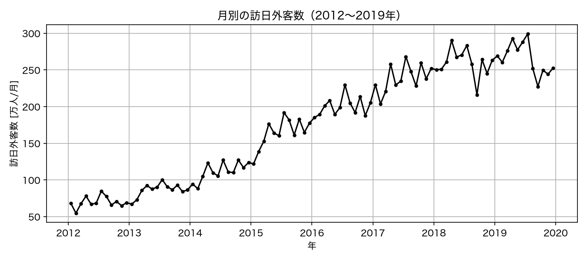
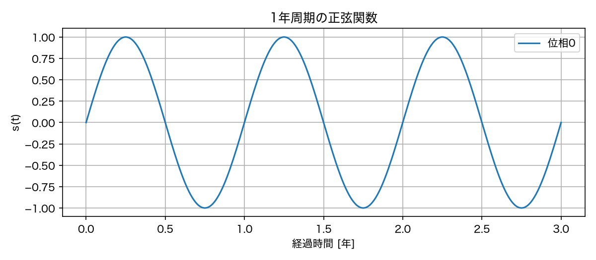
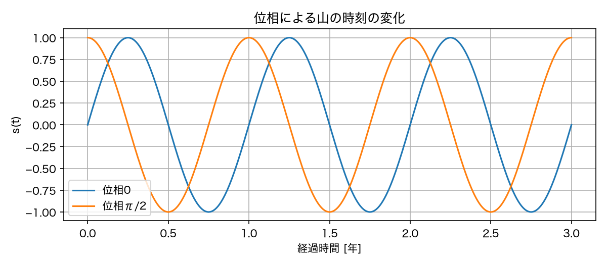
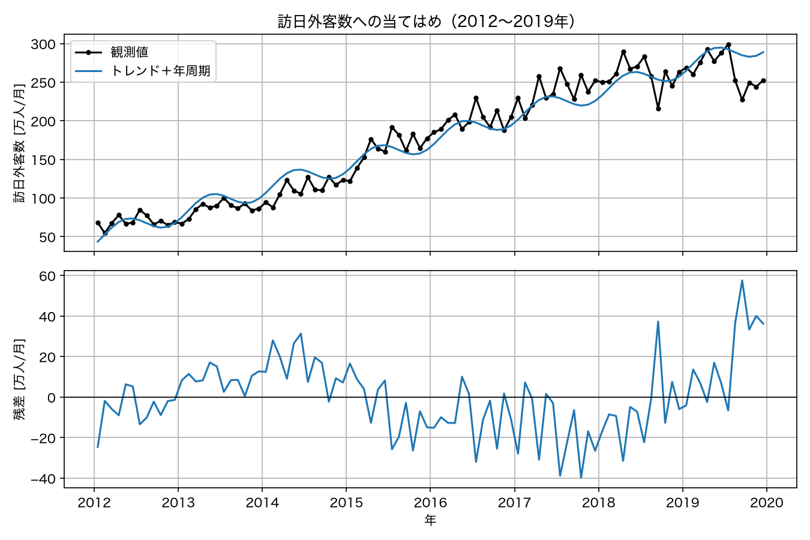
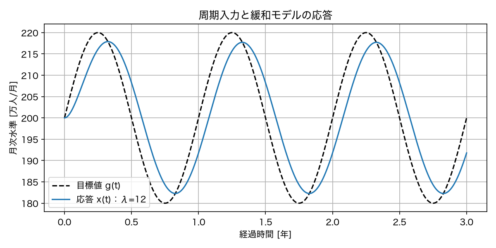
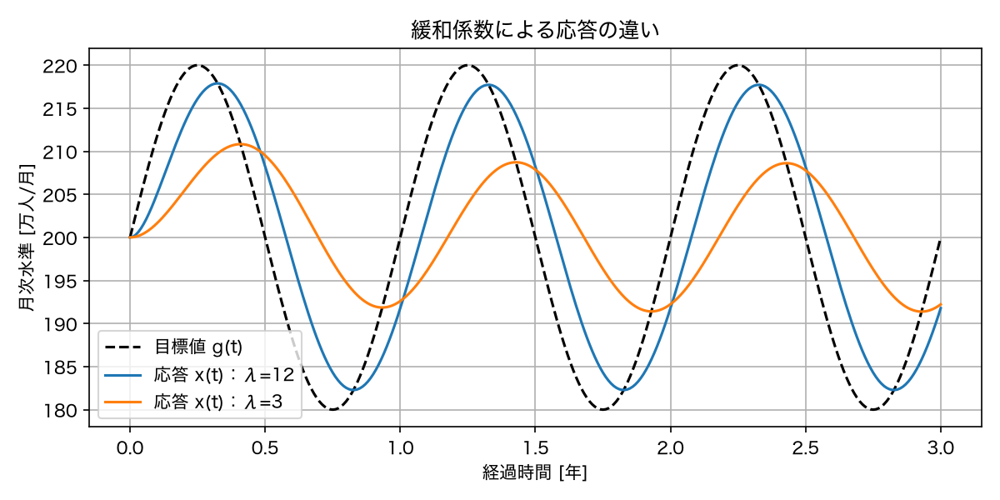
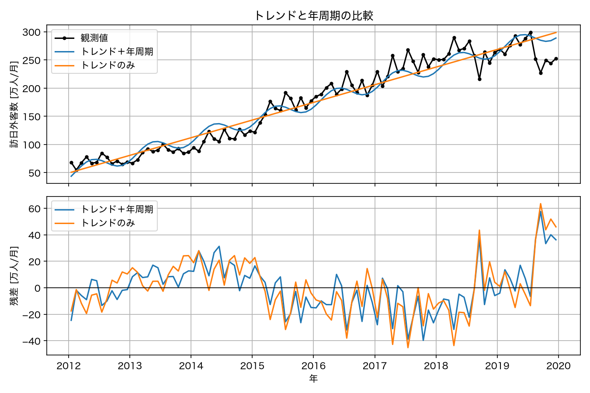
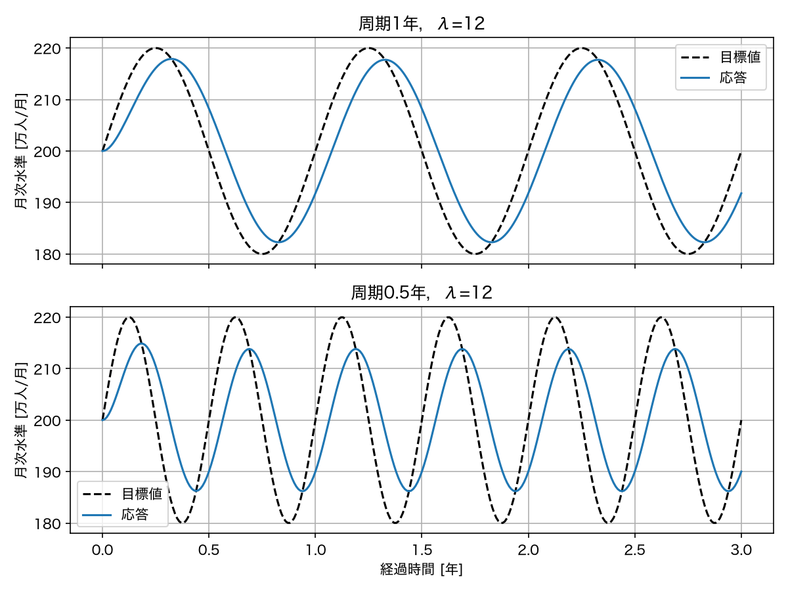
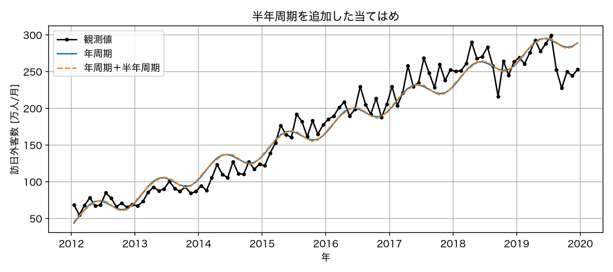

---
downloads:
  - file: ../data/visitors_monthly.csv
    filename: visitors_monthly.csv
    title: 訪日外客数の月次データ（CSV）
---

# 第9回　観光・電力需要と周期的外力

### 今回の位置付け

- **第8回**：観測した降水量を入力として，集水域の貯留とダムへの流入量を計算した．
- **第9回**：繰り返す変動を周期関数で表し，その関数を入力とする微分方程式の応答を計算する．

### 到達目標

今回は**時間で変わる入力を正弦関数で表すこと**と，**入力と応答の振幅・山の時刻の違い**を扱う．

- **周期関数**：振幅・周期・位相を変えたときの，グラフの変化を説明できる．
- **データとの対応**：トレンドと年周期を組み合わせ，同じ期間の訪日外客数に当てはめて残差を求められる．
- **微分方程式の応答**：周期入力と状態変数を区別し，緩和係数を変えた計算結果を比較できる．

<!--
105分の目安：準備とデータの確認15分，周期関数と演習1に25分，既習の最小二乗法による当てはめ20分，周期入力への応答と演習2に30分，まとめと課題の説明5分，操作・質問の予備10分．
授業中は2012〜2019年の同じデータで完結する．別期間への適用，電力データの取得，半年周期の追加は本文の実習に含めない．
-->

## 準備

````{note} 演習0：作業フォルダとNotebookの準備

1. 第9回のフォルダとNotebookを作成せよ．

```bash
mkdir -p ~/applied_programming_ii/09/notebooks
mkdir -p ~/applied_programming_ii/09/reports/figures
cd ~/applied_programming_ii/09
```

作成するディレクトリ構成は次のとおりである．

```text
applied_programming_ii/
├── data/
│   └── visitors_monthly.csv
└── 09/
    ├── README.md
    ├── notebooks/
    │   └── periodic_forcing.ipynb
    └── reports/
        └── figures/
```

2. 講義タイトル右上のダウンロードボタンから`visitors_monthly.csv`を取得し，共通の`data`フォルダに保存せよ．出典は[授業用データ一覧](../data/README.md)を参照せよ．
3. `README.md`に次の解答欄を作成せよ．

```markdown
# 応用プログラミングII 第9回

- 氏名：
- 学籍番号：

## 演習1：位相の変更
1. （Notebookに図を出力）
2. 山の時刻の変化：

## 演習2：緩和係数の変更
1. （Notebookに図を出力）
2. 振幅と山の時刻の違い：

## 課題1：トレンドと年周期の比較
1. （Notebookに各モデルのRMSEを出力）
2. （Notebookに比較図を出力）

## 課題2：周期の変更と応答
1. （Notebookに比較図を出力）
2. 周期と時定数の関係：
```

4. 最初のコードセルに，ライブラリと保存先の設定をまとめて入力し，実行せよ．

<!-- cell:setup -->
```python
from pathlib import Path

import numpy as np
import pandas as pd
import matplotlib.pyplot as plt
from scipy.integrate import solve_ivp
from scipy.optimize import least_squares

plt.rcParams["font.family"] = "Hiragino Sans"
PROJECT_DIR = Path.home() / "applied_programming_ii" / "09"
DATA_DIR = Path.home() / "applied_programming_ii" / "data"
FIGURE_DIR = PROJECT_DIR / "reports" / "figures"
FIGURE_DIR.mkdir(parents=True, exist_ok=True)
print("データの有無:", (DATA_DIR / "visitors_monthly.csv").exists())
```
````

## 復習とデータの準備

- **外部入力**：第8回では観測された降水量を補間して右辺に与えた．今回は周期関数を右辺に与える．
- **パラメタ推定**：第7・8回と同じく，計算値から観測値を引いた残差を`least_squares`に渡す．

### 訪日外客数の確認

日本政府観光局（JNTO）の訪日外客数は，月ごとの入国外国人旅行者数である．[集計の定義](https://statistics.jnto.go.jp/faq/)には駐在員や留学生なども含まれ，入国の都度数える．

授業用CSVを読み込み，先頭と欠損値を確認する．

<!-- cell:read -->
```python
visitors = pd.read_csv(DATA_DIR / "visitors_monthly.csv")
print(visitors.head())
print("欠損値の数:")
print(visitors.isna().sum().to_string())
```

<!-- output:read -->
```text
   year  month  visitors
0  2003      1    450847
1  2003      2    394869
2  2003      3    456614
3  2003      4    354054
4  2003      5    288562
欠損値の数:
year        0
month       0
visitors    0
```

当てはめと比較に使う期間を2012〜2019年に固定し，時間と人数の配列を準備する．

<!-- cell:prepare -->
```python
fit_data = visitors[(visitors["year"] >= 2012) & (visitors["year"] <= 2019)].copy()
t_obs = (fit_data["year"].values - 2012) + (fit_data["month"].values - 0.5) / 12
y_obs = fit_data["visitors"].values / 10000
print("観測点数:", len(t_obs))
```

- **コードの補足**：2012年の年初を時刻0とし，月別合計を各月の中央に対応させる．人数は人から万人へ換算する．

<!-- output:prepare -->
```text
観測点数: 96
```

観測値を描き，長期的な増加と年内の上下を確認する．

<!-- cell:observed_plot -->
```python
fig, ax = plt.subplots(figsize=(9, 4))
ax.plot(t_obs + 2012, y_obs, color="black", marker="o", markersize=3)
ax.set_title("月別の訪日外客数（2012〜2019年）")
ax.set_xlabel("年")
ax.set_ylabel("訪日外客数 [万人/月]")
ax.grid(True)
fig.tight_layout()
fig.savefig(FIGURE_DIR / "observed.png", dpi=150)
plt.show()
```



**長期的な増加傾向と繰り返す変動を分けて表す**．ここでは，月別合計を万人/月の水準として扱う．これは日本に滞在している人数を表す量とは区別する．

## 周期関数による変動の表現

### 振幅・周期・位相

周期的な変動を，次の正弦関数で表す．

$$
s(t)=A\sin\left(\frac{2\pi t}{T}+\phi\right).
$$

- $t$ ：経過時間（年）．
- $s(t)$ ：基準値からの周期的なずれ．
- $A\geq0$ ：振幅．基準値からのずれの最大値で，単位は $s$ と同じ．
- $T>0$ ：周期（年）．同じ変動を繰り返す時間間隔．
- $\phi$ ：位相（ラジアン）．山や谷が現れる時刻を決める．

振幅と周期を固定し，位相0の波形を計算する．この節の $s$ は単位を付けずに比較する．

<!-- cell:sine -->
```python
t_demo = np.linspace(0, 3, 301)
A = 1.0
T = 1.0
phi = 0.0
s_demo = A * np.sin(2 * np.pi * t_demo / T + phi)
```

- **コードの補足**：`np.sin`は配列の各要素の正弦を求める．引数の角度はラジアンで与え，`np.pi`は円周率を表す．

3年間の波形を描く．

<!-- cell:sine_plot -->
```python
fig, ax = plt.subplots(figsize=(8, 3.5))
ax.plot(t_demo, s_demo, color="tab:blue", label="位相0")
ax.set_title("1年周期の正弦関数")
ax.set_xlabel("経過時間 [年]")
ax.set_ylabel("s(t)")
ax.grid(True)
ax.legend()
fig.tight_layout()
fig.savefig(FIGURE_DIR / "sine.png", dpi=150)
plt.show()
```



位相0では，最初の山は $t=T/4$ に現れる．位相を $\pi/2$ 増やすと，波形が時間の早い側へ $T/4$ だけ移動する．

````{note} 演習1：位相の変更

1. 本文の計算・描画コードを使い，`phi`を $\pi/2$ に変えた波形を求めよ．元の波形と重ねた<span style="color:red">比較図をNotebookに出力せよ</span>．計算結果は`s_shift`に保存せよ．
2. 図から，位相0の波形に対する<span style="color:red">山の時刻の移動方向と移動量を答えよ</span>．
````

````{visible-answer} 演習1の解答例

位相を変え，本文と同じ式から波形を求める．

<!-- cell:answer1_calc -->
```{code-block} python
:emphasize-lines: 1
:class: code-focus

phi = np.pi / 2
s_shift = A * np.sin(2 * np.pi * t_demo / T + phi)
```

本文の図に，位相を変えた波形を追加する．

<!-- cell:answer1_plot -->
```{code-block} python
:emphasize-lines: 3
:class: code-focus

fig, ax = plt.subplots(figsize=(8, 3.5))
ax.plot(t_demo, s_demo, color="tab:blue", label="位相0")
ax.plot(t_demo, s_shift, color="tab:orange", label="位相π/2")
ax.set_title("位相による山の時刻の変化")
ax.set_xlabel("経過時間 [年]")
ax.set_ylabel("s(t)")
ax.grid(True)
ax.legend()
fig.tight_layout()
fig.savefig(FIGURE_DIR / "exercise1.png", dpi=150)
plt.show()
```



**2．山の時刻**：早い側へ0.25年，すなわち3か月移動する．最初の山は0.25年から0年へ移る．
````

### トレンドと年周期の組合せ

訪日外客数を，直線的な増加と年周期の和で表す．

$$
g(t)=b_0+b_1t+b_s\sin(2\pi t)+b_c\cos(2\pi t).
$$

- $g(t)$ ：計算する訪日外客数の月次水準（万人/月）．
- $b_0$ ：直線部分の時刻0での値（万人/月）．
- $b_1$ ：直線部分の1年あたりの増加量（万人/月/年）．
- $b_s,b_c$ ：正弦・余弦の係数（万人/月）．この4係数を推定する．

正弦と余弦を組み合わせると，**山の時刻もデータに合わせて変えられる**．加法定理から $A\sin(2\pi t+\phi)=A\cos\phi\sin(2\pi t)+A\sin\phi\cos(2\pi t)$ となるためである．周期成分の振幅は $\sqrt{b_s^2+b_c^2}$ で求まる．正弦・余弦を使った回帰を**調和回帰**という．

## 既習の最小二乗法による当てはめ

### 計算値と残差の関数

式の4係数を`beta`として受け取り，時刻の配列から計算値を返す．

<!-- cell:periodic_level -->
```python
def periodic_level(t, beta):
    b0, b1, bs, bc = beta
    return b0 + b1 * t + bs * np.sin(2 * np.pi * t) + bc * np.cos(2 * np.pi * t)
```

第7回と同じく，**計算値から観測値を引いた残差**を返す．

<!-- cell:residuals -->
```python
def residuals_periodic(beta, t_obs, y_obs):
    return periodic_level(t_obs, beta) - y_obs
```

### 推定と同じ期間での比較

既習の`least_squares`で係数を推定し，96か月の残差とRMSEを求める．引数と戻り値は[第7回](7_parameter_estimation.md)を参照する．

<!-- cell:fit -->
```python
beta_initial = [100.0, 20.0, 0.0, 0.0]
result = least_squares(residuals_periodic, beta_initial, args=(t_obs, y_obs))
beta = result.x
print("停止条件:", result.success)
print("係数 b0, b1, bs, bc:", beta.round(2))
```

<!-- output:fit -->
```text
停止条件: True
係数 b0, b1, bs, bc: [48.22 31.61  9.59 -8.73]
```

推定結果から計算値と残差を求める．

<!-- cell:fit_report -->
```python
g_fit = periodic_level(t_obs, beta)
residual_fit = g_fit - y_obs
rmse_fit = np.sqrt(np.mean(residual_fit ** 2))
amplitude = np.sqrt(beta[2] ** 2 + beta[3] ** 2)
print(f"年周期の振幅: {amplitude:.1f} 万人/月")
print(f"当てはめ期間のRMSE: {rmse_fit:.1f} 万人/月")
```

<!-- output:fit_report -->
```text
年周期の振幅: 13.0 万人/月
当てはめ期間のRMSE: 18.0 万人/月
```

観測値・計算値を上段，残差を下段に描く．

<!-- cell:fit_plot -->
```python
fig, axes = plt.subplots(2, 1, figsize=(9, 6), sharex=True)
axes[0].plot(t_obs + 2012, y_obs, color="black", marker="o", markersize=3, label="観測値")
axes[0].plot(t_obs + 2012, g_fit, color="tab:blue", label="トレンド＋年周期")
axes[0].set_title("訪日外客数への当てはめ（2012〜2019年）")
axes[0].set_ylabel("訪日外客数 [万人/月]")
axes[0].legend()
axes[1].plot(t_obs + 2012, residual_fit, color="tab:blue")
axes[1].axhline(0, color="black", linewidth=0.8)
axes[1].set_ylabel("残差 [万人/月]")
axes[1].set_xlabel("年")
for ax in axes:
    ax.grid(True)
fig.tight_layout()
fig.savefig(FIGURE_DIR / "periodic_fit.png", dpi=150)
plt.show()
```



**年周期を加えても残差は残る**．直線で表した増加傾向のずれや，各年固有の変動も含まれる．残差は，追加すべき要因を考える材料になる．

## 周期入力に対する微分方程式の応答

### 入力と状態変数の区別

ここまでの $g(t)$ は，時刻から値を直接求める関数だった．次は，**状態変数が目標値との差に比例する速さで変化する**と仮定する．

$$
\frac{dx}{dt}=\lambda\bigl(g(t)-x(t)\bigr).
$$

- $x(t)$ ：目標に近づく状態変数（万人/月）．
- $g(t)$ ：外部から与える目標値（万人/月）．
- $\lambda>0$ ：緩和係数（1/年）．今回は値を指定して応答の違いを調べる．

この形を**緩和モデル**という．一定の目標値との差は指数減衰し，時定数は $1/\lambda$ である． $x<g$ なら増加， $x>g$ なら減少する．

訪日外客数への適用には，移動の計画などにより月次水準の調整に時間がかかる，という仮定が必要になる．ここでは**周期入力と応答の違いを確かめる数値実験**として，目標値を単純な年周期に固定する．推定した訪日外客数の曲線を使う場合も，同じ右辺の構造で計算できる．

### 右辺と初期条件

基準値200，振幅20，周期1年の目標値を与える関数を定義する．

<!-- cell:target -->
```python
def periodic_target(t, period):
    return 200.0 + 20.0 * np.sin(2 * np.pi * t / period)
```

第8回の降水入力と同様に，時刻から求めた値を微分方程式の右辺で参照する．

<!-- cell:rhs -->
```python
def relaxation_rhs(t, x, lam, period):
    return lam * (periodic_target(t, period) - x)
```

3年間の応答を，初期値200，緩和係数12（1/年）で計算する．時定数は1か月になる．

<!-- cell:response -->
```python
period = 1.0
lam = 12.0
x0 = 200.0
sol = solve_ivp(
    relaxation_rhs, (t_demo[0], t_demo[-1]), [x0],
    t_eval=t_demo, args=(lam, period), max_step=1 / 48,
    rtol=1e-7, atol=1e-7,
)
x_response = sol.y[0]
g_demo = periodic_target(t_demo, period)
print(f"時定数: {12 / lam:.1f} か月")
```

- **コードの補足**：`max_step=1 / 48`は，1年周期の変化を細かく追うための刻み幅の上限（年）．`t_eval`は結果を受け取る時刻の配列である．

<!-- output:response -->
```text
時定数: 1.0 か月
```

入力した目標値と，計算した状態変数を重ねる．

<!-- cell:response_plot -->
```python
fig, ax = plt.subplots(figsize=(8, 4))
ax.plot(t_demo, g_demo, color="black", linestyle="--", label="目標値 g(t)")
ax.plot(t_demo, x_response, color="tab:blue", label="応答 x(t)：λ=12")
ax.set_title("周期入力と緩和モデルの応答")
ax.set_xlabel("経過時間 [年]")
ax.set_ylabel("月次水準 [万人/月]")
ax.grid(True)
ax.legend()
fig.tight_layout()
fig.savefig(FIGURE_DIR / "response.png", dpi=150)
plt.show()
```



応答の山は目標値の山より遅れ，振幅も小さくなる．第8回のタンクでも，入力をそのまま流出させず，いったん貯留することで応答が変わった．

````{note} 演習2：緩和係数の変更

1. 本文の計算コードをコピーし，緩和係数を3（1/年）に変えよ．初期値・周期・計算期間は固定し，計算結果を`x_slow`に保存せよ．本文の描画に追加して，<span style="color:red">目標値・係数12の応答・係数3の応答の比較図を出力せよ</span>．
2. 計算開始直後の影響が小さい2〜3年の区間で比較し，係数を小さくしたときの<span style="color:red">振幅と山の時刻の変化を2文程度で説明せよ</span>．
````

````{visible-answer} 演習2の解答例

本文の係数だけを変え，同じ初期値と入力で計算する．

<!-- cell:answer2_calc -->
```{code-block} python
:emphasize-lines: 1
:class: code-focus

lam = 3.0
sol = solve_ivp(
    relaxation_rhs, (t_demo[0], t_demo[-1]), [x0],
    t_eval=t_demo, args=(lam, period), max_step=1 / 48,
    rtol=1e-7, atol=1e-7,
)
x_slow = sol.y[0]
```

本文の図に，係数3の応答を加える．

<!-- cell:answer2_plot -->
```{code-block} python
:emphasize-lines: 4
:class: code-focus

fig, ax = plt.subplots(figsize=(8, 4))
ax.plot(t_demo, g_demo, color="black", linestyle="--", label="目標値 g(t)")
ax.plot(t_demo, x_response, color="tab:blue", label="応答 x(t)：λ=12")
ax.plot(t_demo, x_slow, color="tab:orange", label="応答 x(t)：λ=3")
ax.set_title("緩和係数による応答の違い")
ax.set_xlabel("経過時間 [年]")
ax.set_ylabel("月次水準 [万人/月]")
ax.grid(True)
ax.legend()
fig.tight_layout()
fig.savefig(FIGURE_DIR / "exercise2.png", dpi=150)
plt.show()
```



**2．比較**：係数3の応答は，係数12より振幅が小さい．山が現れる時刻も遅く，入力の変化に追いつくまでに時間を要する．
````

```{tip} 電力需要への接続
電力需要にも，日内・曜日・季節による変動がある．異なる周期の正弦・余弦を加えると，複数の時間間隔の変動を表せる．訪日外客数と同様に，観測量を周期関数で直接表す方法と，需要の変化に応答する機器や蓄電量の微分方程式を区別してモデル化する．
```

## まとめ

- **周期性の表現**：振幅・周期・位相で変動の大きさと時間的な配置を表す．
- **入力と応答の区別**：周期関数を右辺に与えると，状態変数の振幅や山の時刻は入力と異なり得る．
- **データとの比較**：トレンドと年周期を当てはめ，残差からモデルで説明しきれていない変動を確認する．

## 課題

````{warning} 課題1：トレンドと年周期の比較

1. 本文の`periodic_level`・残差関数・推定・描画をコピーし，周期項を除いた直線 $b_0+b_1t$ のモデルも同じ期間に当てはめよ．関数名を`trend_level`・`residuals_trend`，係数を`beta_trend`，計算結果を`g_trend`とせよ．<span style="color:red">各モデルのRMSEをNotebookに出力せよ</span>．
2. 本文の描画コードに直線モデルの結果を追加し，<span style="color:red">観測値・二つの計算値・残差の比較図をNotebookに出力せよ</span>．
````

````{visible-answer} 課題1の解答例

**1．RMSEの比較**

本文の関数から正弦・余弦の項を除き，係数を二つにする．

<!-- cell:homework1_fit -->
```python
def trend_level(t, beta_trend):
    b0, b1 = beta_trend
    return b0 + b1 * t


def residuals_trend(beta_trend, t_obs, y_obs):
    return trend_level(t_obs, beta_trend) - y_obs


beta_initial = [100.0, 20.0]
result = least_squares(residuals_trend, beta_initial, args=(t_obs, y_obs))
beta_trend = result.x
g_trend = trend_level(t_obs, beta_trend)
residual_trend = g_trend - y_obs
rmse_trend = np.sqrt(np.mean(residual_trend ** 2))
print(f"トレンドのみのRMSE: {rmse_trend:.1f} 万人/月")
print(f"トレンド＋年周期のRMSE: {rmse_fit:.1f} 万人/月")
```

<!-- output:homework1_fit -->
```text
トレンドのみのRMSE: 20.2 万人/月
トレンド＋年周期のRMSE: 18.0 万人/月
```

**2．比較図**

本文の2段の図に，直線モデルの計算値と残差を追加する．

<!-- cell:homework1_plot -->
```python
fig, axes = plt.subplots(2, 1, figsize=(9, 6), sharex=True)
axes[0].plot(t_obs + 2012, y_obs, color="black", marker="o", markersize=3, label="観測値")
axes[0].plot(t_obs + 2012, g_fit, color="tab:blue", label="トレンド＋年周期")
axes[0].plot(t_obs + 2012, g_trend, color="tab:orange", label="トレンドのみ")
axes[0].set_title("トレンドと年周期の比較")
axes[0].set_ylabel("訪日外客数 [万人/月]")
axes[0].legend()
axes[1].plot(t_obs + 2012, residual_fit, color="tab:blue", label="トレンド＋年周期")
axes[1].plot(t_obs + 2012, residual_trend, color="tab:orange", label="トレンドのみ")
axes[1].axhline(0, color="black", linewidth=0.8)
axes[1].set_ylabel("残差 [万人/月]")
axes[1].set_xlabel("年")
axes[1].legend()
for ax in axes:
    ax.grid(True)
fig.tight_layout()
fig.savefig(FIGURE_DIR / "homework1.png", dpi=150)
plt.show()
```



年周期を加えることで，同じ期間の残差二乗和は小さくなる．ただし残差には，直線トレンドと実際の増加の違いなども残る．
````

````{warning} 課題2：周期の変更と応答

1. 本文の目標値の関数と応答の計算・描画を使い，係数を12（1/年）に固定したまま周期を0.5年に変えよ．計算結果を`x_half`，目標値を`g_half`に保存し，周期1年と0.5年の結果を上下に配置した<span style="color:red">目標値と応答の比較図をNotebookに出力せよ</span>．
2. 2〜3年の区間の図に基づき，周期が短くなったときに応答の振幅がどう変わるかを，<span style="color:red">時定数が同じであることと関連づけて2文程度で説明せよ</span>．
````

````{visible-answer} 課題2の解答例

演習2で変更した係数を12へ戻し，本文の周期だけを変える．

<!-- cell:homework2_calc -->
```{code-block} python
:emphasize-lines: 1
:class: code-focus

period = 0.5
lam = 12.0
sol = solve_ivp(
    relaxation_rhs, (t_demo[0], t_demo[-1]), [x0],
    t_eval=t_demo, args=(lam, period), max_step=1 / 48,
    rtol=1e-7, atol=1e-7,
)
x_half = sol.y[0]
g_half = periodic_target(t_demo, period)
```

本文の描画を上下に配置し，周期ごとの目標値と応答を比べる．

<!-- cell:homework2_plot -->
```python
fig, axes = plt.subplots(2, 1, figsize=(8, 6), sharex=True, sharey=True)
axes[0].plot(t_demo, g_demo, color="black", linestyle="--", label="目標値")
axes[0].plot(t_demo, x_response, color="tab:blue", label="応答")
axes[0].set_title("周期1年，λ=12")
axes[1].plot(t_demo, g_half, color="black", linestyle="--", label="目標値")
axes[1].plot(t_demo, x_half, color="tab:blue", label="応答")
axes[1].set_title("周期0.5年，λ=12")
axes[1].set_xlabel("経過時間 [年]")
for ax in axes:
    ax.set_ylabel("月次水準 [万人/月]")
    ax.grid(True)
    ax.legend()
fig.tight_layout()
fig.savefig(FIGURE_DIR / "homework2.png", dpi=150)
plt.show()
```

- **コードの補足**：`sharey=True`は，上下の図の縦軸の範囲を共通にし，振幅を同じ尺度で比較する指定である．



**2．周期と時定数**：周期が短い方が，応答の振幅は小さい．時定数は同じ1か月のため，目標値が速く変動する場合ほどその変化に追いつきにくくなる．
````

### 提出先・期限

- 提出場所：WebClass「第9回課題」．
- 提出物：`README.md`とNotebookファイル`periodic_forcing.ipynb`．
- 提出期限：2026年12月5日(土)23:59．

## 自主学習用の発展課題

````{note} 発展課題：半年周期の追加

本文の`periodic_level`に半年周期の正弦・余弦を追加し，同じ2012〜2019年のデータを使う．

1. 係数を六つに増やして再推定し，<span style="color:red">本文のモデルと今回のモデルのRMSEを出力せよ</span>．
2. 本文の描画コードに新しい計算値を追加し，<span style="color:red">比較図をNotebookに出力せよ</span>．
3. 当てはめの改善と係数の増加を踏まえ，モデルを比較するために<span style="color:red">追加で確認したいことを一つ述べよ</span>．
````

````{visible-answer} 発展課題の解答例

**1．RMSEの比較**

本文の関数に周期0.5年の項を追加する．残差関数と推定の手順は同じである．

<!-- cell:advanced_fit -->
```python
def periodic_level_two(t, beta_two):
    b0, b1, bs, bc, bs2, bc2 = beta_two
    return (b0 + b1 * t + bs * np.sin(2 * np.pi * t) + bc * np.cos(2 * np.pi * t)
            + bs2 * np.sin(4 * np.pi * t) + bc2 * np.cos(4 * np.pi * t))


def residuals_two(beta_two, t_obs, y_obs):
    return periodic_level_two(t_obs, beta_two) - y_obs


beta_initial = [100.0, 20.0, 0.0, 0.0, 0.0, 0.0]
result = least_squares(residuals_two, beta_initial, args=(t_obs, y_obs))
beta_two = result.x
g_two = periodic_level_two(t_obs, beta_two)
residual_two = g_two - y_obs
rmse_two = np.sqrt(np.mean(residual_two ** 2))
print(f"年周期のRMSE: {rmse_fit:.2f} 万人/月")
print(f"年周期＋半年周期のRMSE: {rmse_two:.2f} 万人/月")
```

<!-- output:advanced_fit -->
```text
年周期のRMSE: 18.00 万人/月
年周期＋半年周期のRMSE: 17.95 万人/月
```

**2．比較図**

本文の観測値と周期モデルの図に，半年周期を追加した結果を重ねる．

<!-- cell:advanced_plot -->
```python
fig, ax = plt.subplots(figsize=(9, 4))
ax.plot(t_obs + 2012, y_obs, color="black", marker="o", markersize=3, label="観測値")
ax.plot(t_obs + 2012, g_fit, color="tab:blue", label="年周期")
ax.plot(t_obs + 2012, g_two, color="tab:orange", linestyle="--", label="年周期＋半年周期")
ax.set_title("半年周期を追加した当てはめ")
ax.set_xlabel("年")
ax.set_ylabel("訪日外客数 [万人/月]")
ax.grid(True)
ax.legend()
fig.tight_layout()
fig.savefig(FIGURE_DIR / "advanced.png", dpi=150)
plt.show()
```



**3．追加の確認**：係数を固定して別の期間の誤差を比較する．係数を増やすと同じ期間への当てはまりは改善し得るため，未使用データでも改善するかを確かめる．
````
